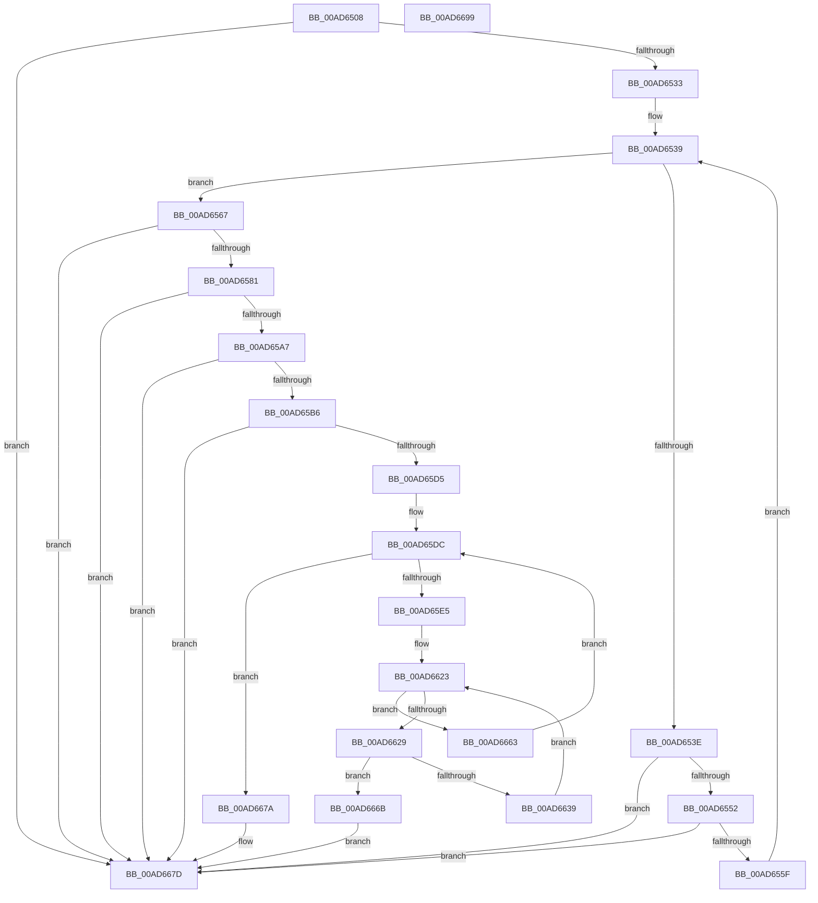

# PopFxConvertV1Components

- RVA: `0x00AD6508`–`0x00AD669A` (길이 `402` bytes)
- VA: `0x0000000140AD6508`
- 실행 섹션: `PAGE`
- PDB 이름 있음: `예`; PDB Function 태그: `아니요`
- unwind 정보 RVA: `0x000BEF48`
- 디코드: `112`개 명령, `402/402` bytes 표시
- 미해석 바이트: `0` (있으면 어셈블리에 `.byte`로 보존)

> 이 문서는 커널 이미지의 기계어와 PDB 기호를 분석해 생성했습니다. 4번과 5번은 함수 원형과 자료형을 바이너리 사용 방식에서 추정한 C 해석이며 원본 소스 복구 결과는 아닙니다.

## 1. Dependencies

- 직접 호출 지점: **3**; 고유 호출 대상: **3**
- 직접 호출자로 확인된 함수: **3**
- RIP 상대 이미지 참조: **0**

### Outgoing calls
- `0x00AD6574` → [RtlULongLongMult](../../text/43/RtlULongLongMult_function_0043E530.md) (function, `0x0043E530`)
- `0x00AD65C4` → [ExAllocatePool2](../../poolcode/B8/ExAllocatePool2_function_00B820F0.md) (function, `0x00B820F0`)
- `0x00AD6673` → [ExFreePoolWithTag](../../poolcode/B8/ExFreePoolWithTag_function_00B82870.md) (function, `0x00B82870`)

### Direct callers
- [PoFxRegisterCoreDevice](../75/PoFxRegisterCoreDevice_function_00758800.md) at `0x0075884A`
- [PoFxRegisterDevice](../75/PoFxRegisterDevice_function_00758940.md) at `0x00758A1C`
- [PoFxRegisterPrimaryDevice](../75/PoFxRegisterPrimaryDevice_function_00758C20.md) at `0x00758C63`

### Static image references
- 디코드된 RIP-relative 메모리 참조가 없습니다.

## 2. Other-region calls and transfers

- 다른 실행 섹션으로 향하는 call: **3**
  - `0x00AD6574` → [RtlULongLongMult](../../text/43/RtlULongLongMult_function_0043E530.md) (`PAGE` → `.text`)
  - `0x00AD65C4` → [ExAllocatePool2](../../poolcode/B8/ExAllocatePool2_function_00B820F0.md) (`PAGE` → `POOLCODE`)
  - `0x00AD6673` → [ExFreePoolWithTag](../../poolcode/B8/ExFreePoolWithTag_function_00B82870.md) (`PAGE` → `POOLCODE`)
- 별도 외부 분기/꼬리 이동을 확인하지 못했습니다.

## 3. Assembly (complete function range)

```asm
00AD6508  48 8B C4                        mov rax, rsp
00AD650B  48 89 58 08                     mov qword ptr [rax + 8], rbx
00AD650F  48 89 68 10                     mov qword ptr [rax + 0x10], rbp
00AD6513  48 89 70 20                     mov qword ptr [rax + 0x20], rsi
00AD6517  57                              push rdi
00AD6518  41 56                           push r14
00AD651A  41 57                           push r15
00AD651C  48 83 EC 20                     sub rsp, 0x20
00AD6520  33 DB                           xor ebx, ebx
00AD6522  8B F2                           mov esi, edx
00AD6524  48 89 58 18                     mov qword ptr [rax + 0x18], rbx
00AD6528  4C 8B F1                        mov r14, rcx
00AD652B  85 D2                           test edx, edx
00AD652D  0F 84 4A 01 00 00               je 0x140ad667d
00AD6533  44 8B CB                        mov r9d, ebx
00AD6536  44 8B C3                        mov r8d, ebx
00AD6539  44 3B C6                        cmp r8d, esi
00AD653C  73 29                           jae 0x140ad6567
00AD653E  41 8B C0                        mov eax, r8d
00AD6541  48 C1 E0 05                     shl rax, 5
00AD6545  42 8B 4C 30 10                  mov ecx, dword ptr [rax + r14 + 0x10]
00AD654A  85 C9                           test ecx, ecx
00AD654C  0F 84 2B 01 00 00               je 0x140ad667d
00AD6552  42 8D 04 09                     lea eax, [rcx + r9]
00AD6556  41 3B C1                        cmp eax, r9d
00AD6559  0F 82 1E 01 00 00               jb 0x140ad667d
00AD655F  44 8B C8                        mov r9d, eax
00AD6562  41 FF C0                        inc r8d
00AD6565  EB D2                           jmp 0x140ad6539
00AD6567  48 8B CE                        mov rcx, rsi
00AD656A  4C 8D 44 24 50                  lea r8, [rsp + 0x50]
00AD656F  BA 38 00 00 00                  mov edx, 0x38
00AD6574  E8 B7 7F 96 FF                  call 0x14043e530
00AD6579  85 C0                           test eax, eax
00AD657B  0F 88 FC 00 00 00               js 0x140ad667d
00AD6581  48 8B 7C 24 50                  mov rdi, qword ptr [rsp + 0x50]
00AD6586  41 8B C1                        mov eax, r9d
00AD6589  48 83 C7 07                     add rdi, 7
00AD658D  48 83 E7 F8                     and rdi, 0xfffffffffffffff8
00AD6591  48 8D 0C 40                     lea rcx, [rax + rax*2]
00AD6595  B8 FF FF FF FF                  mov eax, 0xffffffff
00AD659A  48 C1 E1 03                     shl rcx, 3
00AD659E  48 3B C8                        cmp rcx, rax
00AD65A1  0F 87 D6 00 00 00               ja 0x140ad667d
00AD65A7  8B C1                           mov eax, ecx
00AD65A9  48 8D 2C 07                     lea rbp, [rdi + rax]
00AD65AD  48 3B E8                        cmp rbp, rax
00AD65B0  0F 82 C7 00 00 00               jb 0x140ad667d
00AD65B6  41 B8 50 46 58 4D               mov r8d, 0x4d584650
00AD65BC  48 8B D5                        mov rdx, rbp
00AD65BF  B9 40 00 00 00                  mov ecx, 0x40
00AD65C4  E8 27 BB 0A 00                  call 0x140b820f0
00AD65C9  4C 8B C0                        mov r8, rax
00AD65CC  48 85 C0                        test rax, rax
00AD65CF  0F 84 A8 00 00 00               je 0x140ad667d
00AD65D5  4C 8D 14 07                     lea r10, [rdi + rax]
00AD65D9  44 8B CB                        mov r9d, ebx
00AD65DC  44 3B CE                        cmp r9d, esi
00AD65DF  0F 83 95 00 00 00               jae 0x140ad667a
00AD65E5  41 8B C9                        mov ecx, r9d
00AD65E8  49 C7 C7 F0 FF FF FF            mov r15, 0xfffffffffffffff0
00AD65EF  48 6B D1 38                     imul rdx, rcx, 0x38
00AD65F3  45 8B D9                        mov r11d, r9d
00AD65F6  8B FB                           mov edi, ebx
00AD65F8  49 03 D0                        add rdx, r8
00AD65FB  49 C1 E3 05                     shl r11, 5
00AD65FF  4D 03 DE                        add r11, r14
00AD6602  4D 2B F8                        sub r15, r8
00AD6605  41 0F 10 03                     movups xmm0, xmmword ptr [r11]
00AD6609  48 89 5A 10                     mov qword ptr [rdx + 0x10], rbx
00AD660D  F3 0F 7F 02                     movdqu xmmword ptr [rdx], xmm0
00AD6611  41 8B 43 10                     mov eax, dword ptr [r11 + 0x10]
00AD6615  89 42 1C                        mov dword ptr [rdx + 0x1c], eax
00AD6618  4C 89 52 20                     mov qword ptr [rdx + 0x20], r10
00AD661C  41 8B 43 14                     mov eax, dword ptr [r11 + 0x14]
00AD6620  89 42 18                        mov dword ptr [rdx + 0x18], eax
00AD6623  41 3B 7B 10                     cmp edi, dword ptr [r11 + 0x10]
00AD6627  73 3A                           jae 0x140ad6663
00AD6629  49 8D 4F 10                     lea rcx, [r15 + 0x10]
00AD662D  49 03 CA                        add rcx, r10
00AD6630  48 8D 45 E8                     lea rax, [rbp - 0x18]
00AD6634  48 3B C8                        cmp rcx, rax
00AD6637  77 32                           ja 0x140ad666b
00AD6639  49 8B 4B 18                     mov rcx, qword ptr [r11 + 0x18]
00AD663D  8B C7                           mov eax, edi
00AD663F  48 8D 14 40                     lea rdx, [rax + rax*2]
00AD6643  8B 44 D1 10                     mov eax, dword ptr [rcx + rdx*8 + 0x10]
00AD6647  41 89 42 10                     mov dword ptr [r10 + 0x10], eax
00AD664B  48 8B 04 D1                     mov rax, qword ptr [rcx + rdx*8]
00AD664F  49 89 02                        mov qword ptr [r10], rax
00AD6652  48 8B 44 D1 08                  mov rax, qword ptr [rcx + rdx*8 + 8]
00AD6657  49 89 42 08                     mov qword ptr [r10 + 8], rax
00AD665B  49 83 C2 18                     add r10, 0x18
00AD665F  FF C7                           inc edi
00AD6661  EB C0                           jmp 0x140ad6623
00AD6663  41 FF C1                        inc r9d
00AD6666  E9 71 FF FF FF                  jmp 0x140ad65dc
00AD666B  BA 50 46 58 4D                  mov edx, 0x4d584650
00AD6670  49 8B C8                        mov rcx, r8
00AD6673  E8 F8 C1 0A 00                  call 0x140b82870
00AD6678  EB 03                           jmp 0x140ad667d
00AD667A  49 8B D8                        mov rbx, r8
00AD667D  48 8B 6C 24 48                  mov rbp, qword ptr [rsp + 0x48]
00AD6682  48 8B C3                        mov rax, rbx
00AD6685  48 8B 5C 24 40                  mov rbx, qword ptr [rsp + 0x40]
00AD668A  48 8B 74 24 58                  mov rsi, qword ptr [rsp + 0x58]
00AD668F  48 83 C4 20                     add rsp, 0x20
00AD6693  41 5F                           pop r15
00AD6695  41 5E                           pop r14
00AD6697  5F                              pop rdi
00AD6698  C3                              ret
00AD6699  CC                              int3
```

## 4. C-style interpretation (structured pseudocode)

```c
__int64 __fastcall PopFxConvertV1Components(__int64 a1, int a2)
{
    __int64 result;
    __int64 v_r10;
    __int64 v_r11;
    __int64 v_r15;
    __int64 v_rbx;
    __int64 v_rdi;
    __int64 v_rsp;
    unsigned __int64 v_stack_p10;
    unsigned __int64 v_stack_p18;
    unsigned __int64 v_stack_p20;
    unsigned __int64 v_stack_p8;

    *(unsigned __int64 *)(v_rsp + 8) = v_rbx;
    *(unsigned __int64 *)(v_rsp + 16) = v_rbp;
    *(unsigned __int64 *)(v_rsp + 32) = v_rsi;
    v_rsp = (v_rsp) - (32);
    v_rbx = 0;
    *(unsigned __int64 *)(v_rsp + 24) = 0;
    if (a2 == 0) goto loc_00AD667D;
loc_00AD6539:
    if (0 >= ((unsigned int)((unsigned int)(a2)))) goto loc_00AD6567;
    result = (0) << (5);
    if ((unsigned int)((unsigned int)(*(unsigned int *)(result + a1 * 1 + 16))) == 0) goto loc_00AD667D;
    if (((unsigned int)((unsigned int)(*(unsigned int *)(result + a1 * 1 + 16)) + 0 * 1)) < 0) goto loc_00AD667D;
    a3 = (unsigned int)((0) + 1);
    goto loc_00AD6539;
loc_00AD6567:
    result = RtlULongLongMult((unsigned int)(a2), 56, v_stack_p18, (unsigned int)((unsigned int)((unsigned int)(*(unsigned int *)(result + a1 * 1 + 16)) + 0 * 1)));
    if (sign_flag) goto loc_00AD667D;
    v_rdi = (v_stack_p18) + (7);
    v_rdi = (v_rdi) & (-8);
    a1 = ((unsigned int)((unsigned int)((unsigned int)((unsigned int)((unsigned int)(*(unsigned int *)(result + a1 * 1 + 16)) + 0 * 1)))) + (unsigned int)((unsigned int)((unsigned int)((unsigned int)((unsigned int)(*(unsigned int *)(result + a1 * 1 + 16)) + 0 * 1)))) * 2) << (3);
    if (a1 > ((unsigned int)(0xFFFFFFFFULL))) goto loc_00AD667D;
    if ((v_rdi + (unsigned int)((unsigned int)(a1)) * 1) < ((unsigned int)((unsigned int)(a1)))) goto loc_00AD667D;
    result = ExAllocatePool2(64, v_rdi + (unsigned int)((unsigned int)(a1)) * 1, (unsigned int)(0x4D584650ULL), (unsigned int)((unsigned int)((unsigned int)(*(unsigned int *)(result + a1 * 1 + 16)) + 0 * 1)));
    if (result == 0) goto loc_00AD667D;
loc_00AD65DC:
    if (0 >= ((unsigned int)((unsigned int)(a2)))) goto loc_00AD667A;
    a2 = (v_rdi + (unsigned int)((unsigned int)(a1)) * 1) * (0);
    a2 = (a2) + (result);
    v_r11 = (0) << (5);
    v_r11 = (v_r11) + (a1);
    v_r15 = (-16) - (result);
    *(unsigned __int64 *)(a2 + 16) = 0;
    *(unsigned __int64 *)(a2) = v_xmm0;
    *(unsigned int *)(a2 + 28) = (unsigned int)((unsigned int)(*(unsigned int *)(v_r11 + 16)));
    *(unsigned __int64 *)(a2 + 32) = v_rdi + result * 1;
    *(unsigned int *)(a2 + 24) = (unsigned int)((unsigned int)(*(unsigned int *)(v_r11 + 20)));
loc_00AD6623:
    if (0 >= (*(unsigned int *)(v_r11 + 16))) goto loc_00AD6663;
    a1 = (v_r15 + 16) + (v_rdi + result * 1);
    if (a1 > (v_rdi + (unsigned int)((unsigned int)(a1)) * 1 - 24)) goto loc_00AD666B;
    *(unsigned int *)(v_rdi + result * 1 + 16) = (unsigned int)((unsigned int)(*(unsigned int *)(*(unsigned __int64 *)(v_r11 + 24) + 0 + 0 * 2 * 8 + 16)));
    *(unsigned __int64 *)(v_rdi + result * 1) = *(unsigned __int64 *)(*(unsigned __int64 *)(v_r11 + 24) + 0 + 0 * 2 * 8);
    *(unsigned __int64 *)(v_rdi + result * 1 + 8) = *(unsigned __int64 *)(*(unsigned __int64 *)(v_r11 + 24) + 0 + 0 * 2 * 8 + 8);
    v_r10 = (v_rdi + result * 1) + (24);
    v_rdi = (unsigned int)((0) + 1);
    goto loc_00AD6623;
loc_00AD6663:
    a4 = (unsigned int)((0) + 1);
    goto loc_00AD65DC;
loc_00AD666B:
    result = ExFreePoolWithTag(result, (unsigned int)(0x4D584650ULL), result, a4);
    goto loc_00AD667D;
loc_00AD667A:
loc_00AD667D:
    v_rsp = (v_rsp) + (32);
    return result;
}
```

## 5. (Beta) C Style

```c
int64_t PopFxConvertV1Components(int64_t Arg1, int32_t Arg2)
{
    int64_t result;
    int64_t local_r10;
    int64_t local_r11;
    int64_t local_r15;
    int64_t local_rbx;
    int64_t local_rdi;
    int64_t local_rsp;
    uint64_t v_stack_p10;
    uint64_t v_stack_p18;
    uint64_t v_stack_p20;
    uint64_t v_stack_p8;

    *(uint64_t *)(local_rsp + 0x8) = local_rbx;
    *(uint64_t *)(local_rsp + 0x10) = local_rbp;
    *(uint64_t *)(local_rsp + 0x20) = local_rsi;
    local_rsp = (local_rsp) - (32);
    local_rbx = 0;
    *(uint64_t *)(local_rsp + 0x18) = 0;
    if (Arg2 == 0) goto loc_00AD667D;
loc_00AD6539:
    if (0 >= ((uint32_t)((uint32_t)(Arg2)))) goto loc_00AD6567;
    result = (0) << (5);
    if ((uint32_t)((uint32_t)(*(uint32_t *)(result + Arg1 * 1 + 0x10))) == 0) goto loc_00AD667D;
    if (((uint32_t)((uint32_t)(*(uint32_t *)(result + Arg1 * 1 + 0x10)) + 0 * 1)) < 0) goto loc_00AD667D;
    a3 = (uint32_t)((0) + 1);
    goto loc_00AD6539;
loc_00AD6567:
    result = RtlULongLongMult((uint32_t)(Arg2), 56, v_stack_p18, (uint32_t)((uint32_t)((uint32_t)(*(uint32_t *)(result + Arg1 * 1 + 0x10)) + 0 * 1)));
    if (sign_flag) goto loc_00AD667D;
    local_rdi = (v_stack_p18) + (7);
    local_rdi = (local_rdi) & (-8);
    Arg1 = ((uint32_t)((uint32_t)((uint32_t)((uint32_t)((uint32_t)(*(uint32_t *)(result + Arg1 * 1 + 0x10)) + 0 * 1)))) + (uint32_t)((uint32_t)((uint32_t)((uint32_t)((uint32_t)(*(uint32_t *)(result + Arg1 * 1 + 0x10)) + 0 * 1)))) * 2) << (3);
    if (Arg1 > ((uint32_t)(0xFFFFFFFFULL))) goto loc_00AD667D;
    if ((local_rdi + (uint32_t)((uint32_t)(Arg1)) * 1) < ((uint32_t)((uint32_t)(Arg1)))) goto loc_00AD667D;
    result = ExAllocatePool2(64, local_rdi + (uint32_t)((uint32_t)(Arg1)) * 1, (uint32_t)(0x4D584650ULL), (uint32_t)((uint32_t)((uint32_t)(*(uint32_t *)(result + Arg1 * 1 + 0x10)) + 0 * 1)));
    if (result == 0) goto loc_00AD667D;
loc_00AD65DC:
    if (0 >= ((uint32_t)((uint32_t)(Arg2)))) goto loc_00AD667A;
    Arg2 = (local_rdi + (uint32_t)((uint32_t)(Arg1)) * 1) * (0);
    Arg2 = (Arg2) + (result);
    local_r11 = (0) << (5);
    local_r11 = (local_r11) + (Arg1);
    local_r15 = (-16) - (result);
    *(uint64_t *)(Arg2 + 0x10) = 0;
    *(uint64_t *)(Arg2) = v_xmm0;
    *(uint32_t *)(Arg2 + 0x1C) = (uint32_t)((uint32_t)(*(uint32_t *)(local_r11 + 0x10)));
    *(uint64_t *)(Arg2 + 0x20) = local_rdi + result * 1;
    *(uint32_t *)(Arg2 + 0x18) = (uint32_t)((uint32_t)(*(uint32_t *)(local_r11 + 0x14)));
loc_00AD6623:
    if (0 >= (*(uint32_t *)(local_r11 + 0x10))) goto loc_00AD6663;
    Arg1 = (local_r15 + 16) + (local_rdi + result * 1);
    if (Arg1 > (local_rdi + (uint32_t)((uint32_t)(Arg1)) * 1 - 24)) goto loc_00AD666B;
    *(uint32_t *)(local_rdi + result * 1 + 0x10) = (uint32_t)((uint32_t)(*(uint32_t *)(*(uint64_t *)(local_r11 + 0x18) + 0x0 + 0x0 * 2 * 8 + 0x10)));
    *(uint64_t *)(local_rdi + result * 1) = *(uint64_t *)(*(uint64_t *)(local_r11 + 0x18) + 0x0 + 0x0 * 2 * 8);
    *(uint64_t *)(local_rdi + result * 1 + 0x8) = *(uint64_t *)(*(uint64_t *)(local_r11 + 0x18) + 0x0 + 0x0 * 2 * 8 + 0x8);
    local_r10 = (local_rdi + result * 1) + (24);
    local_rdi = (uint32_t)((0) + 1);
    goto loc_00AD6623;
loc_00AD6663:
    a4 = (uint32_t)((0) + 1);
    goto loc_00AD65DC;
loc_00AD666B:
    result = ExFreePoolWithTag(result, (uint32_t)(0x4D584650ULL), result, a4);
    goto loc_00AD667D;
loc_00AD667A:
loc_00AD667D:
    local_rsp = (local_rsp) + (32);
    return result;
}
```

## 6. Execution-region graph

[열기: 2D/3D 그래프와 함수 탐색 컨트롤 패널](../../../control-panel.html?section=page&rva=0x00AD6508&view=graph)

- 2D 그래프는 위에서 아래로 흐르고, 3D 그래프는 빈 공간을 드래그해 회전합니다. Shift+드래그는 이동, 휠은 확대·축소, 함수 노드 선택은 대상 보고서 이동입니다.

### Static fallback


