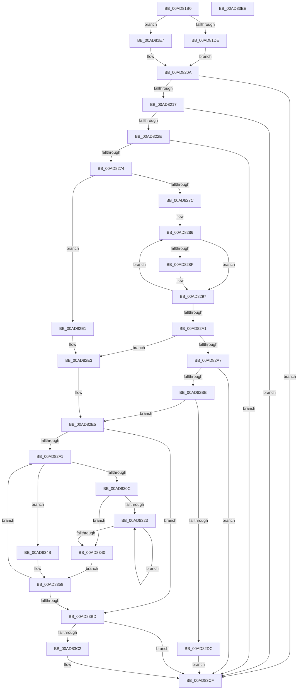

# PopFxTracePerfRegistration

- RVA: `0x00AD81B0`–`0x00AD83EF` (길이 `575` bytes)
- VA: `0x0000000140AD81B0`
- 실행 섹션: `PAGE`
- PDB 이름 있음: `예`; PDB Function 태그: `아니요`
- unwind 정보 RVA: `0x000BD2A0`
- 디코드: `155`개 명령, `575/575` bytes 표시
- 미해석 바이트: `0` (있으면 어셈블리에 `.byte`로 보존)

> 이 문서는 커널 이미지의 기계어와 PDB 기호를 분석해 생성했습니다. 4번과 5번은 함수 원형과 자료형을 바이너리 사용 방식에서 추정한 C 해석이며 원본 소스 복구 결과는 아닙니다.

## 1. Dependencies

- 직접 호출 지점: **8**; 고유 호출 대상: **7**
- 직접 호출자로 확인된 함수: **2**
- RIP 상대 이미지 참조: **6**

### Outgoing calls
- `0x00AD8205` → [PopFxAddLogEntry](../../text/39/PopFxAddLogEntry_function_00390B94.md) (function, `0x00390B94`)
- `0x00AD8221` → [EtwEventEnabled](../../text/39/EtwEventEnabled_function_00392450.md) (function, `0x00392450`)
- `0x00AD8243` → [PopDiagTraceFxPerfRegistration](../76/PopDiagTraceFxPerfRegistration_function_0076183C.md) (function, `0x0076183C`)
- `0x00AD8267` → [EtwEventEnabled](../../text/39/EtwEventEnabled_function_00392450.md) (function, `0x00392450`)
- `0x00AD82CF` → [ExAllocatePool2](../../poolcode/B8/ExAllocatePool2_function_00B820F0.md) (function, `0x00B820F0`)
- `0x00AD8314` → [memset](../../text/6C/memset_function_006C6C40.md) (function, `0x006C6C40`)
- `0x00AD83A8` → [PopDiagTraceFxPerfSetRegistration](../76/PopDiagTraceFxPerfSetRegistration_function_007618CC.md) (function, `0x007618CC`)
- `0x00AD83CA` → [ExFreePoolWithTag](../../poolcode/B8/ExFreePoolWithTag_function_00B82870.md) (function, `0x00B82870`)

### Direct callers
- [PopFxRegisterComponentPerfStates](../75/PopFxRegisterComponentPerfStates_function_00759764.md) at `0x00759B15`
- [PopFxTraceDeviceRegistration](../A6/PopFxTraceDeviceRegistration_function_00A6F888.md) at `0x00A6FB18`

### Static image references
- `0x00AD81DE` → RVA `0x0001ED30` (`.rdata`; read)
- `0x00AD81EA` → RVA `0x0001ED40` (`.rdata`; read)
- `0x00AD820A` → RVA `0x00E67858` (`.data`; read)
- `0x00AD8217` → RVA `0x00F0B408` (`.data`; read)
- `0x00AD824F` → RVA `0x00023180` (`.rdata`; read)
- `0x00AD8259` → RVA `0x00022C30` (`.rdata`; read)

## 2. Other-region calls and transfers

- 다른 실행 섹션으로 향하는 call: **6**
  - `0x00AD8205` → [PopFxAddLogEntry](../../text/39/PopFxAddLogEntry_function_00390B94.md) (`PAGE` → `.text`)
  - `0x00AD8221` → [EtwEventEnabled](../../text/39/EtwEventEnabled_function_00392450.md) (`PAGE` → `.text`)
  - `0x00AD8267` → [EtwEventEnabled](../../text/39/EtwEventEnabled_function_00392450.md) (`PAGE` → `.text`)
  - `0x00AD82CF` → [ExAllocatePool2](../../poolcode/B8/ExAllocatePool2_function_00B820F0.md) (`PAGE` → `POOLCODE`)
  - `0x00AD8314` → [memset](../../text/6C/memset_function_006C6C40.md) (`PAGE` → `.text`)
  - `0x00AD83CA` → [ExFreePoolWithTag](../../poolcode/B8/ExFreePoolWithTag_function_00B82870.md) (`PAGE` → `POOLCODE`)
- 별도 외부 분기/꼬리 이동을 확인하지 못했습니다.

## 3. Assembly (complete function range)

```asm
00AD81B0  48 8B C4                        mov rax, rsp
00AD81B3  48 89 58 08                     mov qword ptr [rax + 8], rbx
00AD81B7  48 89 68 10                     mov qword ptr [rax + 0x10], rbp
00AD81BB  48 89 70 18                     mov qword ptr [rax + 0x18], rsi
00AD81BF  48 89 78 20                     mov qword ptr [rax + 0x20], rdi
00AD81C3  41 54                           push r12
00AD81C5  41 56                           push r14
00AD81C7  41 57                           push r15
00AD81C9  48 83 EC 60                     sub rsp, 0x60
00AD81CD  48 8D B9 90 00 00 00            lea rdi, [rcx + 0x90]
00AD81D4  40 8A EA                        mov bpl, dl
00AD81D7  48 8B F1                        mov rsi, rcx
00AD81DA  84 D2                           test dl, dl
00AD81DC  74 09                           je 0x140ad81e7
00AD81DE  48 8D 1D 4B 6B 54 FF            lea rbx, [rip - 0xab94b5]
00AD81E5  EB 23                           jmp 0x140ad820a
00AD81E7  48 8B 11                        mov rdx, qword ptr [rcx]
00AD81EA  48 8D 1D 4F 6B 54 FF            lea rbx, [rip - 0xab94b1]
00AD81F1  44 8B 0F                        mov r9d, dword ptr [rdi]
00AD81F4  41 B8 0C 00 00 00               mov r8d, 0xc
00AD81FA  48 8B 4A 50                     mov rcx, qword ptr [rdx + 0x50]
00AD81FE  8B 52 10                        mov edx, dword ptr [rdx + 0x10]
00AD8201  48 8B 49 30                     mov rcx, qword ptr [rcx + 0x30]
00AD8205  E8 8A 89 8B FF                  call 0x140390b94
00AD820A  80 3D 47 F6 38 00 00            cmp byte ptr [rip + 0x38f647], 0
00AD8211  0F 84 B8 01 00 00               je 0x140ad83cf
00AD8217  48 8B 0D EA 31 43 00            mov rcx, qword ptr [rip + 0x4331ea]
00AD821E  48 8B D3                        mov rdx, rbx
00AD8221  E8 2A A2 8B FF                  call 0x140392450
00AD8226  84 C0                           test al, al
00AD8228  0F 84 A1 01 00 00               je 0x140ad83cf
00AD822E  4C 8B 06                        mov r8, qword ptr [rsi]
00AD8231  48 8B CB                        mov rcx, rbx
00AD8234  44 8B 0F                        mov r9d, dword ptr [rdi]
00AD8237  49 8B 50 50                     mov rdx, qword ptr [r8 + 0x50]
00AD823B  45 8B 40 10                     mov r8d, dword ptr [r8 + 0x10]
00AD823F  48 8B 52 30                     mov rdx, qword ptr [rdx + 0x30]
00AD8243  E8 F4 95 C8 FF                  call 0x14076183c
00AD8248  48 8B 0D B9 31 43 00            mov rcx, qword ptr [rip + 0x4331b9]
00AD824F  48 8D 05 2A AF 54 FF            lea rax, [rip - 0xab50d6]
00AD8256  40 84 ED                        test bpl, bpl
00AD8259  4C 8D 25 D0 A9 54 FF            lea r12, [rip - 0xab5630]
00AD8260  4C 0F 44 E0                     cmove r12, rax
00AD8264  49 8B D4                        mov rdx, r12
00AD8267  E8 E4 A1 8B FF                  call 0x140392450
00AD826C  84 C0                           test al, al
00AD826E  0F 84 5B 01 00 00               je 0x140ad83cf
00AD8274  8B 07                           mov eax, dword ptr [rdi]
00AD8276  33 C9                           xor ecx, ecx
00AD8278  85 C0                           test eax, eax
00AD827A  74 65                           je 0x140ad82e1
00AD827C  48 8B 96 98 00 00 00            mov rdx, qword ptr [rsi + 0x98]
00AD8283  44 8B C0                        mov r8d, eax
00AD8286  48 8B 02                        mov rax, qword ptr [rdx]
00AD8289  83 78 1C 00                     cmp dword ptr [rax + 0x1c], 0
00AD828D  75 08                           jne 0x140ad8297
00AD828F  8B 40 20                        mov eax, dword ptr [rax + 0x20]
00AD8292  3B C1                           cmp eax, ecx
00AD8294  0F 47 C8                        cmova ecx, eax
00AD8297  48 83 C2 20                     add rdx, 0x20
00AD829B  49 83 E8 01                     sub r8, 1
00AD829F  75 E5                           jne 0x140ad8286
00AD82A1  33 ED                           xor ebp, ebp
00AD82A3  85 C9                           test ecx, ecx
00AD82A5  74 3C                           je 0x140ad82e3
00AD82A7  8B C1                           mov eax, ecx
00AD82A9  BA FF FF FF FF                  mov edx, 0xffffffff
00AD82AE  48 C1 E0 03                     shl rax, 3
00AD82B2  48 3B C2                        cmp rax, rdx
00AD82B5  0F 87 14 01 00 00               ja 0x140ad83cf
00AD82BB  8D 2C CD 00 00 00 00            lea ebp, [rcx*8]
00AD82C2  41 B8 50 46 58 4D               mov r8d, 0x4d584650
00AD82C8  8B D5                           mov edx, ebp
00AD82CA  B9 00 01 00 00                  mov ecx, 0x100
00AD82CF  E8 1C 9E 0A 00                  call 0x140b820f0
00AD82D4  48 8B D8                        mov rbx, rax
00AD82D7  48 85 C0                        test rax, rax
00AD82DA  75 09                           jne 0x140ad82e5
00AD82DC  E9 EE 00 00 00                  jmp 0x140ad83cf
00AD82E1  33 ED                           xor ebp, ebp
00AD82E3  33 DB                           xor ebx, ebx
00AD82E5  45 33 F6                        xor r14d, r14d
00AD82E8  44 39 37                        cmp dword ptr [rdi], r14d
00AD82EB  0F 86 CC 00 00 00               jbe 0x140ad83bd
00AD82F1  48 8B 86 98 00 00 00            mov rax, qword ptr [rsi + 0x98]
00AD82F8  41 8B CE                        mov ecx, r14d
00AD82FB  48 C1 E1 05                     shl rcx, 5
00AD82FF  45 8B FE                        mov r15d, r14d
00AD8302  48 8B 3C 01                     mov rdi, qword ptr [rcx + rax]
00AD8306  83 7F 1C 00                     cmp dword ptr [rdi + 0x1c], 0
00AD830A  75 3F                           jne 0x140ad834b
00AD830C  44 8B C5                        mov r8d, ebp
00AD830F  33 D2                           xor edx, edx
00AD8311  48 8B CB                        mov rcx, rbx
00AD8314  E8 27 E9 BE FF                  call 0x1406c6c40
00AD8319  8B 4F 20                        mov ecx, dword ptr [rdi + 0x20]
00AD831C  45 33 C0                        xor r8d, r8d
00AD831F  85 C9                           test ecx, ecx
00AD8321  74 1D                           je 0x140ad8340
00AD8323  48 8B 47 28                     mov rax, qword ptr [rdi + 0x28]
00AD8327  41 8B C8                        mov ecx, r8d
00AD832A  48 03 C9                        add rcx, rcx
00AD832D  48 8B 0C C8                     mov rcx, qword ptr [rax + rcx*8]
00AD8331  4A 89 0C C3                     mov qword ptr [rbx + r8*8], rcx
00AD8335  41 FF C0                        inc r8d
00AD8338  8B 4F 20                        mov ecx, dword ptr [rdi + 0x20]
00AD833B  44 3B C1                        cmp r8d, ecx
00AD833E  72 E3                           jb 0x140ad8323
00AD8340  45 33 D2                        xor r10d, r10d
00AD8343  4C 8B CB                        mov r9, rbx
00AD8346  45 33 DB                        xor r11d, r11d
00AD8349  EB 0D                           jmp 0x140ad8358
00AD834B  4C 8B 57 20                     mov r10, qword ptr [rdi + 0x20]
00AD834F  33 C9                           xor ecx, ecx
00AD8351  4C 8B 5F 28                     mov r11, qword ptr [rdi + 0x28]
00AD8355  45 33 C9                        xor r9d, r9d
00AD8358  4C 8B 06                        mov r8, qword ptr [rsi]
00AD835B  48 8B 86 98 00 00 00            mov rax, qword ptr [rsi + 0x98]
00AD8362  49 C1 E7 05                     shl r15, 5
00AD8366  49 8B 50 50                     mov rdx, qword ptr [r8 + 0x50]
00AD836A  45 8B 40 10                     mov r8d, dword ptr [r8 + 0x10]
00AD836E  49 8B 44 07 08                  mov rax, qword ptr [r15 + rax + 8]
00AD8373  48 89 44 24 58                  mov qword ptr [rsp + 0x58], rax
00AD8378  8B 47 18                        mov eax, dword ptr [rdi + 0x18]
00AD837B  48 8B 52 30                     mov rdx, qword ptr [rdx + 0x30]
00AD837F  4C 89 4C 24 50                  mov qword ptr [rsp + 0x50], r9
00AD8384  45 8B CE                        mov r9d, r14d
00AD8387  89 4C 24 48                     mov dword ptr [rsp + 0x48], ecx
00AD838B  49 8B CC                        mov rcx, r12
00AD838E  48 89 7C 24 40                  mov qword ptr [rsp + 0x40], rdi
00AD8393  4C 89 5C 24 38                  mov qword ptr [rsp + 0x38], r11
00AD8398  4C 89 54 24 30                  mov qword ptr [rsp + 0x30], r10
00AD839D  89 44 24 28                     mov dword ptr [rsp + 0x28], eax
00AD83A1  8B 47 1C                        mov eax, dword ptr [rdi + 0x1c]
00AD83A4  89 44 24 20                     mov dword ptr [rsp + 0x20], eax
00AD83A8  E8 1F 95 C8 FF                  call 0x1407618cc
00AD83AD  41 FF C6                        inc r14d
00AD83B0  44 3B B6 90 00 00 00            cmp r14d, dword ptr [rsi + 0x90]
00AD83B7  0F 82 34 FF FF FF               jb 0x140ad82f1
00AD83BD  48 85 DB                        test rbx, rbx
00AD83C0  74 0D                           je 0x140ad83cf
00AD83C2  BA 50 46 58 4D                  mov edx, 0x4d584650
00AD83C7  48 8B CB                        mov rcx, rbx
00AD83CA  E8 A1 A4 0A 00                  call 0x140b82870
00AD83CF  4C 8D 5C 24 60                  lea r11, [rsp + 0x60]
00AD83D4  49 8B 5B 20                     mov rbx, qword ptr [r11 + 0x20]
00AD83D8  49 8B 6B 28                     mov rbp, qword ptr [r11 + 0x28]
00AD83DC  49 8B 73 30                     mov rsi, qword ptr [r11 + 0x30]
00AD83E0  49 8B 7B 38                     mov rdi, qword ptr [r11 + 0x38]
00AD83E4  49 8B E3                        mov rsp, r11
00AD83E7  41 5F                           pop r15
00AD83E9  41 5E                           pop r14
00AD83EB  41 5C                           pop r12
00AD83ED  C3                              ret
00AD83EE  CC                              int3
```

## 4. C-style interpretation (structured pseudocode)

```c
__int64 __fastcall PopFxTracePerfRegistration(__int64 a1, unsigned __int8 a2)
{
    __int64 result;
    __int64 v_r10;
    __int64 v_r11;
    __int64 v_r12;
    __int64 v_r14;
    __int64 v_r15;
    __int64 v_rbp;
    __int64 v_rbx;
    __int64 v_rsp;
    unsigned __int64 v_stack_m18;
    unsigned __int64 v_stack_m20;
    unsigned __int64 v_stack_m28;
    unsigned int v_stack_m30;
    unsigned __int64 v_stack_m38;
    unsigned __int64 v_stack_m40;
    unsigned __int64 v_stack_m48;
    unsigned int v_stack_m50;
    unsigned int v_stack_m58;

    *(unsigned __int64 *)(v_rsp + 8) = v_rbx;
    *(unsigned __int64 *)(v_rsp + 16) = v_rbp;
    *(unsigned __int64 *)(v_rsp + 24) = v_rsi;
    *(unsigned __int64 *)(v_rsp + 32) = v_rdi;
    v_rsp = (v_rsp) - (96);
    if (a2 == 0) goto loc_00AD81E7;
    goto loc_00AD820A;
loc_00AD81E7:
    result = PopFxAddLogEntry(*(unsigned __int64 *)(*(unsigned __int64 *)(*(unsigned __int64 *)(a1) + 80) + 48), (unsigned int)(*(unsigned int *)(*(unsigned __int64 *)(a1) + 16)), 12, (unsigned int)(*(unsigned int *)(a1 + 144)));
loc_00AD820A:
    if ((*(unsigned __int8 *)(v_rip + 3733063)) == 0) goto loc_00AD83CF;
    result = EtwEventEnabled(*(unsigned __int64 *)(v_rip + 4403690), v_rip - 11244721, 12, (unsigned int)(*(unsigned int *)(a1 + 144)));
    if ((unsigned __int8)(result) == 0) goto loc_00AD83CF;
    result = PopDiagTraceFxPerfRegistration(v_rip - 11244721, *(unsigned __int64 *)(*(unsigned __int64 *)(*(unsigned __int64 *)(a1) + 80) + 48), (unsigned int)(*(unsigned int *)(*(unsigned __int64 *)(a1) + 16)), (unsigned int)(*(unsigned int *)(a1 + 144)));
    v_r12 = v_rip - 11228720;
    if (a2 == 0) { v_r12 = v_rip - 11227350; }
    result = EtwEventEnabled(*(unsigned __int64 *)(v_rip + 4403641), v_r12, (unsigned int)(*(unsigned int *)(*(unsigned __int64 *)(a1) + 16)), (unsigned int)(*(unsigned int *)(a1 + 144)));
    if ((unsigned __int8)(result) == 0) goto loc_00AD83CF;
    a1 = 0;
    if ((unsigned int)((unsigned int)(*(unsigned int *)(a1 + 144))) == 0) goto loc_00AD82E1;
loc_00AD8286:
    result = *(unsigned __int64 *)(*(unsigned __int64 *)(a1 + 152));
    if ((*(unsigned int *)(*(unsigned __int64 *)(*(unsigned __int64 *)(a1 + 152)) + 28)) == 0) {
        result = *(unsigned int *)(*(unsigned __int64 *)(*(unsigned __int64 *)(a1 + 152)) + 32);
        if (((unsigned int)(result)) > 0) { a1 = (unsigned int)(result); }
    }
    a2 = (*(unsigned __int64 *)(a1 + 152)) + (32);
    a3 = ((unsigned int)((unsigned int)((unsigned int)(*(unsigned int *)(a1 + 144))))) - (1);
    if (condition_is_not_equal) goto loc_00AD8286;
    v_rbp = 0;
    if ((unsigned int)(a1) == 0) goto loc_00AD82E3;
    result = ((unsigned int)((unsigned int)(a1))) << (3);
    if (result > ((unsigned int)(0xFFFFFFFFULL))) goto loc_00AD83CF;
    result = ExAllocatePool2(256, (unsigned int)((unsigned int)(a1 * 8)), (unsigned int)(0x4D584650ULL), (unsigned int)(*(unsigned int *)(a1 + 144)));
    if (result != 0) goto loc_00AD82E5;
    goto loc_00AD83CF;
loc_00AD82E1:
    v_rbp = 0;
loc_00AD82E3:
    v_rbx = 0;
loc_00AD82E5:
    v_r14 = 0;
    if ((*(unsigned int *)(a1 + 144)) <= 0) goto loc_00AD83BD;
loc_00AD82F1:
    a1 = (0) << (5);
    if ((*(unsigned int *)(*(unsigned __int64 *)(a1 + *(unsigned __int64 *)(a1 + 152) * 1) + 28)) != 0) goto loc_00AD834B;
    a2 = 0;
    result = memset(0, a2, 0, (unsigned int)(*(unsigned int *)(a1 + 144)));
    a3 = 0;
    if ((unsigned int)((unsigned int)(*(unsigned int *)(*(unsigned __int64 *)(a1 + *(unsigned __int64 *)(a1 + 152) * 1) + 32))) == 0) goto loc_00AD8340;
loc_00AD8323:
    a1 = (0) + (0);
    *(unsigned __int64 *)(v_rbx + a3 * 8) = *(unsigned __int64 *)(*(unsigned __int64 *)(*(unsigned __int64 *)(a1 + *(unsigned __int64 *)(a1 + 152) * 1) + 40) + a1 * 8);
    a3 = (unsigned int)((a3) + 1);
    if (((unsigned int)(a3)) < ((unsigned int)((unsigned int)(*(unsigned int *)(*(unsigned __int64 *)(a1 + *(unsigned __int64 *)(a1 + 152) * 1) + 32))))) goto loc_00AD8323;
loc_00AD8340:
    v_r10 = 0;
    v_r11 = 0;
    goto loc_00AD8358;
loc_00AD834B:
    a1 = 0;
    a4 = 0;
loc_00AD8358:
    v_r15 = (0) << (5);
    v_stack_m20 = *(unsigned __int64 *)(v_r15 + *(unsigned __int64 *)(a1 + 152) * 1 + 8);
    v_stack_m28 = 0;
    v_stack_m30 = 0;
    v_stack_m38 = *(unsigned __int64 *)(a1 + *(unsigned __int64 *)(a1 + 152) * 1);
    v_stack_m40 = *(unsigned __int64 *)(*(unsigned __int64 *)(a1 + *(unsigned __int64 *)(a1 + 152) * 1) + 40);
    v_stack_m48 = *(unsigned __int64 *)(*(unsigned __int64 *)(a1 + *(unsigned __int64 *)(a1 + 152) * 1) + 32);
    v_stack_m50 = (unsigned int)((unsigned int)(*(unsigned int *)(*(unsigned __int64 *)(a1 + *(unsigned __int64 *)(a1 + 152) * 1) + 24)));
    v_stack_m58 = (unsigned int)((unsigned int)(*(unsigned int *)(*(unsigned __int64 *)(a1 + *(unsigned __int64 *)(a1 + 152) * 1) + 28)));
    result = PopDiagTraceFxPerfSetRegistration(v_r12, *(unsigned __int64 *)(*(unsigned __int64 *)(*(unsigned __int64 *)(a1) + 80) + 48), (unsigned int)(*(unsigned int *)(*(unsigned __int64 *)(a1) + 16)), 0);
    v_r14 = (unsigned int)((v_r14) + 1);
    if (((unsigned int)(v_r14)) < (*(unsigned int *)(a1 + 144))) goto loc_00AD82F1;
loc_00AD83BD:
    if (0 != 0) {
        a2 = 0x4D584650ULL;
        a1 = 0;
        result = ExFreePoolWithTag(a1, a2, (unsigned int)(*(unsigned int *)(*(unsigned __int64 *)(a1) + 16)), 0);
    }
    return result;
}
```

## 5. (Beta) C Style

```c
int64_t PopFxTracePerfRegistration(void *Arg1, uint8_t Arg2)
{
    uint8_t *arg1 = (uint8_t *)Arg1;

    int64_t result;
    int64_t local_r10;
    int64_t local_r11;
    int64_t local_r12;
    int64_t local_r14;
    int64_t local_r15;
    int64_t local_rbp;
    int64_t local_rbx;
    int64_t local_rsp;
    uint64_t v_stack_m18;
    uint64_t v_stack_m20;
    uint64_t v_stack_m28;
    uint32_t v_stack_m30;
    uint64_t v_stack_m38;
    uint64_t v_stack_m40;
    uint64_t v_stack_m48;
    uint32_t v_stack_m50;
    uint32_t v_stack_m58;

    *(uint64_t *)(local_rsp + 0x8) = local_rbx;
    *(uint64_t *)(local_rsp + 0x10) = local_rbp;
    *(uint64_t *)(local_rsp + 0x18) = local_rsi;
    *(uint64_t *)(local_rsp + 0x20) = local_rdi;
    local_rsp = (local_rsp) - (96);
    if (Arg2 == 0) goto loc_00AD81E7;
    goto loc_00AD820A;
loc_00AD81E7:
    result = PopFxAddLogEntry(*(uint64_t *)(*(uint64_t *)(*(uint64_t *)(arg1) + 0x50) + 0x30), (uint32_t)(*(uint32_t *)(*(uint64_t *)(arg1) + 0x10)), 12, (uint32_t)(*(uint32_t *)(arg1 + 0x90)));
loc_00AD820A:
    if ((*(uint8_t *)(v_rip + 0x38F647)) == 0) goto loc_00AD83CF;
    result = EtwEventEnabled(*(uint64_t *)(v_rip + 0x4331EA), v_rip - 11244721, 12, (uint32_t)(*(uint32_t *)(arg1 + 0x90)));
    if ((uint8_t)(result) == 0) goto loc_00AD83CF;
    result = PopDiagTraceFxPerfRegistration(v_rip - 11244721, *(uint64_t *)(*(uint64_t *)(*(uint64_t *)(arg1) + 0x50) + 0x30), (uint32_t)(*(uint32_t *)(*(uint64_t *)(arg1) + 0x10)), (uint32_t)(*(uint32_t *)(arg1 + 0x90)));
    local_r12 = v_rip - 11228720;
    if (Arg2 == 0) { local_r12 = v_rip - 11227350; }
    result = EtwEventEnabled(*(uint64_t *)(v_rip + 0x4331B9), local_r12, (uint32_t)(*(uint32_t *)(*(uint64_t *)(arg1) + 0x10)), (uint32_t)(*(uint32_t *)(arg1 + 0x90)));
    if ((uint8_t)(result) == 0) goto loc_00AD83CF;
    Arg1 = 0;
    if ((uint32_t)((uint32_t)(*(uint32_t *)(arg1 + 0x90))) == 0) goto loc_00AD82E1;
loc_00AD8286:
    result = *(uint64_t *)(*(uint64_t *)(arg1 + 0x98));
    if ((*(uint32_t *)(*(uint64_t *)(*(uint64_t *)(arg1 + 0x98)) + 0x1C)) == 0) {
        result = *(uint32_t *)(*(uint64_t *)(*(uint64_t *)(arg1 + 0x98)) + 0x20);
        if (((uint32_t)(result)) > 0) { Arg1 = (uint32_t)(result); }
    }
    Arg2 = (*(uint64_t *)(arg1 + 0x98)) + (32);
    a3 = ((uint32_t)((uint32_t)((uint32_t)(*(uint32_t *)(arg1 + 0x90))))) - (1);
    if (condition_is_not_equal) goto loc_00AD8286;
    local_rbp = 0;
    if ((uint32_t)(Arg1) == 0) goto loc_00AD82E3;
    result = ((uint32_t)((uint32_t)(Arg1))) << (3);
    if (result > ((uint32_t)(0xFFFFFFFFULL))) goto loc_00AD83CF;
    result = ExAllocatePool2(256, (uint32_t)((uint32_t)(Arg1 * 8)), (uint32_t)(0x4D584650ULL), (uint32_t)(*(uint32_t *)(arg1 + 0x90)));
    if (result != 0) goto loc_00AD82E5;
    goto loc_00AD83CF;
loc_00AD82E1:
    local_rbp = 0;
loc_00AD82E3:
    local_rbx = 0;
loc_00AD82E5:
    local_r14 = 0;
    if ((*(uint32_t *)(arg1 + 0x90)) <= 0) goto loc_00AD83BD;
loc_00AD82F1:
    Arg1 = (0) << (5);
    if ((*(uint32_t *)(*(uint64_t *)(arg1 + *(uint64_t *)(arg1 + 0x98) * 1) + 0x1C)) != 0) goto loc_00AD834B;
    Arg2 = 0;
    result = memset(0, Arg2, 0, (uint32_t)(*(uint32_t *)(arg1 + 0x90)));
    a3 = 0;
    if ((uint32_t)((uint32_t)(*(uint32_t *)(*(uint64_t *)(arg1 + *(uint64_t *)(arg1 + 0x98) * 1) + 0x20))) == 0) goto loc_00AD8340;
loc_00AD8323:
    Arg1 = (0) + (0);
    *(uint64_t *)(local_rbx + a3 * 8) = *(uint64_t *)(*(uint64_t *)(*(uint64_t *)(arg1 + *(uint64_t *)(arg1 + 0x98) * 1) + 0x28) + arg1 * 8);
    a3 = (uint32_t)((a3) + 1);
    if (((uint32_t)(a3)) < ((uint32_t)((uint32_t)(*(uint32_t *)(*(uint64_t *)(arg1 + *(uint64_t *)(arg1 + 0x98) * 1) + 0x20))))) goto loc_00AD8323;
loc_00AD8340:
    local_r10 = 0;
    local_r11 = 0;
    goto loc_00AD8358;
loc_00AD834B:
    Arg1 = 0;
    a4 = 0;
loc_00AD8358:
    local_r15 = (0) << (5);
    v_stack_m20 = *(uint64_t *)(local_r15 + *(uint64_t *)(arg1 + 0x98) * 1 + 0x8);
    v_stack_m28 = 0;
    v_stack_m30 = 0;
    v_stack_m38 = *(uint64_t *)(arg1 + *(uint64_t *)(arg1 + 0x98) * 1);
    v_stack_m40 = *(uint64_t *)(*(uint64_t *)(arg1 + *(uint64_t *)(arg1 + 0x98) * 1) + 0x28);
    v_stack_m48 = *(uint64_t *)(*(uint64_t *)(arg1 + *(uint64_t *)(arg1 + 0x98) * 1) + 0x20);
    v_stack_m50 = (uint32_t)((uint32_t)(*(uint32_t *)(*(uint64_t *)(arg1 + *(uint64_t *)(arg1 + 0x98) * 1) + 0x18)));
    v_stack_m58 = (uint32_t)((uint32_t)(*(uint32_t *)(*(uint64_t *)(arg1 + *(uint64_t *)(arg1 + 0x98) * 1) + 0x1C)));
    result = PopDiagTraceFxPerfSetRegistration(local_r12, *(uint64_t *)(*(uint64_t *)(*(uint64_t *)(arg1) + 0x50) + 0x30), (uint32_t)(*(uint32_t *)(*(uint64_t *)(arg1) + 0x10)), 0);
    local_r14 = (uint32_t)((local_r14) + 1);
    if (((uint32_t)(local_r14)) < (*(uint32_t *)(arg1 + 0x90))) goto loc_00AD82F1;
loc_00AD83BD:
    if (0 != 0) {
        Arg2 = 0x4D584650ULL;
        Arg1 = 0;
        result = ExFreePoolWithTag(Arg1, Arg2, (uint32_t)(*(uint32_t *)(*(uint64_t *)(arg1) + 0x10)), 0);
    }
    return result;
}
```

### 관측된 메모리 오프셋

구조체 형식이 확인되지 않은 접근은 인자 기준의 오프셋으로만 기록했습니다.

| 기준 인자 | 오프셋 표현 | 폭 (bit) | 접근 |
|---|---:|---:|---|
| `Arg1` | `+ 0x0` | `32` | `R` |
| `Arg1` | `+ 0x0` | `64` | `R` |
| `Arg1` | `+ 0x90` | `32` | `R` |
| `Arg1` | `+ 0x90` | `64` | `R` |
| `Arg1` | `+ 0x98` | `64` | `R` |

## 6. Execution-region graph

[열기: 2D/3D 그래프와 함수 탐색 컨트롤 패널](../../../control-panel.html?section=page&rva=0x00AD81B0&view=graph)

- 2D 그래프는 위에서 아래로 흐르고, 3D 그래프는 빈 공간을 드래그해 회전합니다. Shift+드래그는 이동, 휠은 확대·축소, 함수 노드 선택은 대상 보고서 이동입니다.

### Static fallback


