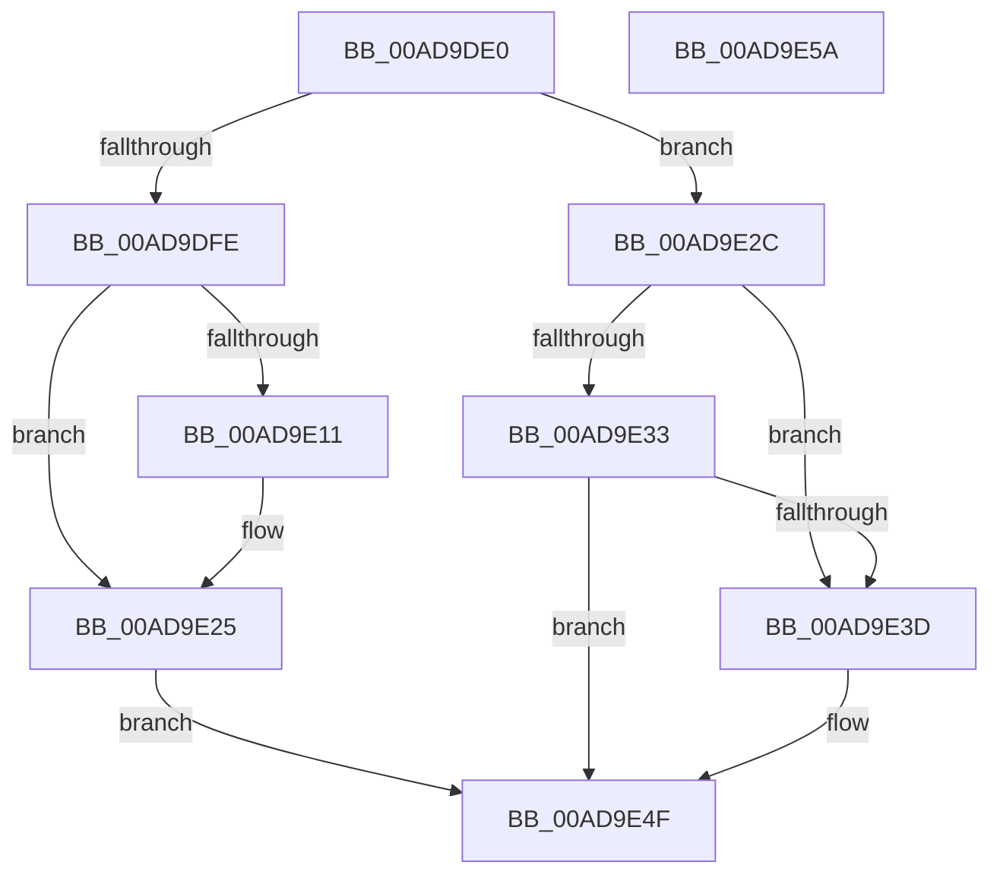

# PopIdleCsStateChanged

- RVA: `0x00AD9DE0`–`0x00AD9E5B` (길이 `123` bytes)
- VA: `0x0000000140AD9DE0`
- 실행 섹션: `PAGE`
- PDB 이름 있음: `예`; PDB Function 태그: `아니요`
- unwind 정보 RVA: `0x0005CF00`
- 디코드: `31`개 명령, `123/123` bytes 표시
- 미해석 바이트: `0` (있으면 어셈블리에 `.byte`로 보존)

> 이 문서는 커널 이미지의 기계어와 PDB 기호를 분석해 생성했습니다. 4번과 5번은 함수 원형과 자료형을 바이너리 사용 방식에서 추정한 C 해석이며 원본 소스 복구 결과는 아닙니다.

## 1. Dependencies

- 직접 호출 지점: **5**; 고유 호출 대상: **5**
- 직접 호출자로 확인된 함수: **1**
- RIP 상대 이미지 참조: **4**

### Outgoing calls
- `0x00AD9DE8` → [PopAcquirePolicyLock](../../pagelk/B7/PopAcquirePolicyLock_function_00B783C0.md) (function, `0x00B783C0`)
- `0x00AD9DF5` → [PopGetModernStandbyTransitionReason](../../text/4B/PopGetModernStandbyTransitionReason_function_004BDF6C.md) (function, `0x004BDF6C`)
- `0x00AD9E25` → [PopIdleArmAoAcDozeS4Timer](../../text/4E/PopIdleArmAoAcDozeS4Timer_function_004E03A8.md) (function, `0x004E03A8`)
- `0x00AD9E42` → [PopIdleCancelAoAcDozeS4Timer](../../text/4B/PopIdleCancelAoAcDozeS4Timer_function_004BC9C4.md) (function, `0x004BC9C4`)
- `0x00AD9E4F` → [PopReleasePolicyLock](../../pagelk/B7/PopReleasePolicyLock_function_00B78410.md) (function, `0x00B78410`)

### Direct callers
- [PdcPoCurrentPdcPhase](../../text/5D/PdcPoCurrentPdcPhase_function_005D9E70.md) at `0x005D9F7B`

### Static image references
- `0x00AD9DEF` → RVA `0x00F0BCA0` (`.data`; write)
- `0x00AD9DFE` → RVA `0x00E27D08` (`.data`; read)
- `0x00AD9E05` → RVA `0x00F0BCA8` (`.data`; write)
- `0x00AD9E47` → RVA `0x00F0BCA8` (`.data`; read/write)

## 2. Other-region calls and transfers

- 다른 실행 섹션으로 향하는 call: **5**
  - `0x00AD9DE8` → [PopAcquirePolicyLock](../../pagelk/B7/PopAcquirePolicyLock_function_00B783C0.md) (`PAGE` → `PAGELK`)
  - `0x00AD9DF5` → [PopGetModernStandbyTransitionReason](../../text/4B/PopGetModernStandbyTransitionReason_function_004BDF6C.md) (`PAGE` → `.text`)
  - `0x00AD9E25` → [PopIdleArmAoAcDozeS4Timer](../../text/4E/PopIdleArmAoAcDozeS4Timer_function_004E03A8.md) (`PAGE` → `.text`)
  - `0x00AD9E42` → [PopIdleCancelAoAcDozeS4Timer](../../text/4B/PopIdleCancelAoAcDozeS4Timer_function_004BC9C4.md) (`PAGE` → `.text`)
  - `0x00AD9E4F` → [PopReleasePolicyLock](../../pagelk/B7/PopReleasePolicyLock_function_00B78410.md) (`PAGE` → `PAGELK`)
- 별도 외부 분기/꼬리 이동을 확인하지 못했습니다.

## 3. Assembly (complete function range)

```asm
00AD9DE0  40 53                           push rbx
00AD9DE2  48 83 EC 20                     sub rsp, 0x20
00AD9DE6  8A D9                           mov bl, cl
00AD9DE8  E8 D3 E5 09 00                  call 0x140b783c0
00AD9DED  33 C9                           xor ecx, ecx
00AD9DEF  88 1D AB 1E 43 00               mov byte ptr [rip + 0x431eab], bl
00AD9DF5  E8 72 41 9E FF                  call 0x1404bdf6c
00AD9DFA  84 DB                           test bl, bl
00AD9DFC  74 2E                           je 0x140ad9e2c
00AD9DFE  48 8B 05 03 DF 34 00            mov rax, qword ptr [rip + 0x34df03]
00AD9E05  48 89 05 9C 1E 43 00            mov qword ptr [rip + 0x431e9c], rax
00AD9E0C  48 85 C0                        test rax, rax
00AD9E0F  75 14                           jne 0x140ad9e25
00AD9E11  48 B8 08 00 00 00 80 F7 FF FF   movabs rax, 0xfffff78000000008
00AD9E1B  48 8B 00                        mov rax, qword ptr [rax]
00AD9E1E  48 89 05 83 1E 43 00            mov qword ptr [rip + 0x431e83], rax
00AD9E25  E8 7E 65 A0 FF                  call 0x1404e03a8
00AD9E2A  EB 23                           jmp 0x140ad9e4f
00AD9E2C  3D 00 00 00 01                  cmp eax, 0x1000000
00AD9E31  73 0A                           jae 0x140ad9e3d
00AD9E33  25 FF FF FF 00                  and eax, 0xffffff
00AD9E38  83 F8 06                        cmp eax, 6
00AD9E3B  74 12                           je 0x140ad9e4f
00AD9E3D  B9 01 00 00 00                  mov ecx, 1
00AD9E42  E8 7D 2B 9E FF                  call 0x1404bc9c4
00AD9E47  48 83 25 59 1E 43 00 00         and qword ptr [rip + 0x431e59], 0
00AD9E4F  E8 BC E5 09 00                  call 0x140b78410
00AD9E54  48 83 C4 20                     add rsp, 0x20
00AD9E58  5B                              pop rbx
00AD9E59  C3                              ret
00AD9E5A  CC                              int3
```

## 4. C-style interpretation (structured pseudocode)

```c
__int64 __fastcall PopIdleCsStateChanged(int a1)
{
    __int64 result;
    __int64 v_rsp;

    v_rsp = (v_rsp) - (32);
    result = PopAcquirePolicyLock(a1, a2, a3, a4);
    a1 = 0;
    *(unsigned __int8 *)(v_rip + 4398763) = (unsigned __int8)((unsigned __int8)(a1));
    result = PopGetModernStandbyTransitionReason(a1, a2, a3, a4);
    if ((unsigned __int8)((unsigned __int8)(a1)) == 0) goto loc_00AD9E2C;
    *(unsigned __int64 *)(v_rip + 4398748) = *(unsigned __int64 *)(v_rip + 3464963);
    result = *(unsigned __int64 *)(v_rip + 3464963);
    if (*(unsigned __int64 *)(v_rip + 3464963) == 0) {
        result = *(unsigned __int64 *)(*(unsigned __int64 *)(v_rip + 3464963));
        *(unsigned __int64 *)(v_rip + 4398723) = result;
    }
    result = PopIdleArmAoAcDozeS4Timer(a1, a2, a3, a4);
    goto loc_00AD9E4F;
loc_00AD9E2C:
    if (((unsigned int)(result)) >= 0x1000000ULL) goto loc_00AD9E3D;
    result = (unsigned int)((result) & (0xFFFFFFULL));
    if (((unsigned int)(result)) != 6) {
        a1 = 1;
        result = PopIdleCancelAoAcDozeS4Timer(a1, a2, a3, a4);
    }
    result = PopReleasePolicyLock(a1, a2, a3, a4);
    v_rsp = (v_rsp) + (32);
    return result;
}
```

## 5. (Beta) C Style

```c
int64_t PopIdleCsStateChanged(int32_t Arg1)
{
    int64_t result;
    int64_t local_rsp;

    local_rsp = (local_rsp) - (32);
    result = PopAcquirePolicyLock(Arg1, a2, a3, a4);
    Arg1 = 0;
    *(uint8_t *)(v_rip + 0x431EAB) = (uint8_t)((uint8_t)(Arg1));
    result = PopGetModernStandbyTransitionReason(Arg1, a2, a3, a4);
    if ((uint8_t)((uint8_t)(Arg1)) == 0) goto loc_00AD9E2C;
    *(uint64_t *)(v_rip + 0x431E9C) = *(uint64_t *)(v_rip + 0x34DF03);
    result = *(uint64_t *)(v_rip + 0x34DF03);
    if (*(uint64_t *)(v_rip + 0x34DF03) == 0) {
        result = *(uint64_t *)(*(uint64_t *)(v_rip + 0x34DF03));
        *(uint64_t *)(v_rip + 0x431E83) = result;
    }
    result = PopIdleArmAoAcDozeS4Timer(Arg1, a2, a3, a4);
    goto loc_00AD9E4F;
loc_00AD9E2C:
    if (((uint32_t)(result)) >= 0x1000000ULL) goto loc_00AD9E3D;
    result = (uint32_t)((result) & (0xFFFFFFULL));
    if (((uint32_t)(result)) != 6) {
        Arg1 = 1;
        result = PopIdleCancelAoAcDozeS4Timer(Arg1, a2, a3, a4);
    }
    result = PopReleasePolicyLock(Arg1, a2, a3, a4);
    local_rsp = (local_rsp) + (32);
    return result;
}
```

## 6. Execution-region graph

[열기: 2D/3D 그래프와 함수 탐색 컨트롤 패널](../../../control-panel.html?section=page&rva=0x00AD9DE0&view=graph)

- 2D 그래프는 위에서 아래로 흐르고, 3D 그래프는 빈 공간을 드래그해 회전합니다. Shift+드래그는 이동, 휠은 확대·축소, 함수 노드 선택은 대상 보고서 이동입니다.

### Static fallback


