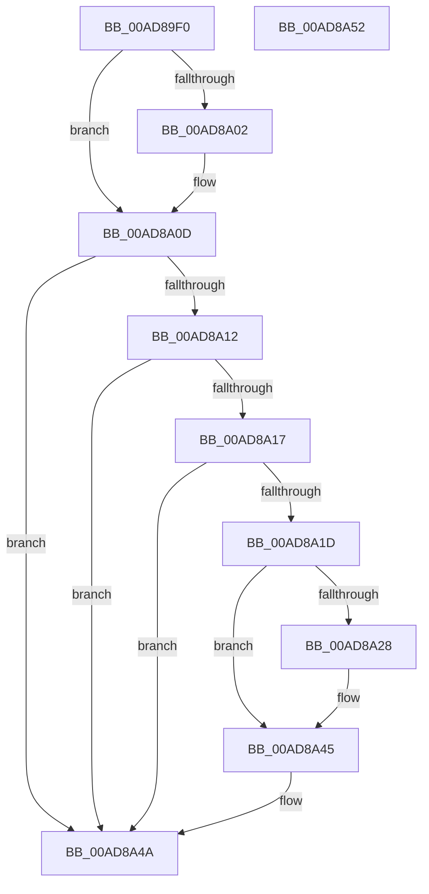

# PopIdleGlobalUserPresenceCallback

- RVA: `0x00AD89F0`–`0x00AD8A53` (길이 `99` bytes)
- VA: `0x0000000140AD89F0`
- 실행 섹션: `PAGE`
- PDB 이름 있음: `예`; PDB Function 태그: `아니요`
- unwind 정보 RVA: `0x0005CF00`
- 디코드: `28`개 명령, `99/99` bytes 표시
- 미해석 바이트: `0` (있으면 어셈블리에 `.byte`로 보존)

> 이 문서는 커널 이미지의 기계어와 PDB 기호를 분석해 생성했습니다. 4번과 5번은 함수 원형과 자료형을 바이너리 사용 방식에서 추정한 C 해석이며 원본 소스 복구 결과는 아닙니다.

## 1. Dependencies

- 직접 호출 지점: **4**; 고유 호출 대상: **4**
- 직접 호출자로 확인된 함수: **0**
- RIP 상대 이미지 참조: **4**

### Outgoing calls
- `0x00AD8A1F` → [PopAcquirePolicyLock](../../pagelk/B7/PopAcquirePolicyLock_function_00B783C0.md) (function, `0x00B783C0`)
- `0x00AD8A2B` → [PopIdleCancelAoAcDozeS4Timer](../../text/4B/PopIdleCancelAoAcDozeS4Timer_function_004BC9C4.md) (function, `0x004BC9C4`)
- `0x00AD8A40` → [PopSmartSuspendValidatePredictions](../76/PopSmartSuspendValidatePredictions_function_007688EC.md) (function, `0x007688EC`)
- `0x00AD8A45` → [PopReleasePolicyLock](../../pagelk/B7/PopReleasePolicyLock_function_00B78410.md) (function, `0x00B78410`)

### Direct callers
- 이 함수 시작 RVA로 연결되는 직접 call은 확인되지 않았습니다. 간접 호출은 완전히 역산할 수 없습니다.

### Static image references
- `0x00AD89F9` → RVA `0x0001ED50` (`.rdata`; read)
- `0x00AD8A06` → RVA `0x0001ED58` (`.rdata`; read)
- `0x00AD8A30` → RVA `0x00F0BDA8` (`.data`; read/write)
- `0x00AD8A38` → RVA `0x00F0BE10` (`.data`; read/write)

## 2. Other-region calls and transfers

- 다른 실행 섹션으로 향하는 call: **3**
  - `0x00AD8A1F` → [PopAcquirePolicyLock](../../pagelk/B7/PopAcquirePolicyLock_function_00B783C0.md) (`PAGE` → `PAGELK`)
  - `0x00AD8A2B` → [PopIdleCancelAoAcDozeS4Timer](../../text/4B/PopIdleCancelAoAcDozeS4Timer_function_004BC9C4.md) (`PAGE` → `.text`)
  - `0x00AD8A45` → [PopReleasePolicyLock](../../pagelk/B7/PopReleasePolicyLock_function_00B78410.md) (`PAGE` → `PAGELK`)
- 별도 외부 분기/꼬리 이동을 확인하지 못했습니다.

## 3. Assembly (complete function range)

```asm
00AD89F0  40 53                           push rbx
00AD89F2  48 83 EC 20                     sub rsp, 0x20
00AD89F6  48 8B 01                        mov rax, qword ptr [rcx]
00AD89F9  48 2B 05 50 63 54 FF            sub rax, qword ptr [rip - 0xab9cb0]
00AD8A00  75 0B                           jne 0x140ad8a0d
00AD8A02  48 8B 41 08                     mov rax, qword ptr [rcx + 8]
00AD8A06  48 2B 05 4B 63 54 FF            sub rax, qword ptr [rip - 0xab9cb5]
00AD8A0D  48 85 C0                        test rax, rax
00AD8A10  75 38                           jne 0x140ad8a4a
00AD8A12  48 85 D2                        test rdx, rdx
00AD8A15  74 33                           je 0x140ad8a4a
00AD8A17  41 83 F8 04                     cmp r8d, 4
00AD8A1B  75 2D                           jne 0x140ad8a4a
00AD8A1D  8B 1A                           mov ebx, dword ptr [rdx]
00AD8A1F  E8 9C F9 09 00                  call 0x140b783c0
00AD8A24  85 DB                           test ebx, ebx
00AD8A26  75 1D                           jne 0x140ad8a45
00AD8A28  8D 4B 02                        lea ecx, [rbx + 2]
00AD8A2B  E8 94 3F 9E FF                  call 0x1404bc9c4
00AD8A30  48 83 25 70 33 43 00 00         and qword ptr [rip + 0x433370], 0
00AD8A38  48 83 25 D0 33 43 00 00         and qword ptr [rip + 0x4333d0], 0
00AD8A40  E8 A7 FE C8 FF                  call 0x1407688ec
00AD8A45  E8 C6 F9 09 00                  call 0x140b78410
00AD8A4A  33 C0                           xor eax, eax
00AD8A4C  48 83 C4 20                     add rsp, 0x20
00AD8A50  5B                              pop rbx
00AD8A51  C3                              ret
00AD8A52  CC                              int3
```

## 4. C-style interpretation (structured pseudocode)

```c
__int64 __fastcall PopIdleGlobalUserPresenceCallback(__int64 a1, __int64 a2, int a3)
{
    __int64 result;
    __int64 v_rsp;

    v_rsp = (v_rsp) - (32);
    result = (*(unsigned __int64 *)(a1)) - (*(unsigned __int64 *)(v_rip - 11246768));
    if (!(condition_is_not_equal)) {
        result = *(unsigned __int64 *)(a1 + 8);
        result = (result) - (*(unsigned __int64 *)(v_rip - 11246773));
    }
    if (result != 0) goto loc_00AD8A4A;
    if (a2 == 0) goto loc_00AD8A4A;
    if (a3 != 4) goto loc_00AD8A4A;
    result = PopAcquirePolicyLock(a1, a2, a3, a4);
    if ((unsigned int)((unsigned int)(*(unsigned int *)(a2))) == 0) {
        a1 = (unsigned int)(*(unsigned int *)(a2)) + 2;
        result = PopIdleCancelAoAcDozeS4Timer(a1, a2, a3, a4);
        result = PopSmartSuspendValidatePredictions(a1, a2, a3, a4);
    }
    result = PopReleasePolicyLock(a1, a2, a3, a4);
loc_00AD8A4A:
    result = 0;
    v_rsp = (v_rsp) + (32);
    return result;
}
```

## 5. (Beta) C Style

```c
int64_t PopIdleGlobalUserPresenceCallback(void *Arg1, int64_t Arg2, int32_t Arg3)
{
    uint8_t *arg1 = (uint8_t *)Arg1;

    int64_t result;
    int64_t local_rsp;

    local_rsp = (local_rsp) - (32);
    result = (*(uint64_t *)(arg1)) - (*(uint64_t *)(v_rip - 0xAB9CB0));
    if (!(condition_is_not_equal)) {
        result = *(uint64_t *)(arg1 + 0x8);
        result = (result) - (*(uint64_t *)(v_rip - 0xAB9CB5));
    }
    if (result != 0) goto loc_00AD8A4A;
    if (Arg2 == 0) goto loc_00AD8A4A;
    if (Arg3 != 4) goto loc_00AD8A4A;
    result = PopAcquirePolicyLock(Arg1, Arg2, Arg3, a4);
    if ((uint32_t)((uint32_t)(*(uint32_t *)(Arg2))) == 0) {
        Arg1 = (uint32_t)(*(uint32_t *)(Arg2)) + 2;
        result = PopIdleCancelAoAcDozeS4Timer(Arg1, Arg2, Arg3, a4);
        result = PopSmartSuspendValidatePredictions(Arg1, Arg2, Arg3, a4);
    }
    result = PopReleasePolicyLock(Arg1, Arg2, Arg3, a4);
loc_00AD8A4A:
    result = 0;
    local_rsp = (local_rsp) + (32);
    return result;
}
```

### 관측된 메모리 오프셋

구조체 형식이 확인되지 않은 접근은 인자 기준의 오프셋으로만 기록했습니다.

| 기준 인자 | 오프셋 표현 | 폭 (bit) | 접근 |
|---|---:|---:|---|
| `Arg1` | `+ 0x0` | `64` | `R` |
| `Arg1` | `+ 0x8` | `64` | `R` |

## 6. Execution-region graph

[열기: 2D/3D 그래프와 함수 탐색 컨트롤 패널](../../../control-panel.html?section=page&rva=0x00AD89F0&view=graph)

- 2D 그래프는 위에서 아래로 흐르고, 3D 그래프는 빈 공간을 드래그해 회전합니다. Shift+드래그는 이동, 휠은 확대·축소, 함수 노드 선택은 대상 보고서 이동입니다.

### Static fallback


