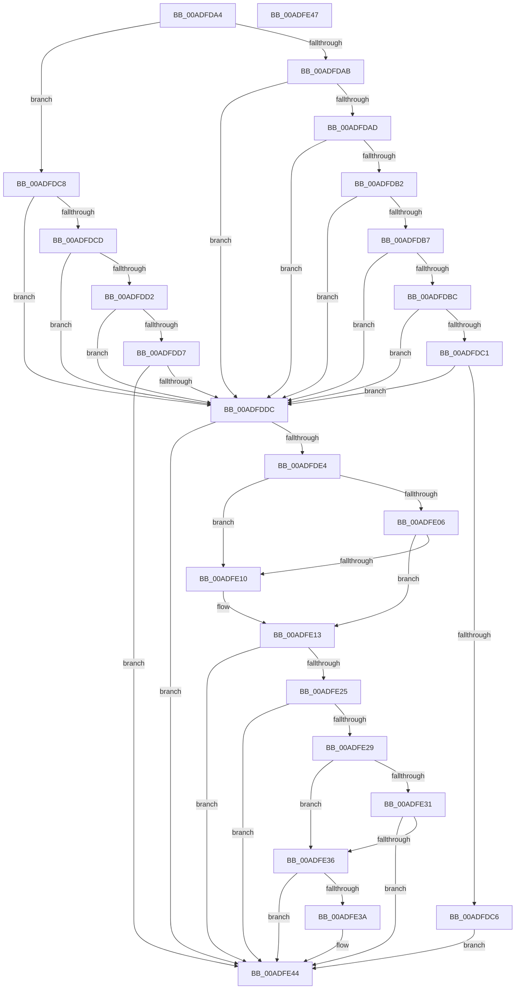

# PopIsInputSuppressionEngaged

- RVA: `0x00ADFDA4`–`0x00ADFE48` (길이 `164` bytes)
- VA: `0x0000000140ADFDA4`
- 실행 섹션: `PAGE`
- PDB 이름 있음: `예`; PDB Function 태그: `아니요`
- unwind 정보 RVA: `0x000DB714`
- 디코드: `54`개 명령, `164/164` bytes 표시
- 미해석 바이트: `0` (있으면 어셈블리에 `.byte`로 보존)

> 이 문서는 커널 이미지의 기계어와 PDB 기호를 분석해 생성했습니다. 4번과 5번은 함수 원형과 자료형을 바이너리 사용 방식에서 추정한 C 해석이며 원본 소스 복구 결과는 아닙니다.

## 1. Dependencies

- 직접 호출 지점: **0**; 고유 호출 대상: **0**
- 직접 호출자로 확인된 함수: **2**
- RIP 상대 이미지 참조: **8**

### Outgoing calls
- 직접 디코드된 call 명령이 없습니다.

### Direct callers
- [PopMonitorInvocation](../76/PopMonitorInvocation_function_00769710.md) at `0x0076972A`
- [PopPowerAggregatorHandleActiveIntent](PopPowerAggregatorHandleActiveIntent_function_00ADFCB0.md) at `0x00ADFD24`

### Static image references
- `0x00ADFDDC` → RVA `0x00E67894` (`.data`; read)
- `0x00ADFDE4` → RVA `0x00E0B579` (`.data`; read)
- `0x00ADFDF3` → RVA `0x00F0CE0C` (`.data`; read)
- `0x00ADFDFE` → RVA `0x00E67A54` (`.data`; read)
- `0x00ADFE06` → RVA `0x00E67884` (`.data`; read)
- `0x00ADFE13` → RVA `0x00E67A50` (`.data`; read)
- `0x00ADFE1D` → RVA `0x00E67A38` (`.data`; read)
- `0x00ADFE29` → RVA `0x00E67885` (`.data`; read)

## 2. Other-region calls and transfers

- 다른 실행 섹션으로 향하는 call: **0**
- 별도 외부 분기/꼬리 이동을 확인하지 못했습니다.

## 3. Assembly (complete function range)

```asm
00ADFDA4  33 D2                           xor edx, edx
00ADFDA6  83 F9 24                        cmp ecx, 0x24
00ADFDA9  7F 1D                           jg 0x140adfdc8
00ADFDAB  74 2F                           je 0x140adfddc
00ADFDAD  83 E9 1F                        sub ecx, 0x1f
00ADFDB0  74 2A                           je 0x140adfddc
00ADFDB2  83 E9 01                        sub ecx, 1
00ADFDB5  74 25                           je 0x140adfddc
00ADFDB7  83 E9 01                        sub ecx, 1
00ADFDBA  74 20                           je 0x140adfddc
00ADFDBC  83 E9 01                        sub ecx, 1
00ADFDBF  74 1B                           je 0x140adfddc
00ADFDC1  83 F9 01                        cmp ecx, 1
00ADFDC4  74 16                           je 0x140adfddc
00ADFDC6  EB 7C                           jmp 0x140adfe44
00ADFDC8  83 E9 25                        sub ecx, 0x25
00ADFDCB  74 0F                           je 0x140adfddc
00ADFDCD  83 E9 01                        sub ecx, 1
00ADFDD0  74 0A                           je 0x140adfddc
00ADFDD2  83 E9 01                        sub ecx, 1
00ADFDD5  74 05                           je 0x140adfddc
00ADFDD7  83 F9 0F                        cmp ecx, 0xf
00ADFDDA  75 68                           jne 0x140adfe44
00ADFDDC  38 15 B2 7A 38 00               cmp byte ptr [rip + 0x387ab2], dl
00ADFDE2  74 60                           je 0x140adfe44
00ADFDE4  38 15 8F B7 32 00               cmp byte ptr [rip + 0x32b78f], dl
00ADFDEA  41 BA 01 00 00 00               mov r10d, 1
00ADFDF0  0F 94 C1                        sete cl
00ADFDF3  44 39 15 12 D0 42 00            cmp dword ptr [rip + 0x42d012], r10d
00ADFDFA  41 0F 94 C0                     sete r8b
00ADFDFE  38 15 50 7C 38 00               cmp byte ptr [rip + 0x387c50], dl
00ADFE04  75 0A                           jne 0x140adfe10
00ADFE06  38 15 78 7A 38 00               cmp byte ptr [rip + 0x387a78], dl
00ADFE0C  8A C2                           mov al, dl
00ADFE0E  74 03                           je 0x140adfe13
00ADFE10  41 8A C2                        mov al, r10b
00ADFE13  39 15 37 7C 38 00               cmp dword ptr [rip + 0x387c37], edx
00ADFE19  41 0F 94 C1                     sete r9b
00ADFE1D  38 15 15 7C 38 00               cmp byte ptr [rip + 0x387c15], dl
00ADFE23  75 1F                           jne 0x140adfe44
00ADFE25  84 C9                           test cl, cl
00ADFE27  74 1B                           je 0x140adfe44
00ADFE29  38 15 56 7A 38 00               cmp byte ptr [rip + 0x387a56], dl
00ADFE2F  75 05                           jne 0x140adfe36
00ADFE31  45 84 C0                        test r8b, r8b
00ADFE34  74 0E                           je 0x140adfe44
00ADFE36  84 C0                           test al, al
00ADFE38  75 0A                           jne 0x140adfe44
00ADFE3A  45 84 C9                        test r9b, r9b
00ADFE3D  0F B6 D2                        movzx edx, dl
00ADFE40  41 0F 45 D2                     cmovne edx, r10d
00ADFE44  8A C2                           mov al, dl
00ADFE46  C3                              ret
00ADFE47  CC                              int3
```

## 4. C-style interpretation (structured pseudocode)

```c
__int64 __fastcall PopIsInputSuppressionEngaged(int a1, int a2)
{
    __int64 result;

    a2 = 0;
    if (a1 > 36) goto loc_00ADFDC8;
    if (a1 == 36) goto loc_00ADFDDC;
    a1 = (unsigned int)((a1) - (31));
    if (condition_is_equal) goto loc_00ADFDDC;
    a1 = (unsigned int)((a1) - (1));
    if (condition_is_equal) goto loc_00ADFDDC;
    a1 = (unsigned int)((a1) - (1));
    if (condition_is_equal) goto loc_00ADFDDC;
    a1 = (unsigned int)((a1) - (1));
    if (condition_is_equal) goto loc_00ADFDDC;
    if (a1 == 1) goto loc_00ADFDDC;
    goto loc_00ADFE44;
loc_00ADFDC8:
    a1 = (unsigned int)((a1) - (37));
    if (condition_is_equal) goto loc_00ADFDDC;
    a1 = (unsigned int)((a1) - (1));
    if (condition_is_equal) goto loc_00ADFDDC;
    a1 = (unsigned int)((a1) - (1));
    if (condition_is_equal) goto loc_00ADFDDC;
    if (a1 != 15) goto loc_00ADFE44;
loc_00ADFDDC:
    if ((*(unsigned __int8 *)(v_rip + 3701426)) == 0) goto loc_00ADFE44;
    a1 = ((*(unsigned __int8 *)(v_rip + 3323791)) == 0) ? 1 : 0;
    a3 = ((*(unsigned int *)(v_rip + 4378642)) == 1) ? 1 : 0;
    if ((*(unsigned __int8 *)(v_rip + 3701840)) != 0) goto loc_00ADFE10;
    result = 0;
    if ((*(unsigned __int8 *)(v_rip + 3701368)) != 0) {
        result = 1;
    }
    a4 = ((*(unsigned int *)(v_rip + 3701815)) == 0) ? 1 : 0;
    if ((*(unsigned __int8 *)(v_rip + 3701781)) != 0) goto loc_00ADFE44;
    if ((unsigned __int8)(a1) == 0) goto loc_00ADFE44;
    if ((*(unsigned __int8 *)(v_rip + 3701334)) != 0) goto loc_00ADFE36;
    if ((unsigned __int8)(a3) == 0) goto loc_00ADFE44;
loc_00ADFE36:
    if ((unsigned __int8)(result) == 0) {
        a2 = 0;
        if ((unsigned __int8)(a4) != 0) { a2 = 1; }
    }
    return (unsigned __int8)(a2);
}
```

## 5. (Beta) C Style

```c
int64_t PopIsInputSuppressionEngaged(int32_t Arg1, int32_t Arg2)
{
    int64_t result;

    Arg2 = 0;
    if (Arg1 > 36) goto loc_00ADFDC8;
    if (Arg1 == 36) goto loc_00ADFDDC;
    Arg1 = (uint32_t)((Arg1) - (31));
    if (condition_is_equal) goto loc_00ADFDDC;
    Arg1 = (uint32_t)((Arg1) - (1));
    if (condition_is_equal) goto loc_00ADFDDC;
    Arg1 = (uint32_t)((Arg1) - (1));
    if (condition_is_equal) goto loc_00ADFDDC;
    Arg1 = (uint32_t)((Arg1) - (1));
    if (condition_is_equal) goto loc_00ADFDDC;
    if (Arg1 == 1) goto loc_00ADFDDC;
    goto loc_00ADFE44;
loc_00ADFDC8:
    Arg1 = (uint32_t)((Arg1) - (37));
    if (condition_is_equal) goto loc_00ADFDDC;
    Arg1 = (uint32_t)((Arg1) - (1));
    if (condition_is_equal) goto loc_00ADFDDC;
    Arg1 = (uint32_t)((Arg1) - (1));
    if (condition_is_equal) goto loc_00ADFDDC;
    if (Arg1 != 15) goto loc_00ADFE44;
loc_00ADFDDC:
    if ((*(uint8_t *)(v_rip + 0x387AB2)) == 0) goto loc_00ADFE44;
    Arg1 = ((*(uint8_t *)(v_rip + 0x32B78F)) == 0) ? 1 : 0;
    a3 = ((*(uint32_t *)(v_rip + 0x42D012)) == 1) ? 1 : 0;
    if ((*(uint8_t *)(v_rip + 0x387C50)) != 0) goto loc_00ADFE10;
    result = 0;
    if ((*(uint8_t *)(v_rip + 0x387A78)) != 0) {
        result = 1;
    }
    a4 = ((*(uint32_t *)(v_rip + 0x387C37)) == 0) ? 1 : 0;
    if ((*(uint8_t *)(v_rip + 0x387C15)) != 0) goto loc_00ADFE44;
    if ((uint8_t)(Arg1) == 0) goto loc_00ADFE44;
    if ((*(uint8_t *)(v_rip + 0x387A56)) != 0) goto loc_00ADFE36;
    if ((uint8_t)(a3) == 0) goto loc_00ADFE44;
loc_00ADFE36:
    if ((uint8_t)(result) == 0) {
        Arg2 = 0;
        if ((uint8_t)(a4) != 0) { Arg2 = 1; }
    }
    return (uint8_t)(Arg2);
}
```

## 6. Execution-region graph

[열기: 2D/3D 그래프와 함수 탐색 컨트롤 패널](../../../control-panel.html?section=page&rva=0x00ADFDA4&view=graph)

- 2D 그래프는 위에서 아래로 흐르고, 3D 그래프는 빈 공간을 드래그해 회전합니다. Shift+드래그는 이동, 휠은 확대·축소, 함수 노드 선택은 대상 보고서 이동입니다.

### Static fallback


