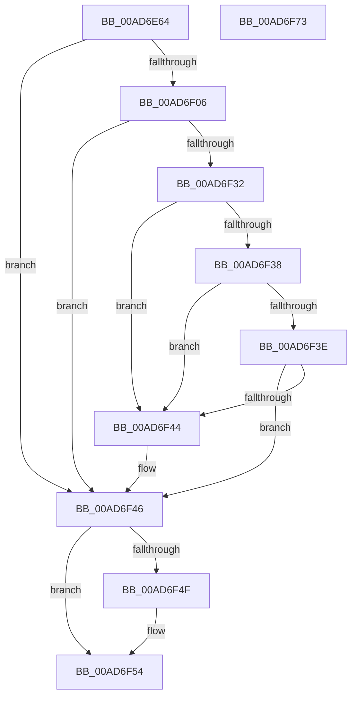

# PopIsRemoteDesktopEnabled

- RVA: `0x00AD6E64`–`0x00AD6F74` (길이 `272` bytes)
- VA: `0x0000000140AD6E64`
- 실행 섹션: `PAGE`
- PDB 이름 있음: `예`; PDB Function 태그: `아니요`
- unwind 정보 RVA: `0x000BF05C`
- 디코드: `69`개 명령, `272/272` bytes 표시
- 미해석 바이트: `0` (있으면 어셈블리에 `.byte`로 보존)

> 이 문서는 커널 이미지의 기계어와 PDB 기호를 분석해 생성했습니다. 4번과 5번은 함수 원형과 자료형을 바이너리 사용 방식에서 추정한 C 해석이며 원본 소스 복구 결과는 아닙니다.

## 1. Dependencies

- 직접 호출 지점: **6**; 고유 호출 대상: **5**
- 직접 호출자로 확인된 함수: **2**
- RIP 상대 이미지 참조: **3**

### Outgoing calls
- `0x00AD6EB8` → [RtlInitUnicodeString](../../text/42/RtlInitUnicodeString_function_0042A780.md) (function, `0x0042A780`)
- `0x00AD6EC8` → [RtlInitUnicodeString](../../text/42/RtlInitUnicodeString_function_0042A780.md) (function, `0x0042A780`)
- `0x00AD6EFD` → [ZwOpenKey](../../text/6A/ZwOpenKey_function_006AD310.md) (function, `0x006AD310`)
- `0x00AD6F29` → [ZwQueryValueKey](../../text/6A/ZwQueryValueKey_function_006AD3B0.md) (function, `0x006AD3B0`)
- `0x00AD6F4F` → [ZwClose](../../text/6A/ZwClose_function_006AD2B0.md) (function, `0x006AD2B0`)
- `0x00AD6F5D` → [_security_check_cookie](../../text/6A/_security_check_cookie_function_006AC640.md) (function, `0x006AC640`)

### Direct callers
- [PopDiagTraceCsResiliencyEnter](../../text/4E/PopDiagTraceCsResiliencyEnter_function_004E0194.md) at `0x004E01B6`
- [PopPowerAggregatorEngageAggressiveStandbyActions](../76/PopPowerAggregatorEngageAggressiveStandbyActions_function_0076460C.md) at `0x00764636`

### Static image references
- `0x00AD6E76` → RVA `0x00E0A740` (`.data`; read)
- `0x00AD6E86` → RVA `0x00B01A60` (` ?? ::NNGAKEGL::`string'`; read)
- `0x00AD6EBD` → RVA `0x00B019D0` (` ?? ::NNGAKEGL::`string'`; read)

## 2. Other-region calls and transfers

- 다른 실행 섹션으로 향하는 call: **6**
  - `0x00AD6EB8` → [RtlInitUnicodeString](../../text/42/RtlInitUnicodeString_function_0042A780.md) (`PAGE` → `.text`)
  - `0x00AD6EC8` → [RtlInitUnicodeString](../../text/42/RtlInitUnicodeString_function_0042A780.md) (`PAGE` → `.text`)
  - `0x00AD6EFD` → [ZwOpenKey](../../text/6A/ZwOpenKey_function_006AD310.md) (`PAGE` → `.text`)
  - `0x00AD6F29` → [ZwQueryValueKey](../../text/6A/ZwQueryValueKey_function_006AD3B0.md) (`PAGE` → `.text`)
  - `0x00AD6F4F` → [ZwClose](../../text/6A/ZwClose_function_006AD2B0.md) (`PAGE` → `.text`)
  - `0x00AD6F5D` → [_security_check_cookie](../../text/6A/_security_check_cookie_function_006AC640.md) (`PAGE` → `.text`)
- 별도 외부 분기/꼬리 이동을 확인하지 못했습니다.

## 3. Assembly (complete function range)

```asm
00AD6E64  48 89 5C 24 08                  mov qword ptr [rsp + 8], rbx
00AD6E69  55                              push rbp
00AD6E6A  48 8D 6C 24 A9                  lea rbp, [rsp - 0x57]
00AD6E6F  48 81 EC B0 00 00 00            sub rsp, 0xb0
00AD6E76  48 8B 05 C3 38 33 00            mov rax, qword ptr [rip + 0x3338c3]
00AD6E7D  48 33 C4                        xor rax, rsp
00AD6E80  48 89 45 4F                     mov qword ptr [rbp + 0x4f], rax
00AD6E84  33 C0                           xor eax, eax
00AD6E86  48 8D 15 D3 AB 02 00            lea rdx, [rip + 0x2abd3]
00AD6E8D  21 45 23                        and dword ptr [rbp + 0x23], eax
00AD6E90  48 8D 4D F7                     lea rcx, [rbp - 9]
00AD6E94  21 45 D7                        and dword ptr [rbp - 0x29], eax
00AD6E97  0F 57 C0                        xorps xmm0, xmm0
00AD6E9A  48 21 45 DF                     and qword ptr [rbp - 0x21], rax
00AD6E9E  0F 57 C9                        xorps xmm1, xmm1
00AD6EA1  89 45 0B                        mov dword ptr [rbp + 0xb], eax
00AD6EA4  32 DB                           xor bl, bl
00AD6EA6  21 45 0B                        and dword ptr [rbp + 0xb], eax
00AD6EA9  0F 11 45 E7                     movups xmmword ptr [rbp - 0x19], xmm0
00AD6EAD  89 45 47                        mov dword ptr [rbp + 0x47], eax
00AD6EB0  0F 11 4D 37                     movups xmmword ptr [rbp + 0x37], xmm1
00AD6EB4  0F 11 45 F7                     movups xmmword ptr [rbp - 9], xmm0
00AD6EB8  E8 C3 38 95 FF                  call 0x14042a780
00AD6EBD  48 8D 15 0C AB 02 00            lea rdx, [rip + 0x2ab0c]
00AD6EC4  48 8D 4D E7                     lea rcx, [rbp - 0x19]
00AD6EC8  E8 B3 38 95 FF                  call 0x14042a780
00AD6ECD  48 83 65 0F 00                  and qword ptr [rbp + 0xf], 0
00AD6ED2  48 8D 45 E7                     lea rax, [rbp - 0x19]
00AD6ED6  0F 57 C0                        xorps xmm0, xmm0
00AD6ED9  48 89 45 17                     mov qword ptr [rbp + 0x17], rax
00AD6EDD  4C 8D 45 07                     lea r8, [rbp + 7]
00AD6EE1  C7 45 07 30 00 00 00            mov dword ptr [rbp + 7], 0x30
00AD6EE8  BA 19 00 02 00                  mov edx, 0x20019
00AD6EED  C7 45 1F 40 02 00 00            mov dword ptr [rbp + 0x1f], 0x240
00AD6EF4  48 8D 4D DF                     lea rcx, [rbp - 0x21]
00AD6EF8  F3 0F 7F 45 27                  movdqu xmmword ptr [rbp + 0x27], xmm0
00AD6EFD  E8 0E 64 BD FF                  call 0x1406ad310
00AD6F02  85 C0                           test eax, eax
00AD6F04  78 40                           js 0x140ad6f46
00AD6F06  48 8B 4D DF                     mov rcx, qword ptr [rbp - 0x21]
00AD6F0A  48 8D 45 D7                     lea rax, [rbp - 0x29]
00AD6F0E  48 89 44 24 28                  mov qword ptr [rsp + 0x28], rax
00AD6F13  4C 8D 4D 37                     lea r9, [rbp + 0x37]
00AD6F17  41 B8 02 00 00 00               mov r8d, 2
00AD6F1D  C7 44 24 20 14 00 00 00         mov dword ptr [rsp + 0x20], 0x14
00AD6F25  48 8D 55 F7                     lea rdx, [rbp - 9]
00AD6F29  E8 82 64 BD FF                  call 0x1406ad3b0
00AD6F2E  85 C0                           test eax, eax
00AD6F30  78 14                           js 0x140ad6f46
00AD6F32  83 7D 3B 04                     cmp dword ptr [rbp + 0x3b], 4
00AD6F36  75 0C                           jne 0x140ad6f44
00AD6F38  83 7D 3F 04                     cmp dword ptr [rbp + 0x3f], 4
00AD6F3C  75 06                           jne 0x140ad6f44
00AD6F3E  83 7D 43 00                     cmp dword ptr [rbp + 0x43], 0
00AD6F42  75 02                           jne 0x140ad6f46
00AD6F44  B3 01                           mov bl, 1
00AD6F46  48 8B 4D DF                     mov rcx, qword ptr [rbp - 0x21]
00AD6F4A  48 85 C9                        test rcx, rcx
00AD6F4D  74 05                           je 0x140ad6f54
00AD6F4F  E8 5C 63 BD FF                  call 0x1406ad2b0
00AD6F54  8A C3                           mov al, bl
00AD6F56  48 8B 4D 4F                     mov rcx, qword ptr [rbp + 0x4f]
00AD6F5A  48 33 CC                        xor rcx, rsp
00AD6F5D  E8 DE 56 BD FF                  call 0x1406ac640
00AD6F62  48 8B 9C 24 C0 00 00 00         mov rbx, qword ptr [rsp + 0xc0]
00AD6F6A  48 81 C4 B0 00 00 00            add rsp, 0xb0
00AD6F71  5D                              pop rbp
00AD6F72  C3                              ret
00AD6F73  CC                              int3
```

## 4. C-style interpretation (structured pseudocode)

```c
__int64 __fastcall PopIsRemoteDesktopEnabled(void)
{
    __int64 result;
    __int64 v_rbx;
    __int64 v_rsp;
    unsigned __int64 v_stack_m10;
    unsigned int v_stack_m18;
    unsigned int v_stack_m1C;
    unsigned int v_stack_m20;
    unsigned int v_stack_m24;
    unsigned __int64 v_stack_m28;
    unsigned __int64 v_stack_m38;
    unsigned int v_stack_m3C;
    unsigned int v_stack_m40;
    unsigned __int64 v_stack_m48;
    unsigned __int64 v_stack_m50;
    unsigned int v_stack_m54;
    unsigned __int64 v_stack_m58;
    unsigned __int64 v_stack_m5F;
    unsigned __int64 v_stack_m68;
    unsigned __int64 v_stack_m78;
    unsigned __int64 v_stack_m80;
    unsigned int v_stack_m88;
    unsigned __int64 v_stack_m90;
    unsigned int v_stack_m98;
    unsigned __int64 v_stack_p8;

    v_stack_p8 = v_rbx;
    v_rsp = (v_rsp) - (176);
    result = (*(unsigned __int64 *)(v_rip + 3356867)) ^ (v_rsp);
    v_stack_m10 = result;
    result = 0;
    v_stack_m54 = 0;
    v_rbx = 0;
    v_stack_m78 = v_xmm0;
    v_stack_m18 = 0;
    v_stack_m28 = v_xmm1;
    v_stack_m68 = v_xmm0;
    result = RtlInitUnicodeString(v_stack_m68, v_rip + 175059, a3, a4);
    result = RtlInitUnicodeString(v_stack_m78, v_rip + 174860, a3, a4);
    v_stack_m48 = v_stack_m78;
    v_stack_m58 = 48;
    v_stack_m40 = 576;
    v_stack_m38 = v_xmm0;
    result = ZwOpenKey(v_stack_m80, (unsigned int)(0x20019ULL), v_stack_m58, a4);
    if (sign_flag) goto loc_00AD6F46;
    v_stack_m90 = v_stack_m88;
    v_stack_m98 = 20;
    result = ZwQueryValueKey(v_stack_m80, v_stack_m68, 2, v_stack_m28);
    if (sign_flag) goto loc_00AD6F46;
    if (v_stack_m24 != 4) goto loc_00AD6F44;
    if (v_stack_m20 != 4) goto loc_00AD6F44;
    if (v_stack_m1C == 0) {
        v_rbx = 1;
    }
    if (v_stack_m80 != 0) {
        result = ZwClose(v_stack_m80, v_stack_m68, 2, v_stack_m28);
    }
    a1 = (v_stack_m10) ^ (v_rsp);
    result = _security_check_cookie(a1, v_stack_m68, 2, v_stack_m28);
    v_rsp = (v_rsp) + (176);
    return result;
}
```

## 5. (Beta) C Style

```c
void PopIsRemoteDesktopEnabled(void)
{
    int64_t result;
    int64_t local_rbx;
    int64_t local_rsp;
    uint64_t v_stack_m10;
    uint32_t v_stack_m18;
    uint32_t v_stack_m1C;
    uint32_t v_stack_m20;
    uint32_t v_stack_m24;
    uint64_t v_stack_m28;
    uint64_t v_stack_m38;
    uint32_t v_stack_m3C;
    uint32_t v_stack_m40;
    uint64_t v_stack_m48;
    uint64_t v_stack_m50;
    uint32_t v_stack_m54;
    uint64_t v_stack_m58;
    uint64_t v_stack_m5F;
    uint64_t v_stack_m68;
    uint64_t v_stack_m78;
    uint64_t v_stack_m80;
    uint32_t v_stack_m88;
    uint64_t v_stack_m90;
    uint32_t v_stack_m98;
    uint64_t v_stack_p8;

    v_stack_p8 = local_rbx;
    local_rsp = (local_rsp) - (176);
    result = (*(uint64_t *)(v_rip + 0x3338C3)) ^ (local_rsp);
    v_stack_m10 = result;
    result = 0;
    v_stack_m54 = 0;
    local_rbx = 0;
    v_stack_m78 = v_xmm0;
    v_stack_m18 = 0;
    v_stack_m28 = v_xmm1;
    v_stack_m68 = v_xmm0;
    result = RtlInitUnicodeString(v_stack_m68, v_rip + 175059, a3, a4);
    result = RtlInitUnicodeString(v_stack_m78, v_rip + 174860, a3, a4);
    v_stack_m48 = v_stack_m78;
    v_stack_m58 = 48;
    v_stack_m40 = 576;
    v_stack_m38 = v_xmm0;
    result = ZwOpenKey(v_stack_m80, (uint32_t)(0x20019ULL), v_stack_m58, a4);
    if (sign_flag) goto loc_00AD6F46;
    v_stack_m90 = v_stack_m88;
    v_stack_m98 = 20;
    result = ZwQueryValueKey(v_stack_m80, v_stack_m68, 2, v_stack_m28);
    if (sign_flag) goto loc_00AD6F46;
    if (v_stack_m24 != 4) goto loc_00AD6F44;
    if (v_stack_m20 != 4) goto loc_00AD6F44;
    if (v_stack_m1C == 0) {
        local_rbx = 1;
    }
    if (v_stack_m80 != 0) {
        result = ZwClose(v_stack_m80, v_stack_m68, 2, v_stack_m28);
    }
    a1 = (v_stack_m10) ^ (local_rsp);
    result = _security_check_cookie(a1, v_stack_m68, 2, v_stack_m28);
    local_rsp = (local_rsp) + (176);
    return result;
}
```

## 6. Execution-region graph

[열기: 2D/3D 그래프와 함수 탐색 컨트롤 패널](../../../control-panel.html?section=page&rva=0x00AD6E64&view=graph)

- 2D 그래프는 위에서 아래로 흐르고, 3D 그래프는 빈 공간을 드래그해 회전합니다. Shift+드래그는 이동, 휠은 확대·축소, 함수 노드 선택은 대상 보고서 이동입니다.

### Static fallback


