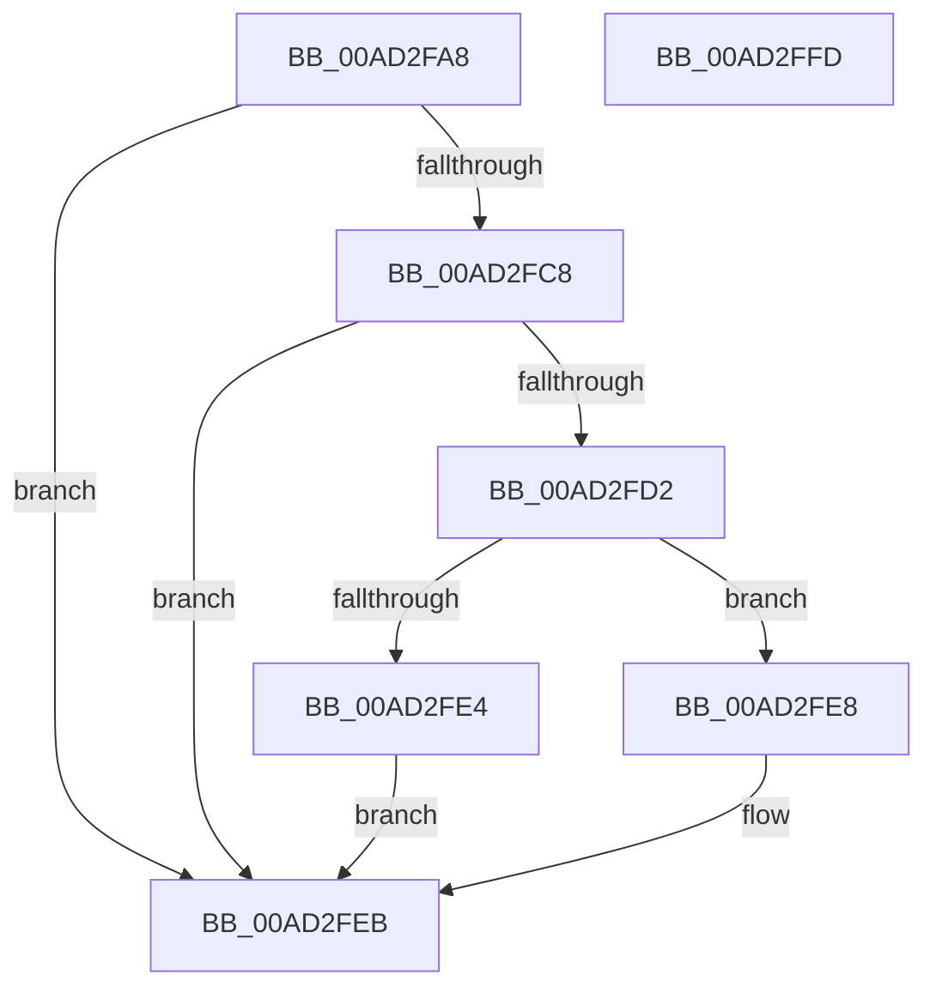

# PopIsSimulatedArchitecturalHeteroPresent

- RVA: `0x00AD2FA8`–`0x00AD2FFE` (길이 `86` bytes)
- VA: `0x0000000140AD2FA8`
- 실행 섹션: `PAGE`
- PDB 이름 있음: `예`; PDB Function 태그: `아니요`
- unwind 정보 RVA: `0x00060BC4`
- 디코드: `28`개 명령, `86/86` bytes 표시
- 미해석 바이트: `0` (있으면 어셈블리에 `.byte`로 보존)

> 이 문서는 커널 이미지의 기계어와 PDB 기호를 분석해 생성했습니다. 4번과 5번은 함수 원형과 자료형을 바이너리 사용 방식에서 추정한 C 해석이며 원본 소스 복구 결과는 아닙니다.

## 1. Dependencies

- 직접 호출 지점: **1**; 고유 호출 대상: **1**
- 직접 호출자로 확인된 함수: **1**
- RIP 상대 이미지 참조: **2**

### Outgoing calls
- `0x00AD2FDB` → [PopHeteroCapabilityDeepCopy](../A9/PopHeteroCapabilityDeepCopy_function_00A90B6C.md) (function, `0x00A90B6C`)

### Direct callers
- [PopInitializeHeteroProcessors](../A5/PopInitializeHeteroProcessors_function_00A53570.md) at `0x00A5367B`

### Static image references
- `0x00AD2FB7` → RVA `0x00FC6EC0` (`ALMOSTRO`; read)
- `0x00AD2FC8` → RVA `0x00FC6C84` (`ALMOSTRO`; read)

## 2. Other-region calls and transfers

- 다른 실행 섹션으로 향하는 call: **0**
- 별도 외부 분기/꼬리 이동을 확인하지 못했습니다.

## 3. Assembly (complete function range)

```asm
00AD2FA8  48 89 5C 24 08                  mov qword ptr [rsp + 8], rbx
00AD2FAD  48 89 74 24 10                  mov qword ptr [rsp + 0x10], rsi
00AD2FB2  57                              push rdi
00AD2FB3  48 83 EC 20                     sub rsp, 0x20
00AD2FB7  48 8B 15 02 3F 4F 00            mov rdx, qword ptr [rip + 0x4f3f02]
00AD2FBE  33 DB                           xor ebx, ebx
00AD2FC0  48 8B F9                        mov rdi, rcx
00AD2FC3  48 85 D2                        test rdx, rdx
00AD2FC6  74 23                           je 0x140ad2feb
00AD2FC8  8B 05 B6 3C 4F 00               mov eax, dword ptr [rip + 0x4f3cb6]
00AD2FCE  A8 01                           test al, 1
00AD2FD0  74 19                           je 0x140ad2feb
00AD2FD2  8B 71 04                        mov esi, dword ptr [rcx + 4]
00AD2FD5  8B 42 04                        mov eax, dword ptr [rdx + 4]
00AD2FD8  89 41 04                        mov dword ptr [rcx + 4], eax
00AD2FDB  E8 8C DB FB FF                  call 0x140a90b6c
00AD2FE0  85 C0                           test eax, eax
00AD2FE2  74 04                           je 0x140ad2fe8
00AD2FE4  B3 01                           mov bl, 1
00AD2FE6  EB 03                           jmp 0x140ad2feb
00AD2FE8  89 77 04                        mov dword ptr [rdi + 4], esi
00AD2FEB  48 8B 74 24 38                  mov rsi, qword ptr [rsp + 0x38]
00AD2FF0  8A C3                           mov al, bl
00AD2FF2  48 8B 5C 24 30                  mov rbx, qword ptr [rsp + 0x30]
00AD2FF7  48 83 C4 20                     add rsp, 0x20
00AD2FFB  5F                              pop rdi
00AD2FFC  C3                              ret
00AD2FFD  CC                              int3
```

## 4. C-style interpretation (structured pseudocode)

```c
__int64 __fastcall PopIsSimulatedArchitecturalHeteroPresent(__int64 a1)
{
    __int64 result;
    __int64 v_rbx;
    __int64 v_rsp;
    unsigned __int64 v_stack_p10;
    unsigned __int64 v_stack_p8;

    v_stack_p8 = v_rbx;
    v_stack_p10 = v_rsi;
    v_rsp = (v_rsp) - (32);
    v_rbx = 0;
    if (*(unsigned __int64 *)(v_rip + 5193474) == 0) goto loc_00AD2FEB;
    if ((((unsigned __int8)((unsigned int)(*(unsigned int *)(v_rip + 5192886)))) & (1)) == 0) goto loc_00AD2FEB;
    *(unsigned int *)(a1 + 4) = (unsigned int)((unsigned int)(*(unsigned int *)(*(unsigned __int64 *)(v_rip + 5193474) + 4)));
    result = PopHeteroCapabilityDeepCopy(a1, *(unsigned __int64 *)(v_rip + 5193474), a3, a4);
    if ((unsigned int)(result) == 0) goto loc_00AD2FE8;
    goto loc_00AD2FEB;
loc_00AD2FE8:
    *(unsigned int *)(a1 + 4) = (unsigned int)((unsigned int)(*(unsigned int *)(a1 + 4)));
loc_00AD2FEB:
    v_rsp = (v_rsp) + (32);
    return 1;
}
```

## 5. (Beta) C Style

```c
int64_t PopIsSimulatedArchitecturalHeteroPresent(void *Arg1)
{
    uint8_t *arg1 = (uint8_t *)Arg1;

    int64_t result;
    int64_t local_rbx;
    int64_t local_rsp;
    uint64_t v_stack_p10;
    uint64_t v_stack_p8;

    v_stack_p8 = local_rbx;
    v_stack_p10 = local_rsi;
    local_rsp = (local_rsp) - (32);
    local_rbx = 0;
    if (*(uint64_t *)(v_rip + 0x4F3F02) == 0) goto loc_00AD2FEB;
    if ((((uint8_t)((uint32_t)(*(uint32_t *)(v_rip + 0x4F3CB6)))) & (1)) == 0) goto loc_00AD2FEB;
    *(uint32_t *)(arg1 + 0x4) = (uint32_t)((uint32_t)(*(uint32_t *)(*(uint64_t *)(v_rip + 0x4F3F02) + 0x4)));
    result = PopHeteroCapabilityDeepCopy(Arg1, *(uint64_t *)(v_rip + 0x4F3F02), a3, a4);
    if ((uint32_t)(result) == 0) goto loc_00AD2FE8;
    goto loc_00AD2FEB;
loc_00AD2FE8:
    *(uint32_t *)(arg1 + 0x4) = (uint32_t)((uint32_t)(*(uint32_t *)(arg1 + 0x4)));
loc_00AD2FEB:
    local_rsp = (local_rsp) + (32);
    return 1;
}
```

### 관측된 메모리 오프셋

구조체 형식이 확인되지 않은 접근은 인자 기준의 오프셋으로만 기록했습니다.

| 기준 인자 | 오프셋 표현 | 폭 (bit) | 접근 |
|---|---:|---:|---|
| `Arg1` | `+ 0x4` | `32` | `R` |
| `Arg1` | `+ 0x4` | `32` | `W` |

## 6. Execution-region graph

[열기: 2D/3D 그래프와 함수 탐색 컨트롤 패널](../../../control-panel.html?section=page&rva=0x00AD2FA8&view=graph)

- 2D 그래프는 위에서 아래로 흐르고, 3D 그래프는 빈 공간을 드래그해 회전합니다. Shift+드래그는 이동, 휠은 확대·축소, 함수 노드 선택은 대상 보고서 이동입니다.

### Static fallback


