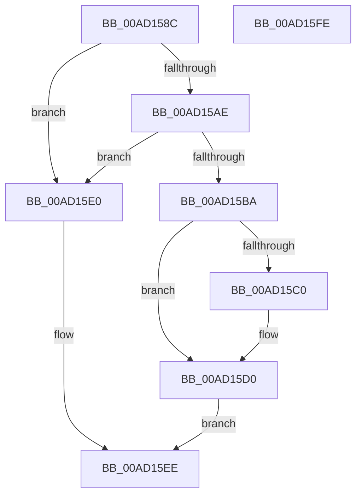

# PopIssueDirectedPowerTransition

- RVA: `0x00AD158C`–`0x00AD15FF` (길이 `115` bytes)
- VA: `0x0000000140AD158C`
- 실행 섹션: `PAGE`
- PDB 이름 있음: `예`; PDB Function 태그: `아니요`
- unwind 정보 RVA: `0x00060BC4`
- 디코드: `34`개 명령, `115/115` bytes 표시
- 미해석 바이트: `0` (있으면 어셈블리에 `.byte`로 보존)

> 이 문서는 커널 이미지의 기계어와 PDB 기호를 분석해 생성했습니다. 4번과 5번은 함수 원형과 자료형을 바이너리 사용 방식에서 추정한 C 해석이며 원본 소스 복구 결과는 아닙니다.

## 1. Dependencies

- 직접 호출 지점: **4**; 고유 호출 대상: **4**
- 직접 호출자로 확인된 함수: **2**
- RIP 상대 이미지 참조: **0**

### Outgoing calls
- `0x00AD15AE` → [PopDirectedDripsIsPnpSoftwareDeviceNode](../75/PopDirectedDripsIsPnpSoftwareDeviceNode_function_007578E4.md) (function, `0x007578E4`)
- `0x00AD15CB` → [PoFxActivateDevice](../../text/4A/PoFxActivateDevice_function_004A0DAC.md) (function, `0x004A0DAC`)
- `0x00AD15D9` → [PopFxIssueDirectedPowerTransition](../../text/5D/PopFxIssueDirectedPowerTransition_function_005D2E2C.md) (function, `0x005D2E2C`)
- `0x00AD15E9` → [PopCompleteDirectedPowerTransitionCallback](../../text/48/PopCompleteDirectedPowerTransitionCallback_function_00483AD0.md) (function, `0x00483AD0`)

### Direct callers
- [PopWakeDeviceList](../../text/43/PopWakeDeviceList_function_00430238.md) at `0x004303D8`
- [PopSleepDeviceList](../../text/43/PopSleepDeviceList_function_00430460.md) at `0x004306A3`

### Static image references
- 디코드된 RIP-relative 메모리 참조가 없습니다.

## 2. Other-region calls and transfers

- 다른 실행 섹션으로 향하는 call: **3**
  - `0x00AD15CB` → [PoFxActivateDevice](../../text/4A/PoFxActivateDevice_function_004A0DAC.md) (`PAGE` → `.text`)
  - `0x00AD15D9` → [PopFxIssueDirectedPowerTransition](../../text/5D/PopFxIssueDirectedPowerTransition_function_005D2E2C.md) (`PAGE` → `.text`)
  - `0x00AD15E9` → [PopCompleteDirectedPowerTransitionCallback](../../text/48/PopCompleteDirectedPowerTransitionCallback_function_00483AD0.md) (`PAGE` → `.text`)
- 별도 외부 분기/꼬리 이동을 확인하지 못했습니다.

## 3. Assembly (complete function range)

```asm
00AD158C  48 89 5C 24 08                  mov qword ptr [rsp + 8], rbx
00AD1591  48 89 74 24 10                  mov qword ptr [rsp + 0x10], rsi
00AD1596  57                              push rdi
00AD1597  48 83 EC 20                     sub rsp, 0x20
00AD159B  48 8B D9                        mov rbx, rcx
00AD159E  48 8D 8A 60 FF FF FF            lea rcx, [rdx - 0xa0]
00AD15A5  48 8B 79 50                     mov rdi, qword ptr [rcx + 0x50]
00AD15A9  80 3B 03                        cmp byte ptr [rbx], 3
00AD15AC  74 32                           je 0x140ad15e0
00AD15AE  E8 31 63 C8 FF                  call 0x1407578e4
00AD15B3  40 32 F6                        xor sil, sil
00AD15B6  84 C0                           test al, al
00AD15B8  75 26                           jne 0x140ad15e0
00AD15BA  83 7B 04 01                     cmp dword ptr [rbx + 4], 1
00AD15BE  74 10                           je 0x140ad15d0
00AD15C0  48 8B 4F 30                     mov rcx, qword ptr [rdi + 0x30]
00AD15C4  40 B6 01                        mov sil, 1
00AD15C7  48 8B 49 20                     mov rcx, qword ptr [rcx + 0x20]
00AD15CB  E8 DC F7 9C FF                  call 0x1404a0dac
00AD15D0  4C 8B C3                        mov r8, rbx
00AD15D3  40 8A D6                        mov dl, sil
00AD15D6  48 8B CF                        mov rcx, rdi
00AD15D9  E8 4E 18 B0 FF                  call 0x1405d2e2c
00AD15DE  EB 0E                           jmp 0x140ad15ee
00AD15E0  45 33 C0                        xor r8d, r8d
00AD15E3  48 8B D3                        mov rdx, rbx
00AD15E6  48 8B CF                        mov rcx, rdi
00AD15E9  E8 E2 24 9B FF                  call 0x140483ad0
00AD15EE  48 8B 5C 24 30                  mov rbx, qword ptr [rsp + 0x30]
00AD15F3  48 8B 74 24 38                  mov rsi, qword ptr [rsp + 0x38]
00AD15F8  48 83 C4 20                     add rsp, 0x20
00AD15FC  5F                              pop rdi
00AD15FD  C3                              ret
00AD15FE  CC                              int3
```

## 4. C-style interpretation (structured pseudocode)

```c
__int64 __fastcall PopIssueDirectedPowerTransition(__int64 a1, __int64 a2)
{
    __int64 result;
    __int64 v_rsi;
    __int64 v_rsp;
    unsigned __int64 v_stack_p10;
    unsigned __int64 v_stack_p8;

    v_stack_p8 = v_rbx;
    v_stack_p10 = v_rsi;
    v_rsp = (v_rsp) - (32);
    if ((*(unsigned __int8 *)(a1)) == 3) goto loc_00AD15E0;
    result = PopDirectedDripsIsPnpSoftwareDeviceNode(a2 - 160, a2, a3, a4);
    v_rsi = 0;
    if ((unsigned __int8)(result) != 0) goto loc_00AD15E0;
    if ((*(unsigned int *)(a1 + 4)) != 1) {
        a1 = *(unsigned __int64 *)(*(unsigned __int64 *)(a2 - 160 + 80) + 48);
        v_rsi = 1;
        a1 = *(unsigned __int64 *)(a1 + 32);
        result = PoFxActivateDevice(a1, a2, a3, a4);
    }
    result = PopFxIssueDirectedPowerTransition(*(unsigned __int64 *)(a2 - 160 + 80), (unsigned __int8)(v_rsi), a1, a4);
    goto loc_00AD15EE;
loc_00AD15E0:
    a3 = 0;
    result = PopCompleteDirectedPowerTransitionCallback(*(unsigned __int64 *)(a2 - 160 + 80), a1, a3, a4);
loc_00AD15EE:
    v_rsp = (v_rsp) + (32);
    return result;
}
```

## 5. (Beta) C Style

```c
int64_t PopIssueDirectedPowerTransition(void *Arg1, void *Arg2)
{
    uint8_t *arg1 = (uint8_t *)Arg1;
    uint8_t *arg2 = (uint8_t *)Arg2;

    int64_t result;
    int64_t local_rsi;
    int64_t local_rsp;
    uint64_t v_stack_p10;
    uint64_t v_stack_p8;

    v_stack_p8 = local_rbx;
    v_stack_p10 = local_rsi;
    local_rsp = (local_rsp) - (32);
    if ((*(uint8_t *)(arg1)) == 3) goto loc_00AD15E0;
    result = PopDirectedDripsIsPnpSoftwareDeviceNode(Arg2 - 160, Arg2, a3, a4);
    local_rsi = 0;
    if ((uint8_t)(result) != 0) goto loc_00AD15E0;
    if ((*(uint32_t *)(arg1 + 0x4)) != 1) {
        Arg1 = *(uint64_t *)(*(uint64_t *)(arg2 - 0xA0 + 0x50) + 0x30);
        local_rsi = 1;
        Arg1 = *(uint64_t *)(arg1 + 0x20);
        result = PoFxActivateDevice(Arg1, Arg2, a3, a4);
    }
    result = PopFxIssueDirectedPowerTransition(*(uint64_t *)(arg2 - 0xA0 + 0x50), (uint8_t)(local_rsi), Arg1, a4);
    goto loc_00AD15EE;
loc_00AD15E0:
    a3 = 0;
    result = PopCompleteDirectedPowerTransitionCallback(*(uint64_t *)(arg2 - 0xA0 + 0x50), Arg1, a3, a4);
loc_00AD15EE:
    local_rsp = (local_rsp) + (32);
    return result;
}
```

### 관측된 메모리 오프셋

구조체 형식이 확인되지 않은 접근은 인자 기준의 오프셋으로만 기록했습니다.

| 기준 인자 | 오프셋 표현 | 폭 (bit) | 접근 |
|---|---:|---:|---|
| `Arg1` | `+ 0x0` | `8` | `R` |
| `Arg1` | `+ 0x4` | `32` | `R` |
| `Arg2` | `- 0xA0` | `64` | `R` |
| `Arg2` | `+ 0x50` | `64` | `R` |

## 6. Execution-region graph

[열기: 2D/3D 그래프와 함수 탐색 컨트롤 패널](../../../control-panel.html?section=page&rva=0x00AD158C&view=graph)

- 2D 그래프는 위에서 아래로 흐르고, 3D 그래프는 빈 공간을 드래그해 회전합니다. Shift+드래그는 이동, 휠은 확대·축소, 함수 노드 선택은 대상 보고서 이동입니다.

### Static fallback


