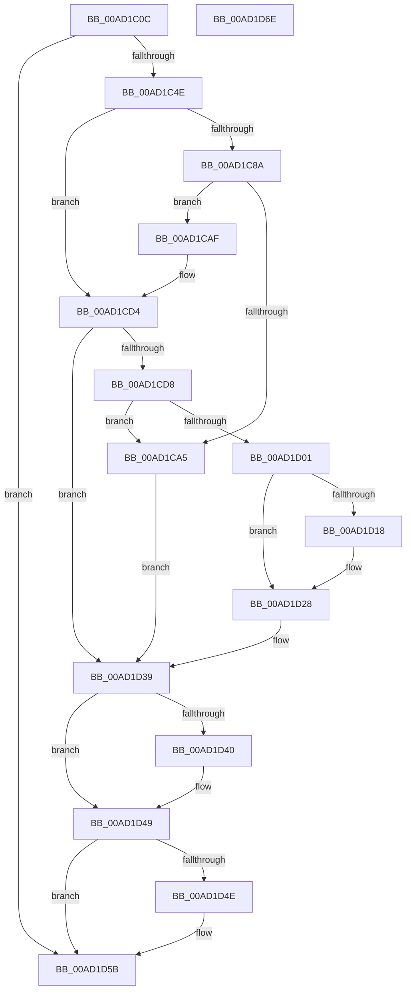

# PopLoadResumeContext

- RVA: `0x00AD1C0C`–`0x00AD1D6F` (길이 `355` bytes)
- VA: `0x0000000140AD1C0C`
- 실행 섹션: `PAGE`
- PDB 이름 있음: `예`; PDB Function 태그: `아니요`
- unwind 정보 RVA: `0x000BEA1C`
- 디코드: `100`개 명령, `355/355` bytes 표시
- 미해석 바이트: `0` (있으면 어셈블리에 `.byte`로 보존)

> 이 문서는 커널 이미지의 기계어와 PDB 기호를 분석해 생성했습니다. 4번과 5번은 함수 원형과 자료형을 바이너리 사용 방식에서 추정한 C 해석이며 원본 소스 복구 결과는 아닙니다.

## 1. Dependencies

- 직접 호출 지점: **10**; 고유 호출 대상: **8**
- 직접 호출자로 확인된 함수: **1**
- RIP 상대 이미지 참조: **2**

### Outgoing calls
- `0x00AD1C3F` → [PopOpenKey](../../text/4B/PopOpenKey_function_004B4330.md) (function, `0x004B4330`)
- `0x00AD1C59` → [RtlInitUnicodeString](../../text/42/RtlInitUnicodeString_function_0042A780.md) (function, `0x0042A780`)
- `0x00AD1C7C` → [ZwQueryValueKey](../../text/6A/ZwQueryValueKey_function_006AD3B0.md) (function, `0x006AD3B0`)
- `0x00AD1C98` → [ExAllocatePool2](../../poolcode/B8/ExAllocatePool2_function_00B820F0.md) (function, `0x00B820F0`)
- `0x00AD1CCD` → [ZwQueryValueKey](../../text/6A/ZwQueryValueKey_function_006AD3B0.md) (function, `0x006AD3B0`)
- `0x00AD1CF4` → [ExAllocatePool2](../../poolcode/B8/ExAllocatePool2_function_00B820F0.md) (function, `0x00B820F0`)
- `0x00AD1D0C` → [memcpy](../../text/6C/memcpy_function_006C6840.md) (function, `0x006C6840`)
- `0x00AD1D23` → [memset](../../text/6C/memset_function_006C6C40.md) (function, `0x006C6C40`)
- `0x00AD1D44` → [ZwClose](../../text/6A/ZwClose_function_006AD2B0.md) (function, `0x006AD2B0`)
- `0x00AD1D56` → [ExFreePoolWithTag](../../poolcode/B8/ExFreePoolWithTag_function_00B82870.md) (function, `0x00B82870`)

### Direct callers
- [PopAllocateHiberContext](PopAllocateHiberContext_function_00ADC05C.md) at `0x00ADC2B9`

### Static image references
- `0x00AD1C23` → RVA `0x00B01AB0` (` ?? ::NNGAKEGL::`string'`; read)
- `0x00AD1C4E` → RVA `0x00B01A90` (` ?? ::NNGAKEGL::`string'`; read)

## 2. Other-region calls and transfers

- 다른 실행 섹션으로 향하는 call: **10**
  - `0x00AD1C3F` → [PopOpenKey](../../text/4B/PopOpenKey_function_004B4330.md) (`PAGE` → `.text`)
  - `0x00AD1C59` → [RtlInitUnicodeString](../../text/42/RtlInitUnicodeString_function_0042A780.md) (`PAGE` → `.text`)
  - `0x00AD1C7C` → [ZwQueryValueKey](../../text/6A/ZwQueryValueKey_function_006AD3B0.md) (`PAGE` → `.text`)
  - `0x00AD1C98` → [ExAllocatePool2](../../poolcode/B8/ExAllocatePool2_function_00B820F0.md) (`PAGE` → `POOLCODE`)
  - `0x00AD1CCD` → [ZwQueryValueKey](../../text/6A/ZwQueryValueKey_function_006AD3B0.md) (`PAGE` → `.text`)
  - `0x00AD1CF4` → [ExAllocatePool2](../../poolcode/B8/ExAllocatePool2_function_00B820F0.md) (`PAGE` → `POOLCODE`)
  - `0x00AD1D0C` → [memcpy](../../text/6C/memcpy_function_006C6840.md) (`PAGE` → `.text`)
  - `0x00AD1D23` → [memset](../../text/6C/memset_function_006C6C40.md) (`PAGE` → `.text`)
  - `0x00AD1D44` → [ZwClose](../../text/6A/ZwClose_function_006AD2B0.md) (`PAGE` → `.text`)
  - `0x00AD1D56` → [ExFreePoolWithTag](../../poolcode/B8/ExFreePoolWithTag_function_00B82870.md) (`PAGE` → `POOLCODE`)
- 별도 외부 분기/꼬리 이동을 확인하지 못했습니다.

## 3. Assembly (complete function range)

```asm
00AD1C0C  48 89 5C 24 08                  mov qword ptr [rsp + 8], rbx
00AD1C11  55                              push rbp
00AD1C12  56                              push rsi
00AD1C13  57                              push rdi
00AD1C14  41 55                           push r13
00AD1C16  41 57                           push r15
00AD1C18  48 8B EC                        mov rbp, rsp
00AD1C1B  48 83 EC 40                     sub rsp, 0x40
00AD1C1F  83 65 38 00                     and dword ptr [rbp + 0x38], 0
00AD1C23  48 8D 15 86 FE 02 00            lea rdx, [rip + 0x2fe86]
00AD1C2A  48 83 65 40 00                  and qword ptr [rbp + 0x40], 0
00AD1C2F  4C 8B E9                        mov r13, rcx
00AD1C32  0F 57 C0                        xorps xmm0, xmm0
00AD1C35  48 8D 4D 40                     lea rcx, [rbp + 0x40]
00AD1C39  0F 11 45 F0                     movups xmmword ptr [rbp - 0x10], xmm0
00AD1C3D  33 FF                           xor edi, edi
00AD1C3F  E8 EC 26 9E FF                  call 0x1404b4330
00AD1C44  8B D8                           mov ebx, eax
00AD1C46  85 C0                           test eax, eax
00AD1C48  0F 88 0D 01 00 00               js 0x140ad1d5b
00AD1C4E  48 8D 15 3B FE 02 00            lea rdx, [rip + 0x2fe3b]
00AD1C55  48 8D 4D F0                     lea rcx, [rbp - 0x10]
00AD1C59  E8 22 8B 95 FF                  call 0x14042a780
00AD1C5E  48 8B 4D 40                     mov rcx, qword ptr [rbp + 0x40]
00AD1C62  48 8D 45 38                     lea rax, [rbp + 0x38]
00AD1C66  48 89 44 24 28                  mov qword ptr [rsp + 0x28], rax
00AD1C6B  8D 77 02                        lea esi, [rdi + 2]
00AD1C6E  21 7C 24 20                     and dword ptr [rsp + 0x20], edi
00AD1C72  48 8D 55 F0                     lea rdx, [rbp - 0x10]
00AD1C76  45 33 C9                        xor r9d, r9d
00AD1C79  44 8B C6                        mov r8d, esi
00AD1C7C  E8 2F B7 BD FF                  call 0x1406ad3b0
00AD1C81  8B D8                           mov ebx, eax
00AD1C83  3D 23 00 00 C0                  cmp eax, 0xc0000023
00AD1C88  75 4A                           jne 0x140ad1cd4
00AD1C8A  8B 55 38                        mov edx, dword ptr [rbp + 0x38]
00AD1C8D  B9 00 01 00 00                  mov ecx, 0x100
00AD1C92  41 B8 52 43 74 78               mov r8d, 0x78744352
00AD1C98  E8 53 04 0B 00                  call 0x140b820f0
00AD1C9D  48 8B F8                        mov rdi, rax
00AD1CA0  48 85 C0                        test rax, rax
00AD1CA3  75 0A                           jne 0x140ad1caf
00AD1CA5  BB 17 00 00 C0                  mov ebx, 0xc0000017
00AD1CAA  E9 8A 00 00 00                  jmp 0x140ad1d39
00AD1CAF  48 8B 4D 40                     mov rcx, qword ptr [rbp + 0x40]
00AD1CB3  48 8D 45 38                     lea rax, [rbp + 0x38]
00AD1CB7  48 89 44 24 28                  mov qword ptr [rsp + 0x28], rax
00AD1CBC  48 8D 55 F0                     lea rdx, [rbp - 0x10]
00AD1CC0  8B 45 38                        mov eax, dword ptr [rbp + 0x38]
00AD1CC3  4C 8B CF                        mov r9, rdi
00AD1CC6  44 8B C6                        mov r8d, esi
00AD1CC9  89 44 24 20                     mov dword ptr [rsp + 0x20], eax
00AD1CCD  E8 DE B6 BD FF                  call 0x1406ad3b0
00AD1CD2  8B D8                           mov ebx, eax
00AD1CD4  85 DB                           test ebx, ebx
00AD1CD6  78 61                           js 0x140ad1d39
00AD1CD8  8B 77 08                        mov esi, dword ptr [rdi + 8]
00AD1CDB  B9 40 00 00 00                  mov ecx, 0x40
00AD1CE0  81 C6 FF 0F 00 00               add esi, 0xfff
00AD1CE6  41 B8 52 43 74 78               mov r8d, 0x78744352
00AD1CEC  81 E6 00 F0 FF FF               and esi, 0xfffff000
00AD1CF2  8B D6                           mov edx, esi
00AD1CF4  E8 F7 03 0B 00                  call 0x140b820f0
00AD1CF9  4C 8B F8                        mov r15, rax
00AD1CFC  48 85 C0                        test rax, rax
00AD1CFF  74 A4                           je 0x140ad1ca5
00AD1D01  44 8B 47 08                     mov r8d, dword ptr [rdi + 8]
00AD1D05  48 8D 57 0C                     lea rdx, [rdi + 0xc]
00AD1D09  48 8B C8                        mov rcx, rax
00AD1D0C  E8 2F 4B BF FF                  call 0x1406c6840
00AD1D11  8B 4F 08                        mov ecx, dword ptr [rdi + 8]
00AD1D14  3B F1                           cmp esi, ecx
00AD1D16  76 10                           jbe 0x140ad1d28
00AD1D18  44 8B C6                        mov r8d, esi
00AD1D1B  33 D2                           xor edx, edx
00AD1D1D  44 2B C1                        sub r8d, ecx
00AD1D20  49 03 CF                        add rcx, r15
00AD1D23  E8 18 4F BF FF                  call 0x1406c6c40
00AD1D28  C1 EE 0C                        shr esi, 0xc
00AD1D2B  41 89 B5 18 01 00 00            mov dword ptr [r13 + 0x118], esi
00AD1D32  4D 89 BD 10 01 00 00            mov qword ptr [r13 + 0x110], r15
00AD1D39  48 83 7D 40 00                  cmp qword ptr [rbp + 0x40], 0
00AD1D3E  74 09                           je 0x140ad1d49
00AD1D40  48 8B 4D 40                     mov rcx, qword ptr [rbp + 0x40]
00AD1D44  E8 67 B5 BD FF                  call 0x1406ad2b0
00AD1D49  48 85 FF                        test rdi, rdi
00AD1D4C  74 0D                           je 0x140ad1d5b
00AD1D4E  BA 52 43 74 78                  mov edx, 0x78744352
00AD1D53  48 8B CF                        mov rcx, rdi
00AD1D56  E8 15 0B 0B 00                  call 0x140b82870
00AD1D5B  8B C3                           mov eax, ebx
00AD1D5D  48 8B 5C 24 70                  mov rbx, qword ptr [rsp + 0x70]
00AD1D62  48 83 C4 40                     add rsp, 0x40
00AD1D66  41 5F                           pop r15
00AD1D68  41 5D                           pop r13
00AD1D6A  5F                              pop rdi
00AD1D6B  5E                              pop rsi
00AD1D6C  5D                              pop rbp
00AD1D6D  C3                              ret
00AD1D6E  CC                              int3
```

## 4. C-style interpretation (structured pseudocode)

```c
__int64 __fastcall PopLoadResumeContext(__int64 a1, __int64 a2, __int64 a3, int a4)
{
    __int64 result;
    __int64 v_rdi;
    __int64 v_rsi;
    __int64 v_rsp;
    unsigned __int64 v_stack_m38;
    unsigned __int64 v_stack_m40;
    unsigned int v_stack_m48;
    unsigned int v_stack_p10;
    unsigned __int64 v_stack_p18;
    unsigned __int64 v_stack_p8;

    v_stack_p8 = v_rbx;
    v_rsp = (v_rsp) - (64);
    v_stack_m38 = v_xmm0;
    v_rdi = 0;
    result = PopOpenKey(v_stack_p18, v_rip + 196230, a3, a4);
    if (sign_flag) goto loc_00AD1D5B;
    result = RtlInitUnicodeString(v_stack_m38, v_rip + 196155, a3, a4);
    v_stack_m40 = v_stack_p10;
    a4 = 0;
    result = ZwQueryValueKey(v_stack_p18, v_stack_m38, (unsigned int)((unsigned int)(v_rdi + 2)), a4);
    if (((unsigned int)(result)) != 0xC0000023ULL) goto loc_00AD1CD4;
    result = ExAllocatePool2(256, (unsigned int)(v_stack_p10), (unsigned int)(0x78744352ULL), a4);
    if (result != 0) goto loc_00AD1CAF;
loc_00AD1CA5:
    goto loc_00AD1D39;
loc_00AD1CAF:
    v_stack_m40 = v_stack_p10;
    v_stack_m48 = (unsigned int)((unsigned int)(v_stack_p10));
    result = ZwQueryValueKey(v_stack_p18, v_stack_m38, (unsigned int)((unsigned int)(v_rdi + 2)), result);
loc_00AD1CD4:
    if (sign_flag) goto loc_00AD1D39;
    v_rsi = (unsigned int)(((unsigned int)(*(unsigned int *)(result + 8))) + (0xFFFULL));
    v_rsi = (unsigned int)((v_rsi) & (0xFFFFF000ULL));
    result = ExAllocatePool2(64, (unsigned int)((unsigned int)(v_rsi)), (unsigned int)(0x78744352ULL), result);
    if (result == 0) goto loc_00AD1CA5;
    result = memcpy(result, result + 12, (unsigned int)(*(unsigned int *)(result + 8)), result);
    if (((unsigned int)(v_rsi)) >= = ((unsigned int)((unsigned int)(*(unsigned int *)(result + 8))))) {
        a3 = (unsigned int)(v_rsi);
        a2 = 0;
        a3 = (unsigned int)((a3) - ((unsigned int)((unsigned int)(*(unsigned int *)(result + 8)))));
        a1 = ((unsigned int)(*(unsigned int *)(result + 8))) + (result);
        result = memset(a1, a2, a3, result);
    }
    v_rsi = (unsigned int)((v_rsi) >> (12));
    *(unsigned int *)(a1 + 280) = (unsigned int)(v_rsi);
    *(unsigned __int64 *)(a1 + 272) = result;
loc_00AD1D39:
    if (v_stack_p18 != 0) {
        a1 = v_stack_p18;
        result = ZwClose(a1, a2, a3, result);
    }
    if (result != 0) {
        a2 = 0x78744352ULL;
        a1 = result;
        result = ExFreePoolWithTag(a1, a2, a3, result);
    }
    v_rsp = (v_rsp) + (64);
    return (unsigned int)((unsigned int)((unsigned int)((unsigned int)(result))));
}
```

## 5. (Beta) C Style

```c
int64_t PopLoadResumeContext(void *Arg1, int64_t Arg2, int64_t Arg3, int32_t Arg4)
{
    uint8_t *arg1 = (uint8_t *)Arg1;

    int64_t result;
    int64_t local_rdi;
    int64_t local_rsi;
    int64_t local_rsp;
    uint64_t v_stack_m38;
    uint64_t v_stack_m40;
    uint32_t v_stack_m48;
    uint32_t v_stack_p10;
    uint64_t v_stack_p18;
    uint64_t v_stack_p8;

    v_stack_p8 = local_rbx;
    local_rsp = (local_rsp) - (64);
    v_stack_m38 = v_xmm0;
    local_rdi = 0;
    result = PopOpenKey(v_stack_p18, v_rip + 196230, Arg3, Arg4);
    if (sign_flag) goto loc_00AD1D5B;
    result = RtlInitUnicodeString(v_stack_m38, v_rip + 196155, Arg3, Arg4);
    v_stack_m40 = v_stack_p10;
    Arg4 = 0;
    result = ZwQueryValueKey(v_stack_p18, v_stack_m38, (uint32_t)((uint32_t)(local_rdi + 2)), Arg4);
    if (((uint32_t)(result)) != 0xC0000023ULL) goto loc_00AD1CD4;
    result = ExAllocatePool2(256, (uint32_t)(v_stack_p10), (uint32_t)(0x78744352ULL), Arg4);
    if (result != 0) goto loc_00AD1CAF;
loc_00AD1CA5:
    goto loc_00AD1D39;
loc_00AD1CAF:
    v_stack_m40 = v_stack_p10;
    v_stack_m48 = (uint32_t)((uint32_t)(v_stack_p10));
    result = ZwQueryValueKey(v_stack_p18, v_stack_m38, (uint32_t)((uint32_t)(local_rdi + 2)), result);
loc_00AD1CD4:
    if (sign_flag) goto loc_00AD1D39;
    local_rsi = (uint32_t)(((uint32_t)(*(uint32_t *)(result + 0x8))) + (0xFFFULL));
    local_rsi = (uint32_t)((local_rsi) & (0xFFFFF000ULL));
    result = ExAllocatePool2(64, (uint32_t)((uint32_t)(local_rsi)), (uint32_t)(0x78744352ULL), result);
    if (result == 0) goto loc_00AD1CA5;
    result = memcpy(result, result + 12, (uint32_t)(*(uint32_t *)(result + 0x8)), result);
    if (((uint32_t)(local_rsi)) >= = ((uint32_t)((uint32_t)(*(uint32_t *)(result + 0x8))))) {
        Arg3 = (uint32_t)(local_rsi);
        Arg2 = 0;
        Arg3 = (uint32_t)((Arg3) - ((uint32_t)((uint32_t)(*(uint32_t *)(result + 0x8)))));
        Arg1 = ((uint32_t)(*(uint32_t *)(result + 0x8))) + (result);
        result = memset(Arg1, Arg2, Arg3, result);
    }
    local_rsi = (uint32_t)((local_rsi) >> (12));
    *(uint32_t *)(arg1 + 0x118) = (uint32_t)(local_rsi);
    *(uint64_t *)(arg1 + 0x110) = result;
loc_00AD1D39:
    if (v_stack_p18 != 0) {
        Arg1 = v_stack_p18;
        result = ZwClose(Arg1, Arg2, Arg3, result);
    }
    if (result != 0) {
        Arg2 = 0x78744352ULL;
        Arg1 = result;
        result = ExFreePoolWithTag(Arg1, Arg2, Arg3, result);
    }
    local_rsp = (local_rsp) + (64);
    return (uint32_t)((uint32_t)((uint32_t)((uint32_t)(result))));
}
```

### 관측된 메모리 오프셋

구조체 형식이 확인되지 않은 접근은 인자 기준의 오프셋으로만 기록했습니다.

| 기준 인자 | 오프셋 표현 | 폭 (bit) | 접근 |
|---|---:|---:|---|
| `Arg1` | `+ 0x110` | `64` | `W` |
| `Arg1` | `+ 0x118` | `32` | `W` |

## 6. Execution-region graph

[열기: 2D/3D 그래프와 함수 탐색 컨트롤 패널](../../../control-panel.html?section=page&rva=0x00AD1C0C&view=graph)

- 2D 그래프는 위에서 아래로 흐르고, 3D 그래프는 빈 공간을 드래그해 회전합니다. Shift+드래그는 이동, 휠은 확대·축소, 함수 노드 선택은 대상 보고서 이동입니다.

### Static fallback


