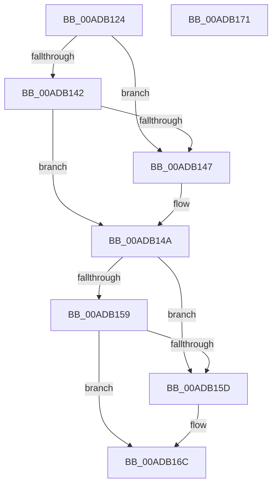

# PopNetClearConnectivityConstraint

- RVA: `0x00ADB124`–`0x00ADB172` (길이 `78` bytes)
- VA: `0x0000000140ADB124`
- 실행 섹션: `PAGE`
- PDB 이름 있음: `예`; PDB Function 태그: `아니요`
- unwind 정보 RVA: `0x0005C788`
- 디코드: `24`개 명령, `78/78` bytes 표시
- 미해석 바이트: `0` (있으면 어셈블리에 `.byte`로 보존)

> 이 문서는 커널 이미지의 기계어와 PDB 기호를 분석해 생성했습니다. 4번과 5번은 함수 원형과 자료형을 바이너리 사용 방식에서 추정한 C 해석이며 원본 소스 복구 결과는 아닙니다.

## 1. Dependencies

- 직접 호출 지점: **1**; 고유 호출 대상: **1**
- 직접 호출자로 확인된 함수: **2**
- RIP 상대 이미지 참조: **3**

### Outgoing calls
- `0x00ADB167` → [PopQueueWorkItem](../../text/4A/PopQueueWorkItem_function_004A20F8.md) (function, `0x004A20F8`)

### Direct callers
- [PopNetCompliantNicUpdate](../76/PopNetCompliantNicUpdate_function_00768A40.md) at `0x00768A79`
- [PopNetNonCompliantDeviceUpdate](../76/PopNetNonCompliantDeviceUpdate_function_00768CB0.md) at `0x00768CDE`

### Static image references
- `0x00ADB137` → RVA `0x00F08878` (`.data`; read/write)
- `0x00ADB14C` → RVA `0x00E678E8` (`.data`; read/write)
- `0x00ADB160` → RVA `0x00F08848` (`.data`; read)

## 2. Other-region calls and transfers

- 다른 실행 섹션으로 향하는 call: **1**
  - `0x00ADB167` → [PopQueueWorkItem](../../text/4A/PopQueueWorkItem_function_004A20F8.md) (`PAGE` → `.text`)
- 별도 외부 분기/꼬리 이동을 확인하지 못했습니다.

## 3. Assembly (complete function range)

```asm
00ADB124  48 83 EC 28                     sub rsp, 0x28
00ADB128  41 B8 01 00 00 00               mov r8d, 1
00ADB12E  32 D2                           xor dl, dl
00ADB130  41 8B C0                        mov eax, r8d
00ADB133  D3 E0                           shl eax, cl
00ADB135  F7 D0                           not eax
00ADB137  21 05 3B D7 42 00               and dword ptr [rip + 0x42d73b], eax
00ADB13D  83 F9 03                        cmp ecx, 3
00ADB140  74 05                           je 0x140adb147
00ADB142  83 F9 06                        cmp ecx, 6
00ADB145  75 03                           jne 0x140adb14a
00ADB147  41 8A D0                        mov dl, r8b
00ADB14A  33 C0                           xor eax, eax
00ADB14C  F0 0F C1 05 94 C7 38 00         lock xadd dword ptr [rip + 0x38c794], eax
00ADB154  83 F8 02                        cmp eax, 2
00ADB157  74 04                           je 0x140adb15d
00ADB159  84 D2                           test dl, dl
00ADB15B  74 0F                           je 0x140adb16c
00ADB15D  41 8B D0                        mov edx, r8d
00ADB160  48 8D 0D E1 D6 42 00            lea rcx, [rip + 0x42d6e1]
00ADB167  E8 8C 6F 9C FF                  call 0x1404a20f8
00ADB16C  48 83 C4 28                     add rsp, 0x28
00ADB170  C3                              ret
00ADB171  CC                              int3
```

## 4. C-style interpretation (structured pseudocode)

```c
__int64 __fastcall PopNetClearConnectivityConstraint(int a1, unsigned __int8 a2)
{
    __int64 result;
    __int64 v_rsp;

    v_rsp = (v_rsp) - (40);
    a2 = 0;
    result = (unsigned int)((1) << ((unsigned __int8)(a1)));
    result = (unsigned int)(~(result));
    if (a1 == 3) goto loc_00ADB147;
    if (a1 == 6) {
        a2 = 1;
    }
    result = 0;
    if (0 == 2) goto loc_00ADB15D;
    if (a2 != 0) {
        a2 = 1;
        a1 = v_rip + 4380385;
        result = PopQueueWorkItem(a1, a2, 1, a4);
    }
    v_rsp = (v_rsp) + (40);
    return result;
}
```

## 5. (Beta) C Style

```c
int64_t PopNetClearConnectivityConstraint(int32_t Arg1, uint8_t Arg2)
{
    int64_t result;
    int64_t local_rsp;

    local_rsp = (local_rsp) - (40);
    Arg2 = 0;
    result = (uint32_t)((1) << ((uint8_t)(Arg1)));
    result = (uint32_t)(~(result));
    if (Arg1 == 3) goto loc_00ADB147;
    if (Arg1 == 6) {
        Arg2 = 1;
    }
    result = 0;
    if (0 == 2) goto loc_00ADB15D;
    if (Arg2 != 0) {
        Arg2 = 1;
        Arg1 = v_rip + 4380385;
        result = PopQueueWorkItem(Arg1, Arg2, 1, a4);
    }
    local_rsp = (local_rsp) + (40);
    return result;
}
```

## 6. Execution-region graph

[열기: 2D/3D 그래프와 함수 탐색 컨트롤 패널](../../../control-panel.html?section=page&rva=0x00ADB124&view=graph)

- 2D 그래프는 위에서 아래로 흐르고, 3D 그래프는 빈 공간을 드래그해 회전합니다. Shift+드래그는 이동, 휠은 확대·축소, 함수 노드 선택은 대상 보고서 이동입니다.

### Static fallback


