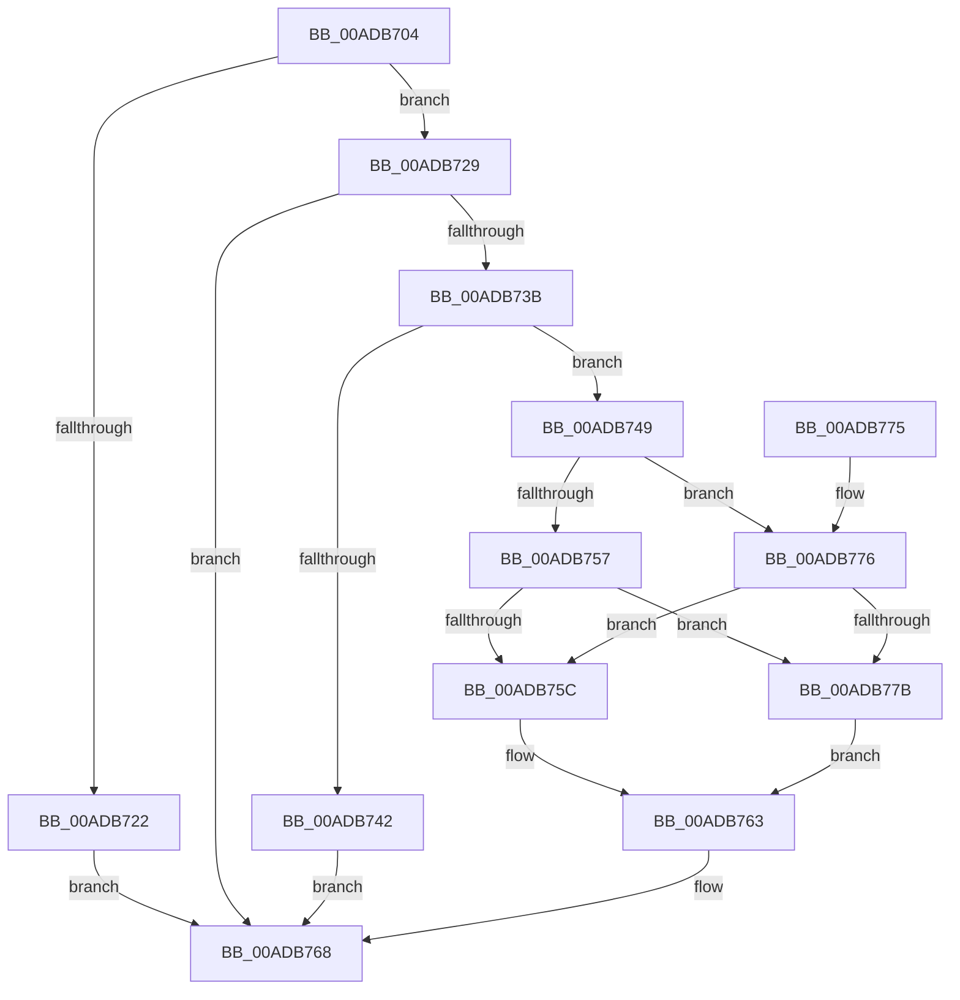

# PopNetUpdateStandbyRequest

- RVA: `0x00ADB704`–`0x00ADB782` (길이 `126` bytes)
- VA: `0x0000000140ADB704`
- 실행 섹션: `PAGE`
- PDB 이름 있음: `예`; PDB Function 태그: `아니요`
- unwind 정보 RVA: `0x00068790`
- 디코드: `37`개 명령, `126/126` bytes 표시
- 미해석 바이트: `0` (있으면 어셈블리에 `.byte`로 보존)

> 이 문서는 커널 이미지의 기계어와 PDB 기호를 분석해 생성했습니다. 4번과 5번은 함수 원형과 자료형을 바이너리 사용 방식에서 추정한 C 해석이며 원본 소스 복구 결과는 아닙니다.

## 1. Dependencies

- 직접 호출 지점: **3**; 고유 호출 대상: **3**
- 직접 호출자로 확인된 함수: **1**
- RIP 상대 이미지 참조: **3**

### Outgoing calls
- `0x00ADB730` → [RtlCheckTokenMembership](../../text/3A/RtlCheckTokenMembership_function_003A5A10.md) (function, `0x003A5A10`)
- `0x00ADB749` → [PopAcquirePolicyLock](../../pagelk/B7/PopAcquirePolicyLock_function_00B783C0.md) (function, `0x00B783C0`)
- `0x00ADB763` → [PopReleasePolicyLock](../../pagelk/B7/PopReleasePolicyLock_function_00B78410.md) (function, `0x00B78410`)

### Direct callers
- [PopPowerInformationInternal](../A8/PopPowerInformationInternal_function_00A8B7C0.md) at `0x00A8BE0D`

### Static image references
- `0x00ADB70E` → RVA `0x00F08880` (`.data`; read)
- `0x00ADB74E` → RVA `0x00F08888` (`.data`; read)
- `0x00ADB75C` → RVA `0x00F08888` (`.data`; write)

## 2. Other-region calls and transfers

- 다른 실행 섹션으로 향하는 call: **3**
  - `0x00ADB730` → [RtlCheckTokenMembership](../../text/3A/RtlCheckTokenMembership_function_003A5A10.md) (`PAGE` → `.text`)
  - `0x00ADB749` → [PopAcquirePolicyLock](../../pagelk/B7/PopAcquirePolicyLock_function_00B783C0.md) (`PAGE` → `PAGELK`)
  - `0x00ADB763` → [PopReleasePolicyLock](../../pagelk/B7/PopReleasePolicyLock_function_00B78410.md) (`PAGE` → `PAGELK`)
- 별도 외부 분기/꼬리 이동을 확인하지 못했습니다.

## 3. Assembly (complete function range)

```asm
00ADB704  48 89 5C 24 08                  mov qword ptr [rsp + 8], rbx
00ADB709  57                              push rdi
00ADB70A  48 83 EC 20                     sub rsp, 0x20
00ADB70E  48 8B 15 6B D1 42 00            mov rdx, qword ptr [rip + 0x42d16b]
00ADB715  40 8A F9                        mov dil, cl
00ADB718  C6 44 24 38 00                  mov byte ptr [rsp + 0x38], 0
00ADB71D  48 85 D2                        test rdx, rdx
00ADB720  75 07                           jne 0x140adb729
00ADB722  BB 01 00 00 C0                  mov ebx, 0xc0000001
00ADB727  EB 3F                           jmp 0x140adb768
00ADB729  4C 8D 44 24 38                  lea r8, [rsp + 0x38]
00ADB72E  33 C9                           xor ecx, ecx
00ADB730  E8 DB A2 8C FF                  call 0x1403a5a10
00ADB735  8B D8                           mov ebx, eax
00ADB737  85 C0                           test eax, eax
00ADB739  78 2D                           js 0x140adb768
00ADB73B  80 7C 24 38 00                  cmp byte ptr [rsp + 0x38], 0
00ADB740  75 07                           jne 0x140adb749
00ADB742  BB 22 00 00 C0                  mov ebx, 0xc0000022
00ADB747  EB 1F                           jmp 0x140adb768
00ADB749  E8 72 CC 09 00                  call 0x140b783c0
00ADB74E  80 3D 33 D1 42 00 00            cmp byte ptr [rip + 0x42d133], 0
00ADB755  75 1F                           jne 0x140adb776
00ADB757  40 84 FF                        test dil, dil
00ADB75A  74 1F                           je 0x140adb77b
00ADB75C  40 88 3D 25 D1 42 00            mov byte ptr [rip + 0x42d125], dil
00ADB763  E8 A8 CC 09 00                  call 0x140b78410
00ADB768  8B C3                           mov eax, ebx
00ADB76A  48 8B 5C 24 30                  mov rbx, qword ptr [rsp + 0x30]
00ADB76F  48 83 C4 20                     add rsp, 0x20
00ADB773  5F                              pop rdi
00ADB774  C3                              ret
00ADB775  CC                              int3
00ADB776  40 84 FF                        test dil, dil
00ADB779  74 E1                           je 0x140adb75c
00ADB77B  BB 0D 00 00 C0                  mov ebx, 0xc000000d
00ADB780  EB E1                           jmp 0x140adb763
```

## 4. C-style interpretation (structured pseudocode)

```c
__int64 __fastcall PopNetUpdateStandbyRequest(int a1)
{
    __int64 result;
    __int64 v_rsp;
    unsigned __int8 v_stack_p10;
    unsigned __int64 v_stack_p8;

    v_stack_p8 = v_rbx;
    v_rsp = (v_rsp) - (32);
    v_stack_p10 = 0;
    if (*(unsigned __int64 *)(v_rip + 4378987) != 0) goto loc_00ADB729;
    goto loc_00ADB768;
loc_00ADB729:
    a1 = 0;
    result = RtlCheckTokenMembership(a1, *(unsigned __int64 *)(v_rip + 4378987), v_stack_p10, a4);
    if (sign_flag) goto loc_00ADB768;
    if (v_stack_p10 != 0) goto loc_00ADB749;
    goto loc_00ADB768;
loc_00ADB749:
    result = PopAcquirePolicyLock(a1, *(unsigned __int64 *)(v_rip + 4378987), v_stack_p10, a4);
    if ((*(unsigned __int8 *)(v_rip + 4378931)) != 0) goto loc_00ADB776;
    if ((unsigned __int8)((unsigned __int8)(a1)) == 0) goto loc_00ADB77B;
loc_00ADB75C:
    *(unsigned __int8 *)(v_rip + 4378917) = (unsigned __int8)((unsigned __int8)(a1));
loc_00ADB763:
    result = PopReleasePolicyLock(a1, *(unsigned __int64 *)(v_rip + 4378987), v_stack_p10, a4);
loc_00ADB768:
    v_rsp = (v_rsp) + (32);
    return (unsigned int)((unsigned int)((unsigned int)(0xC0000022ULL)));
loc_00ADB776:
    if ((unsigned __int8)((unsigned __int8)(a1)) == 0) goto loc_00ADB75C;
loc_00ADB77B:
    goto loc_00ADB763;
}
```

## 5. (Beta) C Style

```c
int64_t PopNetUpdateStandbyRequest(int32_t Arg1)
{
    int64_t result;
    int64_t local_rsp;
    uint8_t v_stack_p10;
    uint64_t v_stack_p8;

    v_stack_p8 = local_rbx;
    local_rsp = (local_rsp) - (32);
    v_stack_p10 = 0;
    if (*(uint64_t *)(v_rip + 0x42D16B) != 0) goto loc_00ADB729;
    goto loc_00ADB768;
loc_00ADB729:
    Arg1 = 0;
    result = RtlCheckTokenMembership(Arg1, *(uint64_t *)(v_rip + 0x42D16B), v_stack_p10, a4);
    if (sign_flag) goto loc_00ADB768;
    if (v_stack_p10 != 0) goto loc_00ADB749;
    goto loc_00ADB768;
loc_00ADB749:
    result = PopAcquirePolicyLock(Arg1, *(uint64_t *)(v_rip + 0x42D16B), v_stack_p10, a4);
    if ((*(uint8_t *)(v_rip + 0x42D133)) != 0) goto loc_00ADB776;
    if ((uint8_t)((uint8_t)(Arg1)) == 0) goto loc_00ADB77B;
loc_00ADB75C:
    *(uint8_t *)(v_rip + 0x42D125) = (uint8_t)((uint8_t)(Arg1));
loc_00ADB763:
    result = PopReleasePolicyLock(Arg1, *(uint64_t *)(v_rip + 0x42D16B), v_stack_p10, a4);
loc_00ADB768:
    local_rsp = (local_rsp) + (32);
    return (uint32_t)((uint32_t)((uint32_t)(0xC0000022ULL)));
loc_00ADB776:
    if ((uint8_t)((uint8_t)(Arg1)) == 0) goto loc_00ADB75C;
loc_00ADB77B:
    goto loc_00ADB763;
}
```

## 6. Execution-region graph

[열기: 2D/3D 그래프와 함수 탐색 컨트롤 패널](../../../control-panel.html?section=page&rva=0x00ADB704&view=graph)

- 2D 그래프는 위에서 아래로 흐르고, 3D 그래프는 빈 공간을 드래그해 회전합니다. Shift+드래그는 이동, 휠은 확대·축소, 함수 노드 선택은 대상 보고서 이동입니다.

### Static fallback


