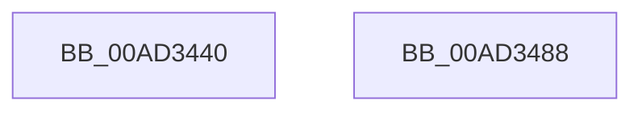

# PopNotifyCallbacksPreSleep

- RVA: `0x00AD3440`–`0x00AD3489` (길이 `73` bytes)
- VA: `0x0000000140AD3440`
- 실행 섹션: `PAGE`
- PDB 이름 있음: `예`; PDB Function 태그: `아니요`
- unwind 정보 RVA: `0x0005C788`
- 디코드: `16`개 명령, `73/73` bytes 표시
- 미해석 바이트: `0` (있으면 어셈블리에 `.byte`로 보존)

> 이 문서는 커널 이미지의 기계어와 PDB 기호를 분석해 생성했습니다. 4번과 5번은 함수 원형과 자료형을 바이너리 사용 방식에서 추정한 C 해석이며 원본 소스 복구 결과는 아닙니다.

## 1. Dependencies

- 직접 호출 지점: **5**; 고유 호출 대상: **3**
- 직접 호출자로 확인된 함수: **1**
- RIP 상대 이미지 참조: **3**

### Outgoing calls
- `0x00AD3449` → [PopCheckpointSystemSleep](../../pagelk/B7/PopCheckpointSystemSleep_function_00B77C90.md) (function, `0x00B77C90`)
- `0x00AD3455` → [PopDiagTraceEventNoPayload](../../text/49/PopDiagTraceEventNoPayload_function_004982F8.md) (function, `0x004982F8`)
- `0x00AD3468` → [ExNotifyCallback](../../text/39/ExNotifyCallback_function_003926B0.md) (function, `0x003926B0`)
- `0x00AD3474` → [PopDiagTraceEventNoPayload](../../text/49/PopDiagTraceEventNoPayload_function_004982F8.md) (function, `0x004982F8`)
- `0x00AD347E` → [PopCheckpointSystemSleep](../../pagelk/B7/PopCheckpointSystemSleep_function_00B77C90.md) (function, `0x00B77C90`)

### Direct callers
- [PopTransitionSystemPowerStateEx](../../pagelk/B7/PopTransitionSystemPowerStateEx_function_00B7E8C0.md) at `0x00B7EA0E`

### Static image references
- `0x00AD344E` → RVA `0x0001ED08` (`.rdata`; read)
- `0x00AD345A` → RVA `0x00EFEDA8` (`.data`; read)
- `0x00AD346D` → RVA `0x0001ED18` (`.rdata`; read)

## 2. Other-region calls and transfers

- 다른 실행 섹션으로 향하는 call: **5**
  - `0x00AD3449` → [PopCheckpointSystemSleep](../../pagelk/B7/PopCheckpointSystemSleep_function_00B77C90.md) (`PAGE` → `PAGELK`)
  - `0x00AD3455` → [PopDiagTraceEventNoPayload](../../text/49/PopDiagTraceEventNoPayload_function_004982F8.md) (`PAGE` → `.text`)
  - `0x00AD3468` → [ExNotifyCallback](../../text/39/ExNotifyCallback_function_003926B0.md) (`PAGE` → `.text`)
  - `0x00AD3474` → [PopDiagTraceEventNoPayload](../../text/49/PopDiagTraceEventNoPayload_function_004982F8.md) (`PAGE` → `.text`)
  - `0x00AD347E` → [PopCheckpointSystemSleep](../../pagelk/B7/PopCheckpointSystemSleep_function_00B77C90.md) (`PAGE` → `PAGELK`)
- 별도 외부 분기/꼬리 이동을 확인하지 못했습니다.

## 3. Assembly (complete function range)

```asm
00AD3440  48 83 EC 28                     sub rsp, 0x28
00AD3444  B9 08 00 00 00                  mov ecx, 8
00AD3449  E8 42 48 0A 00                  call 0x140b77c90
00AD344E  48 8D 0D B3 B8 54 FF            lea rcx, [rip - 0xab474d]
00AD3455  E8 9E 4E 9C FF                  call 0x1404982f8
00AD345A  48 8B 0D 47 B9 42 00            mov rcx, qword ptr [rip + 0x42b947]
00AD3461  45 33 C0                        xor r8d, r8d
00AD3464  41 8D 50 03                     lea edx, [r8 + 3]
00AD3468  E8 43 F2 8B FF                  call 0x1403926b0
00AD346D  48 8D 0D A4 B8 54 FF            lea rcx, [rip - 0xab475c]
00AD3474  E8 7F 4E 9C FF                  call 0x1404982f8
00AD3479  B9 09 00 00 00                  mov ecx, 9
00AD347E  E8 0D 48 0A 00                  call 0x140b77c90
00AD3483  48 83 C4 28                     add rsp, 0x28
00AD3487  C3                              ret
00AD3488  CC                              int3
```

## 4. C-style interpretation (structured pseudocode)

```c
__int64 __fastcall PopNotifyCallbacksPreSleep(__int64 a1, __int64 a2, int a3)
{
    __int64 result;
    __int64 v_rsp;

    v_rsp = (v_rsp) - (40);
    result = PopCheckpointSystemSleep(8, a2, a3, a4);
    result = PopDiagTraceEventNoPayload(v_rip - 11224909, a2, a3, a4);
    a3 = 0;
    result = ExNotifyCallback(*(unsigned __int64 *)(v_rip + 4372807), a3 + 3, a3, a4);
    result = PopDiagTraceEventNoPayload(v_rip - 11224924, a3 + 3, a3, a4);
    result = PopCheckpointSystemSleep(9, a3 + 3, a3, a4);
    v_rsp = (v_rsp) + (40);
    return result;
}
```

## 5. (Beta) C Style

```c
int64_t PopNotifyCallbacksPreSleep(int64_t Arg1, int64_t Arg2, int32_t Arg3)
{
    int64_t result;
    int64_t local_rsp;

    local_rsp = (local_rsp) - (40);
    result = PopCheckpointSystemSleep(8, Arg2, Arg3, a4);
    result = PopDiagTraceEventNoPayload(v_rip - 11224909, Arg2, Arg3, a4);
    Arg3 = 0;
    result = ExNotifyCallback(*(uint64_t *)(v_rip + 0x42B947), Arg3 + 3, Arg3, a4);
    result = PopDiagTraceEventNoPayload(v_rip - 11224924, Arg3 + 3, Arg3, a4);
    result = PopCheckpointSystemSleep(9, Arg3 + 3, Arg3, a4);
    local_rsp = (local_rsp) + (40);
    return result;
}
```

## 6. Execution-region graph

[열기: 2D/3D 그래프와 함수 탐색 컨트롤 패널](../../../control-panel.html?section=page&rva=0x00AD3440&view=graph)

- 2D 그래프는 위에서 아래로 흐르고, 3D 그래프는 빈 공간을 드래그해 회전합니다. Shift+드래그는 이동, 휠은 확대·축소, 함수 노드 선택은 대상 보고서 이동입니다.

### Static fallback


