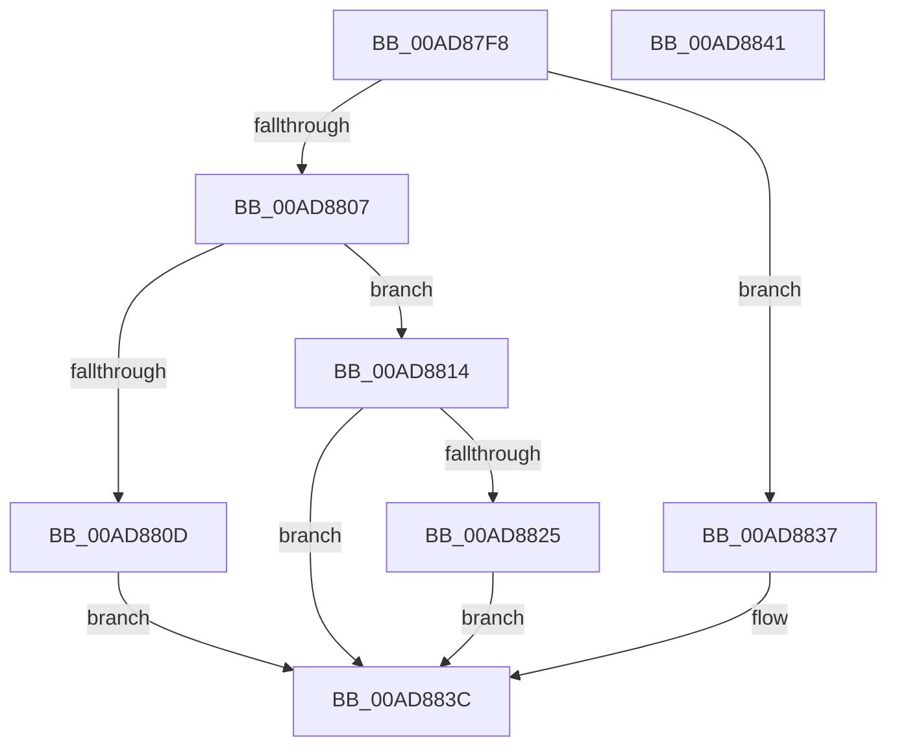

# PopPdcInvocation

- RVA: `0x00AD87F8`–`0x00AD8842` (길이 `74` bytes)
- VA: `0x0000000140AD87F8`
- 실행 섹션: `PAGE`
- PDB 이름 있음: `예`; PDB Function 태그: `아니요`
- unwind 정보 RVA: `0x0005C788`
- 디코드: `22`개 명령, `74/74` bytes 표시
- 미해석 바이트: `0` (있으면 어셈블리에 `.byte`로 보존)

> 이 문서는 커널 이미지의 기계어와 PDB 기호를 분석해 생성했습니다. 4번과 5번은 함수 원형과 자료형을 바이너리 사용 방식에서 추정한 C 해석이며 원본 소스 복구 결과는 아닙니다.

## 1. Dependencies

- 직접 호출 지점: **2**; 고유 호출 대상: **2**
- 직접 호출자로 확인된 함수: **1**
- RIP 상대 이미지 참조: **1**

### Outgoing calls
- `0x00AD8830` → [guard_dispatch_icall](../../text/6B/guard_dispatch_icall_function_006BAAD0.md) (function, `0x006BAAD0`)
- `0x00AD8837` → [PopPdcRegister](../70/PopPdcRegister_function_00704AD0.md) (function, `0x00704AD0`)

### Direct callers
- [NtPowerInformation](../95/NtPowerInformation_function_00955D80.md) at `0x00957601`

### Static image references
- `0x00AD8814` → RVA `0x00E67790` (`.data`; read)

## 2. Other-region calls and transfers

- 다른 실행 섹션으로 향하는 call: **1**
  - `0x00AD8830` → [guard_dispatch_icall](../../text/6B/guard_dispatch_icall_function_006BAAD0.md) (`PAGE` → `.text`)
- 별도 외부 분기/꼬리 이동을 확인하지 못했습니다.

## 3. Assembly (complete function range)

```asm
00AD87F8  48 83 EC 28                     sub rsp, 0x28
00AD87FC  44 8B 01                        mov r8d, dword ptr [rcx]
00AD87FF  4C 8B C9                        mov r9, rcx
00AD8802  45 85 C0                        test r8d, r8d
00AD8805  74 30                           je 0x140ad8837
00AD8807  41 83 F8 01                     cmp r8d, 1
00AD880B  74 07                           je 0x140ad8814
00AD880D  B8 0D 00 00 C0                  mov eax, 0xc000000d
00AD8812  EB 28                           jmp 0x140ad883c
00AD8814  4C 8B 05 75 EF 38 00            mov r8, qword ptr [rip + 0x38ef75]
00AD881B  B8 02 00 00 C0                  mov eax, 0xc0000002
00AD8820  4D 85 C0                        test r8, r8
00AD8823  74 17                           je 0x140ad883c
00AD8825  48 8B 49 10                     mov rcx, qword ptr [rcx + 0x10]
00AD8829  49 8B C0                        mov rax, r8
00AD882C  49 8B 51 08                     mov rdx, qword ptr [r9 + 8]
00AD8830  E8 9B 22 BE FF                  call 0x1406baad0
00AD8835  EB 05                           jmp 0x140ad883c
00AD8837  E8 94 C2 C2 FF                  call 0x140704ad0
00AD883C  48 83 C4 28                     add rsp, 0x28
00AD8840  C3                              ret
00AD8841  CC                              int3
```

## 4. C-style interpretation (structured pseudocode)

```c
__int64 __fastcall PopPdcInvocation(__int64 a1)
{
    __int64 result;
    __int64 v_rsp;

    v_rsp = (v_rsp) - (40);
    if ((unsigned int)((unsigned int)(*(unsigned int *)(a1))) == 0) goto loc_00AD8837;
    if (((unsigned int)((unsigned int)(*(unsigned int *)(a1)))) == 1) goto loc_00AD8814;
    goto loc_00AD883C;
loc_00AD8814:
    if (*(unsigned __int64 *)(v_rip + 3731317) == 0) goto loc_00AD883C;
    result = guard_dispatch_icall(*(unsigned __int64 *)(a1 + 16), *(unsigned __int64 *)(a1 + 8), *(unsigned __int64 *)(v_rip + 3731317), a1);
    goto loc_00AD883C;
loc_00AD8837:
    result = PopPdcRegister(*(unsigned __int64 *)(a1 + 16), *(unsigned __int64 *)(a1 + 8), *(unsigned __int64 *)(v_rip + 3731317), a1);
loc_00AD883C:
    v_rsp = (v_rsp) + (40);
    return result;
}
```

## 5. (Beta) C Style

```c
int64_t PopPdcInvocation(void *Arg1)
{
    uint8_t *arg1 = (uint8_t *)Arg1;

    int64_t result;
    int64_t local_rsp;

    local_rsp = (local_rsp) - (40);
    if ((uint32_t)((uint32_t)(*(uint32_t *)(arg1))) == 0) goto loc_00AD8837;
    if (((uint32_t)((uint32_t)(*(uint32_t *)(arg1)))) == 1) goto loc_00AD8814;
    goto loc_00AD883C;
loc_00AD8814:
    if (*(uint64_t *)(v_rip + 0x38EF75) == 0) goto loc_00AD883C;
    result = guard_dispatch_icall(*(uint64_t *)(arg1 + 0x10), *(uint64_t *)(arg1 + 0x8), *(uint64_t *)(v_rip + 0x38EF75), Arg1);
    goto loc_00AD883C;
loc_00AD8837:
    result = PopPdcRegister(*(uint64_t *)(arg1 + 0x10), *(uint64_t *)(arg1 + 0x8), *(uint64_t *)(v_rip + 0x38EF75), Arg1);
loc_00AD883C:
    local_rsp = (local_rsp) + (40);
    return result;
}
```

### 관측된 메모리 오프셋

구조체 형식이 확인되지 않은 접근은 인자 기준의 오프셋으로만 기록했습니다.

| 기준 인자 | 오프셋 표현 | 폭 (bit) | 접근 |
|---|---:|---:|---|
| `Arg1` | `+ 0x0` | `32` | `R` |
| `Arg1` | `+ 0x8` | `64` | `R` |
| `Arg1` | `+ 0x10` | `64` | `R` |

## 6. Execution-region graph

[열기: 2D/3D 그래프와 함수 탐색 컨트롤 패널](../../../control-panel.html?section=page&rva=0x00AD87F8&view=graph)

- 2D 그래프는 위에서 아래로 흐르고, 3D 그래프는 빈 공간을 드래그해 회전합니다. Shift+드래그는 이동, 휠은 확대·축소, 함수 노드 선택은 대상 보고서 이동입니다.

### Static fallback


