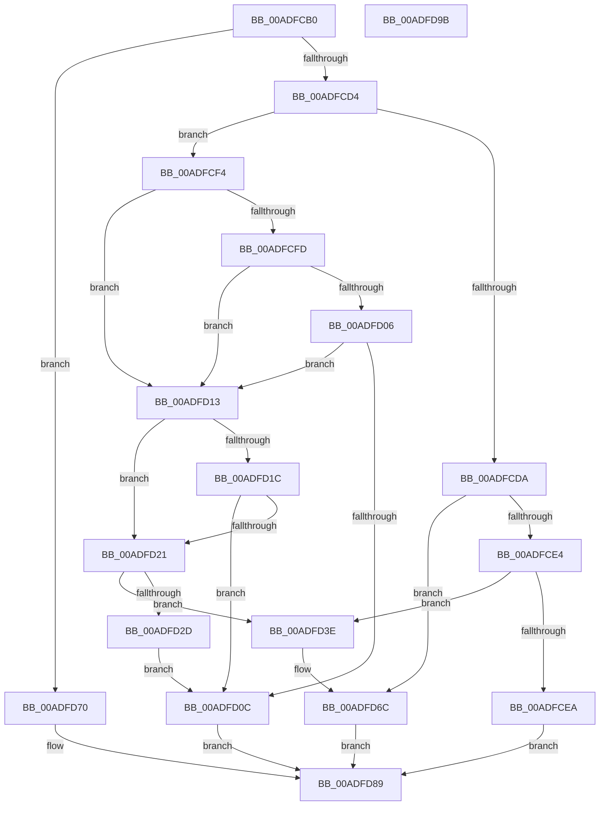

# PopPowerAggregatorHandleActiveIntent

- RVA: `0x00ADFCB0`–`0x00ADFD9C` (길이 `236` bytes)
- VA: `0x0000000140ADFCB0`
- 실행 섹션: `PAGE`
- PDB 이름 있음: `예`; PDB Function 태그: `아니요`
- unwind 정보 RVA: `0x00086C28`
- 디코드: `67`개 명령, `236/236` bytes 표시
- 미해석 바이트: `0` (있으면 어셈블리에 `.byte`로 보존)

> 이 문서는 커널 이미지의 기계어와 PDB 기호를 분석해 생성했습니다. 4번과 5번은 함수 원형과 자료형을 바이너리 사용 방식에서 추정한 C 해석이며 원본 소스 복구 결과는 아닙니다.

## 1. Dependencies

- 직접 호출 지점: **7**; 고유 호출 대상: **6**
- 직접 호출자로 확인된 함수: **0**
- RIP 상대 이미지 참조: **2**

### Outgoing calls
- `0x00ADFCF4` → [Feature_Servicing_GamingHandheldPowBtnFilter__private_IsEnabledDeviceUsageNoInline](../../text/5C/Feature_Servicing_GamingHandheldPowBtnFilter__private_IsEnabledDeviceUsageNoInline_function_005CE2F4.md) (function, `0x005CE2F4`)
- `0x00ADFD13` → [PopIsPlatformAoAcCapable](../../text/49/PopIsPlatformAoAcCapable_function_0049BF40.md) (function, `0x0049BF40`)
- `0x00ADFD24` → [PopIsInputSuppressionEngaged](PopIsInputSuppressionEngaged_function_00ADFDA4.md) (function, `0x00ADFDA4`)
- `0x00ADFD2D` → [Feature_AggressiveInputSuppression__private_IsEnabledPreCheck](../../text/4F/Feature_AggressiveInputSuppression__private_IsEnabledPreCheck_function_004FAD78.md) (function, `0x004FAD78`)
- `0x00ADFD37` → [PopDiagTraceMonitorOnWithLidClosed](../AA/PopDiagTraceMonitorOnWithLidClosed_function_00AA366C.md) (function, `0x00AA366C`)
- `0x00ADFD43` → [PopDiagTraceMonitorOnWithLidClosed](../AA/PopDiagTraceMonitorOnWithLidClosed_function_00AA366C.md) (function, `0x00AA366C`)
- `0x00ADFD67` → [ZwUpdateWnfStateData](../../text/6B/ZwUpdateWnfStateData_function_006B0D10.md) (function, `0x006B0D10`)

### Direct callers
- 이 함수 시작 RVA로 연결되는 직접 call은 확인되지 않았습니다. 간접 호출은 완전히 역산할 수 없습니다.

### Static image references
- `0x00ADFCFD` → RVA `0x00F0F040` (`.data`; read)
- `0x00ADFD57` → RVA `0x00020B30` (`.rdata`; read)

## 2. Other-region calls and transfers

- 다른 실행 섹션으로 향하는 call: **4**
  - `0x00ADFCF4` → [Feature_Servicing_GamingHandheldPowBtnFilter__private_IsEnabledDeviceUsageNoInline](../../text/5C/Feature_Servicing_GamingHandheldPowBtnFilter__private_IsEnabledDeviceUsageNoInline_function_005CE2F4.md) (`PAGE` → `.text`)
  - `0x00ADFD13` → [PopIsPlatformAoAcCapable](../../text/49/PopIsPlatformAoAcCapable_function_0049BF40.md) (`PAGE` → `.text`)
  - `0x00ADFD2D` → [Feature_AggressiveInputSuppression__private_IsEnabledPreCheck](../../text/4F/Feature_AggressiveInputSuppression__private_IsEnabledPreCheck_function_004FAD78.md) (`PAGE` → `.text`)
  - `0x00ADFD67` → [ZwUpdateWnfStateData](../../text/6B/ZwUpdateWnfStateData_function_006B0D10.md) (`PAGE` → `.text`)
- 별도 외부 분기/꼬리 이동을 확인하지 못했습니다.

## 3. Assembly (complete function range)

```asm
00ADFCB0  48 89 5C 24 08                  mov qword ptr [rsp + 8], rbx
00ADFCB5  48 89 74 24 10                  mov qword ptr [rsp + 0x10], rsi
00ADFCBA  57                              push rdi
00ADFCBB  48 83 EC 40                     sub rsp, 0x40
00ADFCBF  44 8B 41 10                     mov r8d, dword ptr [rcx + 0x10]
00ADFCC3  33 DB                           xor ebx, ebx
00ADFCC5  48 8B FA                        mov rdi, rdx
00ADFCC8  48 8B F1                        mov rsi, rcx
00ADFCCB  45 85 C0                        test r8d, r8d
00ADFCCE  0F 84 9C 00 00 00               je 0x140adfd70
00ADFCD4  41 83 E8 01                     sub r8d, 1
00ADFCD8  74 1A                           je 0x140adfcf4
00ADFCDA  41 83 E8 01                     sub r8d, 1
00ADFCDE  0F 84 88 00 00 00               je 0x140adfd6c
00ADFCE4  41 83 F8 02                     cmp r8d, 2
00ADFCE8  74 54                           je 0x140adfd3e
00ADFCEA  BB 03 A0 00 C0                  mov ebx, 0xc000a003
00ADFCEF  E9 95 00 00 00                  jmp 0x140adfd89
00ADFCF4  E8 FB E5 AE FF                  call 0x1405ce2f4
00ADFCF9  85 C0                           test eax, eax
00ADFCFB  74 16                           je 0x140adfd13
00ADFCFD  83 3D 3C F3 42 00 2E            cmp dword ptr [rip + 0x42f33c], 0x2e
00ADFD04  75 0D                           jne 0x140adfd13
00ADFD06  83 7F 08 02                     cmp dword ptr [rdi + 8], 2
00ADFD0A  74 07                           je 0x140adfd13
00ADFD0C  BB 01 00 00 C0                  mov ebx, 0xc0000001
00ADFD11  EB 76                           jmp 0x140adfd89
00ADFD13  E8 28 C2 9B FF                  call 0x14049bf40
00ADFD18  84 C0                           test al, al
00ADFD1A  74 05                           je 0x140adfd21
00ADFD1C  38 5E 29                        cmp byte ptr [rsi + 0x29], bl
00ADFD1F  75 EB                           jne 0x140adfd0c
00ADFD21  8B 4F 08                        mov ecx, dword ptr [rdi + 8]
00ADFD24  E8 7B 00 00 00                  call 0x140adfda4
00ADFD29  84 C0                           test al, al
00ADFD2B  74 11                           je 0x140adfd3e
00ADFD2D  E8 46 B0 A1 FF                  call 0x1404fad78
00ADFD32  8B 4F 08                        mov ecx, dword ptr [rdi + 8]
00ADFD35  B2 01                           mov dl, 1
00ADFD37  E8 30 39 FC FF                  call 0x140aa366c
00ADFD3C  EB CE                           jmp 0x140adfd0c
00ADFD3E  8B 4F 08                        mov ecx, dword ptr [rdi + 8]
00ADFD41  33 D2                           xor edx, edx
00ADFD43  E8 24 39 FC FF                  call 0x140aa366c
00ADFD48  45 33 C9                        xor r9d, r9d
00ADFD4B  89 5C 24 30                     mov dword ptr [rsp + 0x30], ebx
00ADFD4F  48 8D 57 10                     lea rdx, [rdi + 0x10]
00ADFD53  89 5C 24 28                     mov dword ptr [rsp + 0x28], ebx
00ADFD57  48 8D 0D D2 0D 54 FF            lea rcx, [rip - 0xabf22e]
00ADFD5E  48 89 5C 24 20                  mov qword ptr [rsp + 0x20], rbx
00ADFD63  45 8D 41 08                     lea r8d, [r9 + 8]
00ADFD67  E8 A4 0F BD FF                  call 0x1406b0d10
00ADFD6C  89 1F                           mov dword ptr [rdi], ebx
00ADFD6E  EB 19                           jmp 0x140adfd89
00ADFD70  0F 10 41 10                     movups xmm0, xmmword ptr [rcx + 0x10]
00ADFD74  0F 11 02                        movups xmmword ptr [rdx], xmm0
00ADFD77  0F 10 49 20                     movups xmm1, xmmword ptr [rcx + 0x20]
00ADFD7B  0F 11 4A 10                     movups xmmword ptr [rdx + 0x10], xmm1
00ADFD7F  F2 0F 10 41 30                  movsd xmm0, qword ptr [rcx + 0x30]
00ADFD84  F2 0F 11 42 20                  movsd qword ptr [rdx + 0x20], xmm0
00ADFD89  48 8B 74 24 58                  mov rsi, qword ptr [rsp + 0x58]
00ADFD8E  8B C3                           mov eax, ebx
00ADFD90  48 8B 5C 24 50                  mov rbx, qword ptr [rsp + 0x50]
00ADFD95  48 83 C4 40                     add rsp, 0x40
00ADFD99  5F                              pop rdi
00ADFD9A  C3                              ret
00ADFD9B  CC                              int3
```

## 4. C-style interpretation (structured pseudocode)

```c
__int64 __fastcall PopPowerAggregatorHandleActiveIntent(__int64 a1, __int64 a2, __int64 a3, int a4)
{
    __int64 result;
    __int64 v_rbx;
    __int64 v_rsp;
    unsigned int v_stack_m18;
    unsigned int v_stack_m20;
    unsigned __int64 v_stack_m28;
    unsigned __int64 v_stack_p10;
    unsigned __int64 v_stack_p8;

    v_stack_p8 = v_rbx;
    v_stack_p10 = v_rsi;
    v_rsp = (v_rsp) - (64);
    v_rbx = 0;
    if ((unsigned int)((unsigned int)(*(unsigned int *)(a1 + 16))) == 0) goto loc_00ADFD70;
    a3 = (unsigned int)(((unsigned int)(*(unsigned int *)(a1 + 16))) - (1));
    if (condition_is_equal) goto loc_00ADFCF4;
    a3 = (unsigned int)((a3) - (1));
    if (condition_is_equal) goto loc_00ADFD6C;
    if (((unsigned int)(a3)) == 2) goto loc_00ADFD3E;
    goto loc_00ADFD89;
loc_00ADFCF4:
    result = Feature_Servicing_GamingHandheldPowBtnFilter__private_IsEnabledDeviceUsageNoInline(a1, a2, a3, a4);
    if ((unsigned int)(result) == 0) goto loc_00ADFD13;
    if ((*(unsigned int *)(v_rip + 4387644)) != 46) goto loc_00ADFD13;
    if ((*(unsigned int *)(a2 + 8)) == 2) goto loc_00ADFD13;
loc_00ADFD0C:
    goto loc_00ADFD89;
loc_00ADFD13:
    result = PopIsPlatformAoAcCapable(a1, a2, a3, a4);
    if ((unsigned __int8)(result) == 0) goto loc_00ADFD21;
    if ((*(unsigned __int8 *)(a1 + 41)) != ((unsigned __int8)((unsigned int)(0xC0000001ULL)))) goto loc_00ADFD0C;
loc_00ADFD21:
    result = PopIsInputSuppressionEngaged((unsigned int)(*(unsigned int *)(a2 + 8)), a2, a3, a4);
    if ((unsigned __int8)(result) == 0) goto loc_00ADFD3E;
    result = Feature_AggressiveInputSuppression__private_IsEnabledPreCheck((unsigned int)(*(unsigned int *)(a2 + 8)), a2, a3, a4);
    result = PopDiagTraceMonitorOnWithLidClosed((unsigned int)(*(unsigned int *)(a2 + 8)), 1, a3, a4);
    goto loc_00ADFD0C;
loc_00ADFD3E:
    a2 = 0;
    result = PopDiagTraceMonitorOnWithLidClosed((unsigned int)(*(unsigned int *)(a2 + 8)), a2, a3, a4);
    a4 = 0;
    v_stack_m18 = (unsigned int)((unsigned int)(0xC0000001ULL));
    v_stack_m20 = (unsigned int)((unsigned int)(0xC0000001ULL));
    v_stack_m28 = (unsigned int)(0xC0000001ULL);
    result = ZwUpdateWnfStateData(v_rip - 11268654, a2 + 16, a4 + 8, a4);
loc_00ADFD6C:
    *(unsigned int *)(a2) = (unsigned int)((unsigned int)(0xC0000001ULL));
    goto loc_00ADFD89;
loc_00ADFD70:
    *(unsigned __int64 *)(a2 + 16) = v_xmm0;
    *(unsigned __int64 *)(a2 + 16 + 16) = v_xmm1;
    *(unsigned __int64 *)(a2 + 16 + 32) = v_xmm0;
loc_00ADFD89:
    v_rsp = (v_rsp) + (64);
    return (unsigned int)((unsigned int)((unsigned int)(0xC0000001ULL)));
}
```

## 5. (Beta) C Style

```c
int64_t PopPowerAggregatorHandleActiveIntent(void *Arg1, void *Arg2, int64_t Arg3, int32_t Arg4)
{
    uint8_t *arg1 = (uint8_t *)Arg1;
    uint8_t *arg2 = (uint8_t *)Arg2;

    int64_t result;
    int64_t local_rbx;
    int64_t local_rsp;
    uint32_t v_stack_m18;
    uint32_t v_stack_m20;
    uint64_t v_stack_m28;
    uint64_t v_stack_p10;
    uint64_t v_stack_p8;

    v_stack_p8 = local_rbx;
    v_stack_p10 = local_rsi;
    local_rsp = (local_rsp) - (64);
    local_rbx = 0;
    if ((uint32_t)((uint32_t)(*(uint32_t *)(arg1 + 0x10))) == 0) goto loc_00ADFD70;
    Arg3 = (uint32_t)(((uint32_t)(*(uint32_t *)(arg1 + 0x10))) - (1));
    if (condition_is_equal) goto loc_00ADFCF4;
    Arg3 = (uint32_t)((Arg3) - (1));
    if (condition_is_equal) goto loc_00ADFD6C;
    if (((uint32_t)(Arg3)) == 2) goto loc_00ADFD3E;
    goto loc_00ADFD89;
loc_00ADFCF4:
    result = Feature_Servicing_GamingHandheldPowBtnFilter__private_IsEnabledDeviceUsageNoInline(Arg1, Arg2, Arg3, Arg4);
    if ((uint32_t)(result) == 0) goto loc_00ADFD13;
    if ((*(uint32_t *)(v_rip + 0x42F33C)) != 46) goto loc_00ADFD13;
    if ((*(uint32_t *)(arg2 + 0x8)) == 2) goto loc_00ADFD13;
loc_00ADFD0C:
    goto loc_00ADFD89;
loc_00ADFD13:
    result = PopIsPlatformAoAcCapable(Arg1, Arg2, Arg3, Arg4);
    if ((uint8_t)(result) == 0) goto loc_00ADFD21;
    if ((*(uint8_t *)(arg1 + 0x29)) != ((uint8_t)((uint32_t)(0xC0000001ULL)))) goto loc_00ADFD0C;
loc_00ADFD21:
    result = PopIsInputSuppressionEngaged((uint32_t)(*(uint32_t *)(arg2 + 0x8)), Arg2, Arg3, Arg4);
    if ((uint8_t)(result) == 0) goto loc_00ADFD3E;
    result = Feature_AggressiveInputSuppression__private_IsEnabledPreCheck((uint32_t)(*(uint32_t *)(arg2 + 0x8)), Arg2, Arg3, Arg4);
    result = PopDiagTraceMonitorOnWithLidClosed((uint32_t)(*(uint32_t *)(arg2 + 0x8)), 1, Arg3, Arg4);
    goto loc_00ADFD0C;
loc_00ADFD3E:
    Arg2 = 0;
    result = PopDiagTraceMonitorOnWithLidClosed((uint32_t)(*(uint32_t *)(arg2 + 0x8)), Arg2, Arg3, Arg4);
    Arg4 = 0;
    v_stack_m18 = (uint32_t)((uint32_t)(0xC0000001ULL));
    v_stack_m20 = (uint32_t)((uint32_t)(0xC0000001ULL));
    v_stack_m28 = (uint32_t)(0xC0000001ULL);
    result = ZwUpdateWnfStateData(v_rip - 11268654, Arg2 + 16, Arg4 + 8, Arg4);
loc_00ADFD6C:
    *(uint32_t *)(arg2) = (uint32_t)((uint32_t)(0xC0000001ULL));
    goto loc_00ADFD89;
loc_00ADFD70:
    *(uint64_t *)(arg2 + 0x10) = v_xmm0;
    *(uint64_t *)(arg2 + 0x10 + 0x10) = v_xmm1;
    *(uint64_t *)(arg2 + 0x10 + 0x20) = v_xmm0;
loc_00ADFD89:
    local_rsp = (local_rsp) + (64);
    return (uint32_t)((uint32_t)((uint32_t)(0xC0000001ULL)));
}
```

### 관측된 메모리 오프셋

구조체 형식이 확인되지 않은 접근은 인자 기준의 오프셋으로만 기록했습니다.

| 기준 인자 | 오프셋 표현 | 폭 (bit) | 접근 |
|---|---:|---:|---|
| `Arg1` | `+ 0x10` | `32` | `R` |
| `Arg1` | `+ 0x10` | `128` | `R` |
| `Arg1` | `+ 0x20` | `128` | `R` |
| `Arg1` | `+ 0x29` | `8` | `R` |
| `Arg1` | `+ 0x30` | `64` | `R` |
| `Arg2` | `+ 0x0` | `32` | `W` |
| `Arg2` | `+ 0x0` | `128` | `R` |
| `Arg2` | `+ 0x8` | `32` | `R` |
| `Arg2` | `+ 0x10` | `64` | `R` |
| `Arg2` | `+ 0x10` | `128` | `R` |
| `Arg2` | `+ 0x20` | `64` | `W` |

## 6. Execution-region graph

[열기: 2D/3D 그래프와 함수 탐색 컨트롤 패널](../../../control-panel.html?section=page&rva=0x00ADFCB0&view=graph)

- 2D 그래프는 위에서 아래로 흐르고, 3D 그래프는 빈 공간을 드래그해 회전합니다. Shift+드래그는 이동, 휠은 확대·축소, 함수 노드 선택은 대상 보고서 이동입니다.

### Static fallback


