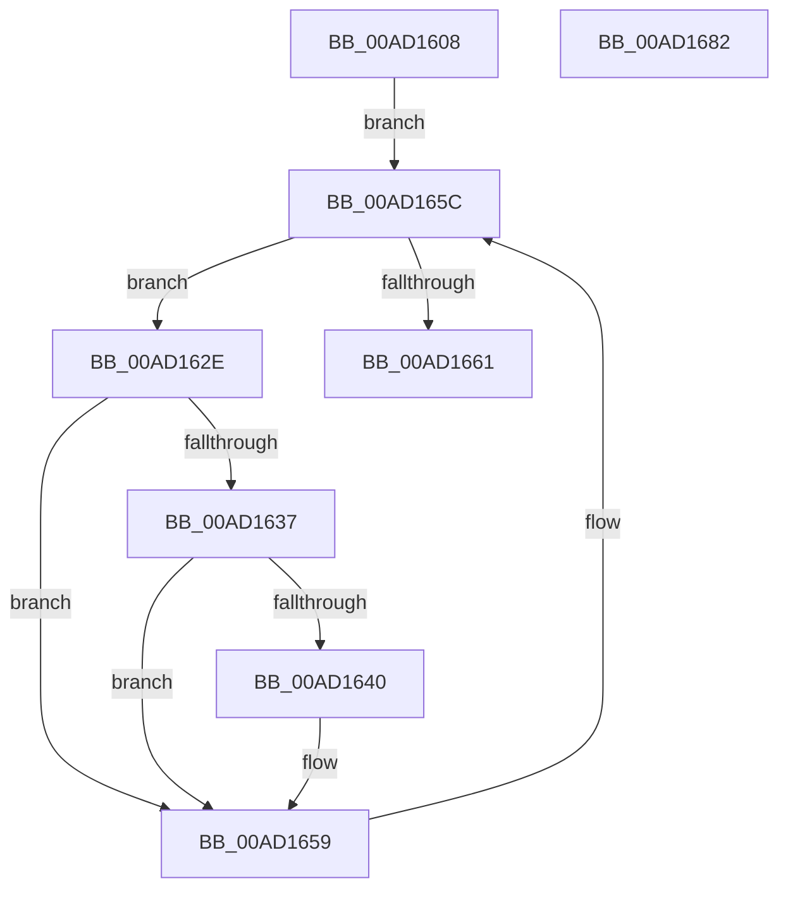

# PopPowerRequestNotifyTtmSessionInitialized

- RVA: `0x00AD1608`–`0x00AD1683` (길이 `123` bytes)
- VA: `0x0000000140AD1608`
- 실행 섹션: `PAGE`
- PDB 이름 있음: `예`; PDB Function 태그: `아니요`
- unwind 정보 RVA: `0x00065960`
- 디코드: `32`개 명령, `123/123` bytes 표시
- 미해석 바이트: `0` (있으면 어셈블리에 `.byte`로 보존)

> 이 문서는 커널 이미지의 기계어와 PDB 기호를 분석해 생성했습니다. 4번과 5번은 함수 원형과 자료형을 바이너리 사용 방식에서 추정한 C 해석이며 원본 소스 복구 결과는 아닙니다.

## 1. Dependencies

- 직접 호출 지점: **4**; 고유 호출 대상: **4**
- 직접 호출자로 확인된 함수: **1**
- RIP 상대 이미지 참조: **2**

### Outgoing calls
- `0x00AD1619` → [PopAcquireRwLockExclusive](../../text/43/PopAcquireRwLockExclusive_function_00430B44.md) (function, `0x00430B44`)
- `0x00AD1654` → [TtmNotifySessionPowerRequestPresent](../77/TtmNotifySessionPowerRequestPresent_function_00776F88.md) (function, `0x00776F88`)
- `0x00AD1666` → [PopPowerRequestUnrevokeRequests](../../text/4B/PopPowerRequestUnrevokeRequests_function_004BF3D0.md) (function, `0x004BF3D0`)
- `0x00AD1672` → [PopReleaseRwLock](../../text/2D/PopReleaseRwLock_function_002DFBBC.md) (function, `0x002DFBBC`)

### Direct callers
- [NtPowerInformation](../95/NtPowerInformation_function_00955D80.md) at `0x00956EC9`

### Static image references
- `0x00AD1612` → RVA `0x00F0ED20` (`.data`; read)
- `0x00AD161E` → RVA `0x00F0ED40` (`.data`; read)

## 2. Other-region calls and transfers

- 다른 실행 섹션으로 향하는 call: **3**
  - `0x00AD1619` → [PopAcquireRwLockExclusive](../../text/43/PopAcquireRwLockExclusive_function_00430B44.md) (`PAGE` → `.text`)
  - `0x00AD1666` → [PopPowerRequestUnrevokeRequests](../../text/4B/PopPowerRequestUnrevokeRequests_function_004BF3D0.md) (`PAGE` → `.text`)
  - `0x00AD1672` → [PopReleaseRwLock](../../text/2D/PopReleaseRwLock_function_002DFBBC.md) (`PAGE` → `.text`)
- 별도 외부 분기/꼬리 이동을 확인하지 못했습니다.

## 3. Assembly (complete function range)

```asm
00AD1608  48 89 5C 24 08                  mov qword ptr [rsp + 8], rbx
00AD160D  57                              push rdi
00AD160E  48 83 EC 40                     sub rsp, 0x40
00AD1612  48 8D 0D 07 D7 43 00            lea rcx, [rip + 0x43d707]
00AD1619  E8 26 F5 95 FF                  call 0x140430b44
00AD161E  48 8B 1D 1B D7 43 00            mov rbx, qword ptr [rip + 0x43d71b]
00AD1625  48 8D 3D 14 D7 43 00            lea rdi, [rip + 0x43d714]
00AD162C  EB 2E                           jmp 0x140ad165c
00AD162E  44 8B 43 68                     mov r8d, dword ptr [rbx + 0x68]
00AD1632  45 85 C0                        test r8d, r8d
00AD1635  74 22                           je 0x140ad1659
00AD1637  4C 8B 4B 70                     mov r9, qword ptr [rbx + 0x70]
00AD163B  4D 85 C9                        test r9, r9
00AD163E  74 19                           je 0x140ad1659
00AD1640  48 8B 43 78                     mov rax, qword ptr [rbx + 0x78]
00AD1644  8B 53 24                        mov edx, dword ptr [rbx + 0x24]
00AD1647  8B 4B 10                        mov ecx, dword ptr [rbx + 0x10]
00AD164A  C6 44 24 30 00                  mov byte ptr [rsp + 0x30], 0
00AD164F  48 89 44 24 20                  mov qword ptr [rsp + 0x20], rax
00AD1654  E8 2F 59 CA FF                  call 0x140776f88
00AD1659  48 8B 1B                        mov rbx, qword ptr [rbx]
00AD165C  48 3B DF                        cmp rbx, rdi
00AD165F  75 CD                           jne 0x140ad162e
00AD1661  B9 01 00 00 00                  mov ecx, 1
00AD1666  E8 65 DD 9E FF                  call 0x1404bf3d0
00AD166B  48 8D 0D AE D6 43 00            lea rcx, [rip + 0x43d6ae]
00AD1672  E8 45 E5 80 FF                  call 0x1402dfbbc
00AD1677  48 8B 5C 24 50                  mov rbx, qword ptr [rsp + 0x50]
00AD167C  48 83 C4 40                     add rsp, 0x40
00AD1680  5F                              pop rdi
00AD1681  C3                              ret
00AD1682  CC                              int3
```

## 4. C-style interpretation (structured pseudocode)

```c
__int64 __fastcall PopPowerRequestNotifyTtmSessionInitialized(void)
{
    __int64 result;
    __int64 v_rsp;
    unsigned __int8 v_stack_m18;
    unsigned __int64 v_stack_m28;
    unsigned __int64 v_stack_p8;

    v_stack_p8 = v_rbx;
    v_rsp = (v_rsp) - (64);
    result = PopAcquireRwLockExclusive(v_rip + 4445959, a2, a3, a4);
    goto loc_00AD165C;
loc_00AD162E:
    if ((unsigned int)((unsigned int)(*(unsigned int *)(*(unsigned __int64 *)(v_rip + 4445979) + 104))) == 0) goto loc_00AD1659;
    if (*(unsigned __int64 *)(*(unsigned __int64 *)(v_rip + 4445979) + 112) != 0) {
        result = *(unsigned __int64 *)(*(unsigned __int64 *)(v_rip + 4445979) + 120);
        a2 = *(unsigned int *)(*(unsigned __int64 *)(v_rip + 4445979) + 36);
        a1 = *(unsigned int *)(*(unsigned __int64 *)(v_rip + 4445979) + 16);
        v_stack_m18 = 0;
        v_stack_m28 = result;
        result = TtmNotifySessionPowerRequestPresent(a1, a2, (unsigned int)(*(unsigned int *)(*(unsigned __int64 *)(v_rip + 4445979) + 104)), *(unsigned __int64 *)(*(unsigned __int64 *)(v_rip + 4445979) + 112));
    }
loc_00AD165C:
    if ((*(unsigned __int64 *)(*(unsigned __int64 *)(v_rip + 4445979))) != (v_rip + 4445972)) goto loc_00AD162E;
    result = PopPowerRequestUnrevokeRequests(1, a2, (unsigned int)(*(unsigned int *)(*(unsigned __int64 *)(v_rip + 4445979) + 104)), *(unsigned __int64 *)(*(unsigned __int64 *)(v_rip + 4445979) + 112));
    result = PopReleaseRwLock(v_rip + 4445870, a2, (unsigned int)(*(unsigned int *)(*(unsigned __int64 *)(v_rip + 4445979) + 104)), *(unsigned __int64 *)(*(unsigned __int64 *)(v_rip + 4445979) + 112));
    v_rsp = (v_rsp) + (64);
    return result;
}
```

## 5. (Beta) C Style

```c
void PopPowerRequestNotifyTtmSessionInitialized(void)
{
    int64_t result;
    int64_t local_rsp;
    uint8_t v_stack_m18;
    uint64_t v_stack_m28;
    uint64_t v_stack_p8;

    v_stack_p8 = local_rbx;
    local_rsp = (local_rsp) - (64);
    result = PopAcquireRwLockExclusive(v_rip + 4445959, a2, a3, a4);
    goto loc_00AD165C;
loc_00AD162E:
    if ((uint32_t)((uint32_t)(*(uint32_t *)(*(uint64_t *)(v_rip + 0x43D71B) + 0x68))) == 0) goto loc_00AD1659;
    if (*(uint64_t *)(*(uint64_t *)(v_rip + 0x43D71B) + 0x70) != 0) {
        result = *(uint64_t *)(*(uint64_t *)(v_rip + 0x43D71B) + 0x78);
        a2 = *(uint32_t *)(*(uint64_t *)(v_rip + 0x43D71B) + 0x24);
        a1 = *(uint32_t *)(*(uint64_t *)(v_rip + 0x43D71B) + 0x10);
        v_stack_m18 = 0;
        v_stack_m28 = result;
        result = TtmNotifySessionPowerRequestPresent(a1, a2, (uint32_t)(*(uint32_t *)(*(uint64_t *)(v_rip + 0x43D71B) + 0x68)), *(uint64_t *)(*(uint64_t *)(v_rip + 0x43D71B) + 0x70));
    }
loc_00AD165C:
    if ((*(uint64_t *)(*(uint64_t *)(v_rip + 0x43D71B))) != (v_rip + 4445972)) goto loc_00AD162E;
    result = PopPowerRequestUnrevokeRequests(1, a2, (uint32_t)(*(uint32_t *)(*(uint64_t *)(v_rip + 0x43D71B) + 0x68)), *(uint64_t *)(*(uint64_t *)(v_rip + 0x43D71B) + 0x70));
    result = PopReleaseRwLock(v_rip + 4445870, a2, (uint32_t)(*(uint32_t *)(*(uint64_t *)(v_rip + 0x43D71B) + 0x68)), *(uint64_t *)(*(uint64_t *)(v_rip + 0x43D71B) + 0x70));
    local_rsp = (local_rsp) + (64);
    return result;
}
```

## 6. Execution-region graph

[열기: 2D/3D 그래프와 함수 탐색 컨트롤 패널](../../../control-panel.html?section=page&rva=0x00AD1608&view=graph)

- 2D 그래프는 위에서 아래로 흐르고, 3D 그래프는 빈 공간을 드래그해 회전합니다. Shift+드래그는 이동, 휠은 확대·축소, 함수 노드 선택은 대상 보고서 이동입니다.

### Static fallback


