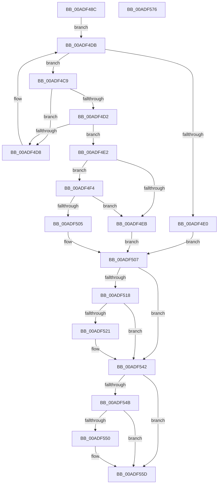

# PopPowerRequestNotifyUserSessionAttributed

- RVA: `0x00ADF48C`–`0x00ADF577` (길이 `235` bytes)
- VA: `0x0000000140ADF48C`
- 실행 섹션: `PAGE`
- PDB 이름 있음: `예`; PDB Function 태그: `아니요`
- unwind 정보 RVA: `0x00093E28`
- 디코드: `70`개 명령, `235/235` bytes 표시
- 미해석 바이트: `0` (있으면 어셈블리에 `.byte`로 보존)

> 이 문서는 커널 이미지의 기계어와 PDB 기호를 분석해 생성했습니다. 4번과 5번은 함수 원형과 자료형을 바이너리 사용 방식에서 추정한 C 해석이며 원본 소스 복구 결과는 아닙니다.

## 1. Dependencies

- 직접 호출 지점: **8**; 고유 호출 대상: **7**
- 직접 호출자로 확인된 함수: **1**
- RIP 상대 이미지 참조: **2**

### Outgoing calls
- `0x00ADF4B4` → [PopAcquirePowerRequestPushLock](../A6/PopAcquirePowerRequestPushLock_function_00A66D94.md) (function, `0x00A66D94`)
- `0x00ADF4E2` → [Feature_2315151673__private_IsEnabledDeviceUsageNoInline](../../text/5C/Feature_2315151673__private_IsEnabledDeviceUsageNoInline_function_005CF11C.md) (function, `0x005CF11C`)
- `0x00ADF4FC` → [ObReferenceObjectSafeWithTag](../../text/21/ObReferenceObjectSafeWithTag_function_00210EE0.md) (function, `0x00210EE0`)
- `0x00ADF50E` → [PopReleaseRwLock](../../text/2D/PopReleaseRwLock_function_002DFBBC.md) (function, `0x002DFBBC`)
- `0x00ADF518` → [TtmIsEnabled](../91/TtmIsEnabled_function_009143D8.md) (function, `0x009143D8`)
- `0x00ADF53D` → [TtmNotifySessionPowerRequestPresent](../77/TtmNotifySessionPowerRequestPresent_function_00776F88.md) (function, `0x00776F88`)
- `0x00ADF542` → [Feature_2315151673__private_IsEnabledDeviceUsageNoInline](../../text/5C/Feature_2315151673__private_IsEnabledDeviceUsageNoInline_function_005CF11C.md) (function, `0x005CF11C`)
- `0x00ADF558` → [ObfDereferenceObjectWithTag](../../text/2F/ObfDereferenceObjectWithTag_function_002F78E0.md) (function, `0x002F78E0`)

### Direct callers
- [PopPowerInformationInternal](../A8/PopPowerInformationInternal_function_00A8B7C0.md) at `0x00A8C5C5`

### Static image references
- `0x00ADF4B9` → RVA `0x00F0ED40` (`.data`; read)
- `0x00ADF507` → RVA `0x00F0ED20` (`.data`; read)

## 2. Other-region calls and transfers

- 다른 실행 섹션으로 향하는 call: **5**
  - `0x00ADF4E2` → [Feature_2315151673__private_IsEnabledDeviceUsageNoInline](../../text/5C/Feature_2315151673__private_IsEnabledDeviceUsageNoInline_function_005CF11C.md) (`PAGE` → `.text`)
  - `0x00ADF4FC` → [ObReferenceObjectSafeWithTag](../../text/21/ObReferenceObjectSafeWithTag_function_00210EE0.md) (`PAGE` → `.text`)
  - `0x00ADF50E` → [PopReleaseRwLock](../../text/2D/PopReleaseRwLock_function_002DFBBC.md) (`PAGE` → `.text`)
  - `0x00ADF542` → [Feature_2315151673__private_IsEnabledDeviceUsageNoInline](../../text/5C/Feature_2315151673__private_IsEnabledDeviceUsageNoInline_function_005CF11C.md) (`PAGE` → `.text`)
  - `0x00ADF558` → [ObfDereferenceObjectWithTag](../../text/2F/ObfDereferenceObjectWithTag_function_002F78E0.md) (`PAGE` → `.text`)
- 별도 외부 분기/꼬리 이동을 확인하지 못했습니다.

## 3. Assembly (complete function range)

```asm
00ADF48C  48 89 5C 24 08                  mov qword ptr [rsp + 8], rbx
00ADF491  48 89 6C 24 10                  mov qword ptr [rsp + 0x10], rbp
00ADF496  48 89 74 24 18                  mov qword ptr [rsp + 0x18], rsi
00ADF49B  57                              push rdi
00ADF49C  41 56                           push r14
00ADF49E  41 57                           push r15
00ADF4A0  48 83 EC 40                     sub rsp, 0x40
00ADF4A4  44 8B F9                        mov r15d, ecx
00ADF4A7  33 FF                           xor edi, edi
00ADF4A9  B1 01                           mov cl, 1
00ADF4AB  40 32 F6                        xor sil, sil
00ADF4AE  49 8B E8                        mov rbp, r8
00ADF4B1  4C 8B F2                        mov r14, rdx
00ADF4B4  E8 DB 78 F8 FF                  call 0x140a66d94
00ADF4B9  48 8B 1D 80 F8 42 00            mov rbx, qword ptr [rip + 0x42f880]
00ADF4C0  48 8D 05 79 F8 42 00            lea rax, [rip + 0x42f879]
00ADF4C7  EB 12                           jmp 0x140adf4db
00ADF4C9  48 8B FB                        mov rdi, rbx
00ADF4CC  44 39 7B 68                     cmp dword ptr [rbx + 0x68], r15d
00ADF4D0  75 06                           jne 0x140adf4d8
00ADF4D2  4C 39 73 70                     cmp qword ptr [rbx + 0x70], r14
00ADF4D6  74 0A                           je 0x140adf4e2
00ADF4D8  48 8B 1B                        mov rbx, qword ptr [rbx]
00ADF4DB  48 3B D8                        cmp rbx, rax
00ADF4DE  75 E9                           jne 0x140adf4c9
00ADF4E0  EB 25                           jmp 0x140adf507
00ADF4E2  E8 35 FC AE FF                  call 0x1405cf11c
00ADF4E7  85 C0                           test eax, eax
00ADF4E9  75 09                           jne 0x140adf4f4
00ADF4EB  48 89 6B 78                     mov qword ptr [rbx + 0x78], rbp
00ADF4EF  40 B6 01                        mov sil, 1
00ADF4F2  EB 13                           jmp 0x140adf507
00ADF4F4  BA 50 6F 50 72                  mov edx, 0x72506f50
00ADF4F9  48 8B CB                        mov rcx, rbx
00ADF4FC  E8 DF 19 73 FF                  call 0x140210ee0
00ADF501  84 C0                           test al, al
00ADF503  75 E6                           jne 0x140adf4eb
00ADF505  33 FF                           xor edi, edi
00ADF507  48 8D 0D 12 F8 42 00            lea rcx, [rip + 0x42f812]
00ADF50E  E8 A9 06 80 FF                  call 0x1402dfbbc
00ADF513  40 84 F6                        test sil, sil
00ADF516  74 2A                           je 0x140adf542
00ADF518  E8 BB 4E E3 FF                  call 0x1409143d8
00ADF51D  84 C0                           test al, al
00ADF51F  74 21                           je 0x140adf542
00ADF521  48 8B 47 78                     mov rax, qword ptr [rdi + 0x78]
00ADF525  4C 8B 4F 70                     mov r9, qword ptr [rdi + 0x70]
00ADF529  44 8B 47 68                     mov r8d, dword ptr [rdi + 0x68]
00ADF52D  8B 57 24                        mov edx, dword ptr [rdi + 0x24]
00ADF530  8B 4F 10                        mov ecx, dword ptr [rdi + 0x10]
00ADF533  C6 44 24 30 01                  mov byte ptr [rsp + 0x30], 1
00ADF538  48 89 44 24 20                  mov qword ptr [rsp + 0x20], rax
00ADF53D  E8 46 7A C9 FF                  call 0x140776f88
00ADF542  E8 D5 FB AE FF                  call 0x1405cf11c
00ADF547  85 C0                           test eax, eax
00ADF549  74 12                           je 0x140adf55d
00ADF54B  40 84 F6                        test sil, sil
00ADF54E  74 0D                           je 0x140adf55d
00ADF550  BA 50 6F 50 72                  mov edx, 0x72506f50
00ADF555  48 8B CF                        mov rcx, rdi
00ADF558  E8 83 83 81 FF                  call 0x1402f78e0
00ADF55D  48 8B 5C 24 60                  mov rbx, qword ptr [rsp + 0x60]
00ADF562  48 8B 6C 24 68                  mov rbp, qword ptr [rsp + 0x68]
00ADF567  48 8B 74 24 70                  mov rsi, qword ptr [rsp + 0x70]
00ADF56C  48 83 C4 40                     add rsp, 0x40
00ADF570  41 5F                           pop r15
00ADF572  41 5E                           pop r14
00ADF574  5F                              pop rdi
00ADF575  C3                              ret
00ADF576  CC                              int3
```

## 4. C-style interpretation (structured pseudocode)

```c
__int64 __fastcall PopPowerRequestNotifyUserSessionAttributed(int a1, __int64 a2, __int64 a3)
{
    __int64 result;
    __int64 v_rdi;
    __int64 v_rsi;
    __int64 v_rsp;
    unsigned __int8 v_stack_m28;
    unsigned __int64 v_stack_m38;
    unsigned __int64 v_stack_p10;
    unsigned __int64 v_stack_p18;
    unsigned __int64 v_stack_p8;

    v_stack_p8 = v_rbx;
    v_stack_p10 = v_rbp;
    v_stack_p18 = v_rsi;
    v_rsp = (v_rsp) - (64);
    v_rdi = 0;
    v_rsi = 0;
    result = PopAcquirePowerRequestPushLock(1, a2, a3, a4);
    goto loc_00ADF4DB;
loc_00ADF4C9:
    if ((*(unsigned int *)(*(unsigned __int64 *)(v_rip + 4388992) + 104)) != ((unsigned int)((unsigned int)(a1)))) goto loc_00ADF4D8;
    if ((*(unsigned __int64 *)(*(unsigned __int64 *)(v_rip + 4388992) + 112)) == a2) goto loc_00ADF4E2;
loc_00ADF4D8:
loc_00ADF4DB:
    if ((*(unsigned __int64 *)(*(unsigned __int64 *)(v_rip + 4388992))) != (v_rip + 4388985)) goto loc_00ADF4C9;
    goto loc_00ADF507;
loc_00ADF4E2:
    result = Feature_2315151673__private_IsEnabledDeviceUsageNoInline(1, a2, a3, a4);
    if ((unsigned int)(result) != 0) goto loc_00ADF4F4;
loc_00ADF4EB:
    *(unsigned __int64 *)(*(unsigned __int64 *)(*(unsigned __int64 *)(v_rip + 4388992)) + 120) = a3;
    goto loc_00ADF507;
loc_00ADF4F4:
    result = ObReferenceObjectSafeWithTag(*(unsigned __int64 *)(*(unsigned __int64 *)(v_rip + 4388992)), (unsigned int)(0x72506F50ULL), a3, a4);
    if ((unsigned __int8)(result) != 0) goto loc_00ADF4EB;
    v_rdi = 0;
loc_00ADF507:
    result = PopReleaseRwLock(v_rip + 4388882, (unsigned int)(0x72506F50ULL), a3, a4);
    if (1 == 0) goto loc_00ADF542;
    result = TtmIsEnabled(v_rip + 4388882, (unsigned int)(0x72506F50ULL), a3, a4);
    if ((unsigned __int8)(result) != 0) {
        result = *(unsigned __int64 *)(v_rdi + 120);
        a4 = *(unsigned __int64 *)(v_rdi + 112);
        a3 = *(unsigned int *)(v_rdi + 104);
        a2 = *(unsigned int *)(v_rdi + 36);
        a1 = *(unsigned int *)(v_rdi + 16);
        v_stack_m28 = 1;
        v_stack_m38 = result;
        result = TtmNotifySessionPowerRequestPresent(a1, a2, a3, a4);
    }
    result = Feature_2315151673__private_IsEnabledDeviceUsageNoInline(a1, a2, a3, a4);
    if ((unsigned int)(result) == 0) goto loc_00ADF55D;
    if (1 != 0) {
        a2 = 0x72506F50ULL;
        a1 = 0;
        result = ObfDereferenceObjectWithTag(a1, a2, a3, a4);
    }
    v_rsp = (v_rsp) + (64);
    return result;
}
```

## 5. (Beta) C Style

```c
int64_t PopPowerRequestNotifyUserSessionAttributed(int32_t Arg1, int64_t Arg2, int64_t Arg3)
{
    int64_t result;
    int64_t local_rdi;
    int64_t local_rsi;
    int64_t local_rsp;
    uint8_t v_stack_m28;
    uint64_t v_stack_m38;
    uint64_t v_stack_p10;
    uint64_t v_stack_p18;
    uint64_t v_stack_p8;

    v_stack_p8 = local_rbx;
    v_stack_p10 = local_rbp;
    v_stack_p18 = local_rsi;
    local_rsp = (local_rsp) - (64);
    local_rdi = 0;
    local_rsi = 0;
    result = PopAcquirePowerRequestPushLock(1, Arg2, Arg3, a4);
    goto loc_00ADF4DB;
loc_00ADF4C9:
    if ((*(uint32_t *)(*(uint64_t *)(v_rip + 0x42F880) + 0x68)) != ((uint32_t)((uint32_t)(Arg1)))) goto loc_00ADF4D8;
    if ((*(uint64_t *)(*(uint64_t *)(v_rip + 0x42F880) + 0x70)) == Arg2) goto loc_00ADF4E2;
loc_00ADF4D8:
loc_00ADF4DB:
    if ((*(uint64_t *)(*(uint64_t *)(v_rip + 0x42F880))) != (v_rip + 4388985)) goto loc_00ADF4C9;
    goto loc_00ADF507;
loc_00ADF4E2:
    result = Feature_2315151673__private_IsEnabledDeviceUsageNoInline(1, Arg2, Arg3, a4);
    if ((uint32_t)(result) != 0) goto loc_00ADF4F4;
loc_00ADF4EB:
    *(uint64_t *)(*(uint64_t *)(*(uint64_t *)(v_rip + 0x42F880)) + 0x78) = Arg3;
    goto loc_00ADF507;
loc_00ADF4F4:
    result = ObReferenceObjectSafeWithTag(*(uint64_t *)(*(uint64_t *)(v_rip + 0x42F880)), (uint32_t)(0x72506F50ULL), Arg3, a4);
    if ((uint8_t)(result) != 0) goto loc_00ADF4EB;
    local_rdi = 0;
loc_00ADF507:
    result = PopReleaseRwLock(v_rip + 4388882, (uint32_t)(0x72506F50ULL), Arg3, a4);
    if (1 == 0) goto loc_00ADF542;
    result = TtmIsEnabled(v_rip + 4388882, (uint32_t)(0x72506F50ULL), Arg3, a4);
    if ((uint8_t)(result) != 0) {
        result = *(uint64_t *)(local_rdi + 0x78);
        a4 = *(uint64_t *)(local_rdi + 0x70);
        Arg3 = *(uint32_t *)(local_rdi + 0x68);
        Arg2 = *(uint32_t *)(local_rdi + 0x24);
        Arg1 = *(uint32_t *)(local_rdi + 0x10);
        v_stack_m28 = 1;
        v_stack_m38 = result;
        result = TtmNotifySessionPowerRequestPresent(Arg1, Arg2, Arg3, a4);
    }
    result = Feature_2315151673__private_IsEnabledDeviceUsageNoInline(Arg1, Arg2, Arg3, a4);
    if ((uint32_t)(result) == 0) goto loc_00ADF55D;
    if (1 != 0) {
        Arg2 = 0x72506F50ULL;
        Arg1 = 0;
        result = ObfDereferenceObjectWithTag(Arg1, Arg2, Arg3, a4);
    }
    local_rsp = (local_rsp) + (64);
    return result;
}
```

## 6. Execution-region graph

[열기: 2D/3D 그래프와 함수 탐색 컨트롤 패널](../../../control-panel.html?section=page&rva=0x00ADF48C&view=graph)

- 2D 그래프는 위에서 아래로 흐르고, 3D 그래프는 빈 공간을 드래그해 회전합니다. Shift+드래그는 이동, 휠은 확대·축소, 함수 노드 선택은 대상 보고서 이동입니다.

### Static fallback


