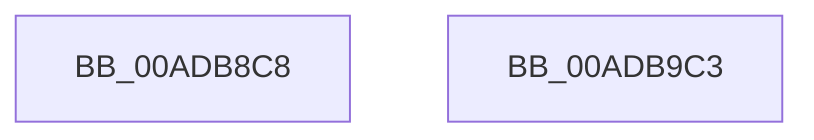

# PopPublishPowerButtonState

- RVA: `0x00ADB8C8`–`0x00ADB9C4` (길이 `252` bytes)
- VA: `0x0000000140ADB8C8`
- 실행 섹션: `PAGE`
- PDB 이름 있음: `예`; PDB Function 태그: `아니요`
- unwind 정보 RVA: `0x000BF5A4`
- 디코드: `63`개 명령, `252/252` bytes 표시
- 미해석 바이트: `0` (있으면 어셈블리에 `.byte`로 보존)

> 이 문서는 커널 이미지의 기계어와 PDB 기호를 분석해 생성했습니다. 4번과 5번은 함수 원형과 자료형을 바이너리 사용 방식에서 추정한 C 해석이며 원본 소스 복구 결과는 아닙니다.

## 1. Dependencies

- 직접 호출 지점: **2**; 고유 호출 대상: **2**
- 직접 호출자로 확인된 함수: **1**
- RIP 상대 이미지 참조: **2**

### Outgoing calls
- `0x00ADB977` → [DbgPrintEx](../../text/35/DbgPrintEx_function_00359290.md) (function, `0x00359290`)
- `0x00ADB99C` → [ZwUpdateWnfStateData](../../text/6B/ZwUpdateWnfStateData_function_006B0D10.md) (function, `0x006B0D10`)

### Direct callers
- [PopPowerButtonWorkCallback](../../text/5D/PopPowerButtonWorkCallback_function_005D9A70.md) at `0x005D9B4D`
- [PopPowerButtonWorkCallback](../../text/5D/PopPowerButtonWorkCallback_function_005D9A70.md) at `0x005D9C11`

### Static image references
- `0x00ADB939` → RVA `0x00B02D30` (` ?? ::NNGAKEGL::`string'`; read)
- `0x00ADB97E` → RVA `0x0001ED80` (`.rdata`; read)

## 2. Other-region calls and transfers

- 다른 실행 섹션으로 향하는 call: **2**
  - `0x00ADB977` → [DbgPrintEx](../../text/35/DbgPrintEx_function_00359290.md) (`PAGE` → `.text`)
  - `0x00ADB99C` → [ZwUpdateWnfStateData](../../text/6B/ZwUpdateWnfStateData_function_006B0D10.md) (`PAGE` → `.text`)
- 별도 외부 분기/꼬리 이동을 확인하지 못했습니다.

## 3. Assembly (complete function range)

```asm
00ADB8C8  48 8B C4                        mov rax, rsp
00ADB8CB  48 89 58 08                     mov qword ptr [rax + 8], rbx
00ADB8CF  48 89 68 10                     mov qword ptr [rax + 0x10], rbp
00ADB8D3  48 89 70 18                     mov qword ptr [rax + 0x18], rsi
00ADB8D7  48 89 78 20                     mov qword ptr [rax + 0x20], rdi
00ADB8DB  41 54                           push r12
00ADB8DD  41 56                           push r14
00ADB8DF  41 57                           push r15
00ADB8E1  48 81 EC 90 00 00 00            sub rsp, 0x90
00ADB8E8  0F B6 41 17                     movzx eax, byte ptr [rcx + 0x17]
00ADB8EC  4C 8B E1                        mov r12, rcx
00ADB8EF  0F B6 51 16                     movzx edx, byte ptr [rcx + 0x16]
00ADB8F3  44 0F B6 41 15                  movzx r8d, byte ptr [rcx + 0x15]
00ADB8F8  44 8B 09                        mov r9d, dword ptr [rcx]
00ADB8FB  45 8B F9                        mov r15d, r9d
00ADB8FE  44 0F B6 51 14                  movzx r10d, byte ptr [rcx + 0x14]
00ADB903  41 83 E1 01                     and r9d, 1
00ADB907  44 0F B6 59 13                  movzx r11d, byte ptr [rcx + 0x13]
00ADB90C  0F B6 59 12                     movzx ebx, byte ptr [rcx + 0x12]
00ADB910  0F B6 79 11                     movzx edi, byte ptr [rcx + 0x11]
00ADB914  0F B6 71 10                     movzx esi, byte ptr [rcx + 0x10]
00ADB918  0F B7 69 0E                     movzx ebp, word ptr [rcx + 0xe]
00ADB91C  44 0F B7 71 0C                  movzx r14d, word ptr [rcx + 0xc]
00ADB921  89 84 24 80 00 00 00            mov dword ptr [rsp + 0x80], eax
00ADB928  8B 41 08                        mov eax, dword ptr [rcx + 8]
00ADB92B  89 54 24 78                     mov dword ptr [rsp + 0x78], edx
00ADB92F  BA 03 00 00 00                  mov edx, 3
00ADB934  44 89 44 24 70                  mov dword ptr [rsp + 0x70], r8d
00ADB939  4C 8D 05 F0 73 02 00            lea r8, [rip + 0x273f0]
00ADB940  44 89 54 24 68                  mov dword ptr [rsp + 0x68], r10d
00ADB945  44 89 5C 24 60                  mov dword ptr [rsp + 0x60], r11d
00ADB94A  89 5C 24 58                     mov dword ptr [rsp + 0x58], ebx
00ADB94E  89 7C 24 50                     mov dword ptr [rsp + 0x50], edi
00ADB952  89 74 24 48                     mov dword ptr [rsp + 0x48], esi
00ADB956  89 6C 24 40                     mov dword ptr [rsp + 0x40], ebp
00ADB95A  44 89 74 24 38                  mov dword ptr [rsp + 0x38], r14d
00ADB95F  89 44 24 30                     mov dword ptr [rsp + 0x30], eax
00ADB963  8B 41 04                        mov eax, dword ptr [rcx + 4]
00ADB966  B9 92 00 00 00                  mov ecx, 0x92
00ADB96B  89 44 24 28                     mov dword ptr [rsp + 0x28], eax
00ADB96F  41 D1 EF                        shr r15d, 1
00ADB972  44 89 7C 24 20                  mov dword ptr [rsp + 0x20], r15d
00ADB977  E8 14 D9 87 FF                  call 0x140359290
00ADB97C  33 C0                           xor eax, eax
00ADB97E  48 8D 0D FB 33 54 FF            lea rcx, [rip - 0xabcc05]
00ADB985  89 44 24 30                     mov dword ptr [rsp + 0x30], eax
00ADB989  45 33 C9                        xor r9d, r9d
00ADB98C  89 44 24 28                     mov dword ptr [rsp + 0x28], eax
00ADB990  49 8B D4                        mov rdx, r12
00ADB993  48 89 44 24 20                  mov qword ptr [rsp + 0x20], rax
00ADB998  44 8D 40 18                     lea r8d, [rax + 0x18]
00ADB99C  E8 6F 53 BD FF                  call 0x1406b0d10
00ADB9A1  4C 8D 9C 24 90 00 00 00         lea r11, [rsp + 0x90]
00ADB9A9  49 8B 5B 20                     mov rbx, qword ptr [r11 + 0x20]
00ADB9AD  49 8B 6B 28                     mov rbp, qword ptr [r11 + 0x28]
00ADB9B1  49 8B 73 30                     mov rsi, qword ptr [r11 + 0x30]
00ADB9B5  49 8B 7B 38                     mov rdi, qword ptr [r11 + 0x38]
00ADB9B9  49 8B E3                        mov rsp, r11
00ADB9BC  41 5F                           pop r15
00ADB9BE  41 5E                           pop r14
00ADB9C0  41 5C                           pop r12
00ADB9C2  C3                              ret
00ADB9C3  CC                              int3
```

## 4. C-style interpretation (structured pseudocode)

```c
__int64 __fastcall PopPublishPowerButtonState(__int64 a1)
{
    __int64 result;
    __int64 v_r15;
    __int64 v_rsp;
    unsigned __int64 v_stack_m18;
    unsigned int v_stack_m28;
    unsigned int v_stack_m30;
    unsigned int v_stack_m38;
    unsigned int v_stack_m40;
    unsigned int v_stack_m48;
    unsigned int v_stack_m50;
    unsigned int v_stack_m58;
    unsigned int v_stack_m60;
    unsigned int v_stack_m68;
    unsigned int v_stack_m70;
    unsigned int v_stack_m78;
    unsigned int v_stack_m80;
    unsigned int v_stack_m88;

    *(unsigned __int64 *)(v_rsp + 8) = v_rbx;
    *(unsigned __int64 *)(v_rsp + 16) = v_rbp;
    *(unsigned __int64 *)(v_rsp + 24) = v_rsi;
    *(unsigned __int64 *)(v_rsp + 32) = v_rdi;
    v_rsp = (v_rsp) - (144);
    a4 = (unsigned int)(((unsigned int)(*(unsigned int *)(a1))) & (1));
    v_stack_m28 = (unsigned int)(*(unsigned __int8 *)(a1 + 23));
    v_stack_m30 = (unsigned int)(*(unsigned __int8 *)(a1 + 22));
    v_stack_m38 = (unsigned int)(*(unsigned __int8 *)(a1 + 21));
    v_stack_m40 = (unsigned int)(*(unsigned __int8 *)(a1 + 20));
    v_stack_m48 = (unsigned int)(*(unsigned __int8 *)(a1 + 19));
    v_stack_m50 = (unsigned int)(*(unsigned __int8 *)(a1 + 18));
    v_stack_m58 = (unsigned int)(*(unsigned __int8 *)(a1 + 17));
    v_stack_m60 = (unsigned int)(*(unsigned __int8 *)(a1 + 16));
    v_stack_m68 = (unsigned int)(*(unsigned __int16 *)(a1 + 14));
    v_stack_m70 = (unsigned int)(*(unsigned __int16 *)(a1 + 12));
    v_stack_m78 = (unsigned int)((unsigned int)(*(unsigned int *)(a1 + 8)));
    v_stack_m80 = (unsigned int)((unsigned int)(*(unsigned int *)(a1 + 4)));
    v_r15 = (unsigned int)(((unsigned int)((unsigned int)((unsigned int)(*(unsigned int *)(a1))))) >> (1));
    v_stack_m88 = (unsigned int)(v_r15);
    result = DbgPrintEx(146, 3, v_rip + 160752, a4);
    result = 0;
    v_stack_m78 = 0;
    a4 = 0;
    v_stack_m80 = 0;
    v_stack_m88 = 0;
    result = ZwUpdateWnfStateData(v_rip - 11258885, a1, result + 24, a4);
    return result;
}
```

## 5. (Beta) C Style

```c
int64_t PopPublishPowerButtonState(void *Arg1)
{
    uint8_t *arg1 = (uint8_t *)Arg1;

    int64_t result;
    int64_t local_r15;
    int64_t local_rsp;
    uint64_t v_stack_m18;
    uint32_t v_stack_m28;
    uint32_t v_stack_m30;
    uint32_t v_stack_m38;
    uint32_t v_stack_m40;
    uint32_t v_stack_m48;
    uint32_t v_stack_m50;
    uint32_t v_stack_m58;
    uint32_t v_stack_m60;
    uint32_t v_stack_m68;
    uint32_t v_stack_m70;
    uint32_t v_stack_m78;
    uint32_t v_stack_m80;
    uint32_t v_stack_m88;

    *(uint64_t *)(local_rsp + 0x8) = local_rbx;
    *(uint64_t *)(local_rsp + 0x10) = local_rbp;
    *(uint64_t *)(local_rsp + 0x18) = local_rsi;
    *(uint64_t *)(local_rsp + 0x20) = local_rdi;
    local_rsp = (local_rsp) - (144);
    a4 = (uint32_t)(((uint32_t)(*(uint32_t *)(arg1))) & (1));
    v_stack_m28 = (uint32_t)(*(uint8_t *)(arg1 + 0x17));
    v_stack_m30 = (uint32_t)(*(uint8_t *)(arg1 + 0x16));
    v_stack_m38 = (uint32_t)(*(uint8_t *)(arg1 + 0x15));
    v_stack_m40 = (uint32_t)(*(uint8_t *)(arg1 + 0x14));
    v_stack_m48 = (uint32_t)(*(uint8_t *)(arg1 + 0x13));
    v_stack_m50 = (uint32_t)(*(uint8_t *)(arg1 + 0x12));
    v_stack_m58 = (uint32_t)(*(uint8_t *)(arg1 + 0x11));
    v_stack_m60 = (uint32_t)(*(uint8_t *)(arg1 + 0x10));
    v_stack_m68 = (uint32_t)(*(uint16_t *)(arg1 + 0xE));
    v_stack_m70 = (uint32_t)(*(uint16_t *)(arg1 + 0xC));
    v_stack_m78 = (uint32_t)((uint32_t)(*(uint32_t *)(arg1 + 0x8)));
    v_stack_m80 = (uint32_t)((uint32_t)(*(uint32_t *)(arg1 + 0x4)));
    local_r15 = (uint32_t)(((uint32_t)((uint32_t)((uint32_t)(*(uint32_t *)(arg1))))) >> (1));
    v_stack_m88 = (uint32_t)(local_r15);
    result = DbgPrintEx(146, 3, v_rip + 160752, a4);
    result = 0;
    v_stack_m78 = 0;
    a4 = 0;
    v_stack_m80 = 0;
    v_stack_m88 = 0;
    result = ZwUpdateWnfStateData(v_rip - 11258885, Arg1, result + 24, a4);
    return result;
}
```

### 관측된 메모리 오프셋

구조체 형식이 확인되지 않은 접근은 인자 기준의 오프셋으로만 기록했습니다.

| 기준 인자 | 오프셋 표현 | 폭 (bit) | 접근 |
|---|---:|---:|---|
| `Arg1` | `+ 0x0` | `32` | `R` |
| `Arg1` | `+ 0x4` | `32` | `R` |
| `Arg1` | `+ 0x8` | `32` | `R` |
| `Arg1` | `+ 0xC` | `16` | `R` |
| `Arg1` | `+ 0xE` | `16` | `R` |
| `Arg1` | `+ 0x10` | `8` | `R` |
| `Arg1` | `+ 0x11` | `8` | `R` |
| `Arg1` | `+ 0x12` | `8` | `R` |
| `Arg1` | `+ 0x13` | `8` | `R` |
| `Arg1` | `+ 0x14` | `8` | `R` |
| `Arg1` | `+ 0x15` | `8` | `R` |
| `Arg1` | `+ 0x16` | `8` | `R` |
| `Arg1` | `+ 0x17` | `8` | `R` |

## 6. Execution-region graph

[열기: 2D/3D 그래프와 함수 탐색 컨트롤 패널](../../../control-panel.html?section=page&rva=0x00ADB8C8&view=graph)

- 2D 그래프는 위에서 아래로 흐르고, 3D 그래프는 빈 공간을 드래그해 회전합니다. Shift+드래그는 이동, 휠은 확대·축소, 함수 노드 선택은 대상 보고서 이동입니다.

### Static fallback


