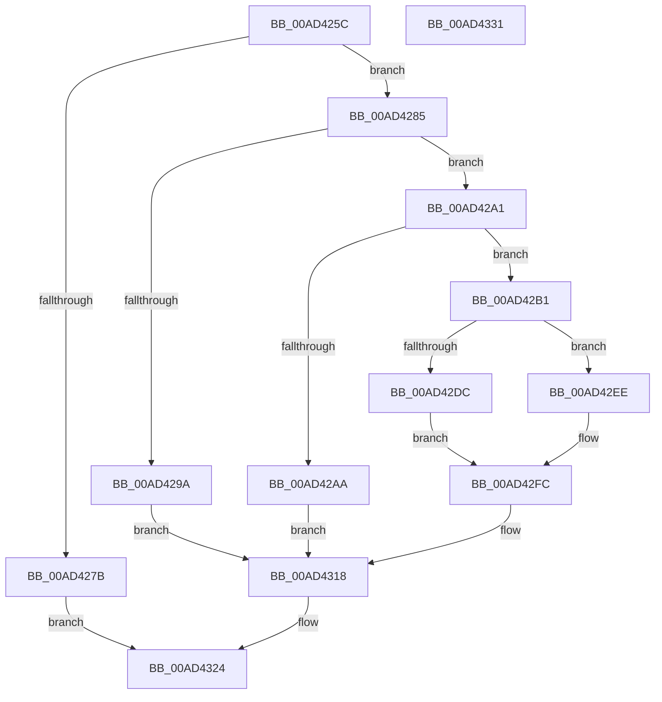

# PopSendSuspendResumeNotifications

- RVA: `0x00AD425C`–`0x00AD4332` (길이 `214` bytes)
- VA: `0x0000000140AD425C`
- 실행 섹션: `PAGE`
- PDB 이름 있음: `예`; PDB Function 태그: `아니요`
- unwind 정보 RVA: `0x0005CAAC`
- 디코드: `48`개 명령, `214/214` bytes 표시
- 미해석 바이트: `0` (있으면 어셈블리에 `.byte`로 보존)

> 이 문서는 커널 이미지의 기계어와 PDB 기호를 분석해 생성했습니다. 4번과 5번은 함수 원형과 자료형을 바이너리 사용 방식에서 추정한 C 해석이며 원본 소스 복구 결과는 아닙니다.

## 1. Dependencies

- 직접 호출 지점: **8**; 고유 호출 대상: **4**
- 직접 호출자로 확인된 함수: **1**
- RIP 상대 이미지 참조: **7**

### Outgoing calls
- `0x00AD428C` → [PopAcquireRwLockExclusive](../../text/43/PopAcquireRwLockExclusive_function_00430B44.md) (function, `0x00430B44`)
- `0x00AD42D2` → [PopReleaseRwLock](../../text/2D/PopReleaseRwLock_function_002DFBBC.md) (function, `0x002DFBBC`)
- `0x00AD42DF` → [PopSendSuspendResumeApplicationNotification](../75/PopSendSuspendResumeApplicationNotification_function_0075EC74.md) (function, `0x0075EC74`)
- `0x00AD42E7` → [PopSendSuspendResumeServiceNotification](../75/PopSendSuspendResumeServiceNotification_function_0075ED9C.md) (function, `0x0075ED9C`)
- `0x00AD42F0` → [PopSendSuspendResumeServiceNotification](../75/PopSendSuspendResumeServiceNotification_function_0075ED9C.md) (function, `0x0075ED9C`)
- `0x00AD42F7` → [PopSendSuspendResumeApplicationNotification](../75/PopSendSuspendResumeApplicationNotification_function_0075EC74.md) (function, `0x0075EC74`)
- `0x00AD4305` → [PopAcquireRwLockExclusive](../../text/43/PopAcquireRwLockExclusive_function_00430B44.md) (function, `0x00430B44`)
- `0x00AD431F` → [PopReleaseRwLock](../../text/2D/PopReleaseRwLock_function_002DFBBC.md) (function, `0x002DFBBC`)

### Direct callers
- [NtPowerInformation](../95/NtPowerInformation_function_00955D80.md) at `0x00957E48`

### Static image references
- `0x00AD4285` → RVA `0x00F0D120` (`.data`; read)
- `0x00AD4291` → RVA `0x00F0D134` (`.data`; read)
- `0x00AD42A1` → RVA `0x00F0D130` (`.data`; read)
- `0x00AD42C1` → RVA `0x00F0D138` (`.data`; write)
- `0x00AD42C8` → RVA `0x00F0D134` (`.data`; write)
- `0x00AD430A` → RVA `0x00F0D134` (`.data`; read/write)
- `0x00AD4311` → RVA `0x00F0D130` (`.data`; write)

## 2. Other-region calls and transfers

- 다른 실행 섹션으로 향하는 call: **4**
  - `0x00AD428C` → [PopAcquireRwLockExclusive](../../text/43/PopAcquireRwLockExclusive_function_00430B44.md) (`PAGE` → `.text`)
  - `0x00AD42D2` → [PopReleaseRwLock](../../text/2D/PopReleaseRwLock_function_002DFBBC.md) (`PAGE` → `.text`)
  - `0x00AD4305` → [PopAcquireRwLockExclusive](../../text/43/PopAcquireRwLockExclusive_function_00430B44.md) (`PAGE` → `.text`)
  - `0x00AD431F` → [PopReleaseRwLock](../../text/2D/PopReleaseRwLock_function_002DFBBC.md) (`PAGE` → `.text`)
- 별도 외부 분기/꼬리 이동을 확인하지 못했습니다.

## 3. Assembly (complete function range)

```asm
00AD425C  48 89 5C 24 08                  mov qword ptr [rsp + 8], rbx
00AD4261  57                              push rdi
00AD4262  48 83 EC 20                     sub rsp, 0x20
00AD4266  65 48 8B 04 25 88 01 00 00      mov rax, qword ptr gs:[0x188]
00AD426F  40 8A F9                        mov dil, cl
00AD4272  80 B8 32 02 00 00 00            cmp byte ptr [rax + 0x232], 0
00AD4279  75 0A                           jne 0x140ad4285
00AD427B  BB 22 00 00 C0                  mov ebx, 0xc0000022
00AD4280  E9 9F 00 00 00                  jmp 0x140ad4324
00AD4285  48 8D 0D 94 8E 43 00            lea rcx, [rip + 0x438e94]
00AD428C  E8 B3 C8 95 FF                  call 0x140430b44
00AD4291  83 3D 9C 8E 43 00 01            cmp dword ptr [rip + 0x438e9c], 1
00AD4298  75 07                           jne 0x140ad42a1
00AD429A  BB 02 00 19 C0                  mov ebx, 0xc0190002
00AD429F  EB 77                           jmp 0x140ad4318
00AD42A1  40 3A 3D 88 8E 43 00            cmp dil, byte ptr [rip + 0x438e88]
00AD42A8  75 07                           jne 0x140ad42b1
00AD42AA  BB D3 02 00 C0                  mov ebx, 0xc00002d3
00AD42AF  EB 67                           jmp 0x140ad4318
00AD42B1  65 48 8B 04 25 88 01 00 00      mov rax, qword ptr gs:[0x188]
00AD42BA  48 8D 0D 5F 8E 43 00            lea rcx, [rip + 0x438e5f]
00AD42C1  48 89 05 70 8E 43 00            mov qword ptr [rip + 0x438e70], rax
00AD42C8  C7 05 62 8E 43 00 01 00 00 00   mov dword ptr [rip + 0x438e62], 1
00AD42D2  E8 E5 B8 80 FF                  call 0x1402dfbbc
00AD42D7  40 84 FF                        test dil, dil
00AD42DA  74 12                           je 0x140ad42ee
00AD42DC  40 8A CF                        mov cl, dil
00AD42DF  E8 90 A9 C8 FF                  call 0x14075ec74
00AD42E4  40 8A CF                        mov cl, dil
00AD42E7  E8 B0 AA C8 FF                  call 0x14075ed9c
00AD42EC  EB 0E                           jmp 0x140ad42fc
00AD42EE  33 C9                           xor ecx, ecx
00AD42F0  E8 A7 AA C8 FF                  call 0x14075ed9c
00AD42F5  33 C9                           xor ecx, ecx
00AD42F7  E8 78 A9 C8 FF                  call 0x14075ec74
00AD42FC  48 8D 0D 1D 8E 43 00            lea rcx, [rip + 0x438e1d]
00AD4303  8B D8                           mov ebx, eax
00AD4305  E8 3A C8 95 FF                  call 0x140430b44
00AD430A  83 25 23 8E 43 00 00            and dword ptr [rip + 0x438e23], 0
00AD4311  40 88 3D 18 8E 43 00            mov byte ptr [rip + 0x438e18], dil
00AD4318  48 8D 0D 01 8E 43 00            lea rcx, [rip + 0x438e01]
00AD431F  E8 98 B8 80 FF                  call 0x1402dfbbc
00AD4324  8B C3                           mov eax, ebx
00AD4326  48 8B 5C 24 30                  mov rbx, qword ptr [rsp + 0x30]
00AD432B  48 83 C4 20                     add rsp, 0x20
00AD432F  5F                              pop rdi
00AD4330  C3                              ret
00AD4331  CC                              int3
```

## 4. C-style interpretation (structured pseudocode)

```c
__int64 __fastcall PopSendSuspendResumeNotifications(unsigned __int8 a1)
{
    __int64 result;
    __int64 v_rsp;
    unsigned __int64 v_stack_p8;

    v_stack_p8 = v_rbx;
    v_rsp = (v_rsp) - (32);
    if ((*(unsigned __int8 *)(*(unsigned __int64 *)(gs_base + (0 + 392)) + 562)) != 0) goto loc_00AD4285;
    goto loc_00AD4324;
loc_00AD4285:
    result = PopAcquireRwLockExclusive(v_rip + 4427412, a2, a3, a4);
    if ((*(unsigned int *)(v_rip + 4427420)) != 1) goto loc_00AD42A1;
    goto loc_00AD4318;
loc_00AD42A1:
    if (a1 != (*(unsigned __int8 *)(v_rip + 4427400))) goto loc_00AD42B1;
    goto loc_00AD4318;
loc_00AD42B1:
    *(unsigned __int64 *)(v_rip + 4427376) = *(unsigned __int64 *)(gs_base + (0 + 392));
    *(unsigned int *)(v_rip + 4427362) = 1;
    result = PopReleaseRwLock(v_rip + 4427359, a2, a3, a4);
    if (a1 == 0) goto loc_00AD42EE;
    result = PopSendSuspendResumeApplicationNotification(a1, a2, a3, a4);
    result = PopSendSuspendResumeServiceNotification(a1, a2, a3, a4);
    goto loc_00AD42FC;
loc_00AD42EE:
    a1 = 0;
    result = PopSendSuspendResumeServiceNotification(a1, a2, a3, a4);
    a1 = 0;
    result = PopSendSuspendResumeApplicationNotification(a1, a2, a3, a4);
loc_00AD42FC:
    result = PopAcquireRwLockExclusive(v_rip + 4427293, a2, a3, a4);
    *(unsigned __int8 *)(v_rip + 4427288) = 0;
loc_00AD4318:
    result = PopReleaseRwLock(v_rip + 4427265, a2, a3, a4);
loc_00AD4324:
    v_rsp = (v_rsp) + (32);
    return (unsigned int)((unsigned int)((unsigned int)((unsigned int)(result))));
}
```

## 5. (Beta) C Style

```c
int64_t PopSendSuspendResumeNotifications(uint8_t Arg1)
{
    int64_t result;
    int64_t local_rsp;
    uint64_t v_stack_p8;

    v_stack_p8 = local_rbx;
    local_rsp = (local_rsp) - (32);
    if ((*(uint8_t *)(*(uint64_t *)(gs_base + (0 + 0x188)) + 0x232)) != 0) goto loc_00AD4285;
    goto loc_00AD4324;
loc_00AD4285:
    result = PopAcquireRwLockExclusive(v_rip + 4427412, a2, a3, a4);
    if ((*(uint32_t *)(v_rip + 0x438E9C)) != 1) goto loc_00AD42A1;
    goto loc_00AD4318;
loc_00AD42A1:
    if (Arg1 != (*(uint8_t *)(v_rip + 0x438E88))) goto loc_00AD42B1;
    goto loc_00AD4318;
loc_00AD42B1:
    *(uint64_t *)(v_rip + 0x438E70) = *(uint64_t *)(gs_base + (0 + 0x188));
    *(uint32_t *)(v_rip + 0x438E62) = 1;
    result = PopReleaseRwLock(v_rip + 4427359, a2, a3, a4);
    if (Arg1 == 0) goto loc_00AD42EE;
    result = PopSendSuspendResumeApplicationNotification(Arg1, a2, a3, a4);
    result = PopSendSuspendResumeServiceNotification(Arg1, a2, a3, a4);
    goto loc_00AD42FC;
loc_00AD42EE:
    Arg1 = 0;
    result = PopSendSuspendResumeServiceNotification(Arg1, a2, a3, a4);
    Arg1 = 0;
    result = PopSendSuspendResumeApplicationNotification(Arg1, a2, a3, a4);
loc_00AD42FC:
    result = PopAcquireRwLockExclusive(v_rip + 4427293, a2, a3, a4);
    *(uint8_t *)(v_rip + 0x438E18) = 0;
loc_00AD4318:
    result = PopReleaseRwLock(v_rip + 4427265, a2, a3, a4);
loc_00AD4324:
    local_rsp = (local_rsp) + (32);
    return (uint32_t)((uint32_t)((uint32_t)((uint32_t)(result))));
}
```

## 6. Execution-region graph

[열기: 2D/3D 그래프와 함수 탐색 컨트롤 패널](../../../control-panel.html?section=page&rva=0x00AD425C&view=graph)

- 2D 그래프는 위에서 아래로 흐르고, 3D 그래프는 빈 공간을 드래그해 회전합니다. Shift+드래그는 이동, 휠은 확대·축소, 함수 노드 선택은 대상 보고서 이동입니다.

### Static fallback


