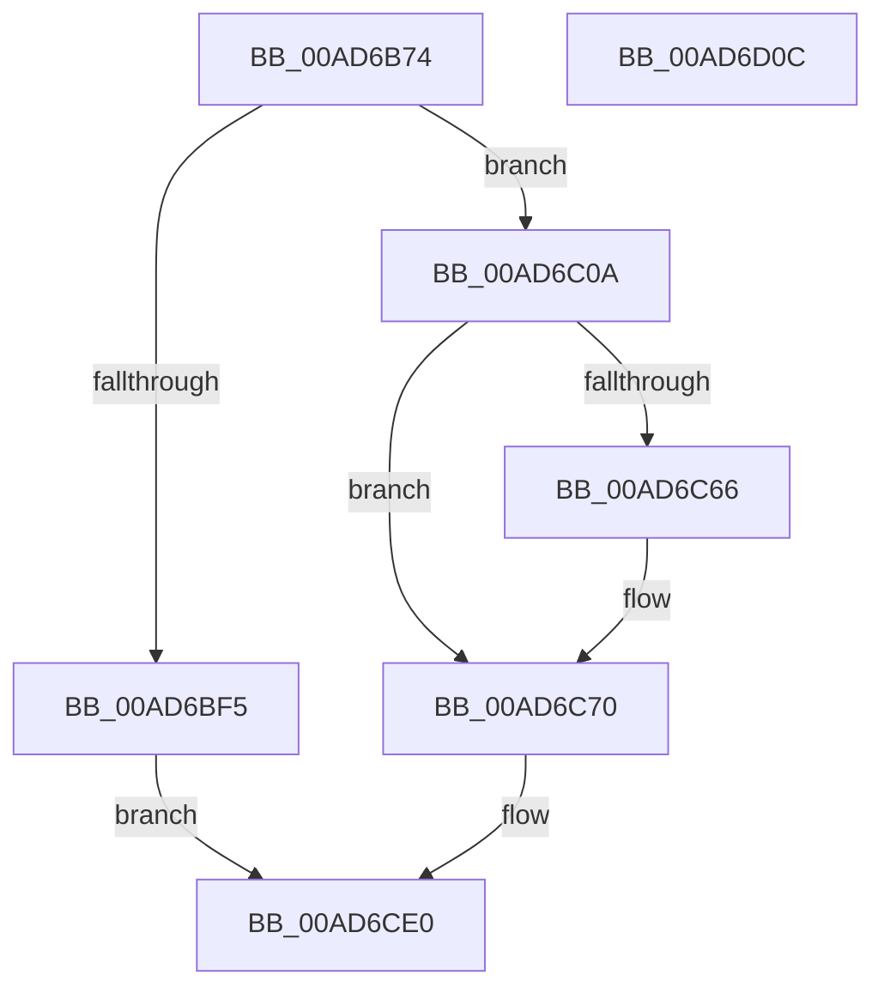

# PopSleepstudyCaptureResiliencyStatistics

- RVA: `0x00AD6B74`–`0x00AD6D0D` (길이 `409` bytes)
- VA: `0x0000000140AD6B74`
- 실행 섹션: `PAGE`
- PDB 이름 있음: `예`; PDB Function 태그: `아니요`
- unwind 정보 RVA: `0x000BEFCC`
- 디코드: `96`개 명령, `409/409` bytes 표시
- 미해석 바이트: `0` (있으면 어셈블리에 `.byte`로 보존)

> 이 문서는 커널 이미지의 기계어와 PDB 기호를 분석해 생성했습니다. 4번과 5번은 함수 원형과 자료형을 바이너리 사용 방식에서 추정한 C 해석이며 원본 소스 복구 결과는 아닙니다.

## 1. Dependencies

- 직접 호출 지점: **10**; 고유 호출 대상: **9**
- 직접 호출자로 확인된 함수: **1**
- RIP 상대 이미지 참조: **10**

### Outgoing calls
- `0x00AD6BC7` → [memset](../../text/6C/memset_function_006C6C40.md) (function, `0x006C6C40`)
- `0x00AD6BD3` → [PopAcquireRwLockShared](../../text/2D/PopAcquireRwLockShared_function_002D9A40.md) (function, `0x002D9A40`)
- `0x00AD6BEC` → [PopReleaseRwLock](../../text/2D/PopReleaseRwLock_function_002DFBBC.md) (function, `0x002DFBBC`)
- `0x00AD6C00` → [PopDiagTraceCsResiliencyEnter](../../text/4E/PopDiagTraceCsResiliencyEnter_function_004E0194.md) (function, `0x004E0194`)
- `0x00AD6C31` → [PopCalculateTotalHwDripsResidency](../../text/4F/PopCalculateTotalHwDripsResidency_function_004F9908.md) (function, `0x004F9908`)
- `0x00AD6C6B` → [guard_dispatch_icall](../../text/6B/guard_dispatch_icall_function_006BAAD0.md) (function, `0x006BAAD0`)
- `0x00AD6CA5` → [memset](../../text/6C/memset_function_006C6C40.md) (function, `0x006C6C40`)
- `0x00AD6CD2` → [PopDiagTraceCsResiliencyExit](../../text/43/PopDiagTraceCsResiliencyExit_function_0043AB34.md) (function, `0x0043AB34`)
- `0x00AD6CDB` → [PopDiagTraceCsResiliencyStats](PopDiagTraceCsResiliencyStats_function_00AD07DC.md) (function, `0x00AD07DC`)
- `0x00AD6CEA` → [_security_check_cookie](../../text/6A/_security_check_cookie_function_006AC640.md) (function, `0x006AC640`)

### Direct callers
- [PopSleepstudyStartNextSession](../AC/PopSleepstudyStartNextSession_function_00AC4720.md) at `0x00AC4999`
- [PopSleepstudyStartNextSession](../AC/PopSleepstudyStartNextSession_function_00AC4720.md) at `0x00AC4BB6`

### Static image references
- `0x00AD6B96` → RVA `0x00E0A740` (`.data`; read)
- `0x00AD6BCC` → RVA `0x00F0C238` (`.data`; read)
- `0x00AD6BD8` → RVA `0x00F0C2B0` (`.data`; read)
- `0x00AD6C41` → RVA `0x00E27D98` (`.data`; read/write)
- `0x00AD6C53` → RVA `0x00E677E8` (`.data`; read)
- `0x00AD6C5A` → RVA `0x00E27DA0` (`.data`; read/write)
- `0x00AD6C79` → RVA `0x00E27E38` (`.data`; write)
- `0x00AD6C8B` → RVA `0x00E27E40` (`.data`; write)
- `0x00AD6C95` → RVA `0x00E27E28` (`.data`; write)
- `0x00AD6C9F` → RVA `0x00E27E30` (`.data`; write)

## 2. Other-region calls and transfers

- 다른 실행 섹션으로 향하는 call: **9**
  - `0x00AD6BC7` → [memset](../../text/6C/memset_function_006C6C40.md) (`PAGE` → `.text`)
  - `0x00AD6BD3` → [PopAcquireRwLockShared](../../text/2D/PopAcquireRwLockShared_function_002D9A40.md) (`PAGE` → `.text`)
  - `0x00AD6BEC` → [PopReleaseRwLock](../../text/2D/PopReleaseRwLock_function_002DFBBC.md) (`PAGE` → `.text`)
  - `0x00AD6C00` → [PopDiagTraceCsResiliencyEnter](../../text/4E/PopDiagTraceCsResiliencyEnter_function_004E0194.md) (`PAGE` → `.text`)
  - `0x00AD6C31` → [PopCalculateTotalHwDripsResidency](../../text/4F/PopCalculateTotalHwDripsResidency_function_004F9908.md) (`PAGE` → `.text`)
  - `0x00AD6C6B` → [guard_dispatch_icall](../../text/6B/guard_dispatch_icall_function_006BAAD0.md) (`PAGE` → `.text`)
  - `0x00AD6CA5` → [memset](../../text/6C/memset_function_006C6C40.md) (`PAGE` → `.text`)
  - `0x00AD6CD2` → [PopDiagTraceCsResiliencyExit](../../text/43/PopDiagTraceCsResiliencyExit_function_0043AB34.md) (`PAGE` → `.text`)
  - `0x00AD6CEA` → [_security_check_cookie](../../text/6A/_security_check_cookie_function_006AC640.md) (`PAGE` → `.text`)
- 별도 외부 분기/꼬리 이동을 확인하지 못했습니다.

## 3. Assembly (complete function range)

```asm
00AD6B74  48 8B C4                        mov rax, rsp
00AD6B77  48 89 58 08                     mov qword ptr [rax + 8], rbx
00AD6B7B  48 89 70 10                     mov qword ptr [rax + 0x10], rsi
00AD6B7F  48 89 78 18                     mov qword ptr [rax + 0x18], rdi
00AD6B83  55                              push rbp
00AD6B84  41 56                           push r14
00AD6B86  41 57                           push r15
00AD6B88  48 8D A8 48 FF FF FF            lea rbp, [rax - 0xb8]
00AD6B8F  48 81 EC A0 01 00 00            sub rsp, 0x1a0
00AD6B96  48 8B 05 A3 3B 33 00            mov rax, qword ptr [rip + 0x333ba3]
00AD6B9D  48 33 C4                        xor rax, rsp
00AD6BA0  48 89 85 90 00 00 00            mov qword ptr [rbp + 0x90], rax
00AD6BA7  33 C0                           xor eax, eax
00AD6BA9  41 8A F8                        mov dil, r8b
00AD6BAC  48 8B F2                        mov rsi, rdx
00AD6BAF  89 45 A4                        mov dword ptr [rbp - 0x5c], eax
00AD6BB2  4C 8B F1                        mov r14, rcx
00AD6BB5  89 44 24 54                     mov dword ptr [rsp + 0x54], eax
00AD6BB9  33 D2                           xor edx, edx
00AD6BBB  48 8D 4C 24 50                  lea rcx, [rsp + 0x50]
00AD6BC0  44 8D 40 44                     lea r8d, [rax + 0x44]
00AD6BC4  41 8A D9                        mov bl, r9b
00AD6BC7  E8 74 00 BF FF                  call 0x1406c6c40
00AD6BCC  48 8D 0D 65 56 43 00            lea rcx, [rip + 0x435665]
00AD6BD3  E8 68 2E 80 FF                  call 0x1402d9a40
00AD6BD8  0F 10 05 D1 56 43 00            movups xmm0, xmmword ptr [rip + 0x4356d1]
00AD6BDF  48 8D 0D 52 56 43 00            lea rcx, [rip + 0x435652]
00AD6BE6  F3 0F 7F 44 24 40               movdqu xmmword ptr [rsp + 0x40], xmm0
00AD6BEC  E8 CB 8F 80 FF                  call 0x1402dfbbc
00AD6BF1  84 DB                           test bl, bl
00AD6BF3  74 15                           je 0x140ad6c0a
00AD6BF5  4C 8D 44 24 40                  lea r8, [rsp + 0x40]
00AD6BFA  40 8A D7                        mov dl, dil
00AD6BFD  48 8B CE                        mov rcx, rsi
00AD6C00  E8 8F 95 A0 FF                  call 0x1404e0194
00AD6C05  E9 D6 00 00 00                  jmp 0x140ad6ce0
00AD6C0A  49 8B 4E 68                     mov rcx, qword ptr [r14 + 0x68]
00AD6C0E  48 B8 CD CC CC CC CC CC CC CC   movabs rax, 0xcccccccccccccccd
00AD6C18  49 2B 4E 10                     sub rcx, qword ptr [r14 + 0x10]
00AD6C1C  48 F7 E1                        mul rcx
00AD6C1F  49 8B 4E 48                     mov rcx, qword ptr [r14 + 0x48]
00AD6C23  48 8B DA                        mov rbx, rdx
00AD6C26  49 8B 56 58                     mov rdx, qword ptr [r14 + 0x58]
00AD6C2A  48 C1 EB 03                     shr rbx, 3
00AD6C2E  4C 8B C3                        mov r8, rbx
00AD6C31  E8 D2 2C A2 FF                  call 0x1404f9908
00AD6C36  45 33 FF                        xor r15d, r15d
00AD6C39  48 83 F8 FF                     cmp rax, -1
00AD6C3D  4C 0F 45 F8                     cmovne r15, rax
00AD6C41  4C 01 3D 50 11 35 00            add qword ptr [rip + 0x351150], r15
00AD6C48  49 8B 46 50                     mov rax, qword ptr [r14 + 0x50]
00AD6C4C  4D 8B 76 60                     mov r14, qword ptr [r14 + 0x60]
00AD6C50  4C 2B F0                        sub r14, rax
00AD6C53  48 8B 05 8E 0B 39 00            mov rax, qword ptr [rip + 0x390b8e]
00AD6C5A  4C 01 35 3F 11 35 00            add qword ptr [rip + 0x35113f], r14
00AD6C61  48 85 C0                        test rax, rax
00AD6C64  74 0A                           je 0x140ad6c70
00AD6C66  48 8D 4C 24 50                  lea rcx, [rsp + 0x50]
00AD6C6B  E8 60 3E BE FF                  call 0x1406baad0
00AD6C70  48 8B 44 24 78                  mov rax, qword ptr [rsp + 0x78]
00AD6C75  48 8D 4D A0                     lea rcx, [rbp - 0x60]
00AD6C79  48 89 05 B8 11 35 00            mov qword ptr [rip + 0x3511b8], rax
00AD6C80  33 D2                           xor edx, edx
00AD6C82  8B 45 80                        mov eax, dword ptr [rbp - 0x80]
00AD6C85  41 B8 F0 00 00 00               mov r8d, 0xf0
00AD6C8B  89 05 AF 11 35 00               mov dword ptr [rip + 0x3511af], eax
00AD6C91  48 8B 45 88                     mov rax, qword ptr [rbp - 0x78]
00AD6C95  48 89 05 8C 11 35 00            mov qword ptr [rip + 0x35118c], rax
00AD6C9C  8B 45 90                        mov eax, dword ptr [rbp - 0x70]
00AD6C9F  89 05 8B 11 35 00               mov dword ptr [rip + 0x35118b], eax
00AD6CA5  E8 96 FF BE FF                  call 0x1406c6c40
00AD6CAA  48 8D 44 24 50                  lea rax, [rsp + 0x50]
00AD6CAF  44 8A C7                        mov r8b, dil
00AD6CB2  48 89 44 24 38                  mov qword ptr [rsp + 0x38], rax
00AD6CB7  4C 8D 4C 24 40                  lea r9, [rsp + 0x40]
00AD6CBC  4C 89 74 24 30                  mov qword ptr [rsp + 0x30], r14
00AD6CC1  48 8D 4D A0                     lea rcx, [rbp - 0x60]
00AD6CC5  4C 89 7C 24 28                  mov qword ptr [rsp + 0x28], r15
00AD6CCA  48 8B D6                        mov rdx, rsi
00AD6CCD  48 89 5C 24 20                  mov qword ptr [rsp + 0x20], rbx
00AD6CD2  E8 5D 3E 96 FF                  call 0x14043ab34
00AD6CD7  48 8D 4D A0                     lea rcx, [rbp - 0x60]
00AD6CDB  E8 FC 9A FF FF                  call 0x140ad07dc
00AD6CE0  48 8B 8D 90 00 00 00            mov rcx, qword ptr [rbp + 0x90]
00AD6CE7  48 33 CC                        xor rcx, rsp
00AD6CEA  E8 51 59 BD FF                  call 0x1406ac640
00AD6CEF  4C 8D 9C 24 A0 01 00 00         lea r11, [rsp + 0x1a0]
00AD6CF7  49 8B 5B 20                     mov rbx, qword ptr [r11 + 0x20]
00AD6CFB  49 8B 73 28                     mov rsi, qword ptr [r11 + 0x28]
00AD6CFF  49 8B 7B 30                     mov rdi, qword ptr [r11 + 0x30]
00AD6D03  49 8B E3                        mov rsp, r11
00AD6D06  41 5F                           pop r15
00AD6D08  41 5E                           pop r14
00AD6D0A  5D                              pop rbp
00AD6D0B  C3                              ret
00AD6D0C  CC                              int3
```

## 4. C-style interpretation (structured pseudocode)

```c
__int64 __fastcall PopSleepstudyCaptureResiliencyStatistics(__int64 a1, __int64 a2, unsigned __int8 a3, unsigned __int8 a4)
{
    __int64 result;
    __int64 v_r14;
    __int64 v_r15;
    __int64 v_rbx;
    __int64 v_rsp;
    unsigned __int64 v_stack_m140;
    unsigned int v_stack_m164;
    unsigned __int64 v_stack_m168;
    unsigned __int64 v_stack_m178;
    unsigned __int64 v_stack_m18;
    unsigned __int64 v_stack_m180;
    unsigned __int64 v_stack_m188;
    unsigned __int64 v_stack_m190;
    unsigned __int64 v_stack_m198;

    *(unsigned __int64 *)(v_rsp + 8) = v_rbx;
    *(unsigned __int64 *)(v_rsp + 16) = v_rsi;
    *(unsigned __int64 *)(v_rsp + 24) = v_rdi;
    v_rsp = (v_rsp) - (416);
    result = (*(unsigned __int64 *)(v_rip + 3357603)) ^ (v_rsp);
    *(unsigned __int64 *)(v_rsp - 184 + 144) = result;
    result = 0;
    *(unsigned int *)(v_rsp - 184 - 92) = 0;
    v_stack_m164 = 0;
    a2 = 0;
    result = memset(v_stack_m168, a2, result + 68, a4);
    result = PopAcquireRwLockShared(v_rip + 4413029, a2, result + 68, a4);
    v_stack_m178 = v_xmm0;
    result = PopReleaseRwLock(v_rip + 4413010, a2, result + 68, a4);
    if (a4 == 0) goto loc_00AD6C0A;
    result = PopDiagTraceCsResiliencyEnter(0, a3, v_stack_m178, a4);
    goto loc_00AD6CE0;
loc_00AD6C0A:
    a1 = (*(unsigned __int64 *)(a1 + 104)) - (*(unsigned __int64 *)(a1 + 16));
    v_rbx = (a3) >> (3);
    result = PopCalculateTotalHwDripsResidency(*(unsigned __int64 *)(a1 + 72), *(unsigned __int64 *)(a1 + 88), v_rbx, a4);
    v_r15 = 0;
    if (result != -1) { v_r15 = result; }
    v_r14 = (*(unsigned __int64 *)(a1 + 96)) - (*(unsigned __int64 *)(a1 + 80));
    result = *(unsigned __int64 *)(v_rip + 3738510);
    if (*(unsigned __int64 *)(v_rip + 3738510) != 0) {
        a1 = v_stack_m168;
        result = guard_dispatch_icall(a1, *(unsigned __int64 *)(a1 + 88), v_rbx, a4);
    }
    *(unsigned __int64 *)(v_rip + 3477944) = v_stack_m140;
    a2 = 0;
    *(unsigned int *)(v_rip + 3477935) = (unsigned int)((unsigned int)(*(unsigned int *)(v_rsp - 184 - 128)));
    *(unsigned __int64 *)(v_rip + 3477900) = *(unsigned __int64 *)(v_rsp - 184 - 120);
    *(unsigned int *)(v_rip + 3477899) = (unsigned int)((unsigned int)(*(unsigned int *)(v_rsp - 184 - 112)));
    result = memset(v_rsp - 184 - 96, a2, 240, a4);
    v_stack_m180 = v_stack_m168;
    v_stack_m188 = v_r14;
    v_stack_m190 = v_r15;
    v_stack_m198 = v_rbx;
    result = PopDiagTraceCsResiliencyExit(v_rsp - 184 - 96, 0, a3, v_stack_m178);
    result = PopDiagTraceCsResiliencyStats(v_rsp - 184 - 96, 0, a3, v_stack_m178);
loc_00AD6CE0:
    a1 = (*(unsigned __int64 *)(v_rsp - 184 + 144)) ^ (v_rsp);
    result = _security_check_cookie(a1, 0, a3, v_stack_m178);
    return result;
}
```

## 5. (Beta) C Style

```c
int64_t PopSleepstudyCaptureResiliencyStatistics(void *Arg1, int64_t Arg2, uint8_t Arg3, uint8_t Arg4)
{
    uint8_t *arg1 = (uint8_t *)Arg1;

    int64_t result;
    int64_t local_r14;
    int64_t local_r15;
    int64_t local_rbx;
    int64_t local_rsp;
    uint64_t v_stack_m140;
    uint32_t v_stack_m164;
    uint64_t v_stack_m168;
    uint64_t v_stack_m178;
    uint64_t v_stack_m18;
    uint64_t v_stack_m180;
    uint64_t v_stack_m188;
    uint64_t v_stack_m190;
    uint64_t v_stack_m198;

    *(uint64_t *)(local_rsp + 0x8) = local_rbx;
    *(uint64_t *)(local_rsp + 0x10) = local_rsi;
    *(uint64_t *)(local_rsp + 0x18) = local_rdi;
    local_rsp = (local_rsp) - (416);
    result = (*(uint64_t *)(v_rip + 0x333BA3)) ^ (local_rsp);
    *(uint64_t *)(local_rsp - 0xB8 + 0x90) = result;
    result = 0;
    *(uint32_t *)(local_rsp - 0xB8 - 0x5C) = 0;
    v_stack_m164 = 0;
    Arg2 = 0;
    result = memset(v_stack_m168, Arg2, result + 68, Arg4);
    result = PopAcquireRwLockShared(v_rip + 4413029, Arg2, result + 68, Arg4);
    v_stack_m178 = v_xmm0;
    result = PopReleaseRwLock(v_rip + 4413010, Arg2, result + 68, Arg4);
    if (Arg4 == 0) goto loc_00AD6C0A;
    result = PopDiagTraceCsResiliencyEnter(0, Arg3, v_stack_m178, Arg4);
    goto loc_00AD6CE0;
loc_00AD6C0A:
    Arg1 = (*(uint64_t *)(arg1 + 0x68)) - (*(uint64_t *)(arg1 + 0x10));
    local_rbx = (Arg3) >> (3);
    result = PopCalculateTotalHwDripsResidency(*(uint64_t *)(arg1 + 0x48), *(uint64_t *)(arg1 + 0x58), local_rbx, Arg4);
    local_r15 = 0;
    if (result != -1) { local_r15 = result; }
    local_r14 = (*(uint64_t *)(arg1 + 0x60)) - (*(uint64_t *)(arg1 + 0x50));
    result = *(uint64_t *)(v_rip + 0x390B8E);
    if (*(uint64_t *)(v_rip + 0x390B8E) != 0) {
        Arg1 = v_stack_m168;
        result = guard_dispatch_icall(Arg1, *(uint64_t *)(arg1 + 0x58), local_rbx, Arg4);
    }
    *(uint64_t *)(v_rip + 0x3511B8) = v_stack_m140;
    Arg2 = 0;
    *(uint32_t *)(v_rip + 0x3511AF) = (uint32_t)((uint32_t)(*(uint32_t *)(local_rsp - 0xB8 - 0x80)));
    *(uint64_t *)(v_rip + 0x35118C) = *(uint64_t *)(local_rsp - 0xB8 - 0x78);
    *(uint32_t *)(v_rip + 0x35118B) = (uint32_t)((uint32_t)(*(uint32_t *)(local_rsp - 0xB8 - 0x70)));
    result = memset(local_rsp - 184 - 96, Arg2, 240, Arg4);
    v_stack_m180 = v_stack_m168;
    v_stack_m188 = local_r14;
    v_stack_m190 = local_r15;
    v_stack_m198 = local_rbx;
    result = PopDiagTraceCsResiliencyExit(local_rsp - 184 - 96, 0, Arg3, v_stack_m178);
    result = PopDiagTraceCsResiliencyStats(local_rsp - 184 - 96, 0, Arg3, v_stack_m178);
loc_00AD6CE0:
    Arg1 = (*(uint64_t *)(local_rsp - 0xB8 + 0x90)) ^ (local_rsp);
    result = _security_check_cookie(Arg1, 0, Arg3, v_stack_m178);
    return result;
}
```

### 관측된 메모리 오프셋

구조체 형식이 확인되지 않은 접근은 인자 기준의 오프셋으로만 기록했습니다.

| 기준 인자 | 오프셋 표현 | 폭 (bit) | 접근 |
|---|---:|---:|---|
| `Arg1` | `+ 0x10` | `64` | `R` |
| `Arg1` | `+ 0x48` | `64` | `R` |
| `Arg1` | `+ 0x50` | `64` | `R` |
| `Arg1` | `+ 0x58` | `64` | `R` |
| `Arg1` | `+ 0x60` | `64` | `R` |
| `Arg1` | `+ 0x68` | `64` | `R` |

## 6. Execution-region graph

[열기: 2D/3D 그래프와 함수 탐색 컨트롤 패널](../../../control-panel.html?section=page&rva=0x00AD6B74&view=graph)

- 2D 그래프는 위에서 아래로 흐르고, 3D 그래프는 빈 공간을 드래그해 회전합니다. Shift+드래그는 이동, 휠은 확대·축소, 함수 노드 선택은 대상 보고서 이동입니다.

### Static fallback


