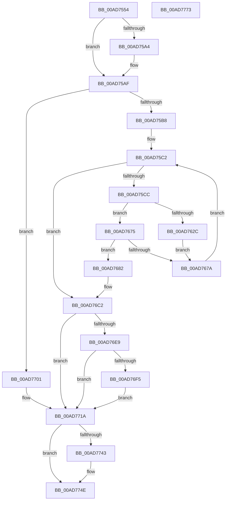

# PopSleepstudyCaptureSessionStatistics

- RVA: `0x00AD7554`–`0x00AD7774` (길이 `544` bytes)
- VA: `0x0000000140AD7554`
- 실행 섹션: `PAGE`
- PDB 이름 있음: `예`; PDB Function 태그: `아니요`
- unwind 정보 RVA: `0x00060300`
- 디코드: `127`개 명령, `544/544` bytes 표시
- 미해석 바이트: `0` (있으면 어셈블리에 `.byte`로 보존)

> 이 문서는 커널 이미지의 기계어와 PDB 기호를 분석해 생성했습니다. 4번과 5번은 함수 원형과 자료형을 바이너리 사용 방식에서 추정한 C 해석이며 원본 소스 복구 결과는 아닙니다.

## 1. Dependencies

- 직접 호출 지점: **9**; 고유 호출 대상: **8**
- 직접 호출자로 확인된 함수: **1**
- RIP 상대 이미지 참조: **9**

### Outgoing calls
- `0x00AD7593` → [memset](../../text/6C/memset_function_006C6C40.md) (function, `0x006C6C40`)
- `0x00AD761C` → [PopCalculateTotalHwDripsResidency](../../text/4F/PopCalculateTotalHwDripsResidency_function_004F9908.md) (function, `0x004F9908`)
- `0x00AD76DF` → [SshSessionManagerTraceCsExitReason](../77/SshSessionManagerTraceCsExitReason_function_00773BDC.md) (function, `0x00773BDC`)
- `0x00AD76FA` → [guard_dispatch_icall](../../text/6B/guard_dispatch_icall_function_006BAAD0.md) (function, `0x006BAAD0`)
- `0x00AD7715` → [SshSessionManagerTraceCsEnterReason](../77/SshSessionManagerTraceCsEnterReason_function_00773AA4.md) (function, `0x00773AA4`)
- `0x00AD7721` → [PopReleaseRwLock](../../text/2D/PopReleaseRwLock_function_002DFBBC.md) (function, `0x002DFBBC`)
- `0x00AD7732` → [PopCaptureSleepStudyStatistics](../../text/43/PopCaptureSleepStudyStatistics_function_004399F4.md) (function, `0x004399F4`)
- `0x00AD7749` → [guard_dispatch_icall](../../text/6B/guard_dispatch_icall_function_006BAAD0.md) (function, `0x006BAAD0`)
- `0x00AD7755` → [PopAcquireRwLockExclusive](../../text/43/PopAcquireRwLockExclusive_function_00430B44.md) (function, `0x00430B44`)

### Direct callers
- [PopSleepstudyStartNextSession](../AC/PopSleepstudyStartNextSession_function_00AC4720.md) at `0x00AC4A7D`
- [PopSleepstudyStartNextSession](../AC/PopSleepstudyStartNextSession_function_00AC4720.md) at `0x00AC4C32`

### Static image references
- `0x00AD7577` → RVA `0x00F0B418` (`.data`; write)
- `0x00AD757E` → RVA `0x00F0B410` (`.data`; write)
- `0x00AD759B` → RVA `0x000112D0` (`.rdata`; read)
- `0x00AD75A8` → RVA `0x000112D8` (`.rdata`; read)
- `0x00AD75CC` → RVA `0x00F0AE68` (`.data`; read)
- `0x00AD75DC` → RVA `0x00F0AE70` (`.data`; read)
- `0x00AD76E9` → RVA `0x00E67818` (`.data`; read)
- `0x00AD771A` → RVA `0x00F0AD80` (`.data`; read)
- `0x00AD7737` → RVA `0x00E677D0` (`.data`; read)

## 2. Other-region calls and transfers

- 다른 실행 섹션으로 향하는 call: **7**
  - `0x00AD7593` → [memset](../../text/6C/memset_function_006C6C40.md) (`PAGE` → `.text`)
  - `0x00AD761C` → [PopCalculateTotalHwDripsResidency](../../text/4F/PopCalculateTotalHwDripsResidency_function_004F9908.md) (`PAGE` → `.text`)
  - `0x00AD76FA` → [guard_dispatch_icall](../../text/6B/guard_dispatch_icall_function_006BAAD0.md) (`PAGE` → `.text`)
  - `0x00AD7721` → [PopReleaseRwLock](../../text/2D/PopReleaseRwLock_function_002DFBBC.md) (`PAGE` → `.text`)
  - `0x00AD7732` → [PopCaptureSleepStudyStatistics](../../text/43/PopCaptureSleepStudyStatistics_function_004399F4.md) (`PAGE` → `.text`)
  - `0x00AD7749` → [guard_dispatch_icall](../../text/6B/guard_dispatch_icall_function_006BAAD0.md) (`PAGE` → `.text`)
  - `0x00AD7755` → [PopAcquireRwLockExclusive](../../text/43/PopAcquireRwLockExclusive_function_00430B44.md) (`PAGE` → `.text`)
- 별도 외부 분기/꼬리 이동을 확인하지 못했습니다.

## 3. Assembly (complete function range)

```asm
00AD7554  48 89 5C 24 08                  mov qword ptr [rsp + 8], rbx
00AD7559  48 89 6C 24 10                  mov qword ptr [rsp + 0x10], rbp
00AD755E  48 89 74 24 18                  mov qword ptr [rsp + 0x18], rsi
00AD7563  57                              push rdi
00AD7564  41 56                           push r14
00AD7566  41 57                           push r15
00AD7568  48 83 EC 20                     sub rsp, 0x20
00AD756C  48 8B 7C 24 60                  mov rdi, qword ptr [rsp + 0x60]
00AD7571  49 8B E8                        mov rbp, r8
00AD7574  48 8B F2                        mov rsi, rdx
00AD7577  48 89 15 9A 3E 43 00            mov qword ptr [rip + 0x433e9a], rdx
00AD757E  4C 89 05 8B 3E 43 00            mov qword ptr [rip + 0x433e8b], r8
00AD7585  48 8B CF                        mov rcx, rdi
00AD7588  33 D2                           xor edx, edx
00AD758A  41 B8 B0 01 00 00               mov r8d, 0x1b0
00AD7590  4D 8B F9                        mov r15, r9
00AD7593  E8 A8 F6 BE FF                  call 0x1406c6c40
00AD7598  48 8B 06                        mov rax, qword ptr [rsi]
00AD759B  48 2B 05 2E 9D 53 FF            sub rax, qword ptr [rip - 0xac62d2]
00AD75A2  75 0B                           jne 0x140ad75af
00AD75A4  48 8B 46 08                     mov rax, qword ptr [rsi + 8]
00AD75A8  48 2B 05 29 9D 53 FF            sub rax, qword ptr [rip - 0xac62d7]
00AD75AF  48 85 C0                        test rax, rax
00AD75B2  0F 85 49 01 00 00               jne 0x140ad7701
00AD75B8  45 33 DB                        xor r11d, r11d
00AD75BB  44 8D 50 01                     lea r10d, [rax + 1]
00AD75BF  45 33 F6                        xor r14d, r14d
00AD75C2  41 83 FA 02                     cmp r10d, 2
00AD75C6  0F 87 F6 00 00 00               ja 0x140ad76c2
00AD75CC  8B 05 96 38 43 00               mov eax, dword ptr [rip + 0x433896]
00AD75D2  41 2B C2                        sub eax, r10d
00AD75D5  83 E0 07                        and eax, 7
00AD75D8  4C 6B C8 70                     imul r9, rax, 0x70
00AD75DC  48 8D 05 8D 38 43 00            lea rax, [rip + 0x43388d]
00AD75E3  4C 03 C8                        add r9, rax
00AD75E6  41 8A 41 3A                     mov al, byte ptr [r9 + 0x3a]
00AD75EA  88 87 84 01 00 00               mov byte ptr [rdi + 0x184], al
00AD75F0  48 B8 CD CC CC CC CC CC CC CC   movabs rax, 0xcccccccccccccccd
00AD75FA  49 8B 49 18                     mov rcx, qword ptr [r9 + 0x18]
00AD75FE  49 2B 49 10                     sub rcx, qword ptr [r9 + 0x10]
00AD7602  49 8B 59 60                     mov rbx, qword ptr [r9 + 0x60]
00AD7606  49 2B 59 50                     sub rbx, qword ptr [r9 + 0x50]
00AD760A  48 F7 E1                        mul rcx
00AD760D  49 8B 49 48                     mov rcx, qword ptr [r9 + 0x48]
00AD7611  4C 8B C2                        mov r8, rdx
00AD7614  49 8B 51 58                     mov rdx, qword ptr [r9 + 0x58]
00AD7618  49 C1 E8 03                     shr r8, 3
00AD761C  E8 E7 22 A2 FF                  call 0x1404f9908
00AD7621  48 8B D0                        mov rdx, rax
00AD7624  41 8B 01                        mov eax, dword ptr [r9]
00AD7627  83 F8 02                        cmp eax, 2
00AD762A  75 49                           jne 0x140ad7675
00AD762C  C6 87 20 01 00 00 01            mov byte ptr [rdi + 0x120], 1
00AD7633  4D 8B F1                        mov r14, r9
00AD7636  4C 89 87 40 01 00 00            mov qword ptr [rdi + 0x140], r8
00AD763D  41 8B 49 28                     mov ecx, dword ptr [r9 + 0x28]
00AD7641  89 8F 48 01 00 00               mov dword ptr [rdi + 0x148], ecx
00AD7647  41 8B 49 30                     mov ecx, dword ptr [r9 + 0x30]
00AD764B  89 8F 50 01 00 00               mov dword ptr [rdi + 0x150], ecx
00AD7651  41 8B 49 2C                     mov ecx, dword ptr [r9 + 0x2c]
00AD7655  89 8F 4C 01 00 00               mov dword ptr [rdi + 0x14c], ecx
00AD765B  41 8B 49 34                     mov ecx, dword ptr [r9 + 0x34]
00AD765F  89 8F 54 01 00 00               mov dword ptr [rdi + 0x154], ecx
00AD7665  48 89 9F A0 01 00 00            mov qword ptr [rdi + 0x1a0], rbx
00AD766C  48 89 97 A8 01 00 00            mov qword ptr [rdi + 0x1a8], rdx
00AD7673  EB 05                           jmp 0x140ad767a
00AD7675  83 F8 01                        cmp eax, 1
00AD7678  74 08                           je 0x140ad7682
00AD767A  41 FF C2                        inc r10d
00AD767D  E9 40 FF FF FF                  jmp 0x140ad75c2
00AD7682  4C 89 87 28 01 00 00            mov qword ptr [rdi + 0x128], r8
00AD7689  4D 8B D9                        mov r11, r9
00AD768C  41 8B 41 28                     mov eax, dword ptr [r9 + 0x28]
00AD7690  89 87 30 01 00 00               mov dword ptr [rdi + 0x130], eax
00AD7696  41 8B 41 30                     mov eax, dword ptr [r9 + 0x30]
00AD769A  89 87 38 01 00 00               mov dword ptr [rdi + 0x138], eax
00AD76A0  41 8B 41 2C                     mov eax, dword ptr [r9 + 0x2c]
00AD76A4  89 87 34 01 00 00               mov dword ptr [rdi + 0x134], eax
00AD76AA  41 8B 41 34                     mov eax, dword ptr [r9 + 0x34]
00AD76AE  89 87 3C 01 00 00               mov dword ptr [rdi + 0x13c], eax
00AD76B4  48 89 9F 90 01 00 00            mov qword ptr [rdi + 0x190], rbx
00AD76BB  48 89 97 98 01 00 00            mov qword ptr [rdi + 0x198], rdx
00AD76C2  8B 05 A0 37 43 00               mov eax, dword ptr [rip + 0x4337a0]
00AD76C8  49 8B D6                        mov rdx, r14
00AD76CB  48 6B D8 70                     imul rbx, rax, 0x70
00AD76CF  48 8D 05 9A 37 43 00            lea rax, [rip + 0x43379a]
00AD76D6  49 8B CB                        mov rcx, r11
00AD76D9  48 03 D8                        add rbx, rax
00AD76DC  4C 8B C3                        mov r8, rbx
00AD76DF  E8 F8 C4 C9 FF                  call 0x140773bdc
00AD76E4  83 3B 03                        cmp dword ptr [rbx], 3
00AD76E7  75 31                           jne 0x140ad771a
00AD76E9  48 8B 05 28 01 39 00            mov rax, qword ptr [rip + 0x390128]
00AD76F0  48 85 C0                        test rax, rax
00AD76F3  74 25                           je 0x140ad771a
00AD76F5  B9 01 00 00 00                  mov ecx, 1
00AD76FA  E8 D1 33 BE FF                  call 0x1406baad0
00AD76FF  EB 19                           jmp 0x140ad771a
00AD7701  8B 05 61 37 43 00               mov eax, dword ptr [rip + 0x433761]
00AD7707  48 6B C8 70                     imul rcx, rax, 0x70
00AD770B  48 8D 05 5E 37 43 00            lea rax, [rip + 0x43375e]
00AD7712  48 03 C8                        add rcx, rax
00AD7715  E8 8A C3 C9 FF                  call 0x140773aa4
00AD771A  48 8D 0D 5F 36 43 00            lea rcx, [rip + 0x43365f]
00AD7721  E8 96 84 80 FF                  call 0x1402dfbbc
00AD7726  4C 8B CF                        mov r9, rdi
00AD7729  4D 8B C7                        mov r8, r15
00AD772C  48 8B D5                        mov rdx, rbp
00AD772F  48 8B CE                        mov rcx, rsi
00AD7732  E8 BD 22 96 FF                  call 0x1404399f4
00AD7737  48 8B 05 92 00 39 00            mov rax, qword ptr [rip + 0x390092]
00AD773E  48 85 C0                        test rax, rax
00AD7741  74 0B                           je 0x140ad774e
00AD7743  48 8B D5                        mov rdx, rbp
00AD7746  48 8B CE                        mov rcx, rsi
00AD7749  E8 82 33 BE FF                  call 0x1406baad0
00AD774E  48 8D 0D 2B 36 43 00            lea rcx, [rip + 0x43362b]
00AD7755  E8 EA 93 95 FF                  call 0x140430b44
00AD775A  48 8B 5C 24 40                  mov rbx, qword ptr [rsp + 0x40]
00AD775F  48 8B 6C 24 48                  mov rbp, qword ptr [rsp + 0x48]
00AD7764  48 8B 74 24 50                  mov rsi, qword ptr [rsp + 0x50]
00AD7769  48 83 C4 20                     add rsp, 0x20
00AD776D  41 5F                           pop r15
00AD776F  41 5E                           pop r14
00AD7771  5F                              pop rdi
00AD7772  C3                              ret
00AD7773  CC                              int3
```

## 4. C-style interpretation (structured pseudocode)

```c
__int64 __fastcall PopSleepstudyCaptureSessionStatistics(__int64 a1, __int64 a2, __int64 a3, __int64 a4, __int64 a5)
{
    __int64 result;
    __int64 v_r10;
    __int64 v_r11;
    __int64 v_r14;
    __int64 v_rbx;
    __int64 v_rsp;
    unsigned __int64 v_stack_p10;
    unsigned __int64 v_stack_p18;
    unsigned __int64 v_stack_p8;

    v_stack_p8 = v_rbx;
    v_stack_p10 = v_rbp;
    v_stack_p18 = v_rsi;
    v_rsp = (v_rsp) - (32);
    *(unsigned __int64 *)(v_rip + 4406938) = a2;
    *(unsigned __int64 *)(v_rip + 4406923) = a3;
    a2 = 0;
    result = memset(a5, a2, 432, a4);
    result = (*(unsigned __int64 *)(a2)) - (*(unsigned __int64 *)(v_rip - 11297490));
    if (!(condition_is_not_equal)) {
        result = *(unsigned __int64 *)(a2 + 8);
        result = (result) - (*(unsigned __int64 *)(v_rip - 11297495));
    }
    if (result != 0) goto loc_00AD7701;
    v_r11 = 0;
    v_r14 = 0;
loc_00AD75C2:
    if (((unsigned int)(result + 1)) > 2) goto loc_00AD76C2;
    result = (unsigned int)(((unsigned int)(*(unsigned int *)(v_rip + 4405398))) - ((unsigned int)(result + 1)));
    result = (unsigned int)((result) & (7));
    a4 = (a4) * (result);
    a4 = (a4) + (v_rip + 4405389);
    *(unsigned __int8 *)(a5 + 388) = (unsigned __int8)(*(unsigned __int8 *)(a4 + 58));
    a1 = (*(unsigned __int64 *)(a4 + 24)) - (*(unsigned __int64 *)(a4 + 16));
    v_rbx = (*(unsigned __int64 *)(a4 + 96)) - (*(unsigned __int64 *)(a4 + 80));
    a3 = (0) >> (3);
    result = PopCalculateTotalHwDripsResidency(*(unsigned __int64 *)(a4 + 72), *(unsigned __int64 *)(a4 + 88), a3, a4);
    if (((unsigned int)((unsigned int)(*(unsigned int *)(a4)))) != 2) goto loc_00AD7675;
    *(unsigned __int8 *)(a5 + 288) = 1;
    *(unsigned __int64 *)(a5 + 320) = a3;
    *(unsigned int *)(a5 + 328) = (unsigned int)((unsigned int)(*(unsigned int *)(a4 + 40)));
    *(unsigned int *)(a5 + 336) = (unsigned int)((unsigned int)(*(unsigned int *)(a4 + 48)));
    *(unsigned int *)(a5 + 332) = (unsigned int)((unsigned int)(*(unsigned int *)(a4 + 44)));
    *(unsigned int *)(a5 + 340) = (unsigned int)((unsigned int)(*(unsigned int *)(a4 + 52)));
    *(unsigned __int64 *)(a5 + 416) = v_rbx;
    *(unsigned __int64 *)(a5 + 424) = result;
    goto loc_00AD767A;
loc_00AD7675:
    if (((unsigned int)((unsigned int)(*(unsigned int *)(a4)))) == 1) goto loc_00AD7682;
loc_00AD767A:
    v_r10 = (unsigned int)((result + 1) + 1);
    goto loc_00AD75C2;
loc_00AD7682:
    *(unsigned __int64 *)(a5 + 296) = a3;
    *(unsigned int *)(a5 + 304) = (unsigned int)((unsigned int)(*(unsigned int *)(a4 + 40)));
    *(unsigned int *)(a5 + 312) = (unsigned int)((unsigned int)(*(unsigned int *)(a4 + 48)));
    *(unsigned int *)(a5 + 308) = (unsigned int)((unsigned int)(*(unsigned int *)(a4 + 44)));
    *(unsigned int *)(a5 + 316) = (unsigned int)((unsigned int)(*(unsigned int *)(a4 + 52)));
    *(unsigned __int64 *)(a5 + 400) = v_rbx;
    *(unsigned __int64 *)(a5 + 408) = result;
loc_00AD76C2:
    v_rbx = (v_rbx) * ((unsigned int)(*(unsigned int *)(v_rip + 4405152)));
    v_rbx = (v_rbx) + (v_rip + 4405146);
    result = SshSessionManagerTraceCsExitReason(a4, a4, v_rbx, a4);
    if ((*(unsigned int *)(v_rbx)) != 3) goto loc_00AD771A;
    if (*(unsigned __int64 *)(v_rip + 3735848) == 0) goto loc_00AD771A;
    result = guard_dispatch_icall(1, a4, v_rbx, a4);
    goto loc_00AD771A;
loc_00AD7701:
    a1 = (1) * ((unsigned int)(*(unsigned int *)(v_rip + 4405089)));
    a1 = (a1) + (v_rip + 4405086);
    result = SshSessionManagerTraceCsEnterReason(a1, a4, v_rbx, a4);
loc_00AD771A:
    result = PopReleaseRwLock(v_rip + 4404831, a4, v_rbx, a4);
    result = PopCaptureSleepStudyStatistics(0, a3, a4, a5);
    result = *(unsigned __int64 *)(v_rip + 3735698);
    if (*(unsigned __int64 *)(v_rip + 3735698) != 0) {
        a2 = a3;
        a1 = a2;
        result = guard_dispatch_icall(a1, a2, a4, a5);
    }
    result = PopAcquireRwLockExclusive(v_rip + 4404779, a2, a4, a5);
    v_rsp = (v_rsp) + (32);
    return result;
}
```

## 5. (Beta) C Style

```c
int64_t PopSleepstudyCaptureSessionStatistics(int64_t Arg1, void *Arg2, int64_t Arg3, int64_t Arg4, void *Arg5)
{
    uint8_t *arg2 = (uint8_t *)Arg2;
    uint8_t *arg5 = (uint8_t *)Arg5;

    int64_t result;
    int64_t local_r10;
    int64_t local_r11;
    int64_t local_r14;
    int64_t local_rbx;
    int64_t local_rsp;
    uint64_t v_stack_p10;
    uint64_t v_stack_p18;
    uint64_t v_stack_p8;

    v_stack_p8 = local_rbx;
    v_stack_p10 = local_rbp;
    v_stack_p18 = local_rsi;
    local_rsp = (local_rsp) - (32);
    *(void **)(v_rip + 0x433E9A) = Arg2;
    *(uint64_t *)(v_rip + 0x433E8B) = Arg3;
    Arg2 = 0;
    result = memset(Arg5, Arg2, 432, Arg4);
    result = (*(uint64_t *)(arg2)) - (*(uint64_t *)(v_rip - 0xAC62D2));
    if (!(condition_is_not_equal)) {
        result = *(uint64_t *)(arg2 + 0x8);
        result = (result) - (*(uint64_t *)(v_rip - 0xAC62D7));
    }
    if (result != 0) goto loc_00AD7701;
    local_r11 = 0;
    local_r14 = 0;
loc_00AD75C2:
    if (((uint32_t)(result + 1)) > 2) goto loc_00AD76C2;
    result = (uint32_t)(((uint32_t)(*(uint32_t *)(v_rip + 0x433896))) - ((uint32_t)(result + 1)));
    result = (uint32_t)((result) & (7));
    Arg4 = (Arg4) * (result);
    Arg4 = (Arg4) + (v_rip + 4405389);
    *(uint8_t *)(arg5 + 0x184) = (uint8_t)(*(uint8_t *)(Arg4 + 0x3A));
    Arg1 = (*(uint64_t *)(Arg4 + 0x18)) - (*(uint64_t *)(Arg4 + 0x10));
    local_rbx = (*(uint64_t *)(Arg4 + 0x60)) - (*(uint64_t *)(Arg4 + 0x50));
    Arg3 = (0) >> (3);
    result = PopCalculateTotalHwDripsResidency(*(uint64_t *)(Arg4 + 0x48), *(uint64_t *)(Arg4 + 0x58), Arg3, Arg4);
    if (((uint32_t)((uint32_t)(*(uint32_t *)(Arg4)))) != 2) goto loc_00AD7675;
    *(uint8_t *)(arg5 + 0x120) = 1;
    *(uint64_t *)(arg5 + 0x140) = Arg3;
    *(uint32_t *)(arg5 + 0x148) = (uint32_t)((uint32_t)(*(uint32_t *)(Arg4 + 0x28)));
    *(uint32_t *)(arg5 + 0x150) = (uint32_t)((uint32_t)(*(uint32_t *)(Arg4 + 0x30)));
    *(uint32_t *)(arg5 + 0x14C) = (uint32_t)((uint32_t)(*(uint32_t *)(Arg4 + 0x2C)));
    *(uint32_t *)(arg5 + 0x154) = (uint32_t)((uint32_t)(*(uint32_t *)(Arg4 + 0x34)));
    *(uint64_t *)(arg5 + 0x1A0) = local_rbx;
    *(uint64_t *)(arg5 + 0x1A8) = result;
    goto loc_00AD767A;
loc_00AD7675:
    if (((uint32_t)((uint32_t)(*(uint32_t *)(Arg4)))) == 1) goto loc_00AD7682;
loc_00AD767A:
    local_r10 = (uint32_t)((result + 1) + 1);
    goto loc_00AD75C2;
loc_00AD7682:
    *(uint64_t *)(arg5 + 0x128) = Arg3;
    *(uint32_t *)(arg5 + 0x130) = (uint32_t)((uint32_t)(*(uint32_t *)(Arg4 + 0x28)));
    *(uint32_t *)(arg5 + 0x138) = (uint32_t)((uint32_t)(*(uint32_t *)(Arg4 + 0x30)));
    *(uint32_t *)(arg5 + 0x134) = (uint32_t)((uint32_t)(*(uint32_t *)(Arg4 + 0x2C)));
    *(uint32_t *)(arg5 + 0x13C) = (uint32_t)((uint32_t)(*(uint32_t *)(Arg4 + 0x34)));
    *(uint64_t *)(arg5 + 0x190) = local_rbx;
    *(uint64_t *)(arg5 + 0x198) = result;
loc_00AD76C2:
    local_rbx = (local_rbx) * ((uint32_t)(*(uint32_t *)(v_rip + 0x4337A0)));
    local_rbx = (local_rbx) + (v_rip + 4405146);
    result = SshSessionManagerTraceCsExitReason(Arg4, Arg4, local_rbx, Arg4);
    if ((*(uint32_t *)(local_rbx)) != 3) goto loc_00AD771A;
    if (*(uint64_t *)(v_rip + 0x390128) == 0) goto loc_00AD771A;
    result = guard_dispatch_icall(1, Arg4, local_rbx, Arg4);
    goto loc_00AD771A;
loc_00AD7701:
    Arg1 = (1) * ((uint32_t)(*(uint32_t *)(v_rip + 0x433761)));
    Arg1 = (Arg1) + (v_rip + 4405086);
    result = SshSessionManagerTraceCsEnterReason(Arg1, Arg4, local_rbx, Arg4);
loc_00AD771A:
    result = PopReleaseRwLock(v_rip + 4404831, Arg4, local_rbx, Arg4);
    result = PopCaptureSleepStudyStatistics(0, Arg3, Arg4, Arg5);
    result = *(uint64_t *)(v_rip + 0x390092);
    if (*(uint64_t *)(v_rip + 0x390092) != 0) {
        Arg2 = Arg3;
        Arg1 = Arg2;
        result = guard_dispatch_icall(Arg1, Arg2, Arg4, Arg5);
    }
    result = PopAcquireRwLockExclusive(v_rip + 4404779, Arg2, Arg4, Arg5);
    local_rsp = (local_rsp) + (32);
    return result;
}
```

### 관측된 메모리 오프셋

구조체 형식이 확인되지 않은 접근은 인자 기준의 오프셋으로만 기록했습니다.

| 기준 인자 | 오프셋 표현 | 폭 (bit) | 접근 |
|---|---:|---:|---|
| `Arg2` | `+ 0x0` | `64` | `R` |
| `Arg2` | `+ 0x8` | `64` | `R` |
| `Arg5` | `+ 0x120` | `8` | `W` |
| `Arg5` | `+ 0x128` | `64` | `W` |
| `Arg5` | `+ 0x130` | `32` | `W` |
| `Arg5` | `+ 0x134` | `32` | `W` |
| `Arg5` | `+ 0x138` | `32` | `W` |
| `Arg5` | `+ 0x13C` | `32` | `W` |
| `Arg5` | `+ 0x140` | `64` | `W` |
| `Arg5` | `+ 0x148` | `32` | `W` |
| `Arg5` | `+ 0x14C` | `32` | `W` |
| `Arg5` | `+ 0x150` | `32` | `W` |
| `Arg5` | `+ 0x154` | `32` | `W` |
| `Arg5` | `+ 0x184` | `8` | `W` |
| `Arg5` | `+ 0x190` | `64` | `W` |
| `Arg5` | `+ 0x198` | `64` | `W` |
| `Arg5` | `+ 0x1A0` | `64` | `W` |
| `Arg5` | `+ 0x1A8` | `64` | `W` |

## 6. Execution-region graph

[열기: 2D/3D 그래프와 함수 탐색 컨트롤 패널](../../../control-panel.html?section=page&rva=0x00AD7554&view=graph)

- 2D 그래프는 위에서 아래로 흐르고, 3D 그래프는 빈 공간을 드래그해 회전합니다. Shift+드래그는 이동, 휠은 확대·축소, 함수 노드 선택은 대상 보고서 이동입니다.

### Static fallback


