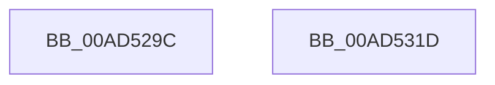

# PopSleepstudySnapModernStandbySessionData

- RVA: `0x00AD529C`–`0x00AD531E` (길이 `130` bytes)
- VA: `0x0000000140AD529C`
- 실행 섹션: `PAGE`
- PDB 이름 있음: `예`; PDB Function 태그: `아니요`
- unwind 정보 RVA: `0x000BED58`
- 디코드: `27`개 명령, `130/130` bytes 표시
- 미해석 바이트: `0` (있으면 어셈블리에 `.byte`로 보존)

> 이 문서는 커널 이미지의 기계어와 PDB 기호를 분석해 생성했습니다. 4번과 5번은 함수 원형과 자료형을 바이너리 사용 방식에서 추정한 C 해석이며 원본 소스 복구 결과는 아닙니다.

## 1. Dependencies

- 직접 호출 지점: **4**; 고유 호출 대상: **4**
- 직접 호출자로 확인된 함수: **1**
- RIP 상대 이미지 참조: **3**

### Outgoing calls
- `0x00AD52BA` → [PopAcquireRwLockExclusive](../../text/43/PopAcquireRwLockExclusive_function_00430B44.md) (function, `0x00430B44`)
- `0x00AD52CE` → [PopCalculateIdleInformation](../../text/43/PopCalculateIdleInformation_function_0043ADEC.md) (function, `0x0043ADEC`)
- `0x00AD52F9` → [KeQueryInterruptTimePrecise](../../text/20/KeQueryInterruptTimePrecise_function_00209530.md) (function, `0x00209530`)
- `0x00AD530D` → [PopReleaseRwLock](../../text/2D/PopReleaseRwLock_function_002DFBBC.md) (function, `0x002DFBBC`)

### Direct callers
- [PopPowerAggregatorEnterScreenOff](../98/PopPowerAggregatorEnterScreenOff_function_00989F38.md) at `0x00989FBC`

### Static image references
- `0x00AD52A9` → RVA `0x00F0AD80` (`.data`; read)
- `0x00AD52BF` → RVA `0x00F0AE68` (`.data`; read)
- `0x00AD52D8` → RVA `0x00F0ADA0` (`.data`; read)

## 2. Other-region calls and transfers

- 다른 실행 섹션으로 향하는 call: **4**
  - `0x00AD52BA` → [PopAcquireRwLockExclusive](../../text/43/PopAcquireRwLockExclusive_function_00430B44.md) (`PAGE` → `.text`)
  - `0x00AD52CE` → [PopCalculateIdleInformation](../../text/43/PopCalculateIdleInformation_function_0043ADEC.md) (`PAGE` → `.text`)
  - `0x00AD52F9` → [KeQueryInterruptTimePrecise](../../text/20/KeQueryInterruptTimePrecise_function_00209530.md) (`PAGE` → `.text`)
  - `0x00AD530D` → [PopReleaseRwLock](../../text/2D/PopReleaseRwLock_function_002DFBBC.md) (`PAGE` → `.text`)
- 별도 외부 분기/꼬리 이동을 확인하지 못했습니다.

## 3. Assembly (complete function range)

```asm
00AD529C  48 89 5C 24 10                  mov qword ptr [rsp + 0x10], rbx
00AD52A1  57                              push rdi
00AD52A2  48 83 EC 40                     sub rsp, 0x40
00AD52A6  0F 57 C0                        xorps xmm0, xmm0
00AD52A9  48 8D 0D D0 5A 43 00            lea rcx, [rip + 0x435ad0]
00AD52B0  0F 11 44 24 20                  movups xmmword ptr [rsp + 0x20], xmm0
00AD52B5  0F 11 44 24 30                  movups xmmword ptr [rsp + 0x30], xmm0
00AD52BA  E8 85 B8 95 FF                  call 0x140430b44
00AD52BF  8B 05 A3 5B 43 00               mov eax, dword ptr [rip + 0x435ba3]
00AD52C5  48 8D 4C 24 20                  lea rcx, [rsp + 0x20]
00AD52CA  48 6B D8 70                     imul rbx, rax, 0x70
00AD52CE  E8 19 5B 96 FF                  call 0x14043adec
00AD52D3  48 8B 44 24 30                  mov rax, qword ptr [rsp + 0x30]
00AD52D8  48 8D 3D C1 5A 43 00            lea rdi, [rip + 0x435ac1]
00AD52DF  48 89 84 3B 28 01 00 00         mov qword ptr [rbx + rdi + 0x128], rax
00AD52E7  48 8D 4C 24 50                  lea rcx, [rsp + 0x50]
00AD52EC  48 8B 44 24 28                  mov rax, qword ptr [rsp + 0x28]
00AD52F1  48 89 84 3B 30 01 00 00         mov qword ptr [rbx + rdi + 0x130], rax
00AD52F9  E8 32 42 73 FF                  call 0x140209530
00AD52FE  48 8D 0D 7B 5A 43 00            lea rcx, [rip + 0x435a7b]
00AD5305  48 89 84 3B 38 01 00 00         mov qword ptr [rbx + rdi + 0x138], rax
00AD530D  E8 AA A8 80 FF                  call 0x1402dfbbc
00AD5312  48 8B 5C 24 58                  mov rbx, qword ptr [rsp + 0x58]
00AD5317  48 83 C4 40                     add rsp, 0x40
00AD531B  5F                              pop rdi
00AD531C  C3                              ret
00AD531D  CC                              int3
```

## 4. C-style interpretation (structured pseudocode)

```c
__int64 __fastcall PopSleepstudySnapModernStandbySessionData(void)
{
    __int64 result;
    __int64 v_rbx;
    __int64 v_rsp;
    unsigned __int64 v_stack_m18;
    unsigned __int64 v_stack_m20;
    unsigned __int64 v_stack_m28;
    unsigned __int64 v_stack_p10;
    unsigned __int64 v_stack_p8;

    v_stack_p10 = v_rbx;
    v_rsp = (v_rsp) - (64);
    v_stack_m28 = v_xmm0;
    v_stack_m18 = v_xmm0;
    result = PopAcquireRwLockExclusive(v_rip + 4414160, a2, a3, a4);
    v_rbx = (v_rbx) * ((unsigned int)(*(unsigned int *)(v_rip + 4414371)));
    result = PopCalculateIdleInformation(v_stack_m28, a2, a3, a4);
    *(unsigned __int64 *)(v_rbx + v_rip + 4414145 * 1 + 296) = v_stack_m18;
    *(unsigned __int64 *)(v_rbx + v_rip + 4414145 * 1 + 304) = v_stack_m20;
    result = KeQueryInterruptTimePrecise(v_stack_p8, a2, a3, a4);
    *(unsigned __int64 *)(v_rbx + v_rip + 4414145 * 1 + 312) = result;
    result = PopReleaseRwLock(v_rip + 4414075, a2, a3, a4);
    v_rsp = (v_rsp) + (64);
    return result;
}
```

## 5. (Beta) C Style

```c
void PopSleepstudySnapModernStandbySessionData(void)
{
    int64_t result;
    int64_t local_rbx;
    int64_t local_rsp;
    uint64_t v_stack_m18;
    uint64_t v_stack_m20;
    uint64_t v_stack_m28;
    uint64_t v_stack_p10;
    uint64_t v_stack_p8;

    v_stack_p10 = local_rbx;
    local_rsp = (local_rsp) - (64);
    v_stack_m28 = v_xmm0;
    v_stack_m18 = v_xmm0;
    result = PopAcquireRwLockExclusive(v_rip + 4414160, a2, a3, a4);
    local_rbx = (local_rbx) * ((uint32_t)(*(uint32_t *)(v_rip + 0x435BA3)));
    result = PopCalculateIdleInformation(v_stack_m28, a2, a3, a4);
    *(uint64_t *)(local_rbx + v_rip + 0x435AC1 * 1 + 0x128) = v_stack_m18;
    *(uint64_t *)(local_rbx + v_rip + 0x435AC1 * 1 + 0x130) = v_stack_m20;
    result = KeQueryInterruptTimePrecise(v_stack_p8, a2, a3, a4);
    *(uint64_t *)(local_rbx + v_rip + 0x435AC1 * 1 + 0x138) = result;
    result = PopReleaseRwLock(v_rip + 4414075, a2, a3, a4);
    local_rsp = (local_rsp) + (64);
    return result;
}
```

## 6. Execution-region graph

[열기: 2D/3D 그래프와 함수 탐색 컨트롤 패널](../../../control-panel.html?section=page&rva=0x00AD529C&view=graph)

- 2D 그래프는 위에서 아래로 흐르고, 3D 그래프는 빈 공간을 드래그해 회전합니다. Shift+드래그는 이동, 휠은 확대·축소, 함수 노드 선택은 대상 보고서 이동입니다.

### Static fallback


