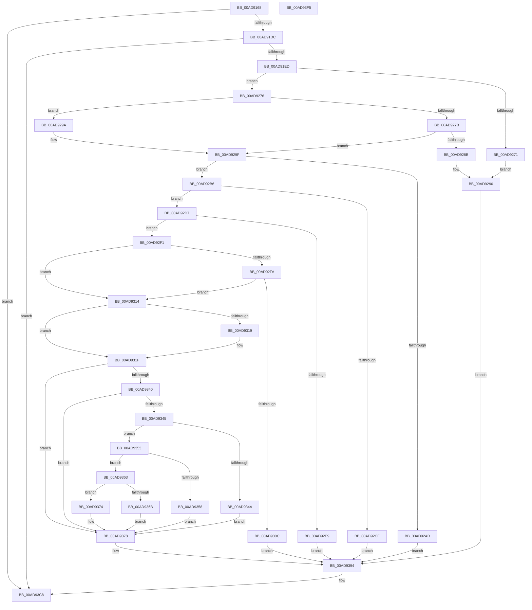

# PopSmartSuspendMakePredictions

- RVA: `0x00AD9168`–`0x00AD93F6` (길이 `654` bytes)
- VA: `0x0000000140AD9168`
- 실행 섹션: `PAGE`
- PDB 이름 있음: `예`; PDB Function 태그: `아니요`
- unwind 정보 RVA: `0x000BF1E8`
- 디코드: `179`개 명령, `654/654` bytes 표시
- 미해석 바이트: `0` (있으면 어셈블리에 `.byte`로 보존)

> 이 문서는 커널 이미지의 기계어와 PDB 기호를 분석해 생성했습니다. 4번과 5번은 함수 원형과 자료형을 바이너리 사용 방식에서 추정한 C 해석이며 원본 소스 복구 결과는 아닙니다.

## 1. Dependencies

- 직접 호출 지점: **13**; 고유 호출 대상: **9**
- 직접 호출자로 확인된 함수: **3**
- RIP 상대 이미지 참조: **9**

### Outgoing calls
- `0x00AD91A7` → [memset](../../text/6C/memset_function_006C6C40.md) (function, `0x006C6C40`)
- `0x00AD91BA` → [memset](../../text/6C/memset_function_006C6C40.md) (function, `0x006C6C40`)
- `0x00AD91CF` → [PopIsPlatformAoAcCapable](../../text/49/PopIsPlatformAoAcCapable_function_0049BF40.md) (function, `0x0049BF40`)
- `0x00AD9221` → [memset](../../text/6C/memset_function_006C6C40.md) (function, `0x006C6C40`)
- `0x00AD924B` → [PopFilterCapabilities](../91/PopFilterCapabilities_function_0091141C.md) (function, `0x0091141C`)
- `0x00AD9255` → [PopIsDozeSupported](../AA/PopIsDozeSupported_function_00AA3DC0.md) (function, `0x00AA3DC0`)
- `0x00AD925D` → [PopReleasePolicyLock](../../pagelk/B7/PopReleasePolicyLock_function_00B78410.md) (function, `0x00B78410`)
- `0x00AD9268` → [PopUmpoQuerySmartSuspendPrediction](../76/PopUmpoQuerySmartSuspendPrediction_function_0076927C.md) (function, `0x0076927C`)
- `0x00AD9282` → [PopUmpoQuerySmartSuspendPrediction](../76/PopUmpoQuerySmartSuspendPrediction_function_0076927C.md) (function, `0x0076927C`)
- `0x00AD9290` → [PopAcquirePolicyLock](../../pagelk/B7/PopAcquirePolicyLock_function_00B783C0.md) (function, `0x00B783C0`)
- `0x00AD929F` → [PopAcquirePolicyLock](../../pagelk/B7/PopAcquirePolicyLock_function_00B783C0.md) (function, `0x00B783C0`)
- `0x00AD93C3` → [PopDiagTraceSmartSuspendPrediction](../76/PopDiagTraceSmartSuspendPrediction_function_00763124.md) (function, `0x00763124`)
- `0x00AD93CF` → [_security_check_cookie](../../text/6A/_security_check_cookie_function_006AC640.md) (function, `0x006AC640`)

### Direct callers
- [PdcPoCurrentPdcPhase](../../text/5D/PdcPoCurrentPdcPhase_function_005D9E70.md) at `0x005D9F5E`
- [PopPowerAggregatorNotifyAcDcStateChange](../6F/PopPowerAggregatorNotifyAcDcStateChange_function_006FE41C.md) at `0x006FE42A`
- [PopPowerAggregatorDozeTimerWorker](../76/PopPowerAggregatorDozeTimerWorker_function_00764490.md) at `0x007645AB`

### Static image references
- `0x00AD918B` → RVA `0x00E0A740` (`.data`; read)
- `0x00AD91E0` → RVA `0x00F0CE0C` (`.data`; read)
- `0x00AD91ED` → RVA `0x00F0888C` (`.data`; read)
- `0x00AD91FF` → RVA `0x00F0888C` (`.data`; write)
- `0x00AD9205` → RVA `0x00F088A0` (`.data`; read)
- `0x00AD921A` → RVA `0x00F08F68` (`.data`; write)
- `0x00AD9226` → RVA `0x00F08EA0` (`.data`; read)
- `0x00AD9239` → RVA `0x00F0CEC0` (`.data`; read)
- `0x00AD9240` → RVA `0x00F08EA0` (`.data`; write)

## 2. Other-region calls and transfers

- 다른 실행 섹션으로 향하는 call: **8**
  - `0x00AD91A7` → [memset](../../text/6C/memset_function_006C6C40.md) (`PAGE` → `.text`)
  - `0x00AD91BA` → [memset](../../text/6C/memset_function_006C6C40.md) (`PAGE` → `.text`)
  - `0x00AD91CF` → [PopIsPlatformAoAcCapable](../../text/49/PopIsPlatformAoAcCapable_function_0049BF40.md) (`PAGE` → `.text`)
  - `0x00AD9221` → [memset](../../text/6C/memset_function_006C6C40.md) (`PAGE` → `.text`)
  - `0x00AD925D` → [PopReleasePolicyLock](../../pagelk/B7/PopReleasePolicyLock_function_00B78410.md) (`PAGE` → `PAGELK`)
  - `0x00AD9290` → [PopAcquirePolicyLock](../../pagelk/B7/PopAcquirePolicyLock_function_00B783C0.md) (`PAGE` → `PAGELK`)
  - `0x00AD929F` → [PopAcquirePolicyLock](../../pagelk/B7/PopAcquirePolicyLock_function_00B783C0.md) (`PAGE` → `PAGELK`)
  - `0x00AD93CF` → [_security_check_cookie](../../text/6A/_security_check_cookie_function_006AC640.md) (`PAGE` → `.text`)
- 별도 외부 분기/꼬리 이동을 확인하지 못했습니다.

## 3. Assembly (complete function range)

```asm
00AD9168  48 8B C4                        mov rax, rsp
00AD916B  48 89 58 08                     mov qword ptr [rax + 8], rbx
00AD916F  48 89 70 10                     mov qword ptr [rax + 0x10], rsi
00AD9173  48 89 78 18                     mov qword ptr [rax + 0x18], rdi
00AD9177  55                              push rbp
00AD9178  41 54                           push r12
00AD917A  41 55                           push r13
00AD917C  41 56                           push r14
00AD917E  41 57                           push r15
00AD9180  48 8D 68 A1                     lea rbp, [rax - 0x5f]
00AD9184  48 81 EC E0 00 00 00            sub rsp, 0xe0
00AD918B  48 8B 05 AE 15 33 00            mov rax, qword ptr [rip + 0x3315ae]
00AD9192  48 33 C4                        xor rax, rsp
00AD9195  48 89 45 27                     mov qword ptr [rbp + 0x27], rax
00AD9199  33 D2                           xor edx, edx
00AD919B  44 8B E1                        mov r12d, ecx
00AD919E  48 8D 4C 24 20                  lea rcx, [rsp + 0x20]
00AD91A3  44 8D 42 4C                     lea r8d, [rdx + 0x4c]
00AD91A7  E8 94 DA BE FF                  call 0x1406c6c40
00AD91AC  33 DB                           xor ebx, ebx
00AD91AE  48 8D 4D C7                     lea rcx, [rbp - 0x39]
00AD91B2  33 D2                           xor edx, edx
00AD91B4  8D 73 60                        lea esi, [rbx + 0x60]
00AD91B7  44 8B C6                        mov r8d, esi
00AD91BA  E8 81 DA BE FF                  call 0x1406c6c40
00AD91BF  48 21 5D F7                     and qword ptr [rbp - 9], rbx
00AD91C3  49 83 CD FF                     or r13, 0xffffffffffffffff
00AD91C7  4C 89 6D EF                     mov qword ptr [rbp - 0x11], r13
00AD91CB  4C 89 6D FF                     mov qword ptr [rbp - 1], r13
00AD91CF  E8 6C 2D 9C FF                  call 0x14049bf40
00AD91D4  84 C0                           test al, al
00AD91D6  0F 84 EC 01 00 00               je 0x140ad93c8
00AD91DC  44 8D 73 01                     lea r14d, [rbx + 1]
00AD91E0  44 39 35 25 3C 43 00            cmp dword ptr [rip + 0x433c25], r14d
00AD91E7  0F 85 DB 01 00 00               jne 0x140ad93c8
00AD91ED  8B 05 99 F6 42 00               mov eax, dword ptr [rip + 0x42f699]
00AD91F3  44 8B C6                        mov r8d, esi
00AD91F6  FF C0                           inc eax
00AD91F8  33 D2                           xor edx, edx
00AD91FA  83 E0 0F                        and eax, 0xf
00AD91FD  8B C8                           mov ecx, eax
00AD91FF  89 0D 87 F6 42 00               mov dword ptr [rip + 0x42f687], ecx
00AD9205  48 8D 0D 94 F6 42 00            lea rcx, [rip + 0x42f694]
00AD920C  48 8D 3C 40                     lea rdi, [rax + rax*2]
00AD9210  48 C1 E7 05                     shl rdi, 5
00AD9214  48 03 F9                        add rdi, rcx
00AD9217  48 8B CF                        mov rcx, rdi
00AD921A  48 89 3D 47 FD 42 00            mov qword ptr [rip + 0x42fd47], rdi
00AD9221  E8 1A DA BE FF                  call 0x1406c6c40
00AD9226  44 8B 3D 73 FC 42 00            mov r15d, dword ptr [rip + 0x42fc73]
00AD922D  48 8D 54 24 20                  lea rdx, [rsp + 0x20]
00AD9232  41 FF C7                        inc r15d
00AD9235  4C 89 6F 28                     mov qword ptr [rdi + 0x28], r13
00AD9239  48 8D 0D 80 3C 43 00            lea rcx, [rip + 0x433c80]
00AD9240  44 89 3D 59 FC 42 00            mov dword ptr [rip + 0x42fc59], r15d
00AD9247  4C 89 6F 38                     mov qword ptr [rdi + 0x38], r13
00AD924B  E8 CC 81 E3 FF                  call 0x14091141c
00AD9250  48 8D 4C 24 20                  lea rcx, [rsp + 0x20]
00AD9255  E8 66 AB FC FF                  call 0x140aa3dc0
00AD925A  40 8A F0                        mov sil, al
00AD925D  E8 AE F1 09 00                  call 0x140b78410
00AD9262  33 D2                           xor edx, edx
00AD9264  48 8D 4D C7                     lea rcx, [rbp - 0x39]
00AD9268  E8 0F 00 C9 FF                  call 0x14076927c
00AD926D  85 C0                           test eax, eax
00AD926F  79 05                           jns 0x140ad9276
00AD9271  41 8B DE                        mov ebx, r14d
00AD9274  EB 1A                           jmp 0x140ad9290
00AD9276  40 84 F6                        test sil, sil
00AD9279  74 1F                           je 0x140ad929a
00AD927B  41 8B D6                        mov edx, r14d
00AD927E  48 8D 4D C7                     lea rcx, [rbp - 0x39]
00AD9282  E8 F5 FF C8 FF                  call 0x14076927c
00AD9287  85 C0                           test eax, eax
00AD9289  79 14                           jns 0x140ad929f
00AD928B  BB 02 00 00 00                  mov ebx, 2
00AD9290  E8 2B F1 09 00                  call 0x140b783c0
00AD9295  E9 FA 00 00 00                  jmp 0x140ad9394
00AD929A  BB 04 00 00 00                  mov ebx, 4
00AD929F  E8 1C F1 09 00                  call 0x140b783c0
00AD92A4  44 3B 3D F5 FB 42 00            cmp r15d, dword ptr [rip + 0x42fbf5]
00AD92AB  74 09                           je 0x140ad92b6
00AD92AD  0F BA EB 1F                     bts ebx, 0x1f
00AD92B1  E9 DE 00 00 00                  jmp 0x140ad9394
00AD92B6  44 8A 75 C7                     mov r14b, byte ptr [rbp - 0x39]
00AD92BA  4C 8B 4D E7                     mov r9, qword ptr [rbp - 0x19]
00AD92BE  4C 8B 45 EF                     mov r8, qword ptr [rbp - 0x11]
00AD92C2  48 8B 55 F7                     mov rdx, qword ptr [rbp - 9]
00AD92C6  4C 8B 55 FF                     mov r10, qword ptr [rbp - 1]
00AD92CA  45 84 F6                        test r14b, r14b
00AD92CD  75 08                           jne 0x140ad92d7
00AD92CF  83 CB 08                        or ebx, 8
00AD92D2  E9 BD 00 00 00                  jmp 0x140ad9394
00AD92D7  48 BE 00 1A 71 18 02 00 00 00   movabs rsi, 0x218711a00
00AD92E1  49 03 F1                        add rsi, r9
00AD92E4  49 3B F0                        cmp rsi, r8
00AD92E7  76 08                           jbe 0x140ad92f1
00AD92E9  83 CB 10                        or ebx, 0x10
00AD92EC  E9 A3 00 00 00                  jmp 0x140ad9394
00AD92F1  44 8A 5D C9                     mov r11b, byte ptr [rbp - 0x37]
00AD92F5  45 84 DB                        test r11b, r11b
00AD92F8  74 1A                           je 0x140ad9314
00AD92FA  48 B8 00 D0 88 C3 10 00 00 00   movabs rax, 0x10c388d000
00AD9304  48 03 C2                        add rax, rdx
00AD9307  49 3B C2                        cmp rax, r10
00AD930A  76 08                           jbe 0x140ad9314
00AD930C  83 CB 20                        or ebx, 0x20
00AD930F  E9 80 00 00 00                  jmp 0x140ad9394
00AD9314  4D 85 C9                        test r9, r9
00AD9317  75 06                           jne 0x140ad931f
00AD9319  4D 8B C5                        mov r8, r13
00AD931C  4D 8B D5                        mov r10, r13
00AD931F  49 8B C1                        mov rax, r9
00AD9322  48 F7 D8                        neg rax
00AD9325  8B C3                           mov eax, ebx
00AD9327  48 1B C9                        sbb rcx, rcx
00AD932A  83 C8 40                        or eax, 0x40
00AD932D  48 23 CA                        and rcx, rdx
00AD9330  4D 85 C9                        test r9, r9
00AD9333  48 8B D1                        mov rdx, rcx
00AD9336  0F 45 C3                        cmovne eax, ebx
00AD9339  8B D8                           mov ebx, eax
00AD933B  45 84 DB                        test r11b, r11b
00AD933E  74 38                           je 0x140ad9378
00AD9340  4D 85 C9                        test r9, r9
00AD9343  74 33                           je 0x140ad9378
00AD9345  48 85 C9                        test rcx, rcx
00AD9348  75 09                           jne 0x140ad9353
00AD934A  4D 8B D5                        mov r10, r13
00AD934D  0F BA EB 07                     bts ebx, 7
00AD9351  EB 25                           jmp 0x140ad9378
00AD9353  4C 3B C1                        cmp r8, rcx
00AD9356  77 0B                           ja 0x140ad9363
00AD9358  33 D2                           xor edx, edx
00AD935A  4D 8B D5                        mov r10, r13
00AD935D  0F BA EB 08                     bts ebx, 8
00AD9361  EB 15                           jmp 0x140ad9378
00AD9363  4D 8B C5                        mov r8, r13
00AD9366  48 3B F1                        cmp rsi, rcx
00AD9369  72 09                           jb 0x140ad9374
00AD936B  45 33 C9                        xor r9d, r9d
00AD936E  0F BA EB 09                     bts ebx, 9
00AD9372  EB 04                           jmp 0x140ad9378
00AD9374  0F BA EB 0A                     bts ebx, 0xa
00AD9378  0F BA EB 0B                     bts ebx, 0xb
00AD937C  44 88 77 01                     mov byte ptr [rdi + 1], r14b
00AD9380  44 88 5F 03                     mov byte ptr [rdi + 3], r11b
00AD9384  4C 89 4F 20                     mov qword ptr [rdi + 0x20], r9
00AD9388  4C 89 47 28                     mov qword ptr [rdi + 0x28], r8
00AD938C  48 89 57 30                     mov qword ptr [rdi + 0x30], rdx
00AD9390  4C 89 57 38                     mov qword ptr [rdi + 0x38], r10
00AD9394  48 B8 14 00 00 00 80 F7 FF FF   movabs rax, 0xfffff78000000014
00AD939E  48 8D 55 C7                     lea rdx, [rbp - 0x39]
00AD93A2  48 8B CF                        mov rcx, rdi
00AD93A5  48 8B 00                        mov rax, qword ptr [rax]
00AD93A8  48 89 47 18                     mov qword ptr [rdi + 0x18], rax
00AD93AC  8B 45 CF                        mov eax, dword ptr [rbp - 0x31]
00AD93AF  89 47 08                        mov dword ptr [rdi + 8], eax
00AD93B2  8B 45 D3                        mov eax, dword ptr [rbp - 0x2d]
00AD93B5  89 47 0C                        mov dword ptr [rdi + 0xc], eax
00AD93B8  44 89 7F 48                     mov dword ptr [rdi + 0x48], r15d
00AD93BC  89 5F 04                        mov dword ptr [rdi + 4], ebx
00AD93BF  44 89 67 44                     mov dword ptr [rdi + 0x44], r12d
00AD93C3  E8 5C 9D C8 FF                  call 0x140763124
00AD93C8  48 8B 4D 27                     mov rcx, qword ptr [rbp + 0x27]
00AD93CC  48 33 CC                        xor rcx, rsp
00AD93CF  E8 6C 32 BD FF                  call 0x1406ac640
00AD93D4  4C 8D 9C 24 E0 00 00 00         lea r11, [rsp + 0xe0]
00AD93DC  49 8B 5B 30                     mov rbx, qword ptr [r11 + 0x30]
00AD93E0  49 8B 73 38                     mov rsi, qword ptr [r11 + 0x38]
00AD93E4  49 8B 7B 40                     mov rdi, qword ptr [r11 + 0x40]
00AD93E8  49 8B E3                        mov rsp, r11
00AD93EB  41 5F                           pop r15
00AD93ED  41 5E                           pop r14
00AD93EF  41 5D                           pop r13
00AD93F1  41 5C                           pop r12
00AD93F3  5D                              pop rbp
00AD93F4  C3                              ret
00AD93F5  CC                              int3
```

## 4. C-style interpretation (structured pseudocode)

```c
__int64 __fastcall PopSmartSuspendMakePredictions(int a1, int a2)
{
    __int64 result;
    __int64 v_r10;
    __int64 v_r13;
    __int64 v_r15;
    __int64 v_rbx;
    __int64 v_rdi;
    __int64 v_rsi;
    __int64 v_rsp;
    unsigned __int64 v_stack_m28;
    unsigned __int64 v_stack_mE8;

    *(unsigned __int64 *)(v_rsp + 8) = v_rbx;
    *(unsigned __int64 *)(v_rsp + 16) = v_rsi;
    *(unsigned __int64 *)(v_rsp + 24) = v_rdi;
    v_rsp = (v_rsp) - (224);
    result = (*(unsigned __int64 *)(v_rip + 3347886)) ^ (v_rsp);
    *(unsigned __int64 *)(v_rsp - 95 + 39) = result;
    a2 = 0;
    result = memset(v_stack_mE8, a2, a2 + 76, a4);
    v_rbx = 0;
    a2 = 0;
    result = memset(v_rsp - 95 - 57, a2, (unsigned int)((unsigned int)(v_rbx + 96)), a4);
    v_r13 = (v_r13) | (-1);
    *(unsigned __int64 *)(v_rsp - 95 - 17) = v_r13;
    *(unsigned __int64 *)(v_rsp - 95 - 1) = v_r13;
    result = PopIsPlatformAoAcCapable(v_rsp - 95 - 57, a2, (unsigned int)((unsigned int)(v_rbx + 96)), a4);
    if ((unsigned __int8)(result) == 0) goto loc_00AD93C8;
    if ((*(unsigned int *)(v_rip + 4406309)) != ((unsigned int)(v_rbx + 1))) goto loc_00AD93C8;
    result = (unsigned int)(((unsigned int)(*(unsigned int *)(v_rip + 4388505))) + 1);
    a2 = 0;
    result = (unsigned int)((result) & (15));
    *(unsigned int *)(v_rip + 4388487) = (unsigned int)((unsigned int)((unsigned int)(result)));
    v_rdi = (result + result * 2) << (5);
    v_rdi = (v_rdi) + (v_rip + 4388500);
    *(unsigned __int64 *)(v_rip + 4390215) = v_rdi;
    result = memset(v_rdi, a2, (unsigned int)((unsigned int)(v_rbx + 96)), a4);
    v_r15 = (unsigned int)(((unsigned int)(*(unsigned int *)(v_rip + 4390003))) + 1);
    *(unsigned __int64 *)(v_rdi + 40) = v_r13;
    *(unsigned int *)(v_rip + 4389977) = (unsigned int)(v_r15);
    *(unsigned __int64 *)(v_rdi + 56) = v_r13;
    result = PopFilterCapabilities(v_rip + 4406400, v_stack_mE8, (unsigned int)((unsigned int)(v_rbx + 96)), a4);
    result = PopIsDozeSupported(v_stack_mE8, v_stack_mE8, (unsigned int)((unsigned int)(v_rbx + 96)), a4);
    result = PopReleasePolicyLock(v_stack_mE8, v_stack_mE8, (unsigned int)((unsigned int)(v_rbx + 96)), a4);
    a2 = 0;
    result = PopUmpoQuerySmartSuspendPrediction(v_rsp - 95 - 57, a2, (unsigned int)((unsigned int)(v_rbx + 96)), a4);
    if (!sign_flag) goto loc_00AD9276;
    goto loc_00AD9290;
loc_00AD9276:
    if ((unsigned __int8)((unsigned __int8)(result)) == 0) goto loc_00AD929A;
    result = PopUmpoQuerySmartSuspendPrediction(v_rsp - 95 - 57, (unsigned int)((unsigned int)(v_rbx + 1)), (unsigned int)((unsigned int)(v_rbx + 96)), a4);
    if (!sign_flag) goto loc_00AD929F;
loc_00AD9290:
    result = PopAcquirePolicyLock(v_rsp - 95 - 57, (unsigned int)((unsigned int)(v_rbx + 1)), (unsigned int)((unsigned int)(v_rbx + 96)), a4);
    goto loc_00AD9394;
loc_00AD929A:
loc_00AD929F:
    result = PopAcquirePolicyLock(v_rsp - 95 - 57, (unsigned int)((unsigned int)(v_rbx + 1)), (unsigned int)((unsigned int)(v_rbx + 96)), a4);
    if (((unsigned int)(v_r15)) == (*(unsigned int *)(v_rip + 4389877))) goto loc_00AD92B6;
    goto loc_00AD9394;
loc_00AD92B6:
    if ((unsigned __int8)(*(unsigned __int8 *)(v_rsp - 95 - 57)) != 0) goto loc_00AD92D7;
    v_rbx = (unsigned int)((4) | (8));
    goto loc_00AD9394;
loc_00AD92D7:
    v_rsi = ((unsigned __int8)(result)) + (*(unsigned __int64 *)(v_rsp - 95 - 25));
    if (v_rsi <= (*(unsigned __int64 *)(v_rsp - 95 - 17))) goto loc_00AD92F1;
    v_rbx = (unsigned int)((v_rbx) | (16));
    goto loc_00AD9394;
loc_00AD92F1:
    if ((unsigned __int8)(*(unsigned __int8 *)(v_rsp - 95 - 55)) == 0) goto loc_00AD9314;
    result = (result) + (*(unsigned __int64 *)(v_rsp - 95 - 9));
    if (result <= (*(unsigned __int64 *)(v_rsp - 95 - 1))) goto loc_00AD9314;
    v_rbx = (unsigned int)((v_rbx) | (32));
    goto loc_00AD9394;
loc_00AD9314:
    v_r10 = *(unsigned __int64 *)(v_rsp - 95 - 1);
    if (*(unsigned __int64 *)(v_rsp - 95 - 25) == 0) {
        a3 = v_r13;
        v_r10 = v_r13;
    }
    result = -(*(unsigned __int64 *)(v_rsp - 95 - 25));
    result = (unsigned int)(((unsigned int)((unsigned int)(v_rbx))) | (64));
    a1 = (v_rsp - 95 - 57) & (*(unsigned __int64 *)(v_rsp - 95 - 9));
    if (*(unsigned __int64 *)(v_rsp - 95 - 25) != 0) { result = (unsigned int)(v_rbx); }
    if ((unsigned __int8)(*(unsigned __int8 *)(v_rsp - 95 - 55)) == 0) goto loc_00AD9378;
    if (*(unsigned __int64 *)(v_rsp - 95 - 25) == 0) goto loc_00AD9378;
    if (a1 != 0) goto loc_00AD9353;
    goto loc_00AD9378;
loc_00AD9353:
    if (a3 > a1) goto loc_00AD9363;
    a2 = 0;
    goto loc_00AD9378;
loc_00AD9363:
    if (v_rsi < a1) goto loc_00AD9374;
    a4 = 0;
    goto loc_00AD9378;
loc_00AD9374:
loc_00AD9378:
    *(unsigned __int8 *)(v_rdi + 1) = (unsigned __int8)(*(unsigned __int8 *)(v_rsp - 95 - 57));
    *(unsigned __int8 *)(v_rdi + 3) = (unsigned __int8)(*(unsigned __int8 *)(v_rsp - 95 - 55));
    *(unsigned __int64 *)(v_rdi + 32) = 0;
    *(unsigned __int64 *)(v_rdi + 40) = v_r13;
    *(unsigned __int64 *)(v_rdi + 48) = 0;
    *(unsigned __int64 *)(v_rdi + 56) = v_r13;
loc_00AD9394:
    *(unsigned __int64 *)(v_rdi + 24) = *(unsigned __int64 *)(result);
    *(unsigned int *)(v_rdi + 8) = (unsigned int)((unsigned int)(*(unsigned int *)(v_rsp - 95 - 49)));
    *(unsigned int *)(v_rdi + 12) = (unsigned int)((unsigned int)(*(unsigned int *)(v_rsp - 95 - 45)));
    *(unsigned int *)(v_rdi + 72) = (unsigned int)(v_r15);
    *(unsigned int *)(v_rdi + 4) = (unsigned int)((unsigned int)((unsigned int)(result)));
    *(unsigned int *)(v_rdi + 68) = (unsigned int)((unsigned int)(a1));
    result = PopDiagTraceSmartSuspendPrediction(v_rdi, v_rsp - 95 - 57, v_r13, a4);
loc_00AD93C8:
    a1 = (*(unsigned __int64 *)(v_rsp - 95 + 39)) ^ (v_rsp);
    result = _security_check_cookie(a1, v_rsp - 95 - 57, v_r13, a4);
    return result;
}
```

## 5. (Beta) C Style

```c
int64_t PopSmartSuspendMakePredictions(int32_t Arg1, int32_t Arg2)
{
    int64_t result;
    int64_t local_r10;
    int64_t local_r13;
    int64_t local_r15;
    int64_t local_rbx;
    int64_t local_rdi;
    int64_t local_rsi;
    int64_t local_rsp;
    uint64_t v_stack_m28;
    uint64_t v_stack_mE8;

    *(uint64_t *)(local_rsp + 0x8) = local_rbx;
    *(uint64_t *)(local_rsp + 0x10) = local_rsi;
    *(uint64_t *)(local_rsp + 0x18) = local_rdi;
    local_rsp = (local_rsp) - (224);
    result = (*(uint64_t *)(v_rip + 0x3315AE)) ^ (local_rsp);
    *(uint64_t *)(local_rsp - 0x5F + 0x27) = result;
    Arg2 = 0;
    result = memset(v_stack_mE8, Arg2, Arg2 + 76, a4);
    local_rbx = 0;
    Arg2 = 0;
    result = memset(local_rsp - 95 - 57, Arg2, (uint32_t)((uint32_t)(local_rbx + 96)), a4);
    local_r13 = (local_r13) | (-1);
    *(uint64_t *)(local_rsp - 0x5F - 0x11) = local_r13;
    *(uint64_t *)(local_rsp - 0x5F - 0x1) = local_r13;
    result = PopIsPlatformAoAcCapable(local_rsp - 95 - 57, Arg2, (uint32_t)((uint32_t)(local_rbx + 96)), a4);
    if ((uint8_t)(result) == 0) goto loc_00AD93C8;
    if ((*(uint32_t *)(v_rip + 0x433C25)) != ((uint32_t)(local_rbx + 1))) goto loc_00AD93C8;
    result = (uint32_t)(((uint32_t)(*(uint32_t *)(v_rip + 0x42F699))) + 1);
    Arg2 = 0;
    result = (uint32_t)((result) & (15));
    *(uint32_t *)(v_rip + 0x42F687) = (uint32_t)((uint32_t)((uint32_t)(result)));
    local_rdi = (result + result * 2) << (5);
    local_rdi = (local_rdi) + (v_rip + 4388500);
    *(uint64_t *)(v_rip + 0x42FD47) = local_rdi;
    result = memset(local_rdi, Arg2, (uint32_t)((uint32_t)(local_rbx + 96)), a4);
    local_r15 = (uint32_t)(((uint32_t)(*(uint32_t *)(v_rip + 0x42FC73))) + 1);
    *(uint64_t *)(local_rdi + 0x28) = local_r13;
    *(uint32_t *)(v_rip + 0x42FC59) = (uint32_t)(local_r15);
    *(uint64_t *)(local_rdi + 0x38) = local_r13;
    result = PopFilterCapabilities(v_rip + 4406400, v_stack_mE8, (uint32_t)((uint32_t)(local_rbx + 96)), a4);
    result = PopIsDozeSupported(v_stack_mE8, v_stack_mE8, (uint32_t)((uint32_t)(local_rbx + 96)), a4);
    result = PopReleasePolicyLock(v_stack_mE8, v_stack_mE8, (uint32_t)((uint32_t)(local_rbx + 96)), a4);
    Arg2 = 0;
    result = PopUmpoQuerySmartSuspendPrediction(local_rsp - 95 - 57, Arg2, (uint32_t)((uint32_t)(local_rbx + 96)), a4);
    if (!sign_flag) goto loc_00AD9276;
    goto loc_00AD9290;
loc_00AD9276:
    if ((uint8_t)((uint8_t)(result)) == 0) goto loc_00AD929A;
    result = PopUmpoQuerySmartSuspendPrediction(local_rsp - 95 - 57, (uint32_t)((uint32_t)(local_rbx + 1)), (uint32_t)((uint32_t)(local_rbx + 96)), a4);
    if (!sign_flag) goto loc_00AD929F;
loc_00AD9290:
    result = PopAcquirePolicyLock(local_rsp - 95 - 57, (uint32_t)((uint32_t)(local_rbx + 1)), (uint32_t)((uint32_t)(local_rbx + 96)), a4);
    goto loc_00AD9394;
loc_00AD929A:
loc_00AD929F:
    result = PopAcquirePolicyLock(local_rsp - 95 - 57, (uint32_t)((uint32_t)(local_rbx + 1)), (uint32_t)((uint32_t)(local_rbx + 96)), a4);
    if (((uint32_t)(local_r15)) == (*(uint32_t *)(v_rip + 0x42FBF5))) goto loc_00AD92B6;
    goto loc_00AD9394;
loc_00AD92B6:
    if ((uint8_t)(*(uint8_t *)(local_rsp - 0x5F - 0x39)) != 0) goto loc_00AD92D7;
    local_rbx = (uint32_t)((4) | (8));
    goto loc_00AD9394;
loc_00AD92D7:
    local_rsi = ((uint8_t)(result)) + (*(uint64_t *)(local_rsp - 0x5F - 0x19));
    if (local_rsi <= (*(uint64_t *)(local_rsp - 0x5F - 0x11))) goto loc_00AD92F1;
    local_rbx = (uint32_t)((local_rbx) | (16));
    goto loc_00AD9394;
loc_00AD92F1:
    if ((uint8_t)(*(uint8_t *)(local_rsp - 0x5F - 0x37)) == 0) goto loc_00AD9314;
    result = (result) + (*(uint64_t *)(local_rsp - 0x5F - 0x9));
    if (result <= (*(uint64_t *)(local_rsp - 0x5F - 0x1))) goto loc_00AD9314;
    local_rbx = (uint32_t)((local_rbx) | (32));
    goto loc_00AD9394;
loc_00AD9314:
    local_r10 = *(uint64_t *)(local_rsp - 0x5F - 0x1);
    if (*(uint64_t *)(local_rsp - 0x5F - 0x19) == 0) {
        a3 = local_r13;
        local_r10 = local_r13;
    }
    result = -(*(uint64_t *)(local_rsp - 0x5F - 0x19));
    result = (uint32_t)(((uint32_t)((uint32_t)(local_rbx))) | (64));
    Arg1 = (local_rsp - 95 - 57) & (*(uint64_t *)(local_rsp - 0x5F - 0x9));
    if (*(uint64_t *)(local_rsp - 0x5F - 0x19) != 0) { result = (uint32_t)(local_rbx); }
    if ((uint8_t)(*(uint8_t *)(local_rsp - 0x5F - 0x37)) == 0) goto loc_00AD9378;
    if (*(uint64_t *)(local_rsp - 0x5F - 0x19) == 0) goto loc_00AD9378;
    if (Arg1 != 0) goto loc_00AD9353;
    goto loc_00AD9378;
loc_00AD9353:
    if (a3 > Arg1) goto loc_00AD9363;
    Arg2 = 0;
    goto loc_00AD9378;
loc_00AD9363:
    if (local_rsi < Arg1) goto loc_00AD9374;
    a4 = 0;
    goto loc_00AD9378;
loc_00AD9374:
loc_00AD9378:
    *(uint8_t *)(local_rdi + 0x1) = (uint8_t)(*(uint8_t *)(local_rsp - 0x5F - 0x39));
    *(uint8_t *)(local_rdi + 0x3) = (uint8_t)(*(uint8_t *)(local_rsp - 0x5F - 0x37));
    *(uint64_t *)(local_rdi + 0x20) = 0;
    *(uint64_t *)(local_rdi + 0x28) = local_r13;
    *(uint64_t *)(local_rdi + 0x30) = 0;
    *(uint64_t *)(local_rdi + 0x38) = local_r13;
loc_00AD9394:
    *(uint64_t *)(local_rdi + 0x18) = *(uint64_t *)(result);
    *(uint32_t *)(local_rdi + 0x8) = (uint32_t)((uint32_t)(*(uint32_t *)(local_rsp - 0x5F - 0x31)));
    *(uint32_t *)(local_rdi + 0xC) = (uint32_t)((uint32_t)(*(uint32_t *)(local_rsp - 0x5F - 0x2D)));
    *(uint32_t *)(local_rdi + 0x48) = (uint32_t)(local_r15);
    *(uint32_t *)(local_rdi + 0x4) = (uint32_t)((uint32_t)((uint32_t)(result)));
    *(uint32_t *)(local_rdi + 0x44) = (uint32_t)((uint32_t)(Arg1));
    result = PopDiagTraceSmartSuspendPrediction(local_rdi, local_rsp - 95 - 57, local_r13, a4);
loc_00AD93C8:
    Arg1 = (*(uint64_t *)(local_rsp - 0x5F + 0x27)) ^ (local_rsp);
    result = _security_check_cookie(Arg1, local_rsp - 95 - 57, local_r13, a4);
    return result;
}
```

## 6. Execution-region graph

[열기: 2D/3D 그래프와 함수 탐색 컨트롤 패널](../../../control-panel.html?section=page&rva=0x00AD9168&view=graph)

- 2D 그래프는 위에서 아래로 흐르고, 3D 그래프는 빈 공간을 드래그해 회전합니다. Shift+드래그는 이동, 휠은 확대·축소, 함수 노드 선택은 대상 보고서 이동입니다.

### Static fallback


