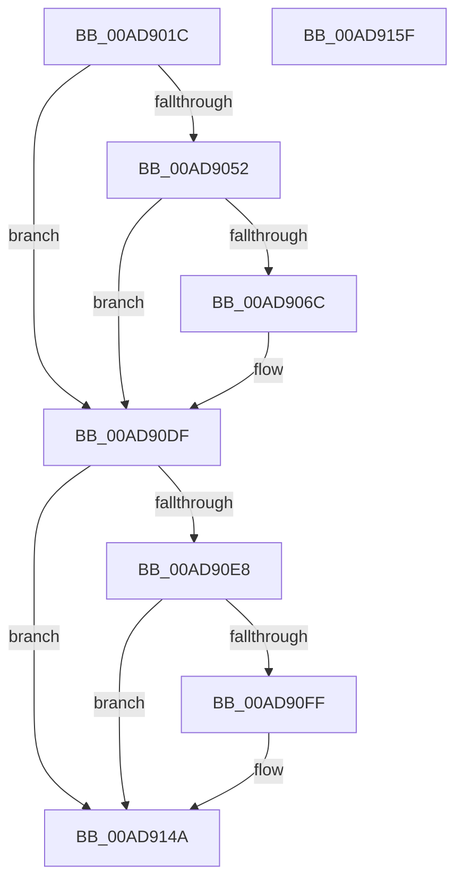

# PopTraceStandbyConnectivityUpdate

- RVA: `0x00AD901C`–`0x00AD9160` (길이 `324` bytes)
- VA: `0x0000000140AD901C`
- 실행 섹션: `PAGE`
- PDB 이름 있음: `예`; PDB Function 태그: `아니요`
- unwind 정보 RVA: `0x000BF1D0`
- 디코드: `69`개 명령, `324/324` bytes 표시
- 미해석 바이트: `0` (있으면 어셈블리에 `.byte`로 보존)

> 이 문서는 커널 이미지의 기계어와 PDB 기호를 분석해 생성했습니다. 4번과 5번은 함수 원형과 자료형을 바이너리 사용 방식에서 추정한 C 해석이며 원본 소스 복구 결과는 아닙니다.

## 1. Dependencies

- 직접 호출 지점: **5**; 고유 호출 대상: **5**
- 직접 호출자로 확인된 함수: **2**
- RIP 상대 이미지 참조: **6**

### Outgoing calls
- `0x00AD9063` → [tlgKeywordOn](../../text/42/tlgKeywordOn_function_0042EAA0.md) (function, `0x0042EAA0`)
- `0x00AD90DA` → [tlgWriteTransfer_EtwWriteTransfer](../../text/42/tlgWriteTransfer_EtwWriteTransfer_function_004260E0.md) (function, `0x004260E0`)
- `0x00AD90F6` → [EtwEventEnabled](../../text/39/EtwEventEnabled_function_00392450.md) (function, `0x00392450`)
- `0x00AD9145` → [EtwWrite](../../text/41/EtwWrite_function_0041C720.md) (function, `0x0041C720`)
- `0x00AD9151` → [_security_check_cookie](../../text/6A/_security_check_cookie_function_006AC640.md) (function, `0x006AC640`)

### Direct callers
- [PopNetEvaluationWorkerCallback](../../text/4B/PopNetEvaluationWorkerCallback_function_004BE0B0.md) at `0x004BE143`
- [PopNetInitialize](../../init/C4/PopNetInitialize_function_00C423AC.md) at `0x00C424CF`

### Static image references
- `0x00AD9031` → RVA `0x00E0A740` (`.data`; read)
- `0x00AD903F` → RVA `0x00E07748` (`.data`; read)
- `0x00AD9078` → RVA `0x000495A7` (`.rdata`; read)
- `0x00AD90DF` → RVA `0x00E67858` (`.data`; read)
- `0x00AD90E8` → RVA `0x00F0B408` (`.data`; read)
- `0x00AD90EF` → RVA `0x00022728` (`.rdata`; read)

## 2. Other-region calls and transfers

- 다른 실행 섹션으로 향하는 call: **5**
  - `0x00AD9063` → [tlgKeywordOn](../../text/42/tlgKeywordOn_function_0042EAA0.md) (`PAGE` → `.text`)
  - `0x00AD90DA` → [tlgWriteTransfer_EtwWriteTransfer](../../text/42/tlgWriteTransfer_EtwWriteTransfer_function_004260E0.md) (`PAGE` → `.text`)
  - `0x00AD90F6` → [EtwEventEnabled](../../text/39/EtwEventEnabled_function_00392450.md) (`PAGE` → `.text`)
  - `0x00AD9145` → [EtwWrite](../../text/41/EtwWrite_function_0041C720.md) (`PAGE` → `.text`)
  - `0x00AD9151` → [_security_check_cookie](../../text/6A/_security_check_cookie_function_006AC640.md) (`PAGE` → `.text`)
- 별도 외부 분기/꼬리 이동을 확인하지 못했습니다.

## 3. Assembly (complete function range)

```asm
00AD901C  89 54 24 10                     mov dword ptr [rsp + 0x10], edx
00AD9020  89 4C 24 08                     mov dword ptr [rsp + 8], ecx
00AD9024  55                              push rbp
00AD9025  48 8D 6C 24 A9                  lea rbp, [rsp - 0x57]
00AD902A  48 81 EC C0 00 00 00            sub rsp, 0xc0
00AD9031  48 8B 05 08 17 33 00            mov rax, qword ptr [rip + 0x331708]
00AD9038  48 33 C4                        xor rax, rsp
00AD903B  48 89 45 47                     mov qword ptr [rbp + 0x47], rax
00AD903F  83 3D 02 E7 32 00 05            cmp dword ptr [rip + 0x32e702], 5
00AD9046  44 8B C2                        mov r8d, edx
00AD9049  44 8B C9                        mov r9d, ecx
00AD904C  0F 86 8D 00 00 00               jbe 0x140ad90df
00AD9052  48 BA 00 00 00 00 00 40 00 00   movabs rdx, 0x400000000000
00AD905C  48 8D 0D E5 E6 32 00            lea rcx, [rip + 0x32e6e5]
00AD9063  E8 38 5A 95 FF                  call 0x14042eaa0
00AD9068  84 C0                           test al, al
00AD906A  74 73                           je 0x140ad90df
00AD906C  83 65 23 00                     and dword ptr [rbp + 0x23], 0
00AD9070  48 8D 45 C7                     lea rax, [rbp - 0x39]
00AD9074  83 65 33 00                     and dword ptr [rbp + 0x33], 0
00AD9078  48 8D 15 28 05 57 FF            lea rdx, [rip - 0xa8fad8]
00AD907F  83 65 43 00                     and dword ptr [rbp + 0x43], 0
00AD9083  48 8D 0D BE E6 32 00            lea rcx, [rip + 0x32e6be]
00AD908A  48 89 45 17                     mov qword ptr [rbp + 0x17], rax
00AD908E  48 8D 45 CB                     lea rax, [rbp - 0x35]
00AD9092  48 89 45 27                     mov qword ptr [rbp + 0x27], rax
00AD9096  48 8D 45 CF                     lea rax, [rbp - 0x31]
00AD909A  48 89 45 37                     mov qword ptr [rbp + 0x37], rax
00AD909E  48 8D 45 F7                     lea rax, [rbp - 9]
00AD90A2  44 89 4D C7                     mov dword ptr [rbp - 0x39], r9d
00AD90A6  45 33 C9                        xor r9d, r9d
00AD90A9  44 89 45 CB                     mov dword ptr [rbp - 0x35], r8d
00AD90AD  45 33 C0                        xor r8d, r8d
00AD90B0  48 89 44 24 28                  mov qword ptr [rsp + 0x28], rax
00AD90B5  C7 44 24 20 05 00 00 00         mov dword ptr [rsp + 0x20], 5
00AD90BD  C7 45 1F 04 00 00 00            mov dword ptr [rbp + 0x1f], 4
00AD90C4  C7 45 2F 04 00 00 00            mov dword ptr [rbp + 0x2f], 4
00AD90CB  48 C7 45 CF 00 00 00 01         mov qword ptr [rbp - 0x31], 0x1000000
00AD90D3  C7 45 3F 08 00 00 00            mov dword ptr [rbp + 0x3f], 8
00AD90DA  E8 01 D0 94 FF                  call 0x1404260e0
00AD90DF  80 3D 72 E7 38 00 00            cmp byte ptr [rip + 0x38e772], 0
00AD90E6  74 62                           je 0x140ad914a
00AD90E8  48 8B 0D 19 23 43 00            mov rcx, qword ptr [rip + 0x432319]
00AD90EF  48 8D 15 32 96 54 FF            lea rdx, [rip - 0xab69ce]
00AD90F6  E8 55 93 8B FF                  call 0x140392450
00AD90FB  84 C0                           test al, al
00AD90FD  74 4B                           je 0x140ad914a
00AD90FF  83 65 E3 00                     and dword ptr [rbp - 0x1d], 0
00AD9103  48 8D 45 67                     lea rax, [rbp + 0x67]
00AD9107  83 65 F3 00                     and dword ptr [rbp - 0xd], 0
00AD910B  48 8D 15 16 96 54 FF            lea rdx, [rip - 0xab69ea]
00AD9112  48 8B 0D EF 22 43 00            mov rcx, qword ptr [rip + 0x4322ef]
00AD9119  41 B9 02 00 00 00               mov r9d, 2
00AD911F  48 89 45 D7                     mov qword ptr [rbp - 0x29], rax
00AD9123  45 33 C0                        xor r8d, r8d
00AD9126  48 8D 45 6F                     lea rax, [rbp + 0x6f]
00AD912A  C7 45 DF 04 00 00 00            mov dword ptr [rbp - 0x21], 4
00AD9131  48 89 45 E7                     mov qword ptr [rbp - 0x19], rax
00AD9135  48 8D 45 D7                     lea rax, [rbp - 0x29]
00AD9139  48 89 44 24 20                  mov qword ptr [rsp + 0x20], rax
00AD913E  C7 45 EF 04 00 00 00            mov dword ptr [rbp - 0x11], 4
00AD9145  E8 D6 35 94 FF                  call 0x14041c720
00AD914A  48 8B 4D 47                     mov rcx, qword ptr [rbp + 0x47]
00AD914E  48 33 CC                        xor rcx, rsp
00AD9151  E8 EA 34 BD FF                  call 0x1406ac640
00AD9156  48 81 C4 C0 00 00 00            add rsp, 0xc0
00AD915D  5D                              pop rbp
00AD915E  C3                              ret
00AD915F  CC                              int3
```

## 4. C-style interpretation (structured pseudocode)

```c
__int64 __fastcall PopTraceStandbyConnectivityUpdate(int a1, int a2)
{
    __int64 result;
    __int64 v_rsp;
    unsigned __int64 v_stack_m18;
    unsigned int v_stack_m1C;
    unsigned int v_stack_m20;
    unsigned __int64 v_stack_m28;
    unsigned int v_stack_m2C;
    unsigned int v_stack_m30;
    unsigned __int64 v_stack_m38;
    unsigned int v_stack_m3C;
    unsigned int v_stack_m40;
    unsigned __int64 v_stack_m48;
    unsigned __int64 v_stack_m5F;
    unsigned __int64 v_stack_m68;
    unsigned int v_stack_m6C;
    unsigned int v_stack_m70;
    unsigned __int64 v_stack_m78;
    unsigned int v_stack_m7C;
    unsigned int v_stack_m80;
    unsigned __int64 v_stack_m88;
    unsigned __int64 v_stack_m90;
    unsigned __int64 v_stack_m94;
    unsigned __int64 v_stack_m98;
    unsigned __int64 v_stack_mA0;
    unsigned int v_stack_mA8;
    unsigned int v_stack_p10;
    unsigned int v_stack_p8;

    v_stack_p10 = a2;
    v_stack_p8 = a1;
    v_rsp = (v_rsp) - (192);
    result = (*(unsigned __int64 *)(v_rip + 3348232)) ^ (v_rsp);
    v_stack_m18 = result;
    if ((*(unsigned int *)(v_rip + 3335938)) <= 5) goto loc_00AD90DF;
    result = tlgKeywordOn(v_rip + 3335909, a2, (unsigned int)(a2), (unsigned int)(a1));
    if ((unsigned __int8)(result) != 0) {
        result = v_stack_m98;
        a2 = v_rip - 11074264;
        a1 = v_rip + 3335870;
        v_stack_m48 = result;
        result = v_stack_m94;
        v_stack_m38 = result;
        result = v_stack_m90;
        v_stack_m28 = result;
        result = v_stack_m68;
        v_stack_m98 = (unsigned int)((unsigned int)(a1));
        a4 = 0;
        v_stack_m94 = (unsigned int)((unsigned int)(a2));
        a3 = 0;
        v_stack_mA0 = result;
        v_stack_mA8 = 5;
        v_stack_m40 = 4;
        v_stack_m30 = 4;
        v_stack_m90 = 0x1000000ULL;
        v_stack_m20 = 8;
        result = tlgWriteTransfer_EtwWriteTransfer(a1, a2, a3, a4);
    }
    if ((*(unsigned __int8 *)(v_rip + 3729266)) == 0) goto loc_00AD914A;
    result = EtwEventEnabled(*(unsigned __int64 *)(v_rip + 4399897), v_rip - 11233742, a3, a4);
    if ((unsigned __int8)(result) != 0) {
        result = v_stack_p8;
        a2 = v_rip - 11233770;
        a1 = *(unsigned __int64 *)(v_rip + 4399855);
        a4 = 2;
        v_stack_m88 = result;
        a3 = 0;
        result = v_stack_p10;
        v_stack_m80 = 4;
        v_stack_m78 = result;
        result = v_stack_m88;
        v_stack_mA8 = result;
        v_stack_m70 = 4;
        result = EtwWrite(a1, a2, a3, a4);
    }
    a1 = (v_stack_m18) ^ (v_rsp);
    result = _security_check_cookie(a1, a2, a3, a4);
    v_rsp = (v_rsp) + (192);
    return result;
}
```

## 5. (Beta) C Style

```c
int64_t PopTraceStandbyConnectivityUpdate(int32_t Arg1, int32_t Arg2)
{
    int64_t result;
    int64_t local_rsp;
    uint64_t v_stack_m18;
    uint32_t v_stack_m1C;
    uint32_t v_stack_m20;
    uint64_t v_stack_m28;
    uint32_t v_stack_m2C;
    uint32_t v_stack_m30;
    uint64_t v_stack_m38;
    uint32_t v_stack_m3C;
    uint32_t v_stack_m40;
    uint64_t v_stack_m48;
    uint64_t v_stack_m5F;
    uint64_t v_stack_m68;
    uint32_t v_stack_m6C;
    uint32_t v_stack_m70;
    uint64_t v_stack_m78;
    uint32_t v_stack_m7C;
    uint32_t v_stack_m80;
    uint64_t v_stack_m88;
    uint64_t v_stack_m90;
    uint64_t v_stack_m94;
    uint64_t v_stack_m98;
    uint64_t v_stack_mA0;
    uint32_t v_stack_mA8;
    uint32_t v_stack_p10;
    uint32_t v_stack_p8;

    v_stack_p10 = Arg2;
    v_stack_p8 = Arg1;
    local_rsp = (local_rsp) - (192);
    result = (*(uint64_t *)(v_rip + 0x331708)) ^ (local_rsp);
    v_stack_m18 = result;
    if ((*(uint32_t *)(v_rip + 0x32E702)) <= 5) goto loc_00AD90DF;
    result = tlgKeywordOn(v_rip + 3335909, Arg2, (uint32_t)(Arg2), (uint32_t)(Arg1));
    if ((uint8_t)(result) != 0) {
        result = v_stack_m98;
        Arg2 = v_rip - 11074264;
        Arg1 = v_rip + 3335870;
        v_stack_m48 = result;
        result = v_stack_m94;
        v_stack_m38 = result;
        result = v_stack_m90;
        v_stack_m28 = result;
        result = v_stack_m68;
        v_stack_m98 = (uint32_t)((uint32_t)(Arg1));
        a4 = 0;
        v_stack_m94 = (uint32_t)((uint32_t)(Arg2));
        a3 = 0;
        v_stack_mA0 = result;
        v_stack_mA8 = 5;
        v_stack_m40 = 4;
        v_stack_m30 = 4;
        v_stack_m90 = 0x1000000ULL;
        v_stack_m20 = 8;
        result = tlgWriteTransfer_EtwWriteTransfer(Arg1, Arg2, a3, a4);
    }
    if ((*(uint8_t *)(v_rip + 0x38E772)) == 0) goto loc_00AD914A;
    result = EtwEventEnabled(*(uint64_t *)(v_rip + 0x432319), v_rip - 11233742, a3, a4);
    if ((uint8_t)(result) != 0) {
        result = v_stack_p8;
        Arg2 = v_rip - 11233770;
        Arg1 = *(uint64_t *)(v_rip + 0x4322EF);
        a4 = 2;
        v_stack_m88 = result;
        a3 = 0;
        result = v_stack_p10;
        v_stack_m80 = 4;
        v_stack_m78 = result;
        result = v_stack_m88;
        v_stack_mA8 = result;
        v_stack_m70 = 4;
        result = EtwWrite(Arg1, Arg2, a3, a4);
    }
    Arg1 = (v_stack_m18) ^ (local_rsp);
    result = _security_check_cookie(Arg1, Arg2, a3, a4);
    local_rsp = (local_rsp) + (192);
    return result;
}
```

## 6. Execution-region graph

[열기: 2D/3D 그래프와 함수 탐색 컨트롤 패널](../../../control-panel.html?section=page&rva=0x00AD901C&view=graph)

- 2D 그래프는 위에서 아래로 흐르고, 3D 그래프는 빈 공간을 드래그해 회전합니다. Shift+드래그는 이동, 휠은 확대·축소, 함수 노드 선택은 대상 보고서 이동입니다.

### Static fallback


