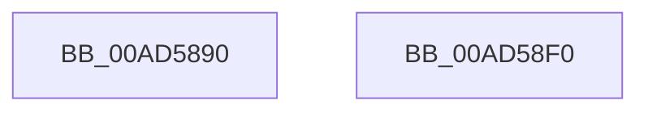

# PopUpdateBackgroundCoolingStatus

- RVA: `0x00AD5890`–`0x00AD58F1` (길이 `97` bytes)
- VA: `0x0000000140AD5890`
- 실행 섹션: `PAGE`
- PDB 이름 있음: `예`; PDB Function 태그: `아니요`
- unwind 정보 RVA: `0x00065FB8`
- 디코드: `26`개 명령, `97/97` bytes 표시
- 미해석 바이트: `0` (있으면 어셈블리에 `.byte`로 보존)

> 이 문서는 커널 이미지의 기계어와 PDB 기호를 분석해 생성했습니다. 4번과 5번은 함수 원형과 자료형을 바이너리 사용 방식에서 추정한 C 해석이며 원본 소스 복구 결과는 아닙니다.

## 1. Dependencies

- 직접 호출 지점: **2**; 고유 호출 대상: **2**
- 직접 호출자로 확인된 함수: **2**
- RIP 상대 이미지 참조: **2**

### Outgoing calls
- `0x00AD58D9` → [ZwUpdateWnfStateData](../../text/6B/ZwUpdateWnfStateData_function_006B0D10.md) (function, `0x006B0D10`)
- `0x00AD58E6` → [_security_check_cookie](../../text/6A/_security_check_cookie_function_006AC640.md) (function, `0x006AC640`)

### Direct callers
- [PopPowerInformationInternal](../A8/PopPowerInformationInternal_function_00A8B7C0.md) at `0x00A8BD90`
- [PoInitSystem](../../init/C7/PoInitSystem_function_00C72358.md) at `0x00C72E80`

### Static image references
- `0x00AD5897` → RVA `0x00E0A740` (`.data`; read)
- `0x00AD58A6` → RVA `0x0001ED28` (`.rdata`; read)

## 2. Other-region calls and transfers

- 다른 실행 섹션으로 향하는 call: **2**
  - `0x00AD58D9` → [ZwUpdateWnfStateData](../../text/6B/ZwUpdateWnfStateData_function_006B0D10.md) (`PAGE` → `.text`)
  - `0x00AD58E6` → [_security_check_cookie](../../text/6A/_security_check_cookie_function_006AC640.md) (`PAGE` → `.text`)
- 별도 외부 분기/꼬리 이동을 확인하지 못했습니다.

## 3. Assembly (complete function range)

```asm
00AD5890  4C 8B DC                        mov r11, rsp
00AD5893  48 83 EC 68                     sub rsp, 0x68
00AD5897  48 8B 05 A2 4E 33 00            mov rax, qword ptr [rip + 0x334ea2]
00AD589E  48 33 C4                        xor rax, rsp
00AD58A1  48 89 44 24 50                  mov qword ptr [rsp + 0x50], rax
00AD58A6  48 8B 05 7B 94 54 FF            mov rax, qword ptr [rip - 0xab6b85]
00AD58AD  33 D2                           xor edx, edx
00AD58AF  89 54 24 30                     mov dword ptr [rsp + 0x30], edx
00AD58B3  84 C9                           test cl, cl
00AD58B5  49 89 43 E0                     mov qword ptr [r11 - 0x20], rax
00AD58B9  49 8D 4B E0                     lea rcx, [r11 - 0x20]
00AD58BD  8B C2                           mov eax, edx
00AD58BF  89 54 24 28                     mov dword ptr [rsp + 0x28], edx
00AD58C3  0F 95 C0                        setne al
00AD58C6  49 89 53 B8                     mov qword ptr [r11 - 0x48], rdx
00AD58CA  44 8D 42 04                     lea r8d, [rdx + 4]
00AD58CE  89 44 24 40                     mov dword ptr [rsp + 0x40], eax
00AD58D2  45 33 C9                        xor r9d, r9d
00AD58D5  49 8D 53 D8                     lea rdx, [r11 - 0x28]
00AD58D9  E8 32 B4 BD FF                  call 0x1406b0d10
00AD58DE  48 8B 4C 24 50                  mov rcx, qword ptr [rsp + 0x50]
00AD58E3  48 33 CC                        xor rcx, rsp
00AD58E6  E8 55 6D BD FF                  call 0x1406ac640
00AD58EB  48 83 C4 68                     add rsp, 0x68
00AD58EF  C3                              ret
00AD58F0  CC                              int3
```

## 4. C-style interpretation (structured pseudocode)

```c
__int64 __fastcall PopUpdateBackgroundCoolingStatus(unsigned __int8 a1, int a2, __int64 a3, int a4)
{
    __int64 result;
    __int64 v_rsp;
    unsigned __int64 v_stack_m18;
    unsigned int v_stack_m28;
    unsigned int v_stack_m38;
    unsigned int v_stack_m40;

    v_rsp = (v_rsp) - (104);
    result = (*(unsigned __int64 *)(v_rip + 3362466)) ^ (v_rsp);
    v_stack_m18 = result;
    a2 = 0;
    v_stack_m38 = 0;
    *(unsigned __int64 *)(v_rsp - 32) = *(unsigned __int64 *)(v_rip - 11234181);
    v_stack_m40 = 0;
    result = (a1 != 0) ? 1 : 0;
    *(unsigned __int64 *)(v_rsp - 72) = 0;
    v_stack_m28 = (unsigned int)(result);
    a4 = 0;
    result = ZwUpdateWnfStateData(v_rsp - 32, v_rsp - 40, a2 + 4, a4);
    a1 = (v_stack_m18) ^ (v_rsp);
    result = _security_check_cookie(a1, v_rsp - 40, a2 + 4, a4);
    v_rsp = (v_rsp) + (104);
    return result;
}
```

## 5. (Beta) C Style

```c
int64_t PopUpdateBackgroundCoolingStatus(uint8_t Arg1, int32_t Arg2, int64_t Arg3, int32_t Arg4)
{
    int64_t result;
    int64_t local_rsp;
    uint64_t v_stack_m18;
    uint32_t v_stack_m28;
    uint32_t v_stack_m38;
    uint32_t v_stack_m40;

    local_rsp = (local_rsp) - (104);
    result = (*(uint64_t *)(v_rip + 0x334EA2)) ^ (local_rsp);
    v_stack_m18 = result;
    Arg2 = 0;
    v_stack_m38 = 0;
    *(uint64_t *)(local_rsp - 0x20) = *(uint64_t *)(v_rip - 0xAB6B85);
    v_stack_m40 = 0;
    result = (Arg1 != 0) ? 1 : 0;
    *(uint64_t *)(local_rsp - 0x48) = 0;
    v_stack_m28 = (uint32_t)(result);
    Arg4 = 0;
    result = ZwUpdateWnfStateData(local_rsp - 32, local_rsp - 40, Arg2 + 4, Arg4);
    Arg1 = (v_stack_m18) ^ (local_rsp);
    result = _security_check_cookie(Arg1, local_rsp - 40, Arg2 + 4, Arg4);
    local_rsp = (local_rsp) + (104);
    return result;
}
```

## 6. Execution-region graph

[열기: 2D/3D 그래프와 함수 탐색 컨트롤 패널](../../../control-panel.html?section=page&rva=0x00AD5890&view=graph)

- 2D 그래프는 위에서 아래로 흐르고, 3D 그래프는 빈 공간을 드래그해 회전합니다. Shift+드래그는 이동, 휠은 확대·축소, 함수 노드 선택은 대상 보고서 이동입니다.

### Static fallback


