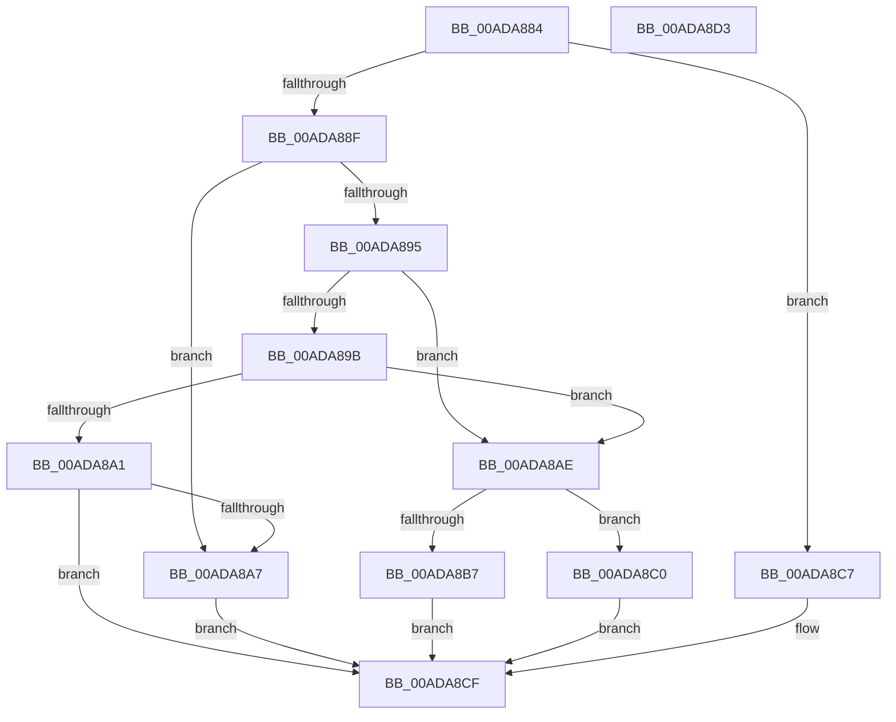

# PopWakeSourceSize

- RVA: `0x00ADA884`–`0x00ADA8D4` (길이 `80` bytes)
- VA: `0x0000000140ADA884`
- 실행 섹션: `PAGE`
- PDB 이름 있음: `예`; PDB Function 태그: `아니요`
- unwind 정보 RVA: `0x000DB714`
- 디코드: `27`개 명령, `80/80` bytes 표시
- 미해석 바이트: `0` (있으면 어셈블리에 `.byte`로 보존)

> 이 문서는 커널 이미지의 기계어와 PDB 기호를 분석해 생성했습니다. 4번과 5번은 함수 원형과 자료형을 바이너리 사용 방식에서 추정한 C 해석이며 원본 소스 복구 결과는 아닙니다.

## 1. Dependencies

- 직접 호출 지점: **0**; 고유 호출 대상: **0**
- 직접 호출자로 확인된 함수: **2**
- RIP 상대 이미지 참조: **0**

### Outgoing calls
- 직접 디코드된 call 명령이 없습니다.

### Direct callers
- [PopCopyWakeSource](../75/PopCopyWakeSource_function_0075C558.md) at `0x0075C565`
- [PopGetWakeSource](../AB/PopGetWakeSource_function_00ABDB68.md) at `0x00ABDC15`

### Static image references
- 디코드된 RIP-relative 메모리 참조가 없습니다.

## 2. Other-region calls and transfers

- 다른 실행 섹션으로 향하는 call: **0**
- 별도 외부 분기/꼬리 이동을 확인하지 못했습니다.

## 3. Assembly (complete function range)

```asm
00ADA884  44 8B 41 10                     mov r8d, dword ptr [rcx + 0x10]
00ADA888  33 D2                           xor edx, edx
00ADA88A  45 85 C0                        test r8d, r8d
00ADA88D  74 38                           je 0x140ada8c7
00ADA88F  41 83 E8 01                     sub r8d, 1
00ADA893  74 12                           je 0x140ada8a7
00ADA895  41 83 E8 01                     sub r8d, 1
00ADA899  74 13                           je 0x140ada8ae
00ADA89B  41 83 E8 01                     sub r8d, 1
00ADA89F  74 0D                           je 0x140ada8ae
00ADA8A1  41 83 F8 01                     cmp r8d, 1
00ADA8A5  75 28                           jne 0x140ada8cf
00ADA8A7  BA 0C 00 00 00                  mov edx, 0xc
00ADA8AC  EB 21                           jmp 0x140ada8cf
00ADA8AE  48 8B 41 18                     mov rax, qword ptr [rcx + 0x18]
00ADA8B2  48 85 C0                        test rax, rax
00ADA8B5  74 09                           je 0x140ada8c0
00ADA8B7  48 8B 10                        mov rdx, qword ptr [rax]
00ADA8BA  48 83 C2 08                     add rdx, 8
00ADA8BE  EB 0F                           jmp 0x140ada8cf
00ADA8C0  BA 30 00 00 00                  mov edx, 0x30
00ADA8C5  EB 08                           jmp 0x140ada8cf
00ADA8C7  0F B7 51 18                     movzx edx, word ptr [rcx + 0x18]
00ADA8CB  48 83 C2 0A                     add rdx, 0xa
00ADA8CF  48 8B C2                        mov rax, rdx
00ADA8D2  C3                              ret
00ADA8D3  CC                              int3
```

## 4. C-style interpretation (structured pseudocode)

```c
__int64 __fastcall PopWakeSourceSize(__int64 a1, int a2)
{
    a2 = 0;
    if ((unsigned int)((unsigned int)(*(unsigned int *)(a1 + 16))) == 0) goto loc_00ADA8C7;
    a3 = (unsigned int)(((unsigned int)(*(unsigned int *)(a1 + 16))) - (1));
    if (condition_is_equal) goto loc_00ADA8A7;
    a3 = (unsigned int)((a3) - (1));
    if (condition_is_equal) goto loc_00ADA8AE;
    a3 = (unsigned int)((a3) - (1));
    if (condition_is_equal) goto loc_00ADA8AE;
    if (((unsigned int)(a3)) != 1) goto loc_00ADA8CF;
loc_00ADA8A7:
    goto loc_00ADA8CF;
loc_00ADA8AE:
    if (*(unsigned __int64 *)(a1 + 24) == 0) goto loc_00ADA8C0;
    a2 = (*(unsigned __int64 *)(*(unsigned __int64 *)(a1 + 24))) + (8);
    goto loc_00ADA8CF;
loc_00ADA8C0:
    goto loc_00ADA8CF;
loc_00ADA8C7:
    a2 = (*(unsigned __int16 *)(a1 + 24)) + (10);
loc_00ADA8CF:
    return a2;
}
```

## 5. (Beta) C Style

```c
int64_t PopWakeSourceSize(void *Arg1, int32_t Arg2)
{
    uint8_t *arg1 = (uint8_t *)Arg1;

    Arg2 = 0;
    if ((uint32_t)((uint32_t)(*(uint32_t *)(arg1 + 0x10))) == 0) goto loc_00ADA8C7;
    a3 = (uint32_t)(((uint32_t)(*(uint32_t *)(arg1 + 0x10))) - (1));
    if (condition_is_equal) goto loc_00ADA8A7;
    a3 = (uint32_t)((a3) - (1));
    if (condition_is_equal) goto loc_00ADA8AE;
    a3 = (uint32_t)((a3) - (1));
    if (condition_is_equal) goto loc_00ADA8AE;
    if (((uint32_t)(a3)) != 1) goto loc_00ADA8CF;
loc_00ADA8A7:
    goto loc_00ADA8CF;
loc_00ADA8AE:
    if (*(uint64_t *)(arg1 + 0x18) == 0) goto loc_00ADA8C0;
    Arg2 = (*(uint64_t *)(*(uint64_t *)(arg1 + 0x18))) + (8);
    goto loc_00ADA8CF;
loc_00ADA8C0:
    goto loc_00ADA8CF;
loc_00ADA8C7:
    Arg2 = (*(uint16_t *)(arg1 + 0x18)) + (10);
loc_00ADA8CF:
    return Arg2;
}
```

### 관측된 메모리 오프셋

구조체 형식이 확인되지 않은 접근은 인자 기준의 오프셋으로만 기록했습니다.

| 기준 인자 | 오프셋 표현 | 폭 (bit) | 접근 |
|---|---:|---:|---|
| `Arg1` | `+ 0x10` | `32` | `R` |
| `Arg1` | `+ 0x18` | `16` | `R` |
| `Arg1` | `+ 0x18` | `64` | `R` |

## 6. Execution-region graph

[열기: 2D/3D 그래프와 함수 탐색 컨트롤 패널](../../../control-panel.html?section=page&rva=0x00ADA884&view=graph)

- 2D 그래프는 위에서 아래로 흐르고, 3D 그래프는 빈 공간을 드래그해 회전합니다. Shift+드래그는 이동, 휠은 확대·축소, 함수 노드 선택은 대상 보고서 이동입니다.

### Static fallback


