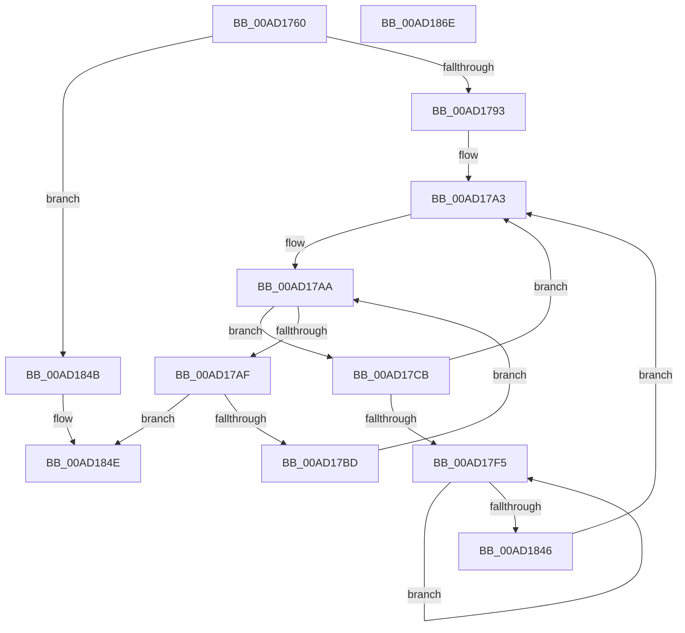

# PpmHeteroDetectFavoredCores

- RVA: `0x00AD1760`–`0x00AD186F` (길이 `271` bytes)
- VA: `0x0000000140AD1760`
- 실행 섹션: `PAGE`
- PDB 이름 있음: `예`; PDB Function 태그: `아니요`
- unwind 정보 RVA: `0x000B0E24`
- 디코드: `73`개 명령, `271/271` bytes 표시
- 미해석 바이트: `0` (있으면 어셈블리에 `.byte`로 보존)

> 이 문서는 커널 이미지의 기계어와 PDB 기호를 분석해 생성했습니다. 4번과 5번은 함수 원형과 자료형을 바이너리 사용 방식에서 추정한 C 해석이며 원본 소스 복구 결과는 아닙니다.

## 1. Dependencies

- 직접 호출 지점: **1**; 고유 호출 대상: **1**
- 직접 호출자로 확인된 함수: **1**
- RIP 상대 이미지 참조: **5**

### Outgoing calls
- `0x00AD17F8` → [KeGetPrcb](../../text/2D/KeGetPrcb_function_002D85D0.md) (function, `0x002D85D0`)

### Direct callers
- [PopInitializeHeteroProcessors](../A5/PopInitializeHeteroProcessors_function_00A53570.md) at `0x00A5368E`
- [PopInitializeHeteroProcessors](../A5/PopInitializeHeteroProcessors_function_00A53570.md) at `0x00A536AE`
- [PopInitializeHeteroProcessors](../A5/PopInitializeHeteroProcessors_function_00A53570.md) at `0x00A536D6`

### Static image references
- `0x00AD177C` → RVA `0x00E0B800` (`.data`; read)
- `0x00AD1784` → RVA `0x00FC6B6D` (`ALMOSTRO`; read)
- `0x00AD179C` → RVA `0x00E0B438` (`.data`; read)
- `0x00AD17A3` → RVA `0x00E0B430` (`.data`; read)
- `0x00AD17E4` → RVA `0x00F231B8` (`.data`; read)

## 2. Other-region calls and transfers

- 다른 실행 섹션으로 향하는 call: **1**
  - `0x00AD17F8` → [KeGetPrcb](../../text/2D/KeGetPrcb_function_002D85D0.md) (`PAGE` → `.text`)
- 별도 외부 분기/꼬리 이동을 확인하지 못했습니다.

## 3. Assembly (complete function range)

```asm
00AD1760  48 89 5C 24 08                  mov qword ptr [rsp + 8], rbx
00AD1765  48 89 6C 24 18                  mov qword ptr [rsp + 0x18], rbp
00AD176A  48 89 74 24 20                  mov qword ptr [rsp + 0x20], rsi
00AD176F  57                              push rdi
00AD1770  41 54                           push r12
00AD1772  41 55                           push r13
00AD1774  41 56                           push r14
00AD1776  41 57                           push r15
00AD1778  48 83 EC 20                     sub rsp, 0x20
00AD177C  8A 05 7E A0 33 00               mov al, byte ptr [rip + 0x33a07e]
00AD1782  33 DB                           xor ebx, ebx
00AD1784  38 05 E3 53 4F 00               cmp byte ptr [rip + 0x4f53e3], al
00AD178A  4C 8B F1                        mov r14, rcx
00AD178D  0F 86 B8 00 00 00               jbe 0x140ad184b
00AD1793  8D 73 01                        lea esi, [rbx + 1]
00AD1796  0F B7 FB                        movzx edi, bx
00AD1799  89 71 04                        mov dword ptr [rcx + 4], esi
00AD179C  48 8B 2D 95 9C 33 00            mov rbp, qword ptr [rip + 0x339c95]
00AD17A3  0F B7 0D 86 9C 33 00            movzx ecx, word ptr [rip + 0x339c86]
00AD17AA  48 85 ED                        test rbp, rbp
00AD17AD  75 1C                           jne 0x140ad17cb
00AD17AF  66 03 FE                        add di, si
00AD17B2  0F B7 FF                        movzx edi, di
00AD17B5  3B F9                           cmp edi, ecx
00AD17B7  0F 83 91 00 00 00               jae 0x140ad184e
00AD17BD  48 8D 2D 74 9C 33 00            lea rbp, [rip + 0x339c74]
00AD17C4  48 8B 6C FD 00                  mov rbp, qword ptr [rbp + rdi*8]
00AD17C9  EB DF                           jmp 0x140ad17aa
00AD17CB  48 0F BC D5                     bsf rdx, rbp
00AD17CF  0F B7 CF                        movzx ecx, di
00AD17D2  44 8B E3                        mov r12d, ebx
00AD17D5  0F B6 C2                        movzx eax, dl
00AD17D8  48 0F B3 C5                     btr rbp, rax
00AD17DC  C1 E1 06                        shl ecx, 6
00AD17DF  0F B6 C2                        movzx eax, dl
00AD17E2  03 C8                           add ecx, eax
00AD17E4  48 8B 05 CD 19 45 00            mov rax, qword ptr [rip + 0x4519cd]
00AD17EB  44 8B 3C 88                     mov r15d, dword ptr [rax + rcx*4]
00AD17EF  41 39 5E 04                     cmp dword ptr [r14 + 4], ebx
00AD17F3  76 AE                           jbe 0x140ad17a3
00AD17F5  41 8B CF                        mov ecx, r15d
00AD17F8  E8 D3 6D 80 FF                  call 0x1402d85d0
00AD17FD  41 8B D7                        mov edx, r15d
00AD1800  41 0F AF 56 04                  imul edx, dword ptr [r14 + 4]
00AD1805  48 8B 80 B0 89 00 00            mov rax, qword ptr [rax + 0x89b0]
00AD180C  41 03 D4                        add edx, r12d
00AD180F  8A 88 2E 01 00 00               mov cl, byte ptr [rax + 0x12e]
00AD1815  41 88 4C 96 19                  mov byte ptr [r14 + rdx*4 + 0x19], cl
00AD181A  49 8B 46 08                     mov rax, qword ptr [r14 + 8]
00AD181E  8A 0D DC 9F 33 00               mov cl, byte ptr [rip + 0x339fdc]
00AD1824  42 2A 0C 38                     sub cl, byte ptr [rax + r15]
00AD1828  40 2A CE                        sub cl, sil
00AD182B  41 88 4C 96 18                  mov byte ptr [r14 + rdx*4 + 0x18], cl
00AD1830  49 8B 46 10                     mov rax, qword ptr [r14 + 0x10]
00AD1834  41 8B CC                        mov ecx, r12d
00AD1837  44 03 E6                        add r12d, esi
00AD183A  66 C7 04 48 01 01               mov word ptr [rax + rcx*2], 0x101
00AD1840  45 3B 66 04                     cmp r12d, dword ptr [r14 + 4]
00AD1844  72 AF                           jb 0x140ad17f5
00AD1846  E9 58 FF FF FF                  jmp 0x140ad17a3
00AD184B  40 8A F3                        mov sil, bl
00AD184E  48 8B 5C 24 50                  mov rbx, qword ptr [rsp + 0x50]
00AD1853  40 8A C6                        mov al, sil
00AD1856  48 8B 74 24 68                  mov rsi, qword ptr [rsp + 0x68]
00AD185B  48 8B 6C 24 60                  mov rbp, qword ptr [rsp + 0x60]
00AD1860  48 83 C4 20                     add rsp, 0x20
00AD1864  41 5F                           pop r15
00AD1866  41 5E                           pop r14
00AD1868  41 5D                           pop r13
00AD186A  41 5C                           pop r12
00AD186C  5F                              pop rdi
00AD186D  C3                              ret
00AD186E  CC                              int3
```

## 4. C-style interpretation (structured pseudocode)

```c
__int64 __fastcall PpmHeteroDetectFavoredCores(__int64 a1)
{
    __int64 result;
    __int64 v_r12;
    __int64 v_rbx;
    __int64 v_rdi;
    __int64 v_rsp;
    unsigned __int64 v_stack_p18;
    unsigned __int64 v_stack_p20;
    unsigned __int64 v_stack_p8;

    v_stack_p8 = v_rbx;
    v_stack_p18 = v_rbp;
    v_stack_p20 = v_rsi;
    v_rsp = (v_rsp) - (32);
    v_rbx = 0;
    if ((*(unsigned __int8 *)(v_rip + 5198819)) <= ((unsigned __int8)(*(unsigned __int8 *)(v_rip + 3383422)))) goto loc_00AD184B;
    *(unsigned int *)(a1 + 4) = (unsigned int)(v_rbx + 1);
loc_00AD17A3:
loc_00AD17AA:
    if (*(unsigned __int64 *)(v_rip + 3382421) != 0) goto loc_00AD17CB;
    v_rdi = (unsigned __int16)((0) + ((unsigned __int16)(v_rbx + 1)));
    if (((unsigned int)((unsigned __int16)(v_rdi))) >= ((unsigned int)(*(unsigned __int16 *)(v_rip + 3382406)))) goto loc_00AD184E;
    goto loc_00AD17AA;
loc_00AD17CB:
    a1 = (unsigned int)(((unsigned __int16)((unsigned __int16)(v_rdi))) << (6));
    a1 = (unsigned int)((a1) + ((unsigned int)((unsigned __int8)(a2))));
    if ((*(unsigned int *)(a1 + 4)) <= 0) goto loc_00AD17A3;
loc_00AD17F5:
    result = KeGetPrcb((unsigned int)((unsigned int)((unsigned int)(*(unsigned int *)(*(unsigned __int64 *)(v_rip + 4528589) + a1 * 4)))), a2, a3, a4);
    a2 = (unsigned int)(((unsigned int)((unsigned int)((unsigned int)(*(unsigned int *)(*(unsigned __int64 *)(v_rip + 4528589) + a1 * 4))))) * (*(unsigned int *)(a1 + 4)));
    a2 = (unsigned int)((a2) + (0));
    *(unsigned __int8 *)(a1 + a2 * 4 + 25) = (unsigned __int8)(*(unsigned __int8 *)(*(unsigned __int64 *)(result + 35248) + 302));
    a1 = (unsigned __int8)((*(unsigned __int8 *)(v_rip + 3383260)) - (*(unsigned __int8 *)(*(unsigned __int64 *)(a1 + 8) + (unsigned int)(*(unsigned int *)(*(unsigned __int64 *)(v_rip + 4528589) + a1 * 4)) * 1)));
    a1 = (unsigned __int8)((a1) - ((unsigned __int8)(v_rbx + 1)));
    *(unsigned __int8 *)(a1 + a2 * 4 + 24) = (unsigned __int8)(a1);
    v_r12 = (unsigned int)((0) + ((unsigned int)(v_rbx + 1)));
    *(unsigned __int16 *)(*(unsigned __int64 *)(a1 + 16) + 0 * 2) = 257;
    if (((unsigned int)(v_r12)) < (*(unsigned int *)(a1 + 4))) goto loc_00AD17F5;
    goto loc_00AD17A3;
loc_00AD184B:
loc_00AD184E:
    v_rsp = (v_rsp) + (32);
    return 0;
}
```

## 5. (Beta) C Style

```c
int64_t PpmHeteroDetectFavoredCores(void *Arg1)
{
    uint8_t *arg1 = (uint8_t *)Arg1;

    int64_t result;
    int64_t local_r12;
    int64_t local_rbx;
    int64_t local_rdi;
    int64_t local_rsp;
    uint64_t v_stack_p18;
    uint64_t v_stack_p20;
    uint64_t v_stack_p8;

    v_stack_p8 = local_rbx;
    v_stack_p18 = local_rbp;
    v_stack_p20 = local_rsi;
    local_rsp = (local_rsp) - (32);
    local_rbx = 0;
    if ((*(uint8_t *)(v_rip + 0x4F53E3)) <= ((uint8_t)(*(uint8_t *)(v_rip + 0x33A07E)))) goto loc_00AD184B;
    *(uint32_t *)(arg1 + 0x4) = (uint32_t)(local_rbx + 1);
loc_00AD17A3:
loc_00AD17AA:
    if (*(uint64_t *)(v_rip + 0x339C95) != 0) goto loc_00AD17CB;
    local_rdi = (uint16_t)((0) + ((uint16_t)(local_rbx + 1)));
    if (((uint32_t)((uint16_t)(local_rdi))) >= ((uint32_t)(*(uint16_t *)(v_rip + 0x339C86)))) goto loc_00AD184E;
    goto loc_00AD17AA;
loc_00AD17CB:
    Arg1 = (uint32_t)(((uint16_t)((uint16_t)(local_rdi))) << (6));
    Arg1 = (uint32_t)((Arg1) + ((uint32_t)((uint8_t)(a2))));
    if ((*(uint32_t *)(arg1 + 0x4)) <= 0) goto loc_00AD17A3;
loc_00AD17F5:
    result = KeGetPrcb((uint32_t)((uint32_t)((uint32_t)(*(uint32_t *)(*(uint64_t *)(v_rip + 0x4519CD) + arg1 * 4)))), a2, a3, a4);
    a2 = (uint32_t)(((uint32_t)((uint32_t)((uint32_t)(*(uint32_t *)(*(uint64_t *)(v_rip + 0x4519CD) + arg1 * 4))))) * (*(uint32_t *)(arg1 + 0x4)));
    a2 = (uint32_t)((a2) + (0));
    *(uint8_t *)(arg1 + a2 * 4 + 0x19) = (uint8_t)(*(uint8_t *)(*(uint64_t *)(result + 0x89B0) + 0x12E));
    Arg1 = (uint8_t)((*(uint8_t *)(v_rip + 0x339FDC)) - (*(uint8_t *)(*(uint64_t *)(arg1 + 0x8) + (uint32_t)(*(uint32_t *)(*(uint64_t *)(v_rip + 0x4519CD) + arg1 * 4)) * 1)));
    Arg1 = (uint8_t)((Arg1) - ((uint8_t)(local_rbx + 1)));
    *(uint8_t *)(arg1 + a2 * 4 + 0x18) = (uint8_t)(Arg1);
    local_r12 = (uint32_t)((0) + ((uint32_t)(local_rbx + 1)));
    *(uint16_t *)(*(uint64_t *)(arg1 + 0x10) + 0x0 * 2) = 257;
    if (((uint32_t)(local_r12)) < (*(uint32_t *)(arg1 + 0x4))) goto loc_00AD17F5;
    goto loc_00AD17A3;
loc_00AD184B:
loc_00AD184E:
    local_rsp = (local_rsp) + (32);
    return 0;
}
```

### 관측된 메모리 오프셋

구조체 형식이 확인되지 않은 접근은 인자 기준의 오프셋으로만 기록했습니다.

| 기준 인자 | 오프셋 표현 | 폭 (bit) | 접근 |
|---|---:|---:|---|
| `Arg1` | `+ 0x4` | `32` | `R` |
| `Arg1` | `+ 0x4` | `32` | `W` |
| `Arg1` | `+ 0x8` | `64` | `R` |
| `Arg1` | `+ 0x10` | `64` | `R` |
| `Arg1` | `+ 0x18 + rdx*4` | `8` | `W` |
| `Arg1` | `+ 0x19 + rdx*4` | `8` | `W` |

## 6. Execution-region graph

[열기: 2D/3D 그래프와 함수 탐색 컨트롤 패널](../../../control-panel.html?section=page&rva=0x00AD1760&view=graph)

- 2D 그래프는 위에서 아래로 흐르고, 3D 그래프는 빈 공간을 드래그해 회전합니다. Shift+드래그는 이동, 휠은 확대·축소, 함수 노드 선택은 대상 보고서 이동입니다.

### Static fallback


