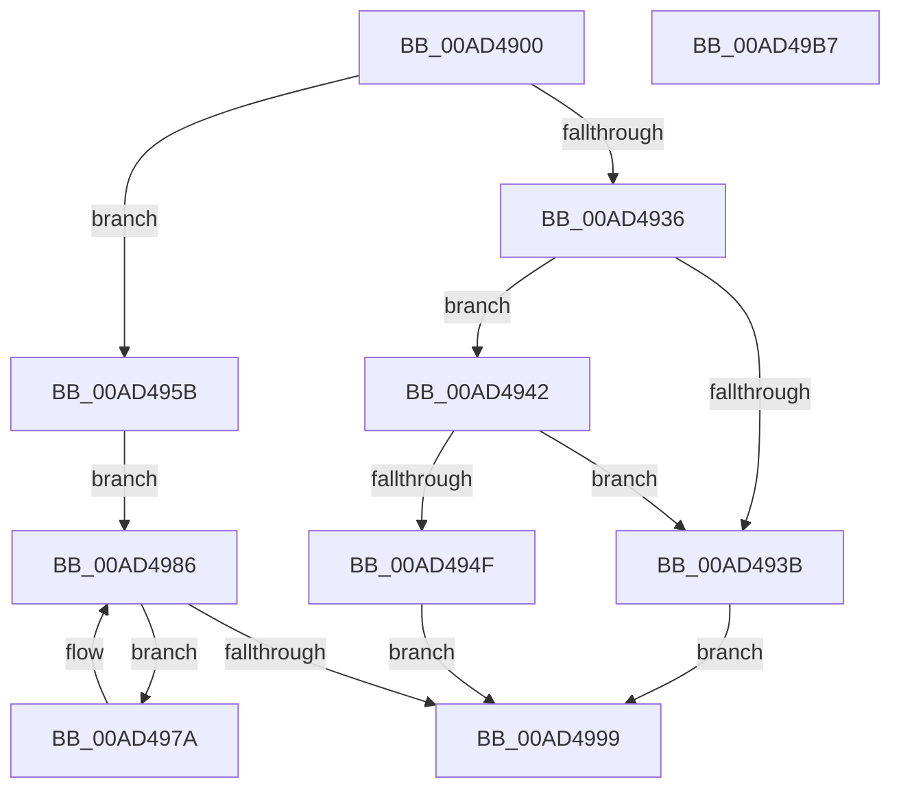

# PpmPerfGetBrandedFrequency

- RVA: `0x00AD4900`–`0x00AD49B8` (길이 `184` bytes)
- VA: `0x0000000140AD4900`
- 실행 섹션: `PAGE`
- PDB 이름 있음: `예`; PDB Function 태그: `아니요`
- unwind 정보 RVA: `0x000937EC`
- 디코드: `51`개 명령, `184/184` bytes 표시
- 미해석 바이트: `0` (있으면 어셈블리에 `.byte`로 보존)

> 이 문서는 커널 이미지의 기계어와 PDB 기호를 분석해 생성했습니다. 4번과 5번은 함수 원형과 자료형을 바이너리 사용 방식에서 추정한 C 해석이며 원본 소스 복구 결과는 아닙니다.

## 1. Dependencies

- 직접 호출 지점: **6**; 고유 호출 대상: **5**
- 직접 호출자로 확인된 함수: **1**
- RIP 상대 이미지 참조: **3**

### Outgoing calls
- `0x00AD4929` → [PpmAcquireLock](../../text/2D/PpmAcquireLock_function_002D9AA4.md) (function, `0x002D9AA4`)
- `0x00AD4945` → [KeGetProcessorIndexFromNumber](../../text/2D/KeGetProcessorIndexFromNumber_function_002DD2D0.md) (function, `0x002DD2D0`)
- `0x00AD4954` → [PpmPerfAccumulateBrandedFrequency](../75/PpmPerfAccumulateBrandedFrequency_function_0075ACE8.md) (function, `0x0075ACE8`)
- `0x00AD4981` → [PpmPerfAccumulateBrandedFrequency](../75/PpmPerfAccumulateBrandedFrequency_function_0075ACE8.md) (function, `0x0075ACE8`)
- `0x00AD4990` → [KeEnumerateNextProcessor](../../text/41/KeEnumerateNextProcessor_function_00415480.md) (function, `0x00415480`)
- `0x00AD49A0` → [PpmReleaseLock](../../text/2D/PpmReleaseLock_function_002DA428.md) (function, `0x002DA428`)

### Direct callers
- [PopPowerInformationInternal](../A8/PopPowerInformationInternal_function_00A8B7C0.md) at `0x00A8C6FF`

### Static image references
- `0x00AD4915` → RVA `0x00F0CC00` (`.data`; read)
- `0x00AD495B` → RVA `0x00E0B5A8` (`.data`; read)
- `0x00AD4967` → RVA `0x00E0B5A0` (`.data`; read)

## 2. Other-region calls and transfers

- 다른 실행 섹션으로 향하는 call: **4**
  - `0x00AD4929` → [PpmAcquireLock](../../text/2D/PpmAcquireLock_function_002D9AA4.md) (`PAGE` → `.text`)
  - `0x00AD4945` → [KeGetProcessorIndexFromNumber](../../text/2D/KeGetProcessorIndexFromNumber_function_002DD2D0.md) (`PAGE` → `.text`)
  - `0x00AD4990` → [KeEnumerateNextProcessor](../../text/41/KeEnumerateNextProcessor_function_00415480.md) (`PAGE` → `.text`)
  - `0x00AD49A0` → [PpmReleaseLock](../../text/2D/PpmReleaseLock_function_002DA428.md) (`PAGE` → `.text`)
- 별도 외부 분기/꼬리 이동을 확인하지 못했습니다.

## 3. Assembly (complete function range)

```asm
00AD4900  48 8B C4                        mov rax, rsp
00AD4903  48 89 58 10                     mov qword ptr [rax + 0x10], rbx
00AD4907  48 89 70 18                     mov qword ptr [rax + 0x18], rsi
00AD490B  57                              push rdi
00AD490C  48 83 EC 40                     sub rsp, 0x40
00AD4910  33 DB                           xor ebx, ebx
00AD4912  48 8B F9                        mov rdi, rcx
00AD4915  48 8D 0D E4 82 43 00            lea rcx, [rip + 0x4382e4]
00AD491C  89 58 EA                        mov dword ptr [rax - 0x16], ebx
00AD491F  66 89 58 EE                     mov word ptr [rax - 0x12], bx
00AD4923  48 8B F2                        mov rsi, rdx
00AD4926  89 58 08                        mov dword ptr [rax + 8], ebx
00AD4929  E8 76 51 80 FF                  call 0x1402d9aa4
00AD492E  89 5E 04                        mov dword ptr [rsi + 4], ebx
00AD4931  48 85 FF                        test rdi, rdi
00AD4934  74 25                           je 0x140ad495b
00AD4936  38 5F 03                        cmp byte ptr [rdi + 3], bl
00AD4939  74 07                           je 0x140ad4942
00AD493B  BB 0D 00 00 C0                  mov ebx, 0xc000000d
00AD4940  EB 57                           jmp 0x140ad4999
00AD4942  48 8B CF                        mov rcx, rdi
00AD4945  E8 86 89 80 FF                  call 0x1402dd2d0
00AD494A  83 F8 FF                        cmp eax, -1
00AD494D  74 EC                           je 0x140ad493b
00AD494F  48 8B D6                        mov rdx, rsi
00AD4952  8B C8                           mov ecx, eax
00AD4954  E8 8F 63 C8 FF                  call 0x14075ace8
00AD4959  EB 3E                           jmp 0x140ad4999
00AD495B  48 8B 05 46 6C 33 00            mov rax, qword ptr [rip + 0x336c46]
00AD4962  48 89 44 24 28                  mov qword ptr [rsp + 0x28], rax
00AD4967  48 8D 05 32 6C 33 00            lea rax, [rip + 0x336c32]
00AD496E  48 89 44 24 20                  mov qword ptr [rsp + 0x20], rax
00AD4973  66 89 5C 24 30                  mov word ptr [rsp + 0x30], bx
00AD4978  EB 0C                           jmp 0x140ad4986
00AD497A  8B 4C 24 50                     mov ecx, dword ptr [rsp + 0x50]
00AD497E  48 8B D6                        mov rdx, rsi
00AD4981  E8 62 63 C8 FF                  call 0x14075ace8
00AD4986  48 8D 54 24 20                  lea rdx, [rsp + 0x20]
00AD498B  48 8D 4C 24 50                  lea rcx, [rsp + 0x50]
00AD4990  E8 EB 0A 94 FF                  call 0x140415480
00AD4995  85 C0                           test eax, eax
00AD4997  74 E1                           je 0x140ad497a
00AD4999  48 8D 0D 60 82 43 00            lea rcx, [rip + 0x438260]
00AD49A0  E8 83 5A 80 FF                  call 0x1402da428
00AD49A5  48 8B 74 24 60                  mov rsi, qword ptr [rsp + 0x60]
00AD49AA  8B C3                           mov eax, ebx
00AD49AC  48 8B 5C 24 58                  mov rbx, qword ptr [rsp + 0x58]
00AD49B1  48 83 C4 40                     add rsp, 0x40
00AD49B5  5F                              pop rdi
00AD49B6  C3                              ret
00AD49B7  CC                              int3
```

## 4. C-style interpretation (structured pseudocode)

```c
__int64 __fastcall PpmPerfGetBrandedFrequency(__int64 a1, __int64 a2)
{
    __int64 result;
    __int64 v_rbx;
    __int64 v_rsp;
    unsigned __int16 v_stack_m18;
    unsigned __int64 v_stack_m20;
    unsigned __int64 v_stack_m28;
    unsigned __int64 v_stack_p10;
    unsigned __int64 v_stack_p18;
    unsigned int v_stack_p8;

    *(unsigned __int64 *)(v_rsp + 16) = v_rbx;
    *(unsigned __int64 *)(v_rsp + 24) = v_rsi;
    v_rsp = (v_rsp) - (64);
    v_rbx = 0;
    *(unsigned int *)(v_rsp - 22) = 0;
    *(unsigned __int16 *)(v_rsp - 18) = 0;
    *(unsigned int *)(v_rsp + 8) = 0;
    result = PpmAcquireLock(v_rip + 4424420, a2, a3, a4);
    *(unsigned int *)(a2 + 4) = 0;
    if (a1 == 0) goto loc_00AD495B;
    if ((*(unsigned __int8 *)(a1 + 3)) == 0) goto loc_00AD4942;
loc_00AD493B:
    goto loc_00AD4999;
loc_00AD4942:
    result = KeGetProcessorIndexFromNumber(a1, a2, a3, a4);
    if (((unsigned int)(result)) == -1) goto loc_00AD493B;
    result = PpmPerfAccumulateBrandedFrequency((unsigned int)((unsigned int)(result)), a2, a3, a4);
    goto loc_00AD4999;
loc_00AD495B:
    v_stack_m20 = *(unsigned __int64 *)(v_rip + 3370054);
    v_stack_m28 = v_rip + 3370034;
    v_stack_m18 = (unsigned __int16)((unsigned int)(0xC000000DULL));
    goto loc_00AD4986;
loc_00AD497A:
    result = PpmPerfAccumulateBrandedFrequency((unsigned int)(v_stack_p8), a2, a3, a4);
loc_00AD4986:
    result = KeEnumerateNextProcessor(v_stack_p8, v_stack_m28, a3, a4);
    if ((unsigned int)(result) == 0) goto loc_00AD497A;
loc_00AD4999:
    result = PpmReleaseLock(v_rip + 4424288, v_stack_m28, a3, a4);
    v_rsp = (v_rsp) + (64);
    return (unsigned int)((unsigned int)((unsigned int)(0xC000000DULL)));
}
```

## 5. (Beta) C Style

```c
int64_t PpmPerfGetBrandedFrequency(int64_t Arg1, void *Arg2)
{
    uint8_t *arg2 = (uint8_t *)Arg2;

    int64_t result;
    int64_t local_rbx;
    int64_t local_rsp;
    uint16_t v_stack_m18;
    uint64_t v_stack_m20;
    uint64_t v_stack_m28;
    uint64_t v_stack_p10;
    uint64_t v_stack_p18;
    uint32_t v_stack_p8;

    *(uint64_t *)(local_rsp + 0x10) = local_rbx;
    *(uint64_t *)(local_rsp + 0x18) = local_rsi;
    local_rsp = (local_rsp) - (64);
    local_rbx = 0;
    *(uint32_t *)(local_rsp - 0x16) = 0;
    *(uint16_t *)(local_rsp - 0x12) = 0;
    *(uint32_t *)(local_rsp + 0x8) = 0;
    result = PpmAcquireLock(v_rip + 4424420, Arg2, a3, a4);
    *(uint32_t *)(arg2 + 0x4) = 0;
    if (Arg1 == 0) goto loc_00AD495B;
    if ((*(uint8_t *)(Arg1 + 0x3)) == 0) goto loc_00AD4942;
loc_00AD493B:
    goto loc_00AD4999;
loc_00AD4942:
    result = KeGetProcessorIndexFromNumber(Arg1, Arg2, a3, a4);
    if (((uint32_t)(result)) == -1) goto loc_00AD493B;
    result = PpmPerfAccumulateBrandedFrequency((uint32_t)((uint32_t)(result)), Arg2, a3, a4);
    goto loc_00AD4999;
loc_00AD495B:
    v_stack_m20 = *(uint64_t *)(v_rip + 0x336C46);
    v_stack_m28 = v_rip + 3370034;
    v_stack_m18 = (uint16_t)((uint32_t)(0xC000000DULL));
    goto loc_00AD4986;
loc_00AD497A:
    result = PpmPerfAccumulateBrandedFrequency((uint32_t)(v_stack_p8), Arg2, a3, a4);
loc_00AD4986:
    result = KeEnumerateNextProcessor(v_stack_p8, v_stack_m28, a3, a4);
    if ((uint32_t)(result) == 0) goto loc_00AD497A;
loc_00AD4999:
    result = PpmReleaseLock(v_rip + 4424288, v_stack_m28, a3, a4);
    local_rsp = (local_rsp) + (64);
    return (uint32_t)((uint32_t)((uint32_t)(0xC000000DULL)));
}
```

### 관측된 메모리 오프셋

구조체 형식이 확인되지 않은 접근은 인자 기준의 오프셋으로만 기록했습니다.

| 기준 인자 | 오프셋 표현 | 폭 (bit) | 접근 |
|---|---:|---:|---|
| `Arg2` | `+ 0x4` | `32` | `W` |

## 6. Execution-region graph

[열기: 2D/3D 그래프와 함수 탐색 컨트롤 패널](../../../control-panel.html?section=page&rva=0x00AD4900&view=graph)

- 2D 그래프는 위에서 아래로 흐르고, 3D 그래프는 빈 공간을 드래그해 회전합니다. Shift+드래그는 이동, 휠은 확대·축소, 함수 노드 선택은 대상 보고서 이동입니다.

### Static fallback


