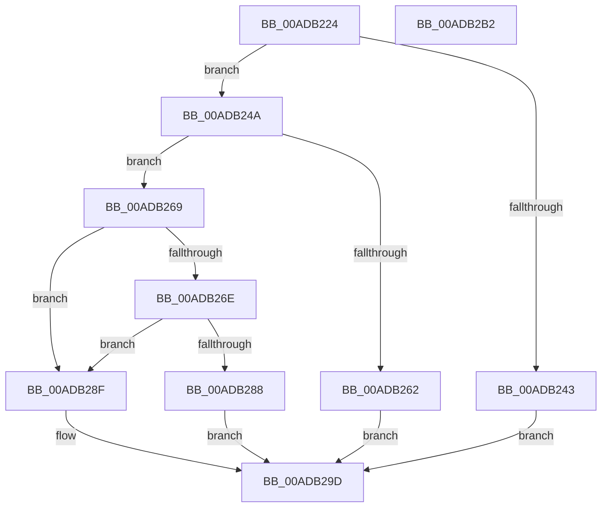

# PsRegisterSyscallProviderServiceTableMetadata

- RVA: `0x00ADB224`–`0x00ADB2B3` (길이 `143` bytes)
- VA: `0x0000000140ADB224`
- 실행 섹션: `PAGE`
- PDB 이름 있음: `예`; PDB Function 태그: `아니요`
- unwind 정보 RVA: `0x0005C954`
- 디코드: `38`개 명령, `143/143` bytes 표시
- 미해석 바이트: `0` (있으면 어셈블리에 `.byte`로 보존)

> 이 문서는 커널 이미지의 기계어와 PDB 기호를 분석해 생성했습니다. 4번과 5번은 함수 원형과 자료형을 바이너리 사용 방식에서 추정한 C 해석이며 원본 소스 복구 결과는 아닙니다.

## 1. Dependencies

- 직접 호출 지점: **2**; 고유 호출 대상: **2**
- 직접 호출자로 확인된 함수: **2**
- RIP 상대 이미지 참조: **2**

### Outgoing calls
- `0x00ADB27E` → [PsGetProcessSessionIdEx](../../text/22/PsGetProcessSessionIdEx_function_0022F8F0.md) (function, `0x0022F8F0`)
- `0x00ADB298` → [VslRegisterSyscallProviderServiceTableMetadata](../71/VslRegisterSyscallProviderServiceTableMetadata_function_00719450.md) (function, `0x00719450`)

### Direct callers
- [KeAddSystemServiceTable](KeAddSystemServiceTable_function_00ADE130.md) at `0x00ADE228`
- [PsInitializeSyscallProviders](../../init/C4/PsInitializeSyscallProviders_function_00C44BA4.md) at `0x00C44BEC`

### Static image references
- `0x00ADB238` → RVA `0x00FD9A64` (`PAGEDATA`; read)
- `0x00ADB24D` → RVA `0x00FC7280` (`ALMOSTRO`; read)

## 2. Other-region calls and transfers

- 다른 실행 섹션으로 향하는 call: **1**
  - `0x00ADB27E` → [PsGetProcessSessionIdEx](../../text/22/PsGetProcessSessionIdEx_function_0022F8F0.md) (`PAGE` → `.text`)
- 별도 외부 분기/꼬리 이동을 확인하지 못했습니다.

## 3. Assembly (complete function range)

```asm
00ADB224  48 89 5C 24 08                  mov qword ptr [rsp + 8], rbx
00ADB229  48 89 6C 24 10                  mov qword ptr [rsp + 0x10], rbp
00ADB22E  48 89 74 24 18                  mov qword ptr [rsp + 0x18], rsi
00ADB233  57                              push rdi
00ADB234  48 83 EC 20                     sub rsp, 0x20
00ADB238  80 3D 25 E8 4F 00 00            cmp byte ptr [rip + 0x4fe825], 0
00ADB23F  8B D9                           mov ebx, ecx
00ADB241  75 07                           jne 0x140adb24a
00ADB243  B8 9D 00 00 C0                  mov eax, 0xc000009d
00ADB248  EB 53                           jmp 0x140adb29d
00ADB24A  48 8B FB                        mov rdi, rbx
00ADB24D  48 8D 2D 2C C0 4E 00            lea rbp, [rip + 0x4ec02c]
00ADB254  48 C1 E7 05                     shl rdi, 5
00ADB258  48 8B 74 2F 18                  mov rsi, qword ptr [rdi + rbp + 0x18]
00ADB25D  48 85 F6                        test rsi, rsi
00ADB260  75 07                           jne 0x140adb269
00ADB262  B8 BB 00 00 C0                  mov eax, 0xc00000bb
00ADB267  EB 34                           jmp 0x140adb29d
00ADB269  83 FB 01                        cmp ebx, 1
00ADB26C  75 21                           jne 0x140adb28f
00ADB26E  65 48 8B 0C 25 88 01 00 00      mov rcx, qword ptr gs:[0x188]
00ADB277  48 8B 89 B8 00 00 00            mov rcx, qword ptr [rcx + 0xb8]
00ADB27E  E8 6D 46 75 FF                  call 0x14022f8f0
00ADB283  83 F8 FF                        cmp eax, -1
00ADB286  75 07                           jne 0x140adb28f
00ADB288  B8 55 04 00 C0                  mov eax, 0xc0000455
00ADB28D  EB 0E                           jmp 0x140adb29d
00ADB28F  8B 54 2F 10                     mov edx, dword ptr [rdi + rbp + 0x10]
00ADB293  4C 8B C6                        mov r8, rsi
00ADB296  8B CB                           mov ecx, ebx
00ADB298  E8 B3 E1 C3 FF                  call 0x140719450
00ADB29D  48 8B 5C 24 30                  mov rbx, qword ptr [rsp + 0x30]
00ADB2A2  48 8B 6C 24 38                  mov rbp, qword ptr [rsp + 0x38]
00ADB2A7  48 8B 74 24 40                  mov rsi, qword ptr [rsp + 0x40]
00ADB2AC  48 83 C4 20                     add rsp, 0x20
00ADB2B0  5F                              pop rdi
00ADB2B1  C3                              ret
00ADB2B2  CC                              int3
```

## 4. C-style interpretation (structured pseudocode)

```c
__int64 __fastcall PsRegisterSyscallProviderServiceTableMetadata(int a1)
{
    __int64 result;
    __int64 v_rdi;
    __int64 v_rsp;
    unsigned __int64 v_stack_p10;
    unsigned __int64 v_stack_p18;
    unsigned __int64 v_stack_p8;

    v_stack_p8 = v_rbx;
    v_stack_p10 = v_rbp;
    v_stack_p18 = v_rsi;
    v_rsp = (v_rsp) - (32);
    if ((*(unsigned __int8 *)(v_rip + 5236773)) != 0) goto loc_00ADB24A;
    goto loc_00ADB29D;
loc_00ADB24A:
    v_rdi = ((unsigned int)(a1)) << (5);
    if (*(unsigned __int64 *)(v_rdi + v_rip + 5161004 * 1 + 24) != 0) goto loc_00ADB269;
    goto loc_00ADB29D;
loc_00ADB269:
    if (((unsigned int)((unsigned int)(a1))) != 1) goto loc_00ADB28F;
    result = PsGetProcessSessionIdEx(*(unsigned __int64 *)(*(unsigned __int64 *)(gs_base + (0 + 392)) + 184), a2, a3, a4);
    if (((unsigned int)(result)) != -1) goto loc_00ADB28F;
    goto loc_00ADB29D;
loc_00ADB28F:
    result = VslRegisterSyscallProviderServiceTableMetadata((unsigned int)((unsigned int)((unsigned int)(a1))), (unsigned int)(*(unsigned int *)(v_rdi + v_rip + 5161004 * 1 + 16)), *(unsigned __int64 *)(v_rdi + v_rip + 5161004 * 1 + 24), a4);
loc_00ADB29D:
    v_rsp = (v_rsp) + (32);
    return result;
}
```

## 5. (Beta) C Style

```c
int64_t PsRegisterSyscallProviderServiceTableMetadata(int32_t Arg1)
{
    int64_t result;
    int64_t local_rdi;
    int64_t local_rsp;
    uint64_t v_stack_p10;
    uint64_t v_stack_p18;
    uint64_t v_stack_p8;

    v_stack_p8 = local_rbx;
    v_stack_p10 = local_rbp;
    v_stack_p18 = local_rsi;
    local_rsp = (local_rsp) - (32);
    if ((*(uint8_t *)(v_rip + 0x4FE825)) != 0) goto loc_00ADB24A;
    goto loc_00ADB29D;
loc_00ADB24A:
    local_rdi = ((uint32_t)(Arg1)) << (5);
    if (*(uint64_t *)(local_rdi + v_rip + 0x4EC02C * 1 + 0x18) != 0) goto loc_00ADB269;
    goto loc_00ADB29D;
loc_00ADB269:
    if (((uint32_t)((uint32_t)(Arg1))) != 1) goto loc_00ADB28F;
    result = PsGetProcessSessionIdEx(*(uint64_t *)(*(uint64_t *)(gs_base + (0 + 0x188)) + 0xB8), a2, a3, a4);
    if (((uint32_t)(result)) != -1) goto loc_00ADB28F;
    goto loc_00ADB29D;
loc_00ADB28F:
    result = VslRegisterSyscallProviderServiceTableMetadata((uint32_t)((uint32_t)((uint32_t)(Arg1))), (uint32_t)(*(uint32_t *)(local_rdi + v_rip + 0x4EC02C * 1 + 0x10)), *(uint64_t *)(local_rdi + v_rip + 0x4EC02C * 1 + 0x18), a4);
loc_00ADB29D:
    local_rsp = (local_rsp) + (32);
    return result;
}
```

## 6. Execution-region graph

[열기: 2D/3D 그래프와 함수 탐색 컨트롤 패널](../../../control-panel.html?section=page&rva=0x00ADB224&view=graph)

- 2D 그래프는 위에서 아래로 흐르고, 3D 그래프는 빈 공간을 드래그해 회전합니다. Shift+드래그는 이동, 휠은 확대·축소, 함수 노드 선택은 대상 보고서 이동입니다.

### Static fallback


