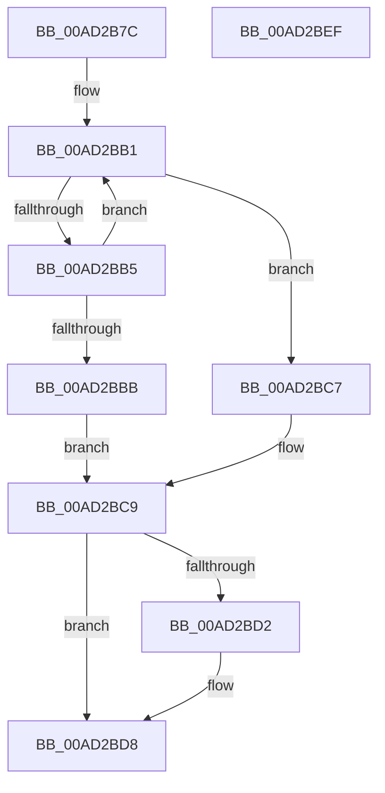

# PspBeginServerSiloShutdown

- RVA: `0x00AD2B7C`–`0x00AD2BF0` (길이 `116` bytes)
- VA: `0x0000000140AD2B7C`
- 실행 섹션: `PAGE`
- PDB 이름 있음: `예`; PDB Function 태그: `아니요`
- unwind 정보 RVA: `0x0005C954`
- 디코드: `35`개 명령, `116/116` bytes 표시
- 미해석 바이트: `0` (있으면 어셈블리에 `.byte`로 보존)

> 이 문서는 커널 이미지의 기계어와 PDB 기호를 분석해 생성했습니다. 4번과 5번은 함수 원형과 자료형을 바이너리 사용 방식에서 추정한 C 해석이며 원본 소스 복구 결과는 아닙니다.

## 1. Dependencies

- 직접 호출 지점: **5**; 고유 호출 대상: **5**
- 직접 호출자로 확인된 함수: **1**
- RIP 상대 이미지 참조: **0**

### Outgoing calls
- `0x00AD2B95` → [PsGetServerSiloGlobals](../../text/22/PsGetServerSiloGlobals_function_002250A0.md) (function, `0x002250A0`)
- `0x00AD2B9D` → [PspGetServerSiloStatePointer](../../text/4F/PspGetServerSiloStatePointer_function_004FCDB8.md) (function, `0x004FCDB8`)
- `0x00AD2BA5` → [PspAcquirePushLockShared](../../text/4F/PspAcquirePushLockShared_function_004F6134.md) (function, `0x004F6134`)
- `0x00AD2BBE` → [EtwTraceJobServerSiloStateChange](../7B/EtwTraceJobServerSiloStateChange_function_007B7EB8.md) (function, `0x007B7EB8`)
- `0x00AD2BC9` → [PspReleasePushLockShared](../../text/4F/PspReleasePushLockShared_function_004F8D00.md) (function, `0x004F8D00`)

### Direct callers
- [PspTerminateProcessesJobCallback](../91/PspTerminateProcessesJobCallback_function_00917430.md) at `0x009174E3`

### Static image references
- 디코드된 RIP-relative 메모리 참조가 없습니다.

## 2. Other-region calls and transfers

- 다른 실행 섹션으로 향하는 call: **4**
  - `0x00AD2B95` → [PsGetServerSiloGlobals](../../text/22/PsGetServerSiloGlobals_function_002250A0.md) (`PAGE` → `.text`)
  - `0x00AD2B9D` → [PspGetServerSiloStatePointer](../../text/4F/PspGetServerSiloStatePointer_function_004FCDB8.md) (`PAGE` → `.text`)
  - `0x00AD2BA5` → [PspAcquirePushLockShared](../../text/4F/PspAcquirePushLockShared_function_004F6134.md) (`PAGE` → `.text`)
  - `0x00AD2BC9` → [PspReleasePushLockShared](../../text/4F/PspReleasePushLockShared_function_004F8D00.md) (`PAGE` → `.text`)
- 별도 외부 분기/꼬리 이동을 확인하지 못했습니다.

## 3. Assembly (complete function range)

```asm
00AD2B7C  48 89 5C 24 08                  mov qword ptr [rsp + 8], rbx
00AD2B81  48 89 6C 24 10                  mov qword ptr [rsp + 0x10], rbp
00AD2B86  48 89 74 24 18                  mov qword ptr [rsp + 0x18], rsi
00AD2B8B  57                              push rdi
00AD2B8C  48 83 EC 20                     sub rsp, 0x20
00AD2B90  8B F2                           mov esi, edx
00AD2B92  48 8B D9                        mov rbx, rcx
00AD2B95  E8 06 25 75 FF                  call 0x1402250a0
00AD2B9A  48 8B E8                        mov rbp, rax
00AD2B9D  E8 16 A2 A2 FF                  call 0x1404fcdb8
00AD2BA2  48 8B F8                        mov rdi, rax
00AD2BA5  E8 8A 35 A2 FF                  call 0x1404f6134
00AD2BAA  8B 07                           mov eax, dword ptr [rdi]
00AD2BAC  BA 03 00 00 00                  mov edx, 3
00AD2BB1  3B C2                           cmp eax, edx
00AD2BB3  7D 12                           jge 0x140ad2bc7
00AD2BB5  F0 0F B1 17                     lock cmpxchg dword ptr [rdi], edx
00AD2BB9  75 F6                           jne 0x140ad2bb1
00AD2BBB  48 8B CB                        mov rcx, rbx
00AD2BBE  E8 F5 52 CE FF                  call 0x1407b7eb8
00AD2BC3  B3 01                           mov bl, 1
00AD2BC5  EB 02                           jmp 0x140ad2bc9
00AD2BC7  32 DB                           xor bl, bl
00AD2BC9  E8 32 61 A2 FF                  call 0x1404f8d00
00AD2BCE  84 DB                           test bl, bl
00AD2BD0  74 06                           je 0x140ad2bd8
00AD2BD2  89 B5 FC 04 00 00               mov dword ptr [rbp + 0x4fc], esi
00AD2BD8  48 8B 6C 24 38                  mov rbp, qword ptr [rsp + 0x38]
00AD2BDD  8A C3                           mov al, bl
00AD2BDF  48 8B 5C 24 30                  mov rbx, qword ptr [rsp + 0x30]
00AD2BE4  48 8B 74 24 40                  mov rsi, qword ptr [rsp + 0x40]
00AD2BE9  48 83 C4 20                     add rsp, 0x20
00AD2BED  5F                              pop rdi
00AD2BEE  C3                              ret
00AD2BEF  CC                              int3
```

## 4. C-style interpretation (structured pseudocode)

```c
__int64 __fastcall PspBeginServerSiloShutdown(__int64 a1, int a2)
{
    __int64 result;
    __int64 v_rbx;
    __int64 v_rsp;
    unsigned __int64 v_stack_p10;
    unsigned __int64 v_stack_p18;
    unsigned __int64 v_stack_p8;

    v_stack_p8 = v_rbx;
    v_stack_p10 = v_rbp;
    v_stack_p18 = v_rsi;
    v_rsp = (v_rsp) - (32);
    result = PsGetServerSiloGlobals(a1, a2, a3, a4);
    result = PspGetServerSiloStatePointer(a1, a2, a3, a4);
    result = PspAcquirePushLockShared(a1, a2, a3, a4);
loc_00AD2BB1:
    if (((unsigned int)((unsigned int)(*(unsigned int *)(result)))) >= 3) goto loc_00AD2BC7;
    if (((unsigned int)((unsigned int)(*(unsigned int *)(result)))) != 3) goto loc_00AD2BB1;
    result = EtwTraceJobServerSiloStateChange(a1, 3, a3, a4);
    goto loc_00AD2BC9;
loc_00AD2BC7:
    v_rbx = 0;
loc_00AD2BC9:
    result = PspReleasePushLockShared(a1, 3, a3, a4);
    if (0 != 0) {
        *(unsigned int *)(result + 1276) = (unsigned int)((unsigned int)(a2));
    }
    v_rsp = (v_rsp) + (32);
    return 0;
}
```

## 5. (Beta) C Style

```c
int64_t PspBeginServerSiloShutdown(int64_t Arg1, int32_t Arg2)
{
    int64_t result;
    int64_t local_rbx;
    int64_t local_rsp;
    uint64_t v_stack_p10;
    uint64_t v_stack_p18;
    uint64_t v_stack_p8;

    v_stack_p8 = local_rbx;
    v_stack_p10 = local_rbp;
    v_stack_p18 = local_rsi;
    local_rsp = (local_rsp) - (32);
    result = PsGetServerSiloGlobals(Arg1, Arg2, a3, a4);
    result = PspGetServerSiloStatePointer(Arg1, Arg2, a3, a4);
    result = PspAcquirePushLockShared(Arg1, Arg2, a3, a4);
loc_00AD2BB1:
    if (((uint32_t)((uint32_t)(*(uint32_t *)(result)))) >= 3) goto loc_00AD2BC7;
    if (((uint32_t)((uint32_t)(*(uint32_t *)(result)))) != 3) goto loc_00AD2BB1;
    result = EtwTraceJobServerSiloStateChange(Arg1, 3, a3, a4);
    goto loc_00AD2BC9;
loc_00AD2BC7:
    local_rbx = 0;
loc_00AD2BC9:
    result = PspReleasePushLockShared(Arg1, 3, a3, a4);
    if (0 != 0) {
        *(uint32_t *)(result + 0x4FC) = (uint32_t)((uint32_t)(Arg2));
    }
    local_rsp = (local_rsp) + (32);
    return 0;
}
```

## 6. Execution-region graph

[열기: 2D/3D 그래프와 함수 탐색 컨트롤 패널](../../../control-panel.html?section=page&rva=0x00AD2B7C&view=graph)

- 2D 그래프는 위에서 아래로 흐르고, 3D 그래프는 빈 공간을 드래그해 회전합니다. Shift+드래그는 이동, 휠은 확대·축소, 함수 노드 선택은 대상 보고서 이동입니다.

### Static fallback


