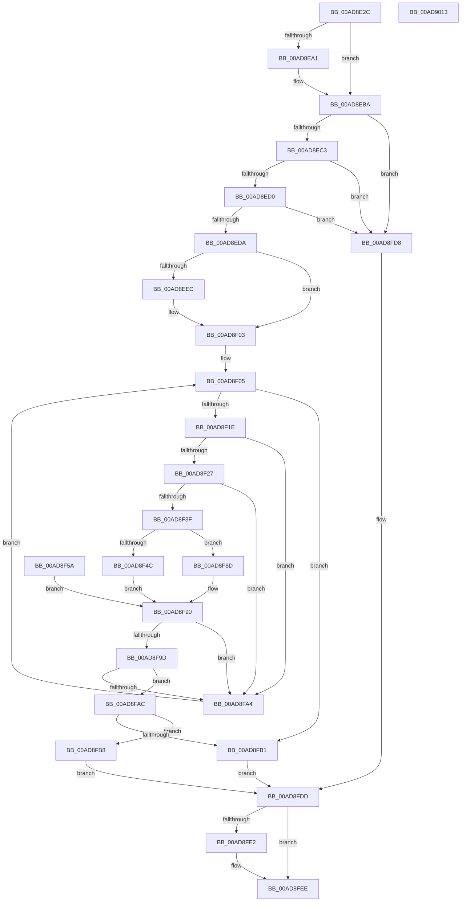

# PspFindFirstThreadByTebValue

- RVA: `0x00AD8E2C`–`0x00AD9014` (길이 `488` bytes)
- VA: `0x0000000140AD8E2C`
- 실행 섹션: `PAGE`
- PDB 이름 있음: `예`; PDB Function 태그: `아니요`
- unwind 정보 RVA: `0x000BF198`
- 디코드: `125`개 명령, `488/488` bytes 표시
- 미해석 바이트: `0` (있으면 어셈블리에 `.byte`로 보존)

> 이 문서는 커널 이미지의 기계어와 PDB 기호를 분석해 생성했습니다. 4번과 5번은 함수 원형과 자료형을 바이너리 사용 방식에서 추정한 C 해석이며 원본 소스 복구 결과는 아닙니다.

## 1. Dependencies

- 직접 호출 지점: **9**; 고유 호출 대상: **9**
- 직접 호출자로 확인된 함수: **1**
- RIP 상대 이미지 참조: **1**

### Outgoing calls
- `0x00AD8EF6` → [KiStackAttachProcess](../../text/21/KiStackAttachProcess_function_00216820.md) (function, `0x00216820`)
- `0x00AD8F08` → [PsGetNextProcessThread](../8C/PsGetNextProcessThread_function_008C9CF0.md) (function, `0x008C9CF0`)
- `0x00AD8F36` → [ExAcquireRundownProtection](../../text/21/ExAcquireRundownProtection_function_00216620.md) (function, `0x00216620`)
- `0x00AD8F42` → [PsGetThreadTeb](../../text/45/PsGetThreadTeb_function_0045F300.md) (function, `0x0045F300`)
- `0x00AD8F93` → [ExReleaseRundownProtection](../../text/34/ExReleaseRundownProtection_function_00349E80.md) (function, `0x00349E80`)
- `0x00AD8FBB` → [PsGetThreadId](../../text/45/PsGetThreadId_function_00452220.md) (function, `0x00452220`)
- `0x00AD8FCF` → [ObfDereferenceObjectWithTag](../../text/2F/ObfDereferenceObjectWithTag_function_002F78E0.md) (function, `0x002F78E0`)
- `0x00AD8FE9` → [KiUnstackDetachProcess](../../text/21/KiUnstackDetachProcess_function_00217D30.md) (function, `0x00217D30`)
- `0x00AD8FFB` → [_security_check_cookie](../../text/6A/_security_check_cookie_function_006AC640.md) (function, `0x006AC640`)

### Direct callers
- [NtQueryInformationProcess](../9A/NtQueryInformationProcess_function_009AA250.md) at `0x009ACCE9`

### Static image references
- `0x00AD8E48` → RVA `0x00E0A740` (`.data`; read)

## 2. Other-region calls and transfers

- 다른 실행 섹션으로 향하는 call: **8**
  - `0x00AD8EF6` → [KiStackAttachProcess](../../text/21/KiStackAttachProcess_function_00216820.md) (`PAGE` → `.text`)
  - `0x00AD8F36` → [ExAcquireRundownProtection](../../text/21/ExAcquireRundownProtection_function_00216620.md) (`PAGE` → `.text`)
  - `0x00AD8F42` → [PsGetThreadTeb](../../text/45/PsGetThreadTeb_function_0045F300.md) (`PAGE` → `.text`)
  - `0x00AD8F93` → [ExReleaseRundownProtection](../../text/34/ExReleaseRundownProtection_function_00349E80.md) (`PAGE` → `.text`)
  - `0x00AD8FBB` → [PsGetThreadId](../../text/45/PsGetThreadId_function_00452220.md) (`PAGE` → `.text`)
  - `0x00AD8FCF` → [ObfDereferenceObjectWithTag](../../text/2F/ObfDereferenceObjectWithTag_function_002F78E0.md) (`PAGE` → `.text`)
  - `0x00AD8FE9` → [KiUnstackDetachProcess](../../text/21/KiUnstackDetachProcess_function_00217D30.md) (`PAGE` → `.text`)
  - `0x00AD8FFB` → [_security_check_cookie](../../text/6A/_security_check_cookie_function_006AC640.md) (`PAGE` → `.text`)
- 별도 외부 분기/꼬리 이동을 확인하지 못했습니다.

## 3. Assembly (complete function range)

```asm
00AD8E2C  4C 89 44 24 18                  mov qword ptr [rsp + 0x18], r8
00AD8E31  48 89 54 24 10                  mov qword ptr [rsp + 0x10], rdx
00AD8E36  53                              push rbx
00AD8E37  56                              push rsi
00AD8E38  57                              push rdi
00AD8E39  41 54                           push r12
00AD8E3B  41 55                           push r13
00AD8E3D  41 56                           push r14
00AD8E3F  41 57                           push r15
00AD8E41  48 81 EC 90 00 00 00            sub rsp, 0x90
00AD8E48  48 8B 05 F1 18 33 00            mov rax, qword ptr [rip + 0x3318f1]
00AD8E4F  48 33 C4                        xor rax, rsp
00AD8E52  48 89 84 24 88 00 00 00         mov qword ptr [rsp + 0x88], rax
00AD8E5A  4C 89 4C 24 38                  mov qword ptr [rsp + 0x38], r9
00AD8E5F  4D 8B E8                        mov r13, r8
00AD8E62  48 8B F2                        mov rsi, rdx
00AD8E65  48 8B F9                        mov rdi, rcx
00AD8E68  48 89 4C 24 40                  mov qword ptr [rsp + 0x40], rcx
00AD8E6D  4C 89 4C 24 48                  mov qword ptr [rsp + 0x48], r9
00AD8E72  0F 57 C0                        xorps xmm0, xmm0
00AD8E75  0F 11 44 24 58                  movups xmmword ptr [rsp + 0x58], xmm0
00AD8E7A  0F 11 44 24 68                  movups xmmword ptr [rsp + 0x68], xmm0
00AD8E7F  0F 11 44 24 78                  movups xmmword ptr [rsp + 0x78], xmm0
00AD8E84  45 32 E4                        xor r12b, r12b
00AD8E87  44 88 64 24 20                  mov byte ptr [rsp + 0x20], r12b
00AD8E8C  B8 78 18 00 00                  mov eax, 0x1878
00AD8E91  48 83 64 24 28 00               and qword ptr [rsp + 0x28], 0
00AD8E97  48 83 B9 10 03 00 00 00         cmp qword ptr [rcx + 0x310], 0
00AD8E9F  74 19                           je 0x140ad8eba
00AD8EA1  B8 38 30 00 00                  mov eax, 0x3038
00AD8EA6  BA 78 38 00 00                  mov edx, 0x3878
00AD8EAB  B9 64 86 00 00                  mov ecx, 0x8664
00AD8EB0  66 39 8F EC 06 00 00            cmp word ptr [rdi + 0x6ec], cx
00AD8EB7  0F 44 C2                        cmove eax, edx
00AD8EBA  48 3B F0                        cmp rsi, rax
00AD8EBD  0F 83 15 01 00 00               jae 0x140ad8fd8
00AD8EC3  48 2B C6                        sub rax, rsi
00AD8EC6  48 83 F8 08                     cmp rax, 8
00AD8ECA  0F 82 08 01 00 00               jb 0x140ad8fd8
00AD8ED0  40 F6 C6 07                     test sil, 7
00AD8ED4  0F 85 FE 00 00 00               jne 0x140ad8fd8
00AD8EDA  65 48 8B 04 25 88 01 00 00      mov rax, qword ptr gs:[0x188]
00AD8EE3  48 3B B8 B8 00 00 00            cmp rdi, qword ptr [rax + 0xb8]
00AD8EEA  74 17                           je 0x140ad8f03
00AD8EEC  4C 8D 44 24 58                  lea r8, [rsp + 0x58]
00AD8EF1  33 D2                           xor edx, edx
00AD8EF3  48 8B CF                        mov rcx, rdi
00AD8EF6  E8 25 D9 73 FF                  call 0x140216820
00AD8EFB  41 B4 01                        mov r12b, 1
00AD8EFE  44 88 64 24 20                  mov byte ptr [rsp + 0x20], r12b
00AD8F03  33 D2                           xor edx, edx
00AD8F05  48 8B CF                        mov rcx, rdi
00AD8F08  E8 E3 0D DF FF                  call 0x1408c9cf0
00AD8F0D  48 8B D8                        mov rbx, rax
00AD8F10  48 89 44 24 30                  mov qword ptr [rsp + 0x30], rax
00AD8F15  48 85 C0                        test rax, rax
00AD8F18  0F 84 93 00 00 00               je 0x140ad8fb1
00AD8F1E  F7 40 74 00 04 00 00            test dword ptr [rax + 0x74], 0x400
00AD8F25  75 7D                           jne 0x140ad8fa4
00AD8F27  4C 8D B8 88 05 00 00            lea r15, [rax + 0x588]
00AD8F2E  4C 89 7C 24 50                  mov qword ptr [rsp + 0x50], r15
00AD8F33  49 8B CF                        mov rcx, r15
00AD8F36  E8 E5 D6 73 FF                  call 0x140216620
00AD8F3B  84 C0                           test al, al
00AD8F3D  74 65                           je 0x140ad8fa4
00AD8F3F  48 8B CB                        mov rcx, rbx
00AD8F42  E8 B9 63 98 FF                  call 0x14045f300
00AD8F47  48 85 C0                        test rax, rax
00AD8F4A  74 41                           je 0x140ad8f8d
00AD8F4C  41 B6 01                        mov r14b, 1
00AD8F4F  48 8B 04 30                     mov rax, qword ptr [rax + rsi]
00AD8F53  48 89 44 24 28                  mov qword ptr [rsp + 0x28], rax
00AD8F58  EB 36                           jmp 0x140ad8f90
00AD8F5A  45 32 F6                        xor r14b, r14b
00AD8F5D  4C 8B AC 24 E0 00 00 00         mov r13, qword ptr [rsp + 0xe0]
00AD8F65  48 8B B4 24 D8 00 00 00         mov rsi, qword ptr [rsp + 0xd8]
00AD8F6D  48 8B 5C 24 30                  mov rbx, qword ptr [rsp + 0x30]
00AD8F72  44 8A 64 24 20                  mov r12b, byte ptr [rsp + 0x20]
00AD8F77  48 8B 7C 24 40                  mov rdi, qword ptr [rsp + 0x40]
00AD8F7C  48 8B 44 24 48                  mov rax, qword ptr [rsp + 0x48]
00AD8F81  48 89 44 24 38                  mov qword ptr [rsp + 0x38], rax
00AD8F86  4C 8B 7C 24 50                  mov r15, qword ptr [rsp + 0x50]
00AD8F8B  EB 03                           jmp 0x140ad8f90
00AD8F8D  45 32 F6                        xor r14b, r14b
00AD8F90  49 8B CF                        mov rcx, r15
00AD8F93  E8 E8 0E 87 FF                  call 0x140349e80
00AD8F98  45 84 F6                        test r14b, r14b
00AD8F9B  74 07                           je 0x140ad8fa4
00AD8F9D  4C 39 6C 24 28                  cmp qword ptr [rsp + 0x28], r13
00AD8FA2  74 08                           je 0x140ad8fac
00AD8FA4  48 8B D3                        mov rdx, rbx
00AD8FA7  E9 59 FF FF FF                  jmp 0x140ad8f05
00AD8FAC  48 85 DB                        test rbx, rbx
00AD8FAF  75 07                           jne 0x140ad8fb8
00AD8FB1  BB 25 02 00 C0                  mov ebx, 0xc0000225
00AD8FB6  EB 25                           jmp 0x140ad8fdd
00AD8FB8  48 8B CB                        mov rcx, rbx
00AD8FBB  E8 60 92 97 FF                  call 0x140452220
00AD8FC0  48 8B 4C 24 38                  mov rcx, qword ptr [rsp + 0x38]
00AD8FC5  89 01                           mov dword ptr [rcx], eax
00AD8FC7  BA 50 73 45 6E                  mov edx, 0x6e457350
00AD8FCC  48 8B CB                        mov rcx, rbx
00AD8FCF  E8 0C E9 81 FF                  call 0x1402f78e0
00AD8FD4  33 DB                           xor ebx, ebx
00AD8FD6  EB 05                           jmp 0x140ad8fdd
00AD8FD8  BB 0D 00 00 C0                  mov ebx, 0xc000000d
00AD8FDD  45 84 E4                        test r12b, r12b
00AD8FE0  74 0C                           je 0x140ad8fee
00AD8FE2  33 D2                           xor edx, edx
00AD8FE4  48 8D 4C 24 58                  lea rcx, [rsp + 0x58]
00AD8FE9  E8 42 ED 73 FF                  call 0x140217d30
00AD8FEE  8B C3                           mov eax, ebx
00AD8FF0  48 8B 8C 24 88 00 00 00         mov rcx, qword ptr [rsp + 0x88]
00AD8FF8  48 33 CC                        xor rcx, rsp
00AD8FFB  E8 40 36 BD FF                  call 0x1406ac640
00AD9000  48 81 C4 90 00 00 00            add rsp, 0x90
00AD9007  41 5F                           pop r15
00AD9009  41 5E                           pop r14
00AD900B  41 5D                           pop r13
00AD900D  41 5C                           pop r12
00AD900F  5F                              pop rdi
00AD9010  5E                              pop rsi
00AD9011  5B                              pop rbx
00AD9012  C3                              ret
00AD9013  CC                              int3
```

## 4. C-style interpretation (structured pseudocode)

```c
__int64 __fastcall PspFindFirstThreadByTebValue(__int64 a1, __int64 a2, __int64 a3, __int64 a4)
{
    __int64 result;
    __int64 v_r12;
    __int64 v_r14;
    __int64 v_rbx;
    __int64 v_rsp;
    unsigned __int64 v_stack_m40;
    unsigned __int64 v_stack_m50;
    unsigned __int64 v_stack_m60;
    unsigned __int64 v_stack_m70;
    unsigned __int64 v_stack_m78;
    unsigned __int64 v_stack_m80;
    unsigned __int64 v_stack_m88;
    unsigned __int64 v_stack_m90;
    unsigned __int64 v_stack_m98;
    unsigned __int64 v_stack_mA0;
    unsigned __int8 v_stack_mA8;
    unsigned __int64 v_stack_p10;
    unsigned __int64 v_stack_p18;

    v_stack_p18 = a3;
    v_stack_p10 = a2;
    v_rsp = (v_rsp) - (144);
    result = (*(unsigned __int64 *)(v_rip + 3348721)) ^ (v_rsp);
    v_stack_m40 = result;
    v_stack_m90 = a4;
    v_stack_m88 = a1;
    v_stack_m80 = a4;
    v_stack_m70 = v_xmm0;
    v_stack_m60 = v_xmm0;
    v_stack_m50 = v_xmm0;
    v_r12 = 0;
    v_stack_mA8 = 0;
    result = (unsigned int)(0x1878ULL);
    if ((*(unsigned __int64 *)(a1 + 784)) != 0) {
        result = 0x3038ULL;
        a2 = 0x3878ULL;
        a1 = 0x8664ULL;
        if ((*(unsigned __int16 *)(a1 + 1772)) == ((unsigned __int16)(a1))) { result = (unsigned int)(a2); }
    }
    if (a2 >= result) goto loc_00AD8FD8;
    result = (result) - (a2);
    if (result < 8) goto loc_00AD8FD8;
    if ((((unsigned __int8)(a2)) & (7)) != 0) goto loc_00AD8FD8;
    result = *(unsigned __int64 *)(gs_base + (0 + 392));
    if (a1 != (*(unsigned __int64 *)(*(unsigned __int64 *)(gs_base + (0 + 392)) + 184))) {
        a3 = v_stack_m70;
        a2 = 0;
        a1 = a1;
        result = KiStackAttachProcess(a1, a2, a3, a4);
        v_r12 = 1;
        v_stack_mA8 = (unsigned __int8)(v_r12);
    }
    a2 = 0;
loc_00AD8F05:
    result = PsGetNextProcessThread(a1, a2, a3, a4);
    v_stack_m98 = result;
    if (result == 0) goto loc_00AD8FB1;
    if (((*(unsigned int *)(result + 116)) & (0x400ULL)) != 0) goto loc_00AD8FA4;
    v_stack_m78 = result + 1416;
    result = ExAcquireRundownProtection(result + 1416, a2, a3, a4);
    if ((unsigned __int8)(result) == 0) goto loc_00AD8FA4;
    result = PsGetThreadTeb(result, a2, a3, a4);
    if (result == 0) goto loc_00AD8F8D;
    v_stack_mA0 = *(unsigned __int64 *)(result + a2 * 1);
    goto loc_00AD8F90;
loc_00AD8F8D:
    v_r14 = 0;
loc_00AD8F90:
    result = ExReleaseRundownProtection(result + 1416, a2, a3, a4);
    if (0 == 0) goto loc_00AD8FA4;
    if (v_stack_mA0 == a3) goto loc_00AD8FAC;
loc_00AD8FA4:
    goto loc_00AD8F05;
loc_00AD8FAC:
    if (result != 0) goto loc_00AD8FB8;
loc_00AD8FB1:
    goto loc_00AD8FDD;
loc_00AD8FB8:
    result = PsGetThreadId((unsigned int)(0xC0000225ULL), result, a3, a4);
    *(unsigned int *)(v_stack_m90) = (unsigned int)(result);
    result = ObfDereferenceObjectWithTag((unsigned int)(0xC0000225ULL), (unsigned int)(0x6E457350ULL), a3, a4);
    v_rbx = 0;
    goto loc_00AD8FDD;
loc_00AD8FD8:
loc_00AD8FDD:
    if ((unsigned __int8)(v_r12) != 0) {
        a2 = 0;
        a1 = v_stack_m70;
        result = KiUnstackDetachProcess(a1, a2, a3, a4);
    }
    a1 = (v_stack_m40) ^ (v_rsp);
    result = _security_check_cookie(a1, a2, a3, a4);
    v_rsp = (v_rsp) + (144);
    return result;
}
```

## 5. (Beta) C Style

```c
int64_t PspFindFirstThreadByTebValue(void *Arg1, int64_t Arg2, int64_t Arg3, int64_t Arg4)
{
    uint8_t *arg1 = (uint8_t *)Arg1;

    int64_t result;
    int64_t local_r12;
    int64_t local_r14;
    int64_t local_rbx;
    int64_t local_rsp;
    uint64_t v_stack_m40;
    uint64_t v_stack_m50;
    uint64_t v_stack_m60;
    uint64_t v_stack_m70;
    uint64_t v_stack_m78;
    uint64_t v_stack_m80;
    uint64_t v_stack_m88;
    uint64_t v_stack_m90;
    uint64_t v_stack_m98;
    uint64_t v_stack_mA0;
    uint8_t v_stack_mA8;
    uint64_t v_stack_p10;
    uint64_t v_stack_p18;

    v_stack_p18 = Arg3;
    v_stack_p10 = Arg2;
    local_rsp = (local_rsp) - (144);
    result = (*(uint64_t *)(v_rip + 0x3318F1)) ^ (local_rsp);
    v_stack_m40 = result;
    v_stack_m90 = Arg4;
    v_stack_m88 = Arg1;
    v_stack_m80 = Arg4;
    v_stack_m70 = v_xmm0;
    v_stack_m60 = v_xmm0;
    v_stack_m50 = v_xmm0;
    local_r12 = 0;
    v_stack_mA8 = 0;
    result = (uint32_t)(0x1878ULL);
    if ((*(uint64_t *)(arg1 + 0x310)) != 0) {
        result = 0x3038ULL;
        Arg2 = 0x3878ULL;
        Arg1 = 0x8664ULL;
        if ((*(uint16_t *)(arg1 + 0x6EC)) == ((uint16_t)(Arg1))) { result = (uint32_t)(Arg2); }
    }
    if (Arg2 >= result) goto loc_00AD8FD8;
    result = (result) - (Arg2);
    if (result < 8) goto loc_00AD8FD8;
    if ((((uint8_t)(Arg2)) & (7)) != 0) goto loc_00AD8FD8;
    result = *(uint64_t *)(gs_base + (0 + 0x188));
    if (Arg1 != (*(uint64_t *)(*(uint64_t *)(gs_base + (0 + 0x188)) + 0xB8))) {
        Arg3 = v_stack_m70;
        Arg2 = 0;
        Arg1 = Arg1;
        result = KiStackAttachProcess(Arg1, Arg2, Arg3, Arg4);
        local_r12 = 1;
        v_stack_mA8 = (uint8_t)(local_r12);
    }
    Arg2 = 0;
loc_00AD8F05:
    result = PsGetNextProcessThread(Arg1, Arg2, Arg3, Arg4);
    v_stack_m98 = result;
    if (result == 0) goto loc_00AD8FB1;
    if (((*(uint32_t *)(result + 0x74)) & (0x400ULL)) != 0) goto loc_00AD8FA4;
    v_stack_m78 = result + 1416;
    result = ExAcquireRundownProtection(result + 1416, Arg2, Arg3, Arg4);
    if ((uint8_t)(result) == 0) goto loc_00AD8FA4;
    result = PsGetThreadTeb(result, Arg2, Arg3, Arg4);
    if (result == 0) goto loc_00AD8F8D;
    v_stack_mA0 = *(uint64_t *)(result + Arg2 * 1);
    goto loc_00AD8F90;
loc_00AD8F8D:
    local_r14 = 0;
loc_00AD8F90:
    result = ExReleaseRundownProtection(result + 1416, Arg2, Arg3, Arg4);
    if (0 == 0) goto loc_00AD8FA4;
    if (v_stack_mA0 == Arg3) goto loc_00AD8FAC;
loc_00AD8FA4:
    goto loc_00AD8F05;
loc_00AD8FAC:
    if (result != 0) goto loc_00AD8FB8;
loc_00AD8FB1:
    goto loc_00AD8FDD;
loc_00AD8FB8:
    result = PsGetThreadId((uint32_t)(0xC0000225ULL), result, Arg3, Arg4);
    *(uint32_t *)(v_stack_m90) = (uint32_t)(result);
    result = ObfDereferenceObjectWithTag((uint32_t)(0xC0000225ULL), (uint32_t)(0x6E457350ULL), Arg3, Arg4);
    local_rbx = 0;
    goto loc_00AD8FDD;
loc_00AD8FD8:
loc_00AD8FDD:
    if ((uint8_t)(local_r12) != 0) {
        Arg2 = 0;
        Arg1 = v_stack_m70;
        result = KiUnstackDetachProcess(Arg1, Arg2, Arg3, Arg4);
    }
    Arg1 = (v_stack_m40) ^ (local_rsp);
    result = _security_check_cookie(Arg1, Arg2, Arg3, Arg4);
    local_rsp = (local_rsp) + (144);
    return result;
}
```

### 관측된 메모리 오프셋

구조체 형식이 확인되지 않은 접근은 인자 기준의 오프셋으로만 기록했습니다.

| 기준 인자 | 오프셋 표현 | 폭 (bit) | 접근 |
|---|---:|---:|---|
| `Arg1` | `+ 0x310` | `64` | `R` |
| `Arg1` | `+ 0x6EC` | `16` | `R` |

## 6. Execution-region graph

[열기: 2D/3D 그래프와 함수 탐색 컨트롤 패널](../../../control-panel.html?section=page&rva=0x00AD8E2C&view=graph)

- 2D 그래프는 위에서 아래로 흐르고, 3D 그래프는 빈 공간을 드래그해 회전합니다. Shift+드래그는 이동, 휠은 확대·축소, 함수 노드 선택은 대상 보고서 이동입니다.

### Static fallback


