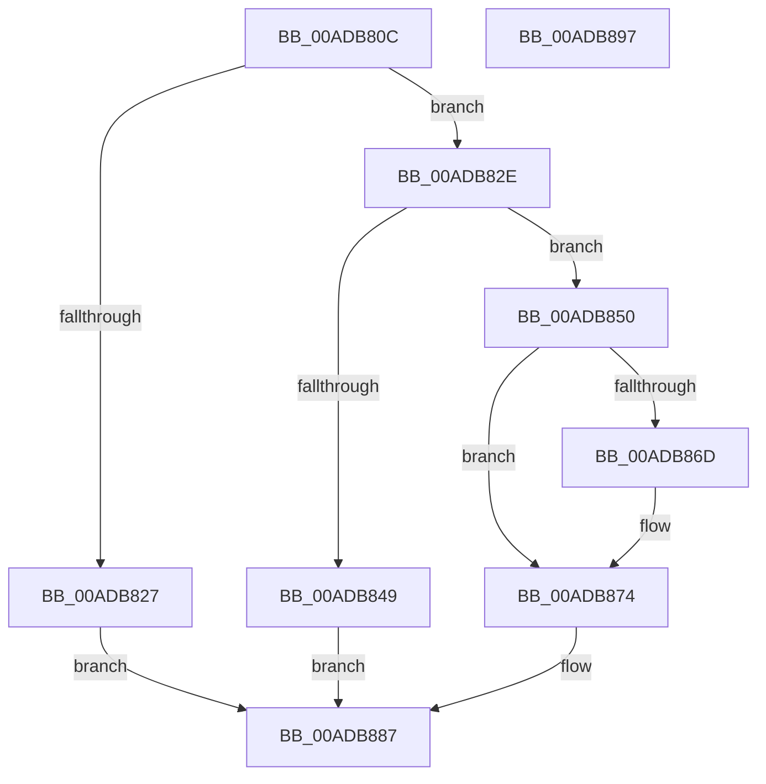

# PspPrepareEnclaveThreadWait

- RVA: `0x00ADB80C`–`0x00ADB898` (길이 `140` bytes)
- VA: `0x0000000140ADB80C`
- 실행 섹션: `PAGE`
- PDB 이름 있음: `예`; PDB Function 태그: `아니요`
- unwind 정보 RVA: `0x00060BC4`
- 디코드: `41`개 명령, `140/140` bytes 표시
- 미해석 바이트: `0` (있으면 어셈블리에 `.byte`로 보존)

> 이 문서는 커널 이미지의 기계어와 PDB 기호를 분석해 생성했습니다. 4번과 5번은 함수 원형과 자료형을 바이너리 사용 방식에서 추정한 C 해석이며 원본 소스 복구 결과는 아닙니다.

## 1. Dependencies

- 직접 호출 지점: **2**; 고유 호출 대상: **2**
- 직접 호출자로 확인된 함수: **1**
- RIP 상대 이미지 참조: **0**

### Outgoing calls
- `0x00ADB83C` → [ExAllocatePool2](../../poolcode/B8/ExAllocatePool2_function_00B820F0.md) (function, `0x00B820F0`)
- `0x00ADB85B` → [KeInitializeEvent](../../text/40/KeInitializeEvent_function_0040DD10.md) (function, `0x0040DD10`)

### Direct callers
- [PsCallEnclave](../A0/PsCallEnclave_function_00A0CF50.md) at `0x00A0D4A6`

### Static image references
- 디코드된 RIP-relative 메모리 참조가 없습니다.

## 2. Other-region calls and transfers

- 다른 실행 섹션으로 향하는 call: **2**
  - `0x00ADB83C` → [ExAllocatePool2](../../poolcode/B8/ExAllocatePool2_function_00B820F0.md) (`PAGE` → `POOLCODE`)
  - `0x00ADB85B` → [KeInitializeEvent](../../text/40/KeInitializeEvent_function_0040DD10.md) (`PAGE` → `.text`)
- 별도 외부 분기/꼬리 이동을 확인하지 못했습니다.

## 3. Assembly (complete function range)

```asm
00ADB80C  48 89 5C 24 08                  mov qword ptr [rsp + 8], rbx
00ADB811  48 89 74 24 10                  mov qword ptr [rsp + 0x10], rsi
00ADB816  57                              push rdi
00ADB817  48 83 EC 20                     sub rsp, 0x20
00ADB81B  83 79 28 00                     cmp dword ptr [rcx + 0x28], 0
00ADB81F  48 8B F2                        mov rsi, rdx
00ADB822  48 8B F9                        mov rdi, rcx
00ADB825  75 07                           jne 0x140adb82e
00ADB827  B8 12 05 00 C0                  mov eax, 0xc0000512
00ADB82C  EB 59                           jmp 0x140adb887
00ADB82E  BA 30 00 00 00                  mov edx, 0x30
00ADB833  41 B8 50 73 45 57               mov r8d, 0x57457350
00ADB839  8D 4A 11                        lea ecx, [rdx + 0x11]
00ADB83C  E8 AF 68 0A 00                  call 0x140b820f0
00ADB841  48 8B D8                        mov rbx, rax
00ADB844  48 85 C0                        test rax, rax
00ADB847  75 07                           jne 0x140adb850
00ADB849  B8 9A 00 00 C0                  mov eax, 0xc000009a
00ADB84E  EB 37                           jmp 0x140adb887
00ADB850  45 33 C0                        xor r8d, r8d
00ADB853  48 8D 48 10                     lea rcx, [rax + 0x10]
00ADB857  41 8D 50 01                     lea edx, [r8 + 1]
00ADB85B  E8 B0 24 93 FF                  call 0x14040dd10
00ADB860  48 8D 47 38                     lea rax, [rdi + 0x38]
00ADB864  48 8B 48 08                     mov rcx, qword ptr [rax + 8]
00ADB868  48 39 01                        cmp qword ptr [rcx], rax
00ADB86B  74 07                           je 0x140adb874
00ADB86D  B9 03 00 00 00                  mov ecx, 3
00ADB872  CD 29                           int 0x29
00ADB874  48 89 03                        mov qword ptr [rbx], rax
00ADB877  48 89 4B 08                     mov qword ptr [rbx + 8], rcx
00ADB87B  48 89 19                        mov qword ptr [rcx], rbx
00ADB87E  48 89 58 08                     mov qword ptr [rax + 8], rbx
00ADB882  33 C0                           xor eax, eax
00ADB884  48 89 1E                        mov qword ptr [rsi], rbx
00ADB887  48 8B 5C 24 30                  mov rbx, qword ptr [rsp + 0x30]
00ADB88C  48 8B 74 24 38                  mov rsi, qword ptr [rsp + 0x38]
00ADB891  48 83 C4 20                     add rsp, 0x20
00ADB895  5F                              pop rdi
00ADB896  C3                              ret
00ADB897  CC                              int3
```

## 4. C-style interpretation (structured pseudocode)

```c
__int64 __fastcall PspPrepareEnclaveThreadWait(__int64 a1, __int64 a2)
{
    __int64 result;
    __int64 v_rsp;
    unsigned __int64 v_stack_p10;
    unsigned __int64 v_stack_p8;

    v_stack_p8 = v_rbx;
    v_stack_p10 = v_rsi;
    v_rsp = (v_rsp) - (32);
    if ((*(unsigned int *)(a1 + 40)) != 0) goto loc_00ADB82E;
    goto loc_00ADB887;
loc_00ADB82E:
    result = ExAllocatePool2(48 + 17, 48, (unsigned int)(0x57457350ULL), a4);
    if (result != 0) goto loc_00ADB850;
    goto loc_00ADB887;
loc_00ADB850:
    a3 = 0;
    result = KeInitializeEvent((unsigned int)(0xC000009AULL) + 16, a3 + 1, a3, a4);
    if ((*(unsigned __int64 *)(*(unsigned __int64 *)(a1 + 56 + 8))) != (a1 + 56)) {
        a1 = 3;
    }
    *(unsigned __int64 *)(result) = a1 + 56;
    *(unsigned __int64 *)(result + 8) = a1;
    *(unsigned __int64 *)(a1) = result;
    *(unsigned __int64 *)(a1 + 56 + 8) = result;
    result = 0;
    *(unsigned __int64 *)(a2) = 0;
loc_00ADB887:
    v_rsp = (v_rsp) + (32);
    return result;
}
```

## 5. (Beta) C Style

```c
int64_t PspPrepareEnclaveThreadWait(void *Arg1, void *Arg2)
{
    uint8_t *arg1 = (uint8_t *)Arg1;
    uint8_t *arg2 = (uint8_t *)Arg2;

    int64_t result;
    int64_t local_rsp;
    uint64_t v_stack_p10;
    uint64_t v_stack_p8;

    v_stack_p8 = local_rbx;
    v_stack_p10 = local_rsi;
    local_rsp = (local_rsp) - (32);
    if ((*(uint32_t *)(arg1 + 0x28)) != 0) goto loc_00ADB82E;
    goto loc_00ADB887;
loc_00ADB82E:
    result = ExAllocatePool2(48 + 17, 48, (uint32_t)(0x57457350ULL), a4);
    if (result != 0) goto loc_00ADB850;
    goto loc_00ADB887;
loc_00ADB850:
    a3 = 0;
    result = KeInitializeEvent((uint32_t)(0xC000009AULL) + 16, a3 + 1, a3, a4);
    if ((*(uint64_t *)(*(uint64_t *)(arg1 + 0x38 + 0x8))) != (Arg1 + 56)) {
        Arg1 = 3;
    }
    *(void **)(result) = Arg1 + 56;
    *(void **)(result + 0x8) = Arg1;
    *(uint64_t *)(arg1) = result;
    *(uint64_t *)(arg1 + 0x38 + 0x8) = result;
    result = 0;
    *(uint64_t *)(arg2) = 0;
loc_00ADB887:
    local_rsp = (local_rsp) + (32);
    return result;
}
```

### 관측된 메모리 오프셋

구조체 형식이 확인되지 않은 접근은 인자 기준의 오프셋으로만 기록했습니다.

| 기준 인자 | 오프셋 표현 | 폭 (bit) | 접근 |
|---|---:|---:|---|
| `Arg1` | `+ 0x8` | `64` | `R` |
| `Arg1` | `+ 0x8` | `64` | `W` |
| `Arg1` | `+ 0x28` | `32` | `R` |
| `Arg1` | `+ 0x38` | `64` | `R` |
| `Arg2` | `+ 0x0` | `64` | `W` |

## 6. Execution-region graph

[열기: 2D/3D 그래프와 함수 탐색 컨트롤 패널](../../../control-panel.html?section=page&rva=0x00ADB80C&view=graph)

- 2D 그래프는 위에서 아래로 흐르고, 3D 그래프는 빈 공간을 드래그해 회전합니다. Shift+드래그는 이동, 휠은 확대·축소, 함수 노드 선택은 대상 보고서 이동입니다.

### Static fallback


