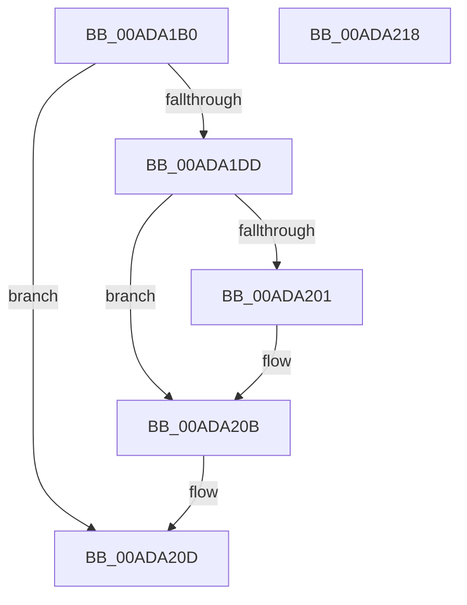

# RtlDeleteRegistryValue

- RVA: `0x00ADA1B0`–`0x00ADA219` (길이 `105` bytes)
- VA: `0x0000000140ADA1B0`
- 실행 섹션: `PAGE`
- PDB 이름 있음: `예`; PDB Function 태그: `아니요`
- unwind 정보 RVA: `0x00084AC0`
- 디코드: `31`개 명령, `105/105` bytes 표시
- 미해석 바이트: `0` (있으면 어셈블리에 `.byte`로 보존)

> 이 문서는 커널 이미지의 기계어와 PDB 기호를 분석해 생성했습니다. 4번과 5번은 함수 원형과 자료형을 바이너리 사용 방식에서 추정한 C 해석이며 원본 소스 복구 결과는 아닙니다.

## 1. Dependencies

- 직접 호출 지점: **4**; 고유 호출 대상: **4**
- 직접 호출자로 확인된 함수: **3**
- RIP 상대 이미지 참조: **0**

### Outgoing calls
- `0x00ADA1D4` → [RtlpGetRegistryHandle](../8C/RtlpGetRegistryHandle_function_008C955C.md) (function, `0x008C955C`)
- `0x00ADA1E5` → [RtlInitUnicodeString](../../text/42/RtlInitUnicodeString_function_0042A780.md) (function, `0x0042A780`)
- `0x00ADA1F4` → [ZwDeleteValueKey](../../text/6A/ZwDeleteValueKey_function_006AECB0.md) (function, `0x006AECB0`)
- `0x00ADA206` → [ZwClose](../../text/6A/ZwClose_function_006AD2B0.md) (function, `0x006AD2B0`)

### Direct callers
- [DifRtlDeleteRegistryValueWrapper](../../text/63/DifRtlDeleteRegistryValueWrapper_function_0063B940.md) at `0x0063BA24`
- [WheapResetPolicyDefaults](../7D/WheapResetPolicyDefaults_function_007D8D10.md) at `0x007D8D35`
- [PerfDiagpSaveActiveDCLLogFileName](../A9/PerfDiagpSaveActiveDCLLogFileName_function_00A9EB80.md) at `0x00A9ECB3`

### Static image references
- 디코드된 RIP-relative 메모리 참조가 없습니다.

## 2. Other-region calls and transfers

- 다른 실행 섹션으로 향하는 call: **3**
  - `0x00ADA1E5` → [RtlInitUnicodeString](../../text/42/RtlInitUnicodeString_function_0042A780.md) (`PAGE` → `.text`)
  - `0x00ADA1F4` → [ZwDeleteValueKey](../../text/6A/ZwDeleteValueKey_function_006AECB0.md) (`PAGE` → `.text`)
  - `0x00ADA206` → [ZwClose](../../text/6A/ZwClose_function_006AD2B0.md) (`PAGE` → `.text`)
- 별도 외부 분기/꼬리 이동을 확인하지 못했습니다.

## 3. Assembly (complete function range)

```asm
00ADA1B0  48 8B C4                        mov rax, rsp
00ADA1B3  48 89 58 08                     mov qword ptr [rax + 8], rbx
00ADA1B7  57                              push rdi
00ADA1B8  48 83 EC 30                     sub rsp, 0x30
00ADA1BC  48 83 60 20 00                  and qword ptr [rax + 0x20], 0
00ADA1C1  4C 8D 48 20                     lea r9, [rax + 0x20]
00ADA1C5  49 8B D8                        mov rbx, r8
00ADA1C8  0F 57 C0                        xorps xmm0, xmm0
00ADA1CB  41 B0 01                        mov r8b, 1
00ADA1CE  8B F9                           mov edi, ecx
00ADA1D0  0F 11 40 E8                     movups xmmword ptr [rax - 0x18], xmm0
00ADA1D4  E8 83 F3 DE FF                  call 0x1408c955c
00ADA1D9  85 C0                           test eax, eax
00ADA1DB  78 30                           js 0x140ada20d
00ADA1DD  48 8B D3                        mov rdx, rbx
00ADA1E0  48 8D 4C 24 20                  lea rcx, [rsp + 0x20]
00ADA1E5  E8 96 05 95 FF                  call 0x14042a780
00ADA1EA  48 8B 4C 24 58                  mov rcx, qword ptr [rsp + 0x58]
00ADA1EF  48 8D 54 24 20                  lea rdx, [rsp + 0x20]
00ADA1F4  E8 B7 4A BD FF                  call 0x1406aecb0
00ADA1F9  8B D8                           mov ebx, eax
00ADA1FB  0F BA E7 1E                     bt edi, 0x1e
00ADA1FF  72 0A                           jb 0x140ada20b
00ADA201  48 8B 4C 24 58                  mov rcx, qword ptr [rsp + 0x58]
00ADA206  E8 A5 30 BD FF                  call 0x1406ad2b0
00ADA20B  8B C3                           mov eax, ebx
00ADA20D  48 8B 5C 24 40                  mov rbx, qword ptr [rsp + 0x40]
00ADA212  48 83 C4 30                     add rsp, 0x30
00ADA216  5F                              pop rdi
00ADA217  C3                              ret
00ADA218  CC                              int3
```

## 4. C-style interpretation (structured pseudocode)

```c
__int64 __fastcall RtlDeleteRegistryValue(int a1, __int64 a2, __int64 a3)
{
    __int64 result;
    __int64 v_rsp;
    unsigned __int64 v_stack_m18;
    unsigned __int64 v_stack_p20;
    unsigned __int64 v_stack_p8;

    *(unsigned __int64 *)(v_rsp + 8) = v_rbx;
    v_rsp = (v_rsp) - (48);
    *(unsigned __int64 *)(v_rsp - 24) = v_xmm0;
    result = RtlpGetRegistryHandle(a1, a2, 1, v_rsp + 32);
    if (sign_flag) goto loc_00ADA20D;
    result = RtlInitUnicodeString(v_stack_m18, a3, 1, v_rsp + 32);
    result = ZwDeleteValueKey(v_stack_p20, v_stack_m18, 1, v_rsp + 32);
    if (!(condition_is_below)) {
        a1 = v_stack_p20;
        result = ZwClose(a1, v_stack_m18, 1, v_rsp + 32);
    }
loc_00ADA20D:
    v_rsp = (v_rsp) + (48);
    return (unsigned int)((unsigned int)((unsigned int)((unsigned int)(result))));
}
```

## 5. (Beta) C Style

```c
int64_t RtlDeleteRegistryValue(int32_t Arg1, int64_t Arg2, int64_t Arg3)
{
    int64_t result;
    int64_t local_rsp;
    uint64_t v_stack_m18;
    uint64_t v_stack_p20;
    uint64_t v_stack_p8;

    *(uint64_t *)(local_rsp + 0x8) = local_rbx;
    local_rsp = (local_rsp) - (48);
    *(uint64_t *)(local_rsp - 0x18) = v_xmm0;
    result = RtlpGetRegistryHandle(Arg1, Arg2, 1, local_rsp + 32);
    if (sign_flag) goto loc_00ADA20D;
    result = RtlInitUnicodeString(v_stack_m18, Arg3, 1, local_rsp + 32);
    result = ZwDeleteValueKey(v_stack_p20, v_stack_m18, 1, local_rsp + 32);
    if (!(condition_is_below)) {
        Arg1 = v_stack_p20;
        result = ZwClose(Arg1, v_stack_m18, 1, local_rsp + 32);
    }
loc_00ADA20D:
    local_rsp = (local_rsp) + (48);
    return (uint32_t)((uint32_t)((uint32_t)((uint32_t)(result))));
}
```

## 6. Execution-region graph

[열기: 2D/3D 그래프와 함수 탐색 컨트롤 패널](../../../control-panel.html?section=page&rva=0x00ADA1B0&view=graph)

- 2D 그래프는 위에서 아래로 흐르고, 3D 그래프는 빈 공간을 드래그해 회전합니다. Shift+드래그는 이동, 휠은 확대·축소, 함수 노드 선택은 대상 보고서 이동입니다.

### Static fallback


