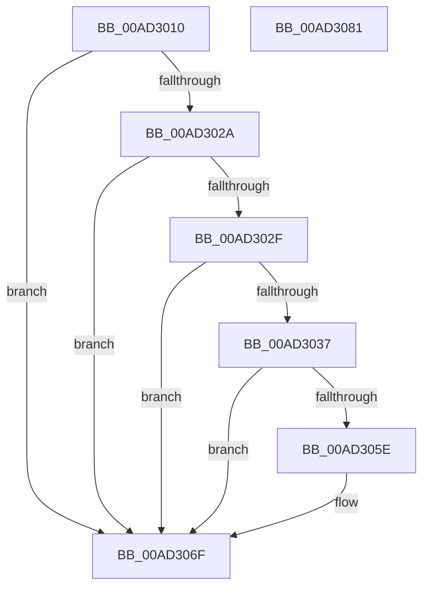

# RtlLCIDToCultureName

- RVA: `0x00AD3010`–`0x00AD3082` (길이 `114` bytes)
- VA: `0x0000000140AD3010`
- 실행 섹션: `PAGE`
- PDB 이름 있음: `예`; PDB Function 태그: `아니요`
- unwind 정보 RVA: `0x00060BC4`
- 디코드: `33`개 명령, `114/114` bytes 표시
- 미해석 바이트: `0` (있으면 어셈블리에 `.byte`로 보존)

> 이 문서는 커널 이미지의 기계어와 PDB 기호를 분석해 생성했습니다. 4번과 5번은 함수 원형과 자료형을 바이너리 사용 방식에서 추정한 C 해석이며 원본 소스 복구 결과는 아닙니다.

## 1. Dependencies

- 직접 호출 지점: **3**; 고유 호출 대상: **3**
- 직접 호출자로 확인된 함수: **10**
- RIP 상대 이미지 참조: **2**

### Outgoing calls
- `0x00AD303E` → [DbgPrint](../../text/35/DbgPrint_function_00358CB0.md) (function, `0x00358CB0`)
- `0x00AD3055` → [DownLevelLangIDToLanguageName](../../text/4B/DownLevelLangIDToLanguageName_function_004BBAA8.md) (function, `0x004BBAA8`)
- `0x00AD3068` → [RtlInitUnicodeString](../../text/42/RtlInitUnicodeString_function_0042A780.md) (function, `0x0042A780`)

### Direct callers
- [RtlpGetNameFromLangInfoNode](../../text/5E/RtlpGetNameFromLangInfoNode_function_005EBCCC.md) at `0x005EBD72`
- [RtlpMuiRegConfigMatchesInstalled](../83/RtlpMuiRegConfigMatchesInstalled_function_0083DA08.md) at `0x0083DBF9`
- [RtlpMuiRegGetInstalledLanguageIndexByLangId](../83/RtlpMuiRegGetInstalledLanguageIndexByLangId_function_0083E31C.md) at `0x0083E406`
- [RtlpMuiRegLangInfoMatchesSpec](../83/RtlpMuiRegLangInfoMatchesSpec_function_0083EBD0.md) at `0x0083ED15`
- [RtlpMuiRegPopulateBaseLanguages](../83/RtlpMuiRegPopulateBaseLanguages_function_0083FC4C.md) at `0x0083FDA7`
- [RtlpMuiRegValidateAndGetInstallFallbackBase](../84/RtlpMuiRegValidateAndGetInstallFallbackBase_function_0084042C.md) at `0x0084048E`
- [RtlpMuiRegValidateInstalled](../84/RtlpMuiRegValidateInstalled_function_008404D4.md) at `0x008405FA`
- [PnpSetDeviceInterfacePropertyData](../8F/PnpSetDeviceInterfacePropertyData_function_008F5328.md) at `0x008F5534`
- [PnpSetDevicePropertyData](../8F/PnpSetDevicePropertyData_function_008F6114.md) at `0x008F6281`
- [PnpGetDevicePropertyData](../90/PnpGetDevicePropertyData_function_009006D0.md) at `0x00900840`

### Static image references
- `0x00AD3037` → RVA `0x00B05A50` (` ?? ::NNGAKEGL::`string'`; read)
- `0x00AD304E` → RVA `0x00E62390` (`.data`; read)

## 2. Other-region calls and transfers

- 다른 실행 섹션으로 향하는 call: **3**
  - `0x00AD303E` → [DbgPrint](../../text/35/DbgPrint_function_00358CB0.md) (`PAGE` → `.text`)
  - `0x00AD3055` → [DownLevelLangIDToLanguageName](../../text/4B/DownLevelLangIDToLanguageName_function_004BBAA8.md) (`PAGE` → `.text`)
  - `0x00AD3068` → [RtlInitUnicodeString](../../text/42/RtlInitUnicodeString_function_0042A780.md) (`PAGE` → `.text`)
- 별도 외부 분기/꼬리 이동을 확인하지 못했습니다.

## 3. Assembly (complete function range)

```asm
00AD3010  48 89 5C 24 08                  mov qword ptr [rsp + 8], rbx
00AD3015  48 89 74 24 10                  mov qword ptr [rsp + 0x10], rsi
00AD301A  57                              push rdi
00AD301B  48 83 EC 20                     sub rsp, 0x20
00AD301F  33 DB                           xor ebx, ebx
00AD3021  48 8B F2                        mov rsi, rdx
00AD3024  8B F9                           mov edi, ecx
00AD3026  85 C9                           test ecx, ecx
00AD3028  74 45                           je 0x140ad306f
00AD302A  48 85 D2                        test rdx, rdx
00AD302D  74 40                           je 0x140ad306f
00AD302F  81 F9 00 10 00 00               cmp ecx, 0x1000
00AD3035  74 38                           je 0x140ad306f
00AD3037  48 8D 0D 12 2A 03 00            lea rcx, [rip + 0x32a12]
00AD303E  E8 6D 5C 88 FF                  call 0x140358cb0
00AD3043  44 8D 4B 02                     lea r9d, [rbx + 2]
00AD3047  0F B7 CF                        movzx ecx, di
00AD304A  44 8D 43 40                     lea r8d, [rbx + 0x40]
00AD304E  48 8D 15 3B F3 38 00            lea rdx, [rip + 0x38f33b]
00AD3055  E8 4E 8A 9E FF                  call 0x1404bbaa8
00AD305A  85 C0                           test eax, eax
00AD305C  7E 11                           jle 0x140ad306f
00AD305E  48 8D 15 2B F3 38 00            lea rdx, [rip + 0x38f32b]
00AD3065  48 8B CE                        mov rcx, rsi
00AD3068  E8 13 77 95 FF                  call 0x14042a780
00AD306D  B3 01                           mov bl, 1
00AD306F  48 8B 74 24 38                  mov rsi, qword ptr [rsp + 0x38]
00AD3074  8A C3                           mov al, bl
00AD3076  48 8B 5C 24 30                  mov rbx, qword ptr [rsp + 0x30]
00AD307B  48 83 C4 20                     add rsp, 0x20
00AD307F  5F                              pop rdi
00AD3080  C3                              ret
00AD3081  CC                              int3
```

## 4. C-style interpretation (structured pseudocode)

```c
__int64 __fastcall RtlLCIDToCultureName(int a1, __int64 a2)
{
    __int64 result;
    __int64 v_rbx;
    __int64 v_rsp;
    unsigned __int64 v_stack_p10;
    unsigned __int64 v_stack_p8;

    v_stack_p8 = v_rbx;
    v_stack_p10 = v_rsi;
    v_rsp = (v_rsp) - (32);
    v_rbx = 0;
    if (a1 == 0) goto loc_00AD306F;
    if (a2 == 0) goto loc_00AD306F;
    if (a1 == 0x1000ULL) goto loc_00AD306F;
    result = DbgPrint(v_rip + 207378, a2, a3, a4);
    result = DownLevelLangIDToLanguageName((unsigned __int16)((unsigned int)(a1)), v_rip + 3732283, v_rbx + 64, v_rbx + 2);
    if (!(condition_is_less_or_equal)) {
        a2 = v_rip + 3732267;
        a1 = a2;
        result = RtlInitUnicodeString(a1, a2, v_rbx + 64, v_rbx + 2);
        v_rbx = 1;
    }
    v_rsp = (v_rsp) + (32);
    return (unsigned __int8)(v_rbx);
}
```

## 5. (Beta) C Style

```c
int64_t RtlLCIDToCultureName(int32_t Arg1, int64_t Arg2)
{
    int64_t result;
    int64_t local_rbx;
    int64_t local_rsp;
    uint64_t v_stack_p10;
    uint64_t v_stack_p8;

    v_stack_p8 = local_rbx;
    v_stack_p10 = local_rsi;
    local_rsp = (local_rsp) - (32);
    local_rbx = 0;
    if (Arg1 == 0) goto loc_00AD306F;
    if (Arg2 == 0) goto loc_00AD306F;
    if (Arg1 == 0x1000ULL) goto loc_00AD306F;
    result = DbgPrint(v_rip + 207378, Arg2, a3, a4);
    result = DownLevelLangIDToLanguageName((uint16_t)((uint32_t)(Arg1)), v_rip + 3732283, local_rbx + 64, local_rbx + 2);
    if (!(condition_is_less_or_equal)) {
        Arg2 = v_rip + 3732267;
        Arg1 = Arg2;
        result = RtlInitUnicodeString(Arg1, Arg2, local_rbx + 64, local_rbx + 2);
        local_rbx = 1;
    }
    local_rsp = (local_rsp) + (32);
    return (uint8_t)(local_rbx);
}
```

## 6. Execution-region graph

[열기: 2D/3D 그래프와 함수 탐색 컨트롤 패널](../../../control-panel.html?section=page&rva=0x00AD3010&view=graph)

- 2D 그래프는 위에서 아래로 흐르고, 3D 그래프는 빈 공간을 드래그해 회전합니다. Shift+드래그는 이동, 휠은 확대·축소, 함수 노드 선택은 대상 보고서 이동입니다.

### Static fallback


