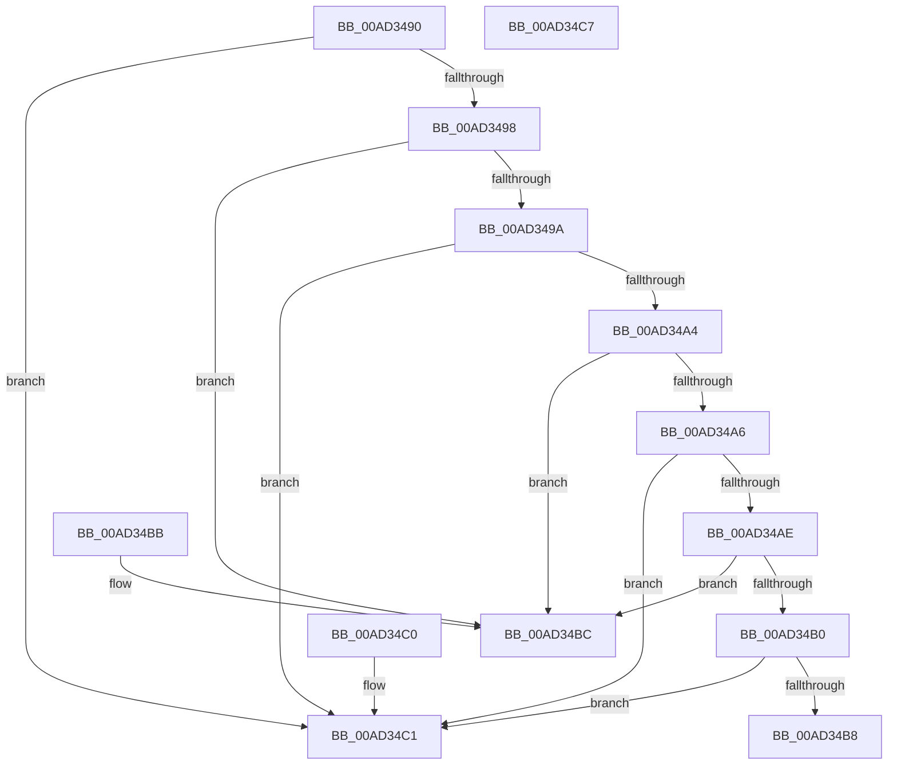

# RtlpFcCompareUsageSubscriptionUpdates

- RVA: `0x00AD3490`–`0x00AD34C8` (길이 `56` bytes)
- VA: `0x0000000140AD3490`
- 실행 섹션: `PAGE`
- PDB 이름 있음: `예`; PDB Function 태그: `아니요`
- unwind 정보 RVA: `0x000DB714`
- 디코드: `24`개 명령, `56/56` bytes 표시
- 미해석 바이트: `0` (있으면 어셈블리에 `.byte`로 보존)

> 이 문서는 커널 이미지의 기계어와 PDB 기호를 분석해 생성했습니다. 4번과 5번은 함수 원형과 자료형을 바이너리 사용 방식에서 추정한 C 해석이며 원본 소스 복구 결과는 아닙니다.

## 1. Dependencies

- 직접 호출 지점: **0**; 고유 호출 대상: **0**
- 직접 호출자로 확인된 함수: **0**
- RIP 상대 이미지 참조: **0**

### Outgoing calls
- 직접 디코드된 call 명령이 없습니다.

### Direct callers
- 이 함수 시작 RVA로 연결되는 직접 call은 확인되지 않았습니다. 간접 호출은 완전히 역산할 수 없습니다.

### Static image references
- 디코드된 RIP-relative 메모리 참조가 없습니다.

## 2. Other-region calls and transfers

- 다른 실행 섹션으로 향하는 call: **0**
- 별도 외부 분기/꼬리 이동을 확인하지 못했습니다.

## 3. Assembly (complete function range)

```asm
00AD3490  8B 41 04                        mov eax, dword ptr [rcx + 4]
00AD3493  3B 42 04                        cmp eax, dword ptr [rdx + 4]
00AD3496  77 29                           ja 0x140ad34c1
00AD3498  72 22                           jb 0x140ad34bc
00AD349A  0F B7 41 08                     movzx eax, word ptr [rcx + 8]
00AD349E  66 3B 42 08                     cmp ax, word ptr [rdx + 8]
00AD34A2  77 1D                           ja 0x140ad34c1
00AD34A4  72 16                           jb 0x140ad34bc
00AD34A6  8B 41 0C                        mov eax, dword ptr [rcx + 0xc]
00AD34A9  3B 42 0C                        cmp eax, dword ptr [rdx + 0xc]
00AD34AC  77 13                           ja 0x140ad34c1
00AD34AE  72 0C                           jb 0x140ad34bc
00AD34B0  8B 41 10                        mov eax, dword ptr [rcx + 0x10]
00AD34B3  3B 42 10                        cmp eax, dword ptr [rdx + 0x10]
00AD34B6  77 09                           ja 0x140ad34c1
00AD34B8  1B C0                           sbb eax, eax
00AD34BA  C3                              ret
00AD34BB  CC                              int3
00AD34BC  83 C8 FF                        or eax, 0xffffffff
00AD34BF  C3                              ret
00AD34C0  CC                              int3
00AD34C1  B8 01 00 00 00                  mov eax, 1
00AD34C6  C3                              ret
00AD34C7  CC                              int3
```

## 4. C-style interpretation (structured pseudocode)

```c
__int64 __fastcall RtlpFcCompareUsageSubscriptionUpdates(__int64 a1, __int64 a2)
{
    __int64 result;

    if (((unsigned int)((unsigned int)(*(unsigned int *)(a1 + 4)))) > (*(unsigned int *)(a2 + 4))) goto loc_00AD34C1;
    if (((unsigned int)((unsigned int)(*(unsigned int *)(a1 + 4)))) < (*(unsigned int *)(a2 + 4))) goto loc_00AD34BC;
    if (((unsigned __int16)(*(unsigned __int16 *)(a1 + 8))) > (*(unsigned __int16 *)(a2 + 8))) goto loc_00AD34C1;
    if (((unsigned __int16)(*(unsigned __int16 *)(a1 + 8))) < (*(unsigned __int16 *)(a2 + 8))) goto loc_00AD34BC;
    if (((unsigned int)((unsigned int)(*(unsigned int *)(a1 + 12)))) > (*(unsigned int *)(a2 + 12))) goto loc_00AD34C1;
    if (((unsigned int)((unsigned int)(*(unsigned int *)(a1 + 12)))) < (*(unsigned int *)(a2 + 12))) goto loc_00AD34BC;
    if (((unsigned int)((unsigned int)(*(unsigned int *)(a1 + 16)))) > (*(unsigned int *)(a2 + 16))) goto loc_00AD34C1;
    return (unsigned int)(*(unsigned int *)(a1 + 16));
loc_00AD34BC:
    result = (unsigned int)(((unsigned int)(*(unsigned int *)(a1 + 16))) | (0xFFFFFFFFULL));
    return result;
loc_00AD34C1:
    return 1;
}
```

## 5. (Beta) C Style

```c
int64_t RtlpFcCompareUsageSubscriptionUpdates(void *Arg1, void *Arg2)
{
    uint8_t *arg1 = (uint8_t *)Arg1;
    uint8_t *arg2 = (uint8_t *)Arg2;

    int64_t result;

    if (((uint32_t)((uint32_t)(*(uint32_t *)(arg1 + 0x4)))) > (*(uint32_t *)(arg2 + 0x4))) goto loc_00AD34C1;
    if (((uint32_t)((uint32_t)(*(uint32_t *)(arg1 + 0x4)))) < (*(uint32_t *)(arg2 + 0x4))) goto loc_00AD34BC;
    if (((uint16_t)(*(uint16_t *)(arg1 + 0x8))) > (*(uint16_t *)(arg2 + 0x8))) goto loc_00AD34C1;
    if (((uint16_t)(*(uint16_t *)(arg1 + 0x8))) < (*(uint16_t *)(arg2 + 0x8))) goto loc_00AD34BC;
    if (((uint32_t)((uint32_t)(*(uint32_t *)(arg1 + 0xC)))) > (*(uint32_t *)(arg2 + 0xC))) goto loc_00AD34C1;
    if (((uint32_t)((uint32_t)(*(uint32_t *)(arg1 + 0xC)))) < (*(uint32_t *)(arg2 + 0xC))) goto loc_00AD34BC;
    if (((uint32_t)((uint32_t)(*(uint32_t *)(arg1 + 0x10)))) > (*(uint32_t *)(arg2 + 0x10))) goto loc_00AD34C1;
    return (uint32_t)(*(uint32_t *)(arg1 + 0x10));
loc_00AD34BC:
    result = (uint32_t)(((uint32_t)(*(uint32_t *)(arg1 + 0x10))) | (0xFFFFFFFFULL));
    return result;
loc_00AD34C1:
    return 1;
}
```

### 관측된 메모리 오프셋

구조체 형식이 확인되지 않은 접근은 인자 기준의 오프셋으로만 기록했습니다.

| 기준 인자 | 오프셋 표현 | 폭 (bit) | 접근 |
|---|---:|---:|---|
| `Arg1` | `+ 0x4` | `32` | `R` |
| `Arg1` | `+ 0x8` | `16` | `R` |
| `Arg1` | `+ 0xC` | `32` | `R` |
| `Arg1` | `+ 0x10` | `32` | `R` |
| `Arg2` | `+ 0x4` | `32` | `R` |
| `Arg2` | `+ 0x8` | `16` | `R` |
| `Arg2` | `+ 0xC` | `32` | `R` |
| `Arg2` | `+ 0x10` | `32` | `R` |

## 6. Execution-region graph

[열기: 2D/3D 그래프와 함수 탐색 컨트롤 패널](../../../control-panel.html?section=page&rva=0x00AD3490&view=graph)

- 2D 그래프는 위에서 아래로 흐르고, 3D 그래프는 빈 공간을 드래그해 회전합니다. Shift+드래그는 이동, 휠은 확대·축소, 함수 노드 선택은 대상 보고서 이동입니다.

### Static fallback


