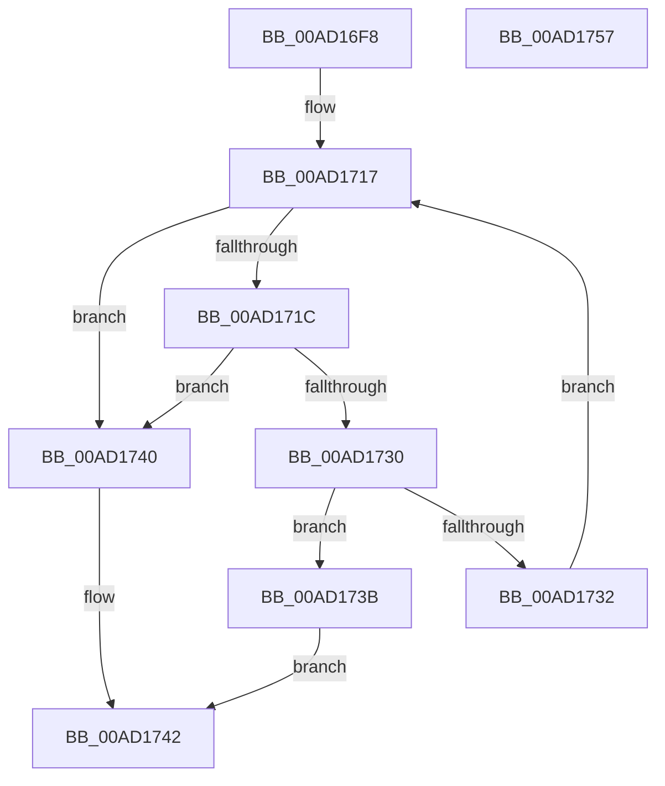

# RtlpFcLinearSearchInSortedArray

- RVA: `0x00AD16F8`–`0x00AD1758` (길이 `96` bytes)
- VA: `0x0000000140AD16F8`
- 실행 섹션: `PAGE`
- PDB 이름 있음: `예`; PDB Function 태그: `아니요`
- unwind 정보 RVA: `0x0005C954`
- 디코드: `31`개 명령, `96/96` bytes 표시
- 미해석 바이트: `0` (있으면 어셈블리에 `.byte`로 보존)

> 이 문서는 커널 이미지의 기계어와 PDB 기호를 분석해 생성했습니다. 4번과 5번은 함수 원형과 자료형을 바이너리 사용 방식에서 추정한 C 해석이며 원본 소스 복구 결과는 아닙니다.

## 1. Dependencies

- 직접 호출 지점: **1**; 고유 호출 대상: **1**
- 직접 호출자로 확인된 함수: **2**
- RIP 상대 이미지 참조: **0**

### Outgoing calls
- `0x00AD1727` → [guard_dispatch_icall](../../text/6B/guard_dispatch_icall_function_006BAAD0.md) (function, `0x006BAAD0`)

### Direct callers
- [RtlpFcHasEffectiveStateInGovernedFeatureInfoTable](../79/RtlpFcHasEffectiveStateInGovernedFeatureInfoTable_function_0079A72C.md) at `0x0079A7A5`
- [RtlpFcGetFeatureHasSubscriptionsFromBuffer](../9B/RtlpFcGetFeatureHasSubscriptionsFromBuffer_function_009BCA30.md) at `0x009BCA99`

### Static image references
- 디코드된 RIP-relative 메모리 참조가 없습니다.

## 2. Other-region calls and transfers

- 다른 실행 섹션으로 향하는 call: **1**
  - `0x00AD1727` → [guard_dispatch_icall](../../text/6B/guard_dispatch_icall_function_006BAAD0.md) (`PAGE` → `.text`)
- 별도 외부 분기/꼬리 이동을 확인하지 못했습니다.

## 3. Assembly (complete function range)

```asm
00AD16F8  48 89 5C 24 08                  mov qword ptr [rsp + 8], rbx
00AD16FD  48 89 6C 24 10                  mov qword ptr [rsp + 0x10], rbp
00AD1702  48 89 74 24 18                  mov qword ptr [rsp + 0x18], rsi
00AD1707  57                              push rdi
00AD1708  48 83 EC 20                     sub rsp, 0x20
00AD170C  49 8B F0                        mov rsi, r8
00AD170F  48 8B DA                        mov rbx, rdx
00AD1712  48 8B E9                        mov rbp, rcx
00AD1715  33 FF                           xor edi, edi
00AD1717  48 3B FE                        cmp rdi, rsi
00AD171A  73 24                           jae 0x140ad1740
00AD171C  48 8B 44 24 50                  mov rax, qword ptr [rsp + 0x50]
00AD1721  48 8B D3                        mov rdx, rbx
00AD1724  48 8B CD                        mov rcx, rbp
00AD1727  E8 A4 93 BE FF                  call 0x1406baad0
00AD172C  85 C0                           test eax, eax
00AD172E  78 10                           js 0x140ad1740
00AD1730  74 09                           je 0x140ad173b
00AD1732  48 FF C7                        inc rdi
00AD1735  48 83 C3 10                     add rbx, 0x10
00AD1739  EB DC                           jmp 0x140ad1717
00AD173B  48 8B C3                        mov rax, rbx
00AD173E  EB 02                           jmp 0x140ad1742
00AD1740  33 C0                           xor eax, eax
00AD1742  48 8B 5C 24 30                  mov rbx, qword ptr [rsp + 0x30]
00AD1747  48 8B 6C 24 38                  mov rbp, qword ptr [rsp + 0x38]
00AD174C  48 8B 74 24 40                  mov rsi, qword ptr [rsp + 0x40]
00AD1751  48 83 C4 20                     add rsp, 0x20
00AD1755  5F                              pop rdi
00AD1756  C3                              ret
00AD1757  CC                              int3
```

## 4. C-style interpretation (structured pseudocode)

```c
__int64 __fastcall RtlpFcLinearSearchInSortedArray(__int64 a1, __int64 a2, __int64 a3, __int64 a4, __int64 a5)
{
    __int64 result;
    __int64 v_rbx;
    __int64 v_rdi;
    __int64 v_rsp;
    unsigned __int64 v_stack_p10;
    unsigned __int64 v_stack_p18;
    unsigned __int64 v_stack_p8;

    v_stack_p8 = v_rbx;
    v_stack_p10 = v_rbp;
    v_stack_p18 = v_rsi;
    v_rsp = (v_rsp) - (32);
    v_rdi = 0;
loc_00AD1717:
    if (0 >= a3) goto loc_00AD1740;
    result = guard_dispatch_icall(a1, a2, a3, a4);
    if (sign_flag) goto loc_00AD1740;
    if ((unsigned int)(result) == 0) goto loc_00AD173B;
    v_rdi = (v_rdi) + 1;
    v_rbx = (a2) + (16);
    goto loc_00AD1717;
loc_00AD173B:
    goto loc_00AD1742;
loc_00AD1740:
    result = 0;
loc_00AD1742:
    v_rsp = (v_rsp) + (32);
    return result;
}
```

## 5. (Beta) C Style

```c
int64_t RtlpFcLinearSearchInSortedArray(int64_t Arg1, int64_t Arg2, int64_t Arg3, int64_t Arg4, int64_t Arg5)
{
    int64_t result;
    int64_t local_rbx;
    int64_t local_rdi;
    int64_t local_rsp;
    uint64_t v_stack_p10;
    uint64_t v_stack_p18;
    uint64_t v_stack_p8;

    v_stack_p8 = local_rbx;
    v_stack_p10 = local_rbp;
    v_stack_p18 = local_rsi;
    local_rsp = (local_rsp) - (32);
    local_rdi = 0;
loc_00AD1717:
    if (0 >= Arg3) goto loc_00AD1740;
    result = guard_dispatch_icall(Arg1, Arg2, Arg3, Arg4);
    if (sign_flag) goto loc_00AD1740;
    if ((uint32_t)(result) == 0) goto loc_00AD173B;
    local_rdi = (local_rdi) + 1;
    local_rbx = (Arg2) + (16);
    goto loc_00AD1717;
loc_00AD173B:
    goto loc_00AD1742;
loc_00AD1740:
    result = 0;
loc_00AD1742:
    local_rsp = (local_rsp) + (32);
    return result;
}
```

## 6. Execution-region graph

[열기: 2D/3D 그래프와 함수 탐색 컨트롤 패널](../../../control-panel.html?section=page&rva=0x00AD16F8&view=graph)

- 2D 그래프는 위에서 아래로 흐르고, 3D 그래프는 빈 공간을 드래그해 회전합니다. Shift+드래그는 이동, 휠은 확대·축소, 함수 노드 선택은 대상 보고서 이동입니다.

### Static fallback


