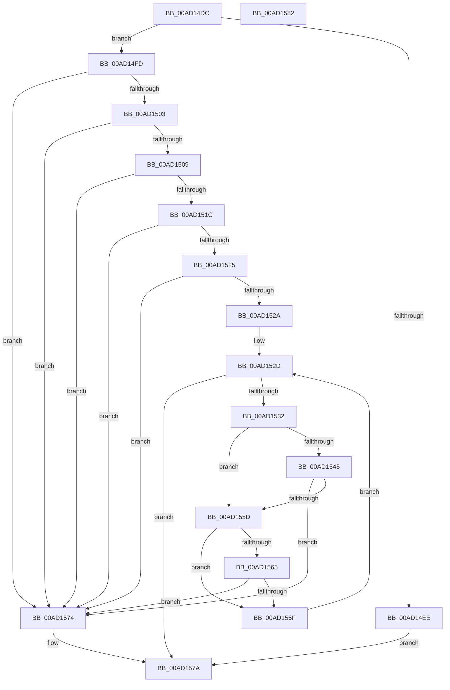

# RtlpFcValidateFeatureConfigurationBuffer

- RVA: `0x00AD14DC`–`0x00AD1583` (길이 `167` bytes)
- VA: `0x0000000140AD14DC`
- 실행 섹션: `PAGE`
- PDB 이름 있음: `예`; PDB Function 태그: `아니요`
- unwind 정보 RVA: `0x0005C788`
- 디코드: `54`개 명령, `167/167` bytes 표시
- 미해석 바이트: `0` (있으면 어셈블리에 `.byte`로 보존)

> 이 문서는 커널 이미지의 기계어와 PDB 기호를 분석해 생성했습니다. 4번과 5번은 함수 원형과 자료형을 바이너리 사용 방식에서 추정한 C 해석이며 원본 소스 복구 결과는 아닙니다.

## 1. Dependencies

- 직접 호출 지점: **1**; 고유 호출 대상: **1**
- 직접 호출자로 확인된 함수: **2**
- RIP 상대 이미지 참조: **0**

### Outgoing calls
- `0x00AD1554` → [RtlFcpCompareFeatureToFeature](../../text/5F/RtlFcpCompareFeatureToFeature_function_005F0D68.md) (function, `0x005F0D68`)

### Direct callers
- [CmFcManagerOverwriteFeatureConfigurationSection](../7F/CmFcManagerOverwriteFeatureConfigurationSection_function_007F4450.md) at `0x007F44C7`
- [CmFcManagerUpdateFeatureConfigurations](../7F/CmFcManagerUpdateFeatureConfigurations_function_007F4CF4.md) at `0x007F4F56`

### Static image references
- 디코드된 RIP-relative 메모리 참조가 없습니다.

## 2. Other-region calls and transfers

- 다른 실행 섹션으로 향하는 call: **1**
  - `0x00AD1554` → [RtlFcpCompareFeatureToFeature](../../text/5F/RtlFcpCompareFeatureToFeature_function_005F0D68.md) (`PAGE` → `.text`)
- 별도 외부 분기/꼬리 이동을 확인하지 못했습니다.

## 3. Assembly (complete function range)

```asm
00AD14DC  48 83 EC 28                     sub rsp, 0x28
00AD14E0  45 33 C0                        xor r8d, r8d
00AD14E3  4C 8B CA                        mov r9, rdx
00AD14E6  4C 8B D1                        mov r10, rcx
00AD14E9  48 85 C9                        test rcx, rcx
00AD14EC  75 0F                           jne 0x140ad14fd
00AD14EE  49 F7 D9                        neg r9
00AD14F1  45 1B C0                        sbb r8d, r8d
00AD14F4  41 81 E0 0D 00 00 C0            and r8d, 0xc000000d
00AD14FB  EB 7D                           jmp 0x140ad157a
00AD14FD  49 83 F9 04                     cmp r9, 4
00AD1501  72 71                           jb 0x140ad1574
00AD1503  41 F6 C2 03                     test r10b, 3
00AD1507  75 6B                           jne 0x140ad1574
00AD1509  44 8B 19                        mov r11d, dword ptr [rcx]
00AD150C  B8 10 00 00 00                  mov eax, 0x10
00AD1511  49 F7 E3                        mul r11
00AD1514  48 8B C8                        mov rcx, rax
00AD1517  48 85 D2                        test rdx, rdx
00AD151A  75 58                           jne 0x140ad1574
00AD151C  48 83 C0 04                     add rax, 4
00AD1520  48 3B C1                        cmp rax, rcx
00AD1523  72 4F                           jb 0x140ad1574
00AD1525  49 3B C1                        cmp rax, r9
00AD1528  77 4A                           ja 0x140ad1574
00AD152A  45 8B C8                        mov r9d, r8d
00AD152D  45 3B CB                        cmp r9d, r11d
00AD1530  73 48                           jae 0x140ad157a
00AD1532  41 8B D1                        mov edx, r9d
00AD1535  48 C1 E2 04                     shl rdx, 4
00AD1539  48 83 C2 04                     add rdx, 4
00AD153D  49 03 D2                        add rdx, r10
00AD1540  45 85 C9                        test r9d, r9d
00AD1543  74 18                           je 0x140ad155d
00AD1545  41 8D 49 FF                     lea ecx, [r9 - 1]
00AD1549  48 C1 E1 04                     shl rcx, 4
00AD154D  48 83 C1 04                     add rcx, 4
00AD1551  49 03 CA                        add rcx, r10
00AD1554  E8 0F F8 B1 FF                  call 0x1405f0d68
00AD1559  85 C0                           test eax, eax
00AD155B  79 17                           jns 0x140ad1574
00AD155D  8B 42 04                        mov eax, dword ptr [rdx + 4]
00AD1560  83 E0 30                        and eax, 0x30
00AD1563  74 0A                           je 0x140ad156f
00AD1565  83 C0 F0                        add eax, -0x10
00AD1568  A9 EF FF FF FF                  test eax, 0xffffffef
00AD156D  75 05                           jne 0x140ad1574
00AD156F  41 FF C1                        inc r9d
00AD1572  EB B9                           jmp 0x140ad152d
00AD1574  41 B8 0D 00 00 C0               mov r8d, 0xc000000d
00AD157A  41 8B C0                        mov eax, r8d
00AD157D  48 83 C4 28                     add rsp, 0x28
00AD1581  C3                              ret
00AD1582  CC                              int3
```

## 4. C-style interpretation (structured pseudocode)

```c
__int64 __fastcall RtlpFcValidateFeatureConfigurationBuffer(__int64 a1, __int64 a2, int a3)
{
    __int64 result;
    __int64 v_rsp;

    v_rsp = (v_rsp) - (40);
    a3 = 0;
    if (a1 != 0) goto loc_00AD14FD;
    a4 = -(a2);
    a3 = (unsigned int)((a3) & (0xC000000DULL));
    goto loc_00AD157A;
loc_00AD14FD:
    if (a4 < 4) goto loc_00AD1574;
    if ((((unsigned __int8)(a1)) & (3)) != 0) goto loc_00AD1574;
    if (a2 != 0) goto loc_00AD1574;
    result = (16) + (4);
    if (result < 16) goto loc_00AD1574;
    if (result > a4) goto loc_00AD1574;
loc_00AD152D:
    if (((unsigned int)((unsigned int)(a3))) >= ((unsigned int)((unsigned int)(*(unsigned int *)(a1))))) goto loc_00AD157A;
    a2 = ((unsigned int)((unsigned int)((unsigned int)(a3)))) << (4);
    a2 = (a2) + (4);
    a2 = (a2) + (a1);
    if ((unsigned int)((unsigned int)(a3)) == 0) goto loc_00AD155D;
    a1 = ((unsigned int)(a3) - 1) << (4);
    a1 = (a1) + (4);
    a1 = (a1) + (a1);
    result = RtlFcpCompareFeatureToFeature(a1, a2, a3, (unsigned int)(a3));
    if (!sign_flag) goto loc_00AD1574;
loc_00AD155D:
    result = (unsigned int)(((unsigned int)(*(unsigned int *)(a2 + 4))) & (48));
    if (condition_is_equal) goto loc_00AD156F;
    result = (unsigned int)((result) + (-16));
    if ((((unsigned int)(result)) & (0xFFFFFFEFULL)) != 0) goto loc_00AD1574;
loc_00AD156F:
    a4 = (unsigned int)(((unsigned int)(a3)) + 1);
    goto loc_00AD152D;
loc_00AD1574:
loc_00AD157A:
    v_rsp = (v_rsp) + (40);
    return (unsigned int)((unsigned int)((unsigned int)(0xC000000DULL)));
}
```

## 5. (Beta) C Style

```c
int64_t RtlpFcValidateFeatureConfigurationBuffer(int64_t Arg1, int64_t Arg2, int32_t Arg3)
{
    int64_t result;
    int64_t local_rsp;

    local_rsp = (local_rsp) - (40);
    Arg3 = 0;
    if (Arg1 != 0) goto loc_00AD14FD;
    a4 = -(Arg2);
    Arg3 = (uint32_t)((Arg3) & (0xC000000DULL));
    goto loc_00AD157A;
loc_00AD14FD:
    if (a4 < 4) goto loc_00AD1574;
    if ((((uint8_t)(Arg1)) & (3)) != 0) goto loc_00AD1574;
    if (Arg2 != 0) goto loc_00AD1574;
    result = (16) + (4);
    if (result < 16) goto loc_00AD1574;
    if (result > a4) goto loc_00AD1574;
loc_00AD152D:
    if (((uint32_t)((uint32_t)(Arg3))) >= ((uint32_t)((uint32_t)(*(uint32_t *)(Arg1))))) goto loc_00AD157A;
    Arg2 = ((uint32_t)((uint32_t)((uint32_t)(Arg3)))) << (4);
    Arg2 = (Arg2) + (4);
    Arg2 = (Arg2) + (Arg1);
    if ((uint32_t)((uint32_t)(Arg3)) == 0) goto loc_00AD155D;
    Arg1 = ((uint32_t)(Arg3) - 1) << (4);
    Arg1 = (Arg1) + (4);
    Arg1 = (Arg1) + (Arg1);
    result = RtlFcpCompareFeatureToFeature(Arg1, Arg2, Arg3, (uint32_t)(Arg3));
    if (!sign_flag) goto loc_00AD1574;
loc_00AD155D:
    result = (uint32_t)(((uint32_t)(*(uint32_t *)(Arg2 + 0x4))) & (48));
    if (condition_is_equal) goto loc_00AD156F;
    result = (uint32_t)((result) + (-16));
    if ((((uint32_t)(result)) & (0xFFFFFFEFULL)) != 0) goto loc_00AD1574;
loc_00AD156F:
    a4 = (uint32_t)(((uint32_t)(Arg3)) + 1);
    goto loc_00AD152D;
loc_00AD1574:
loc_00AD157A:
    local_rsp = (local_rsp) + (40);
    return (uint32_t)((uint32_t)((uint32_t)(0xC000000DULL)));
}
```

## 6. Execution-region graph

[열기: 2D/3D 그래프와 함수 탐색 컨트롤 패널](../../../control-panel.html?section=page&rva=0x00AD14DC&view=graph)

- 2D 그래프는 위에서 아래로 흐르고, 3D 그래프는 빈 공간을 드래그해 회전합니다. Shift+드래그는 이동, 휠은 확대·축소, 함수 노드 선택은 대상 보고서 이동입니다.

### Static fallback


