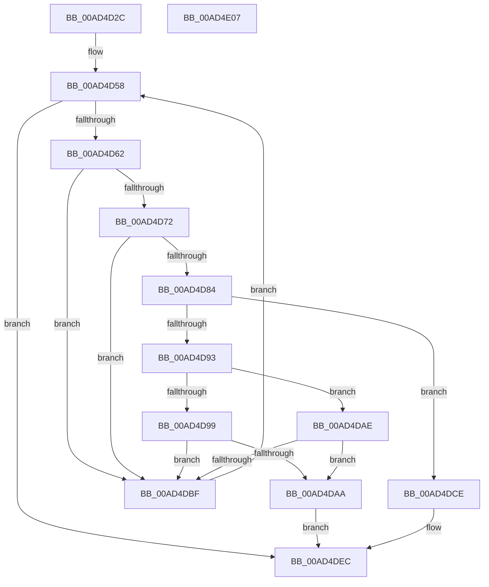

# SdbpFindFirstNamedTagHelper

- RVA: `0x00AD4D2C`–`0x00AD4E08` (길이 `220` bytes)
- VA: `0x0000000140AD4D2C`
- 실행 섹션: `PAGE`
- PDB 이름 있음: `예`; PDB Function 태그: `아니요`
- unwind 정보 RVA: `0x00060300`
- 디코드: `66`개 명령, `220/220` bytes 표시
- 미해석 바이트: `0` (있으면 어셈블리에 `.byte`로 보존)

> 이 문서는 커널 이미지의 기계어와 PDB 기호를 분석해 생성했습니다. 4번과 5번은 함수 원형과 자료형을 바이너리 사용 방식에서 추정한 C 해석이며 원본 소스 복구 결과는 아닙니다.

## 1. Dependencies

- 직접 호출 지점: **8**; 고유 호출 대상: **8**
- 직접 호출자로 확인된 함수: **4**
- RIP 상대 이미지 참조: **2**

### Outgoing calls
- `0x00AD4D53` → [SdbGetFirstChild](../95/SdbGetFirstChild_function_0095E610.md) (function, `0x0095E610`)
- `0x00AD4D67` → [SdbGetTagFromTagID](../95/SdbGetTagFromTagID_function_0095E3C0.md) (function, `0x0095E3C0`)
- `0x00AD4D7B` → [SdbFindFirstTag](../95/SdbFindFirstTag_function_0095E34C.md) (function, `0x0095E34C`)
- `0x00AD4D89` → [SdbGetStringTagPtr](../95/SdbGetStringTagPtr_function_0095DDA8.md) (function, `0x0095DDA8`)
- `0x00AD4DA1` → [AslStringPatternMatchExW](../95/AslStringPatternMatchExW_function_0095E850.md) (function, `0x0095E850`)
- `0x00AD4DB6` → [wcsicmp](../../text/50/wcsicmp_function_00500080.md) (function, `0x00500080`)
- `0x00AD4DC7` → [SdbGetNextChild](../95/SdbGetNextChild_function_0095E520.md) (function, `0x0095E520`)
- `0x00AD4DE7` → [AslLogCallPrintf](../95/AslLogCallPrintf_function_0095E4EC.md) (function, `0x0095E4EC`)

### Direct callers
- [SdbQueryDataExTagID](../81/SdbQueryDataExTagID_function_008136E0.md) at `0x00813823`
- [SdbpFindFirstTagWithoutIndex](../81/SdbpFindFirstTagWithoutIndex_function_00815610.md) at `0x0081569E`
- [SdbpFindFirstWildcardTagWithoutIndex](../81/SdbpFindFirstWildcardTagWithoutIndex_function_008156C8.md) at `0x00815759`
- [SdbpSearchDB](../AB/SdbpSearchDB_function_00AB3294.md) at `0x00AB33A6`
- [SdbpSearchDB](../AB/SdbpSearchDB_function_00AB3294.md) at `0x00AB34D9`
- [SdbpSearchDB](../AB/SdbpSearchDB_function_00AB3294.md) at `0x00AB35D7`
- [SdbpSearchDB](../AB/SdbpSearchDB_function_00AB3294.md) at `0x00AB36DA`

### Static image references
- `0x00AD4DCE` → RVA `0x0003D230` (`.rdata`; read)
- `0x00AD4DDB` → RVA `0x0003D210` (`.rdata`; read)

## 2. Other-region calls and transfers

- 다른 실행 섹션으로 향하는 call: **1**
  - `0x00AD4DB6` → [wcsicmp](../../text/50/wcsicmp_function_00500080.md) (`PAGE` → `.text`)
- 별도 외부 분기/꼬리 이동을 확인하지 못했습니다.

## 3. Assembly (complete function range)

```asm
00AD4D2C  48 89 5C 24 08                  mov qword ptr [rsp + 8], rbx
00AD4D31  48 89 6C 24 10                  mov qword ptr [rsp + 0x10], rbp
00AD4D36  48 89 74 24 18                  mov qword ptr [rsp + 0x18], rsi
00AD4D3B  57                              push rdi
00AD4D3C  41 56                           push r14
00AD4D3E  41 57                           push r15
00AD4D40  48 83 EC 20                     sub rsp, 0x20
00AD4D44  33 DB                           xor ebx, ebx
00AD4D46  45 0F B7 F9                     movzx r15d, r9w
00AD4D4A  45 0F B7 F0                     movzx r14d, r8w
00AD4D4E  8B EA                           mov ebp, edx
00AD4D50  48 8B F1                        mov rsi, rcx
00AD4D53  E8 B8 98 E8 FF                  call 0x14095e610
00AD4D58  8B F8                           mov edi, eax
00AD4D5A  85 C0                           test eax, eax
00AD4D5C  0F 84 8A 00 00 00               je 0x140ad4dec
00AD4D62  8B D0                           mov edx, eax
00AD4D64  48 8B CE                        mov rcx, rsi
00AD4D67  E8 54 96 E8 FF                  call 0x14095e3c0
00AD4D6C  66 41 3B C6                     cmp ax, r14w
00AD4D70  75 4D                           jne 0x140ad4dbf
00AD4D72  45 0F B7 C7                     movzx r8d, r15w
00AD4D76  8B D7                           mov edx, edi
00AD4D78  48 8B CE                        mov rcx, rsi
00AD4D7B  E8 CC 95 E8 FF                  call 0x14095e34c
00AD4D80  85 C0                           test eax, eax
00AD4D82  74 3B                           je 0x140ad4dbf
00AD4D84  8B D0                           mov edx, eax
00AD4D86  48 8B CE                        mov rcx, rsi
00AD4D89  E8 1A 90 E8 FF                  call 0x14095dda8
00AD4D8E  48 85 C0                        test rax, rax
00AD4D91  74 3B                           je 0x140ad4dce
00AD4D93  39 5C 24 68                     cmp dword ptr [rsp + 0x68], ebx
00AD4D97  74 15                           je 0x140ad4dae
00AD4D99  48 8B 54 24 60                  mov rdx, qword ptr [rsp + 0x60]
00AD4D9E  48 8B C8                        mov rcx, rax
00AD4DA1  E8 AA 9A E8 FF                  call 0x14095e850
00AD4DA6  85 C0                           test eax, eax
00AD4DA8  74 15                           je 0x140ad4dbf
00AD4DAA  8B DF                           mov ebx, edi
00AD4DAC  EB 3E                           jmp 0x140ad4dec
00AD4DAE  48 8B 4C 24 60                  mov rcx, qword ptr [rsp + 0x60]
00AD4DB3  48 8B D0                        mov rdx, rax
00AD4DB6  E8 C5 B2 A2 FF                  call 0x140500080
00AD4DBB  85 C0                           test eax, eax
00AD4DBD  74 EB                           je 0x140ad4daa
00AD4DBF  44 8B C7                        mov r8d, edi
00AD4DC2  8B D5                           mov edx, ebp
00AD4DC4  48 8B CE                        mov rcx, rsi
00AD4DC7  E8 54 97 E8 FF                  call 0x14095e520
00AD4DCC  EB 8A                           jmp 0x140ad4d58
00AD4DCE  4C 8D 0D 5B 84 56 FF            lea r9, [rip - 0xa97ba5]
00AD4DD5  41 B8 D9 01 00 00               mov r8d, 0x1d9
00AD4DDB  48 8D 15 2E 84 56 FF            lea rdx, [rip - 0xa97bd2]
00AD4DE2  B9 01 00 00 00                  mov ecx, 1
00AD4DE7  E8 00 97 E8 FF                  call 0x14095e4ec
00AD4DEC  48 8B 6C 24 48                  mov rbp, qword ptr [rsp + 0x48]
00AD4DF1  8B C3                           mov eax, ebx
00AD4DF3  48 8B 5C 24 40                  mov rbx, qword ptr [rsp + 0x40]
00AD4DF8  48 8B 74 24 50                  mov rsi, qword ptr [rsp + 0x50]
00AD4DFD  48 83 C4 20                     add rsp, 0x20
00AD4E01  41 5F                           pop r15
00AD4E03  41 5E                           pop r14
00AD4E05  5F                              pop rdi
00AD4E06  C3                              ret
00AD4E07  CC                              int3
```

## 4. C-style interpretation (structured pseudocode)

```c
__int64 __fastcall SdbpFindFirstNamedTagHelper(__int64 a1, int a2, unsigned __int16 a3, unsigned __int16 a4, __int64 a5, unsigned int a6)
{
    __int64 result;
    __int64 v_rbx;
    __int64 v_rsp;
    unsigned __int64 v_stack_p10;
    unsigned __int64 v_stack_p18;
    unsigned __int64 v_stack_p8;

    v_stack_p8 = v_rbx;
    v_stack_p10 = v_rbp;
    v_stack_p18 = v_rsi;
    v_rsp = (v_rsp) - (32);
    v_rbx = 0;
    result = SdbGetFirstChild(a1, a2, a3, a4);
loc_00AD4D58:
    if ((unsigned int)(result) == 0) goto loc_00AD4DEC;
    result = SdbGetTagFromTagID(a1, (unsigned int)((unsigned int)(result)), a3, a4);
    if (((unsigned __int16)(result)) != a3) goto loc_00AD4DBF;
    result = SdbFindFirstTag(a1, (unsigned int)((unsigned int)((unsigned int)((unsigned int)(result)))), a4, a4);
    if ((unsigned int)(result) == 0) goto loc_00AD4DBF;
    result = SdbGetStringTagPtr(a1, (unsigned int)((unsigned int)(result)), a4, a4);
    if (result == 0) goto loc_00AD4DCE;
    if (a6 == 0) goto loc_00AD4DAE;
    result = AslStringPatternMatchExW(result, a5, a4, a4);
    if ((unsigned int)(result) == 0) goto loc_00AD4DBF;
loc_00AD4DAA:
    goto loc_00AD4DEC;
loc_00AD4DAE:
    result = wcsicmp(a5, result, a4, a4);
    if ((unsigned int)(result) == 0) goto loc_00AD4DAA;
loc_00AD4DBF:
    result = SdbGetNextChild(a1, (unsigned int)((unsigned int)((unsigned int)(a2))), (unsigned int)((unsigned int)((unsigned int)((unsigned int)(result)))), a4);
    goto loc_00AD4D58;
loc_00AD4DCE:
    result = AslLogCallPrintf(1, v_rip - 11107282, 473, v_rip - 11107237);
loc_00AD4DEC:
    v_rsp = (v_rsp) + (32);
    return (unsigned int)((unsigned int)((unsigned int)((unsigned int)((unsigned int)((unsigned int)(result))))));
}
```

## 5. (Beta) C Style

```c
int64_t SdbpFindFirstNamedTagHelper(int64_t Arg1, int32_t Arg2, uint16_t Arg3, uint16_t Arg4, int64_t Arg5, uint32_t Arg6)
{
    int64_t result;
    int64_t local_rbx;
    int64_t local_rsp;
    uint64_t v_stack_p10;
    uint64_t v_stack_p18;
    uint64_t v_stack_p8;

    v_stack_p8 = local_rbx;
    v_stack_p10 = local_rbp;
    v_stack_p18 = local_rsi;
    local_rsp = (local_rsp) - (32);
    local_rbx = 0;
    result = SdbGetFirstChild(Arg1, Arg2, Arg3, Arg4);
loc_00AD4D58:
    if ((uint32_t)(result) == 0) goto loc_00AD4DEC;
    result = SdbGetTagFromTagID(Arg1, (uint32_t)((uint32_t)(result)), Arg3, Arg4);
    if (((uint16_t)(result)) != Arg3) goto loc_00AD4DBF;
    result = SdbFindFirstTag(Arg1, (uint32_t)((uint32_t)((uint32_t)((uint32_t)(result)))), Arg4, Arg4);
    if ((uint32_t)(result) == 0) goto loc_00AD4DBF;
    result = SdbGetStringTagPtr(Arg1, (uint32_t)((uint32_t)(result)), Arg4, Arg4);
    if (result == 0) goto loc_00AD4DCE;
    if (Arg6 == 0) goto loc_00AD4DAE;
    result = AslStringPatternMatchExW(result, Arg5, Arg4, Arg4);
    if ((uint32_t)(result) == 0) goto loc_00AD4DBF;
loc_00AD4DAA:
    goto loc_00AD4DEC;
loc_00AD4DAE:
    result = wcsicmp(Arg5, result, Arg4, Arg4);
    if ((uint32_t)(result) == 0) goto loc_00AD4DAA;
loc_00AD4DBF:
    result = SdbGetNextChild(Arg1, (uint32_t)((uint32_t)((uint32_t)(Arg2))), (uint32_t)((uint32_t)((uint32_t)((uint32_t)(result)))), Arg4);
    goto loc_00AD4D58;
loc_00AD4DCE:
    result = AslLogCallPrintf(1, v_rip - 11107282, 473, v_rip - 11107237);
loc_00AD4DEC:
    local_rsp = (local_rsp) + (32);
    return (uint32_t)((uint32_t)((uint32_t)((uint32_t)((uint32_t)((uint32_t)(result))))));
}
```

## 6. Execution-region graph

[열기: 2D/3D 그래프와 함수 탐색 컨트롤 패널](../../../control-panel.html?section=page&rva=0x00AD4D2C&view=graph)

- 2D 그래프는 위에서 아래로 흐르고, 3D 그래프는 빈 공간을 드래그해 회전합니다. Shift+드래그는 이동, 휠은 확대·축소, 함수 노드 선택은 대상 보고서 이동입니다.

### Static fallback


