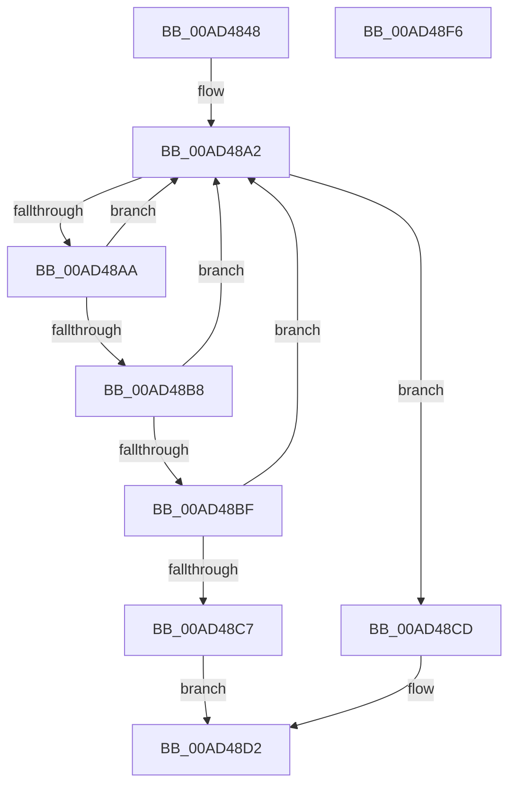

# SepBlockAccessForLogonSession

- RVA: `0x00AD4848`–`0x00AD48F7` (길이 `175` bytes)
- VA: `0x0000000140AD4848`
- 실행 섹션: `PAGE`
- PDB 이름 있음: `예`; PDB Function 태그: `아니요`
- unwind 정보 RVA: `0x0005C954`
- 디코드: `47`개 명령, `175/175` bytes 표시
- 미해석 바이트: `0` (있으면 어셈블리에 `.byte`로 보존)

> 이 문서는 커널 이미지의 기계어와 PDB 기호를 분석해 생성했습니다. 4번과 5번은 함수 원형과 자료형을 바이너리 사용 방식에서 추정한 C 해석이며 원본 소스 복구 결과는 아닙니다.

## 1. Dependencies

- 직접 호출 지점: **4**; 고유 호출 대상: **4**
- 직접 호출자로 확인된 함수: **1**
- RIP 상대 이미지 참조: **2**

### Outgoing calls
- `0x00AD489B` → [ExAcquireResourceExclusiveLite](../../text/21/ExAcquireResourceExclusiveLite_function_00214E20.md) (function, `0x00214E20`)
- `0x00AD48AA` → [PsGetCurrentServerSilo](../../text/22/PsGetCurrentServerSilo_function_00225710.md) (function, `0x00225710`)
- `0x00AD48D5` → [ExReleaseResourceLite](../../text/25/ExReleaseResourceLite_function_0025FA10.md) (function, `0x0025FA10`)
- `0x00AD48DA` → [KeLeaveCriticalRegion](../../text/25/KeLeaveCriticalRegion_function_0025D8B0.md) (function, `0x0025D8B0`)

### Direct callers
- [SepRmInteractiveLogoffLogonSessionCompletedWrkr](../7A/SepRmInteractiveLogoffLogonSessionCompletedWrkr_function_007A1AE0.md) at `0x007A1AF7`

### Static image references
- `0x00AD4865` → RVA `0x00FD9AF0` (`PAGEDATA`; read)
- `0x00AD488D` → RVA `0x00E67F20` (`.data`; read)

## 2. Other-region calls and transfers

- 다른 실행 섹션으로 향하는 call: **4**
  - `0x00AD489B` → [ExAcquireResourceExclusiveLite](../../text/21/ExAcquireResourceExclusiveLite_function_00214E20.md) (`PAGE` → `.text`)
  - `0x00AD48AA` → [PsGetCurrentServerSilo](../../text/22/PsGetCurrentServerSilo_function_00225710.md) (`PAGE` → `.text`)
  - `0x00AD48D5` → [ExReleaseResourceLite](../../text/25/ExReleaseResourceLite_function_0025FA10.md) (`PAGE` → `.text`)
  - `0x00AD48DA` → [KeLeaveCriticalRegion](../../text/25/KeLeaveCriticalRegion_function_0025D8B0.md) (`PAGE` → `.text`)
- 별도 외부 분기/꼬리 이동을 확인하지 못했습니다.

## 3. Assembly (complete function range)

```asm
00AD4848  48 89 5C 24 08                  mov qword ptr [rsp + 8], rbx
00AD484D  48 89 6C 24 10                  mov qword ptr [rsp + 0x10], rbp
00AD4852  48 89 74 24 18                  mov qword ptr [rsp + 0x18], rsi
00AD4857  57                              push rdi
00AD4858  48 83 EC 20                     sub rsp, 0x20
00AD485C  69 11 24 0A 25 5B               imul edx, dword ptr [rcx], 0x5b250a24
00AD4862  48 8B F1                        mov rsi, rcx
00AD4865  48 8B 05 84 52 50 00            mov rax, qword ptr [rip + 0x505284]
00AD486C  48 C1 EA 1C                     shr rdx, 0x1c
00AD4870  48 8D 1C D0                     lea rbx, [rax + rdx*8]
00AD4874  65 48 8B 04 25 88 01 00 00      mov rax, qword ptr gs:[0x188]
00AD487D  83 E2 03                        and edx, 3
00AD4880  48 6B EA 68                     imul rbp, rdx, 0x68
00AD4884  66 FF 88 E4 01 00 00            dec word ptr [rax + 0x1e4]
00AD488B  B2 01                           mov dl, 1
00AD488D  48 8D 05 8C 36 39 00            lea rax, [rip + 0x39368c]
00AD4894  90                              nop
00AD4895  48 03 E8                        add rbp, rax
00AD4898  48 8B CD                        mov rcx, rbp
00AD489B  E8 80 05 74 FF                  call 0x140214e20
00AD48A0  33 FF                           xor edi, edi
00AD48A2  48 8B 1B                        mov rbx, qword ptr [rbx]
00AD48A5  48 85 DB                        test rbx, rbx
00AD48A8  74 23                           je 0x140ad48cd
00AD48AA  E8 61 0E 75 FF                  call 0x140225710
00AD48AF  48 39 83 A8 00 00 00            cmp qword ptr [rbx + 0xa8], rax
00AD48B6  75 EA                           jne 0x140ad48a2
00AD48B8  8B 43 08                        mov eax, dword ptr [rbx + 8]
00AD48BB  39 06                           cmp dword ptr [rsi], eax
00AD48BD  75 E3                           jne 0x140ad48a2
00AD48BF  8B 43 0C                        mov eax, dword ptr [rbx + 0xc]
00AD48C2  39 46 04                        cmp dword ptr [rsi + 4], eax
00AD48C5  75 DB                           jne 0x140ad48a2
00AD48C7  83 4B 28 20                     or dword ptr [rbx + 0x28], 0x20
00AD48CB  EB 05                           jmp 0x140ad48d2
00AD48CD  BF 5F 00 00 C0                  mov edi, 0xc000005f
00AD48D2  48 8B CD                        mov rcx, rbp
00AD48D5  E8 36 B1 78 FF                  call 0x14025fa10
00AD48DA  E8 D1 8F 78 FF                  call 0x14025d8b0
00AD48DF  48 8B 5C 24 30                  mov rbx, qword ptr [rsp + 0x30]
00AD48E4  8B C7                           mov eax, edi
00AD48E6  48 8B 6C 24 38                  mov rbp, qword ptr [rsp + 0x38]
00AD48EB  48 8B 74 24 40                  mov rsi, qword ptr [rsp + 0x40]
00AD48F0  48 83 C4 20                     add rsp, 0x20
00AD48F4  5F                              pop rdi
00AD48F5  C3                              ret
00AD48F6  CC                              int3
```

## 4. C-style interpretation (structured pseudocode)

```c
__int64 __fastcall SepBlockAccessForLogonSession(__int64 a1)
{
    __int64 result;
    __int64 v_rbp;
    __int64 v_rdi;
    __int64 v_rsp;
    unsigned __int64 v_stack_p10;
    unsigned __int64 v_stack_p18;
    unsigned __int64 v_stack_p8;

    v_stack_p8 = v_rbx;
    v_stack_p10 = v_rbp;
    v_stack_p18 = v_rsi;
    v_rsp = (v_rsp) - (32);
    a2 = (unsigned int)((a2) * (*(unsigned int *)(a1)));
    a2 = (a2) >> (28);
    a2 = (unsigned int)((a2) & (3));
    v_rbp = (v_rbp) * (a2);
    v_rbp = (v_rbp) + (v_rip + 3749516);
    result = ExAcquireResourceExclusiveLite(v_rbp, 1, a3, a4);
    v_rdi = 0;
loc_00AD48A2:
    if (*(unsigned __int64 *)(*(unsigned __int64 *)(v_rip + 5264004) + a2 * 8) == 0) goto loc_00AD48CD;
    result = PsGetCurrentServerSilo(v_rbp, 1, a3, a4);
    if ((*(unsigned __int64 *)(*(unsigned __int64 *)(*(unsigned __int64 *)(v_rip + 5264004) + a2 * 8) + 168)) != result) goto loc_00AD48A2;
    if ((*(unsigned int *)(a1)) != ((unsigned int)((unsigned int)(*(unsigned int *)(*(unsigned __int64 *)(*(unsigned __int64 *)(v_rip + 5264004) + a2 * 8) + 8))))) goto loc_00AD48A2;
    if ((*(unsigned int *)(a1 + 4)) != ((unsigned int)((unsigned int)(*(unsigned int *)(*(unsigned __int64 *)(*(unsigned __int64 *)(v_rip + 5264004) + a2 * 8) + 12))))) goto loc_00AD48A2;
    goto loc_00AD48D2;
loc_00AD48CD:
loc_00AD48D2:
    result = ExReleaseResourceLite(v_rbp, 1, a3, a4);
    result = KeLeaveCriticalRegion(v_rbp, 1, a3, a4);
    v_rsp = (v_rsp) + (32);
    return (unsigned int)((unsigned int)((unsigned int)(0xC000005FULL)));
}
```

## 5. (Beta) C Style

```c
int64_t SepBlockAccessForLogonSession(void *Arg1)
{
    uint8_t *arg1 = (uint8_t *)Arg1;

    int64_t result;
    int64_t local_rbp;
    int64_t local_rdi;
    int64_t local_rsp;
    uint64_t v_stack_p10;
    uint64_t v_stack_p18;
    uint64_t v_stack_p8;

    v_stack_p8 = local_rbx;
    v_stack_p10 = local_rbp;
    v_stack_p18 = local_rsi;
    local_rsp = (local_rsp) - (32);
    a2 = (uint32_t)((a2) * (*(uint32_t *)(arg1)));
    a2 = (a2) >> (28);
    a2 = (uint32_t)((a2) & (3));
    local_rbp = (local_rbp) * (a2);
    local_rbp = (local_rbp) + (v_rip + 3749516);
    result = ExAcquireResourceExclusiveLite(local_rbp, 1, a3, a4);
    local_rdi = 0;
loc_00AD48A2:
    if (*(uint64_t *)(*(uint64_t *)(v_rip + 0x505284) + a2 * 8) == 0) goto loc_00AD48CD;
    result = PsGetCurrentServerSilo(local_rbp, 1, a3, a4);
    if ((*(uint64_t *)(*(uint64_t *)(*(uint64_t *)(v_rip + 0x505284) + a2 * 8) + 0xA8)) != result) goto loc_00AD48A2;
    if ((*(uint32_t *)(arg1)) != ((uint32_t)((uint32_t)(*(uint32_t *)(*(uint64_t *)(*(uint64_t *)(v_rip + 0x505284) + a2 * 8) + 0x8))))) goto loc_00AD48A2;
    if ((*(uint32_t *)(arg1 + 0x4)) != ((uint32_t)((uint32_t)(*(uint32_t *)(*(uint64_t *)(*(uint64_t *)(v_rip + 0x505284) + a2 * 8) + 0xC))))) goto loc_00AD48A2;
    goto loc_00AD48D2;
loc_00AD48CD:
loc_00AD48D2:
    result = ExReleaseResourceLite(local_rbp, 1, a3, a4);
    result = KeLeaveCriticalRegion(local_rbp, 1, a3, a4);
    local_rsp = (local_rsp) + (32);
    return (uint32_t)((uint32_t)((uint32_t)(0xC000005FULL)));
}
```

### 관측된 메모리 오프셋

구조체 형식이 확인되지 않은 접근은 인자 기준의 오프셋으로만 기록했습니다.

| 기준 인자 | 오프셋 표현 | 폭 (bit) | 접근 |
|---|---:|---:|---|
| `Arg1` | `+ 0x0` | `32` | `R` |
| `Arg1` | `+ 0x4` | `32` | `R` |

## 6. Execution-region graph

[열기: 2D/3D 그래프와 함수 탐색 컨트롤 패널](../../../control-panel.html?section=page&rva=0x00AD4848&view=graph)

- 2D 그래프는 위에서 아래로 흐르고, 3D 그래프는 빈 공간을 드래그해 회전합니다. Shift+드래그는 이동, 휠은 확대·축소, 함수 노드 선택은 대상 보고서 이동입니다.

### Static fallback


