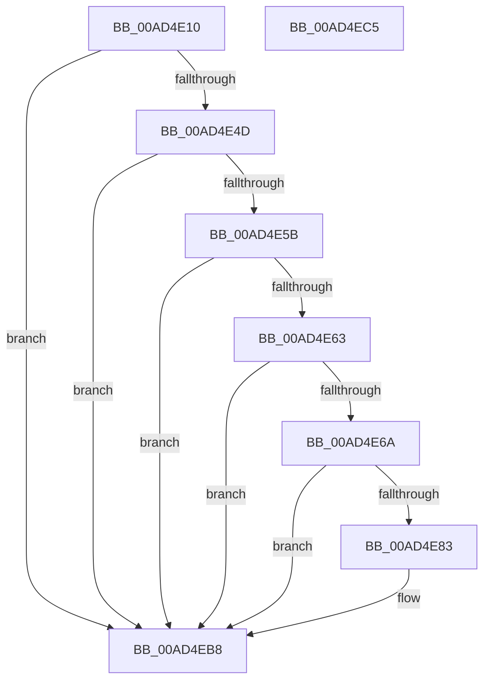

# SepUpdateSiloInClientSecurity

- RVA: `0x00AD4E10`–`0x00AD4EC6` (길이 `182` bytes)
- VA: `0x0000000140AD4E10`
- 실행 섹션: `PAGE`
- PDB 이름 있음: `예`; PDB Function 태그: `아니요`
- unwind 정보 RVA: `0x000BE5C8`
- 디코드: `57`개 명령, `182/182` bytes 표시
- 미해석 바이트: `0` (있으면 어셈블리에 `.byte`로 보존)

> 이 문서는 커널 이미지의 기계어와 PDB 기호를 분석해 생성했습니다. 4번과 5번은 함수 원형과 자료형을 바이너리 사용 방식에서 추정한 C 해석이며 원본 소스 복구 결과는 아닙니다.

## 1. Dependencies

- 직접 호출 지점: **6**; 고유 호출 대상: **6**
- 직접 호출자로 확인된 함수: **3**
- RIP 상대 이미지 참조: **0**

### Outgoing calls
- `0x00AD4E42` → [SeQueryServerSiloToken](../91/SeQueryServerSiloToken_function_00912F30.md) (function, `0x00912F30`)
- `0x00AD4E52` → [PsIsHostSilo](../../text/44/PsIsHostSilo_function_00443B30.md) (function, `0x00443B30`)
- `0x00AD4E78` → [SepCopyClientTokenAndSetSilo](../79/SepCopyClientTokenAndSetSilo_function_0079CE34.md) (function, `0x0079CE34`)
- `0x00AD4E94` → [ObRetagReferences](../9D/ObRetagReferences_function_009DB880.md) (function, `0x009DB880`)
- `0x00AD4EA7` → [ObfDereferenceObjectWithTag](../../text/2F/ObfDereferenceObjectWithTag_function_002F78E0.md) (function, `0x002F78E0`)
- `0x00AD4EB3` → [SeGetTokenControlInformation](../9E/SeGetTokenControlInformation_function_009E47E0.md) (function, `0x009E47E0`)

### Direct callers
- [AlpcpExposeTokenAttribute](../89/AlpcpExposeTokenAttribute_function_00891390.md) at `0x0089172B`
- [sub_00891948](../89/Unknown_function_00891948.md) at `0x00891962`
- [sub_00891C4F](../89/Unknown_function_00891C4F.md) at `0x00891C6D`

### Static image references
- 디코드된 RIP-relative 메모리 참조가 없습니다.

## 2. Other-region calls and transfers

- 다른 실행 섹션으로 향하는 call: **2**
  - `0x00AD4E52` → [PsIsHostSilo](../../text/44/PsIsHostSilo_function_00443B30.md) (`PAGE` → `.text`)
  - `0x00AD4EA7` → [ObfDereferenceObjectWithTag](../../text/2F/ObfDereferenceObjectWithTag_function_002F78E0.md) (`PAGE` → `.text`)
- 별도 외부 분기/꼬리 이동을 확인하지 못했습니다.

## 3. Assembly (complete function range)

```asm
00AD4E10  40 53                           push rbx
00AD4E12  55                              push rbp
00AD4E13  56                              push rsi
00AD4E14  57                              push rdi
00AD4E15  41 56                           push r14
00AD4E17  48 83 EC 20                     sub rsp, 0x20
00AD4E1B  48 8B 69 10                     mov rbp, qword ptr [rcx + 0x10]
00AD4E1F  4C 8B F2                        mov r14, rdx
00AD4E22  48 83 64 24 50 00               and qword ptr [rsp + 0x50], 0
00AD4E28  48 8D 54 24 50                  lea rdx, [rsp + 0x50]
00AD4E2D  48 83 64 24 60 00               and qword ptr [rsp + 0x60], 0
00AD4E33  48 8B F1                        mov rsi, rcx
00AD4E36  48 8B CD                        mov rcx, rbp
00AD4E39  48 8B 5D 18                     mov rbx, qword ptr [rbp + 0x18]
00AD4E3D  48 89 5C 24 68                  mov qword ptr [rsp + 0x68], rbx
00AD4E42  E8 E9 E0 E3 FF                  call 0x140912f30
00AD4E47  8B F8                           mov edi, eax
00AD4E49  85 C0                           test eax, eax
00AD4E4B  78 6B                           js 0x140ad4eb8
00AD4E4D  48 8B 4C 24 50                  mov rcx, qword ptr [rsp + 0x50]
00AD4E52  E8 D9 EC 96 FF                  call 0x140443b30
00AD4E57  84 C0                           test al, al
00AD4E59  74 5D                           je 0x140ad4eb8
00AD4E5B  81 FB E7 03 00 00               cmp ebx, 0x3e7
00AD4E61  75 55                           jne 0x140ad4eb8
00AD4E63  83 7C 24 6C 00                  cmp dword ptr [rsp + 0x6c], 0
00AD4E68  75 4E                           jne 0x140ad4eb8
00AD4E6A  8B 56 04                        mov edx, dword ptr [rsi + 4]
00AD4E6D  4C 8D 4C 24 60                  lea r9, [rsp + 0x60]
00AD4E72  4D 8B C6                        mov r8, r14
00AD4E75  48 8B CD                        mov rcx, rbp
00AD4E78  E8 B7 7F CC FF                  call 0x14079ce34
00AD4E7D  8B F8                           mov edi, eax
00AD4E7F  85 C0                           test eax, eax
00AD4E81  78 35                           js 0x140ad4eb8
00AD4E83  48 8B 5C 24 60                  mov rbx, qword ptr [rsp + 0x60]
00AD4E88  41 BE 53 65 43 63               mov r14d, 0x63436553
00AD4E8E  45 8B C6                        mov r8d, r14d
00AD4E91  48 8B CB                        mov rcx, rbx
00AD4E94  E8 E7 69 F0 FF                  call 0x1409db880
00AD4E99  41 8B D6                        mov edx, r14d
00AD4E9C  48 89 5E 10                     mov qword ptr [rsi + 0x10], rbx
00AD4EA0  48 8B CD                        mov rcx, rbp
00AD4EA3  C6 46 18 00                     mov byte ptr [rsi + 0x18], 0
00AD4EA7  E8 34 2A 82 FF                  call 0x1402f78e0
00AD4EAC  48 8D 56 1C                     lea rdx, [rsi + 0x1c]
00AD4EB0  48 8B CB                        mov rcx, rbx
00AD4EB3  E8 28 F9 F0 FF                  call 0x1409e47e0
00AD4EB8  8B C7                           mov eax, edi
00AD4EBA  48 83 C4 20                     add rsp, 0x20
00AD4EBE  41 5E                           pop r14
00AD4EC0  5F                              pop rdi
00AD4EC1  5E                              pop rsi
00AD4EC2  5D                              pop rbp
00AD4EC3  5B                              pop rbx
00AD4EC4  C3                              ret
00AD4EC5  CC                              int3
```

## 4. C-style interpretation (structured pseudocode)

```c
__int64 __fastcall SepUpdateSiloInClientSecurity(__int64 a1, __int64 a2)
{
    __int64 result;
    __int64 v_r14;
    __int64 v_rbx;
    __int64 v_rsp;
    unsigned __int64 v_stack_p18;
    unsigned __int64 v_stack_p20;
    unsigned int v_stack_p24;
    unsigned __int64 v_stack_p8;

    v_rsp = (v_rsp) - (32);
    v_stack_p20 = *(unsigned __int64 *)(*(unsigned __int64 *)(a1 + 16) + 24);
    result = SeQueryServerSiloToken(*(unsigned __int64 *)(a1 + 16), v_stack_p8, a3, a4);
    if (sign_flag) goto loc_00AD4EB8;
    result = PsIsHostSilo(v_stack_p8, v_stack_p8, a3, a4);
    if ((unsigned __int8)(result) == 0) goto loc_00AD4EB8;
    if (((unsigned int)(*(unsigned __int64 *)(*(unsigned __int64 *)(a1 + 16) + 24))) != 999) goto loc_00AD4EB8;
    if (v_stack_p24 != 0) goto loc_00AD4EB8;
    result = SepCopyClientTokenAndSetSilo(*(unsigned __int64 *)(a1 + 16), (unsigned int)(*(unsigned int *)(a1 + 4)), a2, v_stack_p18);
    v_rbx = *(unsigned __int64 *)(*(unsigned __int64 *)(a1 + 16) + 24);
    v_r14 = a2;
    if (!(sign_flag)) {
        v_rbx = v_stack_p18;
        v_r14 = 0x63436553ULL;
        a3 = (unsigned int)(v_r14);
        a1 = v_rbx;
        result = ObRetagReferences(a1, (unsigned int)(*(unsigned int *)(a1 + 4)), a3, v_stack_p18);
        a2 = (unsigned int)(v_r14);
        *(unsigned __int64 *)(a1 + 16) = v_rbx;
        a1 = *(unsigned __int64 *)(a1 + 16);
        *(unsigned __int8 *)(a1 + 24) = 0;
        result = ObfDereferenceObjectWithTag(a1, a2, a3, v_stack_p18);
        a2 = a1 + 28;
        a1 = v_rbx;
        result = SeGetTokenControlInformation(a1, a2, a3, v_stack_p18);
    }
    v_rsp = (v_rsp) + (32);
    return (unsigned int)((unsigned int)((unsigned int)((unsigned int)(result))));
}
```

## 5. (Beta) C Style

```c
int64_t SepUpdateSiloInClientSecurity(void *Arg1, int64_t Arg2)
{
    uint8_t *arg1 = (uint8_t *)Arg1;

    int64_t result;
    int64_t local_r14;
    int64_t local_rbx;
    int64_t local_rsp;
    uint64_t v_stack_p18;
    uint64_t v_stack_p20;
    uint32_t v_stack_p24;
    uint64_t v_stack_p8;

    local_rsp = (local_rsp) - (32);
    v_stack_p20 = *(uint64_t *)(*(uint64_t *)(arg1 + 0x10) + 0x18);
    result = SeQueryServerSiloToken(*(uint64_t *)(arg1 + 0x10), v_stack_p8, a3, a4);
    if (sign_flag) goto loc_00AD4EB8;
    result = PsIsHostSilo(v_stack_p8, v_stack_p8, a3, a4);
    if ((uint8_t)(result) == 0) goto loc_00AD4EB8;
    if (((uint32_t)(*(uint64_t *)(*(uint64_t *)(arg1 + 0x10) + 0x18))) != 999) goto loc_00AD4EB8;
    if (v_stack_p24 != 0) goto loc_00AD4EB8;
    result = SepCopyClientTokenAndSetSilo(*(uint64_t *)(arg1 + 0x10), (uint32_t)(*(uint32_t *)(arg1 + 0x4)), Arg2, v_stack_p18);
    local_rbx = *(uint64_t *)(*(uint64_t *)(arg1 + 0x10) + 0x18);
    local_r14 = Arg2;
    if (!(sign_flag)) {
        local_rbx = v_stack_p18;
        local_r14 = 0x63436553ULL;
        a3 = (uint32_t)(local_r14);
        Arg1 = local_rbx;
        result = ObRetagReferences(Arg1, (uint32_t)(*(uint32_t *)(arg1 + 0x4)), a3, v_stack_p18);
        Arg2 = (uint32_t)(local_r14);
        *(uint64_t *)(arg1 + 0x10) = local_rbx;
        Arg1 = *(uint64_t *)(arg1 + 0x10);
        *(uint8_t *)(arg1 + 0x18) = 0;
        result = ObfDereferenceObjectWithTag(Arg1, Arg2, a3, v_stack_p18);
        Arg2 = Arg1 + 28;
        Arg1 = local_rbx;
        result = SeGetTokenControlInformation(Arg1, Arg2, a3, v_stack_p18);
    }
    local_rsp = (local_rsp) + (32);
    return (uint32_t)((uint32_t)((uint32_t)((uint32_t)(result))));
}
```

### 관측된 메모리 오프셋

구조체 형식이 확인되지 않은 접근은 인자 기준의 오프셋으로만 기록했습니다.

| 기준 인자 | 오프셋 표현 | 폭 (bit) | 접근 |
|---|---:|---:|---|
| `Arg1` | `+ 0x4` | `32` | `R` |
| `Arg1` | `+ 0x10` | `64` | `R` |
| `Arg1` | `+ 0x10` | `64` | `W` |
| `Arg1` | `+ 0x18` | `8` | `W` |
| `Arg1` | `+ 0x1C` | `64` | `R` |

## 6. Execution-region graph

[열기: 2D/3D 그래프와 함수 탐색 컨트롤 패널](../../../control-panel.html?section=page&rva=0x00AD4E10&view=graph)

- 2D 그래프는 위에서 아래로 흐르고, 3D 그래프는 빈 공간을 드래그해 회전합니다. Shift+드래그는 이동, 휠은 확대·축소, 함수 노드 선택은 대상 보고서 이동입니다.

### Static fallback


