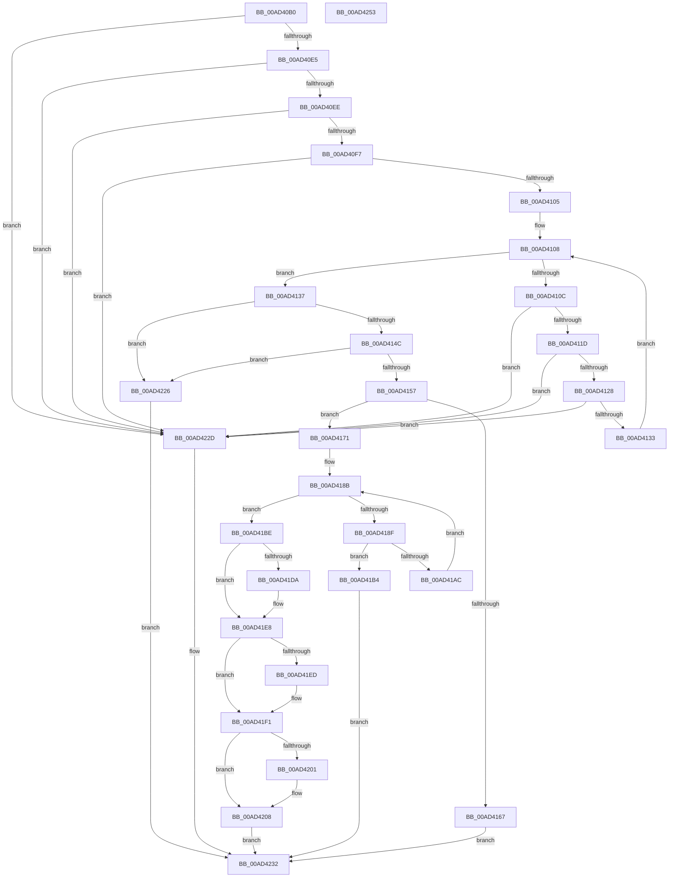

# SleepstudyHelperCreateBlockerData

- RVA: `0x00AD40B0`–`0x00AD4254` (길이 `420` bytes)
- VA: `0x0000000140AD40B0`
- 실행 섹션: `PAGE`
- PDB 이름 있음: `예`; PDB Function 태그: `아니요`
- unwind 정보 RVA: `0x0005FEF8`
- 디코드: `119`개 명령, `420/420` bytes 표시
- 미해석 바이트: `0` (있으면 어셈블리에 `.byte`로 보존)

> 이 문서는 커널 이미지의 기계어와 PDB 기호를 분석해 생성했습니다. 4번과 5번은 함수 원형과 자료형을 바이너리 사용 방식에서 추정한 C 해석이며 원본 소스 복구 결과는 아닙니다.

## 1. Dependencies

- 직접 호출 지점: **6**; 고유 호출 대상: **6**
- 직접 호출자로 확인된 함수: **1**
- RIP 상대 이미지 참조: **0**

### Outgoing calls
- `0x00AD415A` → [SSHSupportAllocateNonPaged](../../text/4A/SSHSupportAllocateNonPaged_function_004A6134.md) (function, `0x004A6134`)
- `0x00AD41A1` → [SshpCopyDataEntry](../../text/5E/SshpCopyDataEntry_function_005E1E10.md) (function, `0x005E1E10`)
- `0x00AD41B7` → [SshpFreeDataEntry](../77/SshpFreeDataEntry_function_00773614.md) (function, `0x00773614`)
- `0x00AD41CA` → [KeAbPreAcquire](../../text/21/KeAbPreAcquire_function_00210230.md) (function, `0x00210230`)
- `0x00AD41E3` → [ExfAcquirePushLockExclusiveEx](../../text/20/ExfAcquirePushLockExclusiveEx_function_0020FC90.md) (function, `0x0020FC90`)
- `0x00AD4219` → [SSHSupportReleasePushLockExclusive](../../text/49/SSHSupportReleasePushLockExclusive_function_004954EC.md) (function, `0x004954EC`)

### Direct callers
- [PopSleepstudyInitialize](../../init/C7/PopSleepstudyInitialize_function_00C76C60.md) at `0x00C76EC6`

### Static image references
- 디코드된 RIP-relative 메모리 참조가 없습니다.

## 2. Other-region calls and transfers

- 다른 실행 섹션으로 향하는 call: **5**
  - `0x00AD415A` → [SSHSupportAllocateNonPaged](../../text/4A/SSHSupportAllocateNonPaged_function_004A6134.md) (`PAGE` → `.text`)
  - `0x00AD41A1` → [SshpCopyDataEntry](../../text/5E/SshpCopyDataEntry_function_005E1E10.md) (`PAGE` → `.text`)
  - `0x00AD41CA` → [KeAbPreAcquire](../../text/21/KeAbPreAcquire_function_00210230.md) (`PAGE` → `.text`)
  - `0x00AD41E3` → [ExfAcquirePushLockExclusiveEx](../../text/20/ExfAcquirePushLockExclusiveEx_function_0020FC90.md) (`PAGE` → `.text`)
  - `0x00AD4219` → [SSHSupportReleasePushLockExclusive](../../text/49/SSHSupportReleasePushLockExclusive_function_004954EC.md) (`PAGE` → `.text`)
- 별도 외부 분기/꼬리 이동을 확인하지 못했습니다.

## 3. Assembly (complete function range)

```asm
00AD40B0  48 8B C4                        mov rax, rsp
00AD40B3  48 89 58 08                     mov qword ptr [rax + 8], rbx
00AD40B7  48 89 68 10                     mov qword ptr [rax + 0x10], rbp
00AD40BB  48 89 70 18                     mov qword ptr [rax + 0x18], rsi
00AD40BF  48 89 78 20                     mov qword ptr [rax + 0x20], rdi
00AD40C3  41 54                           push r12
00AD40C5  41 56                           push r14
00AD40C7  41 57                           push r15
00AD40C9  48 83 EC 20                     sub rsp, 0x20
00AD40CD  45 33 E4                        xor r12d, r12d
00AD40D0  41 8B F0                        mov esi, r8d
00AD40D3  4D 8B F1                        mov r14, r9
00AD40D6  48 8B DA                        mov rbx, rdx
00AD40D9  48 8B E9                        mov rbp, rcx
00AD40DC  48 85 C9                        test rcx, rcx
00AD40DF  0F 84 48 01 00 00               je 0x140ad422d
00AD40E5  45 85 C0                        test r8d, r8d
00AD40E8  0F 84 3F 01 00 00               je 0x140ad422d
00AD40EE  4D 85 C9                        test r9, r9
00AD40F1  0F 84 36 01 00 00               je 0x140ad422d
00AD40F7  4C 8B 7C 24 60                  mov r15, qword ptr [rsp + 0x60]
00AD40FC  4D 85 FF                        test r15, r15
00AD40FF  0F 84 28 01 00 00               je 0x140ad422d
00AD4105  41 8B CC                        mov ecx, r12d
00AD4108  3B CE                           cmp ecx, esi
00AD410A  73 2B                           jae 0x140ad4137
00AD410C  8B C1                           mov eax, ecx
00AD410E  48 C1 E0 05                     shl rax, 5
00AD4112  4E 39 64 08 08                  cmp qword ptr [rax + r9 + 8], r12
00AD4117  0F 84 10 01 00 00               je 0x140ad422d
00AD411D  66 46 39 24 08                  cmp word ptr [rax + r9], r12w
00AD4122  0F 84 05 01 00 00               je 0x140ad422d
00AD4128  4E 39 64 08 18                  cmp qword ptr [rax + r9 + 0x18], r12
00AD412D  0F 84 FA 00 00 00               je 0x140ad422d
00AD4133  FF C1                           inc ecx
00AD4135  EB D1                           jmp 0x140ad4108
00AD4137  48 8B C6                        mov rax, rsi
00AD413A  B9 FF FF FF FF                  mov ecx, 0xffffffff
00AD413F  48 C1 E0 05                     shl rax, 5
00AD4143  48 3B C1                        cmp rax, rcx
00AD4146  0F 87 DA 00 00 00               ja 0x140ad4226
00AD414C  8D 48 30                        lea ecx, [rax + 0x30]
00AD414F  3B C8                           cmp ecx, eax
00AD4151  0F 82 CF 00 00 00               jb 0x140ad4226
00AD4157  8B 55 18                        mov edx, dword ptr [rbp + 0x18]
00AD415A  E8 D5 1F 9D FF                  call 0x1404a6134
00AD415F  48 8B F8                        mov rdi, rax
00AD4162  48 85 C0                        test rax, rax
00AD4165  75 0A                           jne 0x140ad4171
00AD4167  BB 9A 00 00 C0                  mov ebx, 0xc000009a
00AD416C  E9 C1 00 00 00                  jmp 0x140ad4232
00AD4171  0F 10 03                        movups xmm0, xmmword ptr [rbx]
00AD4174  48 89 68 10                     mov qword ptr [rax + 0x10], rbp
00AD4178  F3 0F 7F 40 18                  movdqu xmmword ptr [rax + 0x18], xmm0
00AD417D  48 89 78 08                     mov qword ptr [rax + 8], rdi
00AD4181  48 89 38                        mov qword ptr [rax], rdi
00AD4184  44 89 60 28                     mov dword ptr [rax + 0x28], r12d
00AD4188  41 8B C4                        mov eax, r12d
00AD418B  3B C6                           cmp eax, esi
00AD418D  73 2F                           jae 0x140ad41be
00AD418F  8B 4D 18                        mov ecx, dword ptr [rbp + 0x18]
00AD4192  4C 8D 47 30                     lea r8, [rdi + 0x30]
00AD4196  48 C1 E0 05                     shl rax, 5
00AD419A  4C 03 C0                        add r8, rax
00AD419D  4A 8D 14 30                     lea rdx, [rax + r14]
00AD41A1  E8 6A DC B0 FF                  call 0x1405e1e10
00AD41A6  8B D8                           mov ebx, eax
00AD41A8  85 C0                           test eax, eax
00AD41AA  78 08                           js 0x140ad41b4
00AD41AC  FF 47 28                        inc dword ptr [rdi + 0x28]
00AD41AF  8B 47 28                        mov eax, dword ptr [rdi + 0x28]
00AD41B2  EB D7                           jmp 0x140ad418b
00AD41B4  48 8B CF                        mov rcx, rdi
00AD41B7  E8 58 F4 C9 FF                  call 0x140773614
00AD41BC  EB 74                           jmp 0x140ad4232
00AD41BE  48 8D 5D 10                     lea rbx, [rbp + 0x10]
00AD41C2  45 33 C0                        xor r8d, r8d
00AD41C5  48 8B CB                        mov rcx, rbx
00AD41C8  33 D2                           xor edx, edx
00AD41CA  E8 61 C0 73 FF                  call 0x140210230
00AD41CF  F0 48 0F BA 2B 00               lock bts qword ptr [rbx], 0
00AD41D5  48 8B F0                        mov rsi, rax
00AD41D8  73 0E                           jae 0x140ad41e8
00AD41DA  4C 8B C3                        mov r8, rbx
00AD41DD  48 8B D0                        mov rdx, rax
00AD41E0  48 8B CB                        mov rcx, rbx
00AD41E3  E8 A8 BA 73 FF                  call 0x14020fc90
00AD41E8  48 85 F6                        test rsi, rsi
00AD41EB  74 04                           je 0x140ad41f1
00AD41ED  C6 46 0A 01                     mov byte ptr [rsi + 0xa], 1
00AD41F1  48 8D 85 A8 00 00 00            lea rax, [rbp + 0xa8]
00AD41F8  48 8B 48 08                     mov rcx, qword ptr [rax + 8]
00AD41FC  48 39 01                        cmp qword ptr [rcx], rax
00AD41FF  74 07                           je 0x140ad4208
00AD4201  B9 03 00 00 00                  mov ecx, 3
00AD4206  CD 29                           int 0x29
00AD4208  48 89 4F 08                     mov qword ptr [rdi + 8], rcx
00AD420C  48 89 07                        mov qword ptr [rdi], rax
00AD420F  48 89 39                        mov qword ptr [rcx], rdi
00AD4212  48 8B CB                        mov rcx, rbx
00AD4215  48 89 78 08                     mov qword ptr [rax + 8], rdi
00AD4219  E8 CE 12 9C FF                  call 0x1404954ec
00AD421E  49 89 3F                        mov qword ptr [r15], rdi
00AD4221  41 8B DC                        mov ebx, r12d
00AD4224  EB 0C                           jmp 0x140ad4232
00AD4226  BB 95 00 00 C0                  mov ebx, 0xc0000095
00AD422B  EB 05                           jmp 0x140ad4232
00AD422D  BB 0D 00 00 C0                  mov ebx, 0xc000000d
00AD4232  48 8B 6C 24 48                  mov rbp, qword ptr [rsp + 0x48]
00AD4237  8B C3                           mov eax, ebx
00AD4239  48 8B 5C 24 40                  mov rbx, qword ptr [rsp + 0x40]
00AD423E  48 8B 74 24 50                  mov rsi, qword ptr [rsp + 0x50]
00AD4243  48 8B 7C 24 58                  mov rdi, qword ptr [rsp + 0x58]
00AD4248  48 83 C4 20                     add rsp, 0x20
00AD424C  41 5F                           pop r15
00AD424E  41 5E                           pop r14
00AD4250  41 5C                           pop r12
00AD4252  C3                              ret
00AD4253  CC                              int3
```

## 4. C-style interpretation (structured pseudocode)

```c
__int64 __fastcall SleepstudyHelperCreateBlockerData(__int64 a1, __int64 a2, int a3, __int64 a4, __int64 a5)
{
    __int64 result;
    __int64 v_r12;
    __int64 v_rsp;
    unsigned __int64 v_stack_p10;
    unsigned __int64 v_stack_p18;
    unsigned __int64 v_stack_p20;
    unsigned __int64 v_stack_p8;

    *(unsigned __int64 *)(v_rsp + 8) = v_rbx;
    *(unsigned __int64 *)(v_rsp + 16) = v_rbp;
    *(unsigned __int64 *)(v_rsp + 24) = v_rsi;
    *(unsigned __int64 *)(v_rsp + 32) = v_rdi;
    v_rsp = (v_rsp) - (32);
    v_r12 = 0;
    if (a1 == 0) goto loc_00AD422D;
    if (a3 == 0) goto loc_00AD422D;
    if (a4 == 0) goto loc_00AD422D;
    if (a5 == 0) goto loc_00AD422D;
loc_00AD4108:
    if (0 >= ((unsigned int)((unsigned int)(a3)))) goto loc_00AD4137;
    result = (0) << (5);
    if ((*(unsigned __int64 *)(result + a4 * 1 + 8)) == 0) goto loc_00AD422D;
    if ((*(unsigned __int16 *)(result + a4 * 1)) == 0) goto loc_00AD422D;
    if ((*(unsigned __int64 *)(result + a4 * 1 + 24)) == 0) goto loc_00AD422D;
    a1 = (unsigned int)((0) + 1);
    goto loc_00AD4108;
loc_00AD4137:
    result = ((unsigned int)(a3)) << (5);
    if (result > ((unsigned int)(0xFFFFFFFFULL))) goto loc_00AD4226;
    if (((unsigned int)(result + 48)) < ((unsigned int)(result))) goto loc_00AD4226;
    result = SSHSupportAllocateNonPaged(result + 48, (unsigned int)(*(unsigned int *)(a1 + 24)), a3, a4);
    if (result != 0) goto loc_00AD4171;
    goto loc_00AD4232;
loc_00AD4171:
    *(unsigned __int64 *)(result + 16) = a1;
    *(unsigned __int64 *)(result + 24) = v_xmm0;
    *(unsigned __int64 *)(result + 8) = result;
    *(unsigned __int64 *)(result) = result;
    *(unsigned int *)(result + 40) = 0;
loc_00AD418B:
    if (0 >= ((unsigned int)((unsigned int)(a3)))) goto loc_00AD41BE;
    result = (0) << (5);
    a3 = (result + 48) + (result);
    result = SshpCopyDataEntry((unsigned int)(*(unsigned int *)(a1 + 24)), result + a4 * 1, a3, a4);
    if (sign_flag) goto loc_00AD41B4;
    goto loc_00AD418B;
loc_00AD41B4:
    result = SshpFreeDataEntry(result, result + a4 * 1, a3, a4);
    goto loc_00AD4232;
loc_00AD41BE:
    a3 = 0;
    a2 = 0;
    result = KeAbPreAcquire(a1 + 16, a2, a3, a4);
    if (!(condition_is_above_or_equal)) {
        a3 = a1 + 16;
        a2 = result;
        a1 = a1 + 16;
        result = ExfAcquirePushLockExclusiveEx(a1, a2, a3, a4);
    }
    if (result != 0) {
        *(unsigned __int8 *)(result + 10) = 1;
    }
    if ((*(unsigned __int64 *)(*(unsigned __int64 *)(a1 + 168 + 8))) != (a1 + 168)) {
        a1 = 3;
    }
    *(unsigned __int64 *)(result + 8) = a1;
    *(unsigned __int64 *)(result) = a1 + 168;
    *(unsigned __int64 *)(a1) = result;
    *(unsigned __int64 *)(a1 + 168 + 8) = result;
    result = SSHSupportReleasePushLockExclusive(a1 + 16, a2, a3, a4);
    *(unsigned __int64 *)(a5) = result;
    goto loc_00AD4232;
loc_00AD4226:
    goto loc_00AD4232;
loc_00AD422D:
loc_00AD4232:
    v_rsp = (v_rsp) + (32);
    return (unsigned int)((unsigned int)((unsigned int)(0xC000000DULL)));
}
```

## 5. (Beta) C Style

```c
int64_t SleepstudyHelperCreateBlockerData(void *Arg1, void *Arg2, int32_t Arg3, int64_t Arg4, int64_t Arg5)
{
    uint8_t *arg1 = (uint8_t *)Arg1;
    uint8_t *arg2 = (uint8_t *)Arg2;

    int64_t result;
    int64_t local_r12;
    int64_t local_rsp;
    uint64_t v_stack_p10;
    uint64_t v_stack_p18;
    uint64_t v_stack_p20;
    uint64_t v_stack_p8;

    *(uint64_t *)(local_rsp + 0x8) = local_rbx;
    *(uint64_t *)(local_rsp + 0x10) = local_rbp;
    *(uint64_t *)(local_rsp + 0x18) = local_rsi;
    *(uint64_t *)(local_rsp + 0x20) = local_rdi;
    local_rsp = (local_rsp) - (32);
    local_r12 = 0;
    if (Arg1 == NULL) goto loc_00AD422D;
    if (Arg3 == 0) goto loc_00AD422D;
    if (Arg4 == 0) goto loc_00AD422D;
    if (Arg5 == 0) goto loc_00AD422D;
loc_00AD4108:
    if (0 >= ((uint32_t)((uint32_t)(Arg3)))) goto loc_00AD4137;
    result = (0) << (5);
    if ((*(uint64_t *)(result + Arg4 * 1 + 0x8)) == 0) goto loc_00AD422D;
    if ((*(uint16_t *)(result + Arg4 * 1)) == 0) goto loc_00AD422D;
    if ((*(uint64_t *)(result + Arg4 * 1 + 0x18)) == 0) goto loc_00AD422D;
    Arg1 = (uint32_t)((0) + 1);
    goto loc_00AD4108;
loc_00AD4137:
    result = ((uint32_t)(Arg3)) << (5);
    if (result > ((uint32_t)(0xFFFFFFFFULL))) goto loc_00AD4226;
    if (((uint32_t)(result + 48)) < ((uint32_t)(result))) goto loc_00AD4226;
    result = SSHSupportAllocateNonPaged(result + 48, (uint32_t)(*(uint32_t *)(arg1 + 0x18)), Arg3, Arg4);
    if (result != 0) goto loc_00AD4171;
    goto loc_00AD4232;
loc_00AD4171:
    *(void **)(result + 0x10) = Arg1;
    *(uint64_t *)(result + 0x18) = v_xmm0;
    *(uint64_t *)(result + 0x8) = result;
    *(uint64_t *)(result) = result;
    *(uint32_t *)(result + 0x28) = 0;
loc_00AD418B:
    if (0 >= ((uint32_t)((uint32_t)(Arg3)))) goto loc_00AD41BE;
    result = (0) << (5);
    Arg3 = (result + 48) + (result);
    result = SshpCopyDataEntry((uint32_t)(*(uint32_t *)(arg1 + 0x18)), result + Arg4 * 1, Arg3, Arg4);
    if (sign_flag) goto loc_00AD41B4;
    goto loc_00AD418B;
loc_00AD41B4:
    result = SshpFreeDataEntry(result, result + Arg4 * 1, Arg3, Arg4);
    goto loc_00AD4232;
loc_00AD41BE:
    Arg3 = 0;
    Arg2 = 0;
    result = KeAbPreAcquire(Arg1 + 16, Arg2, Arg3, Arg4);
    if (!(condition_is_above_or_equal)) {
        Arg3 = Arg1 + 16;
        Arg2 = result;
        Arg1 = Arg1 + 16;
        result = ExfAcquirePushLockExclusiveEx(Arg1, Arg2, Arg3, Arg4);
    }
    if (result != 0) {
        *(uint8_t *)(result + 0xA) = 1;
    }
    if ((*(uint64_t *)(*(uint64_t *)(arg1 + 0xA8 + 0x8))) != (Arg1 + 168)) {
        Arg1 = 3;
    }
    *(void **)(result + 0x8) = Arg1;
    *(void **)(result) = Arg1 + 168;
    *(uint64_t *)(arg1) = result;
    *(uint64_t *)(arg1 + 0xA8 + 0x8) = result;
    result = SSHSupportReleasePushLockExclusive(Arg1 + 16, Arg2, Arg3, Arg4);
    *(uint64_t *)(Arg5) = result;
    goto loc_00AD4232;
loc_00AD4226:
    goto loc_00AD4232;
loc_00AD422D:
loc_00AD4232:
    local_rsp = (local_rsp) + (32);
    return (uint32_t)((uint32_t)((uint32_t)(0xC000000DULL)));
}
```

### 관측된 메모리 오프셋

구조체 형식이 확인되지 않은 접근은 인자 기준의 오프셋으로만 기록했습니다.

| 기준 인자 | 오프셋 표현 | 폭 (bit) | 접근 |
|---|---:|---:|---|
| `Arg1` | `+ 0x0` | `64` | `R/W` |
| `Arg1` | `+ 0x8` | `64` | `R` |
| `Arg1` | `+ 0x8` | `64` | `W` |
| `Arg1` | `+ 0x10` | `64` | `R` |
| `Arg1` | `+ 0x18` | `32` | `R` |
| `Arg1` | `+ 0xA8` | `64` | `R` |
| `Arg2` | `+ 0x0` | `128` | `R` |

## 6. Execution-region graph

[열기: 2D/3D 그래프와 함수 탐색 컨트롤 패널](../../../control-panel.html?section=page&rva=0x00AD40B0&view=graph)

- 2D 그래프는 위에서 아래로 흐르고, 3D 그래프는 빈 공간을 드래그해 회전합니다. Shift+드래그는 이동, 휠은 확대·축소, 함수 노드 선택은 대상 보고서 이동입니다.

### Static fallback


