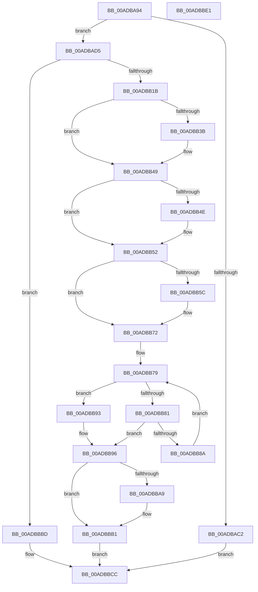

# TlgRegisterAggregateProviderEx

- RVA: `0x00ADBA94`–`0x00ADBBE2` (길이 `334` bytes)
- VA: `0x0000000140ADBA94`
- 실행 섹션: `PAGE`
- PDB 이름 있음: `예`; PDB Function 태그: `아니요`
- unwind 정보 RVA: `0x0005C954`
- 디코드: `85`개 명령, `334/334` bytes 표시
- 미해석 바이트: `0` (있으면 어셈블리에 `.byte`로 보존)

> 이 문서는 커널 이미지의 기계어와 PDB 기호를 분석해 생성했습니다. 4번과 5번은 함수 원형과 자료형을 바이너리 사용 방식에서 추정한 C 해석이며 원본 소스 복구 결과는 아닙니다.

## 1. Dependencies

- 직접 호출 지점: **10**; 고유 호출 대상: **8**
- 직접 호출자로 확인된 함수: **4**
- RIP 상대 이미지 참조: **6**

### Outgoing calls
- `0x00ADBAB5` → [CreateTlgAggregateSession](../83/CreateTlgAggregateSession_function_00835FFC.md) (function, `0x00835FFC`)
- `0x00ADBACB` → [TraceLoggingRegisterEx_EtwRegister_EtwSetInformation](../92/TraceLoggingRegisterEx_EtwRegister_EtwSetInformation_function_009208A0.md) (function, `0x009208A0`)
- `0x00ADBAF4` → [ComputeFlushPeriod](../83/ComputeFlushPeriod_function_00835F58.md) (function, `0x00835F58`)
- `0x00ADBB0C` → [TraceLoggingRegisterEx_EtwRegister_EtwSetInformation](../92/TraceLoggingRegisterEx_EtwRegister_EtwSetInformation_function_009208A0.md) (function, `0x009208A0`)
- `0x00ADBB2A` → [KeAbPreAcquire](../../text/21/KeAbPreAcquire_function_00210230.md) (function, `0x00210230`)
- `0x00ADBB44` → [ExfAcquirePushLockExclusiveEx](../../text/20/ExfAcquirePushLockExclusiveEx_function_0020FC90.md) (function, `0x0020FC90`)
- `0x00ADBB6D` → [TraceLoggingRegisterEx_EtwRegister_EtwSetInformation](../92/TraceLoggingRegisterEx_EtwRegister_EtwSetInformation_function_009208A0.md) (function, `0x009208A0`)
- `0x00ADBBAC` → [ExfTryToWakePushLock](../../text/26/ExfTryToWakePushLock_function_00265DD0.md) (function, `0x00265DD0`)
- `0x00ADBBB4` → [KeAbPostRelease](../../text/2E/KeAbPostRelease_function_002E1600.md) (function, `0x002E1600`)
- `0x00ADBBC5` → [DestroyAggregateSession](../83/DestroyAggregateSession_function_00836138.md) (function, `0x00836138`)

### Direct callers
- [CmpRegisterTraceLoggingProvider](../70/CmpRegisterTraceLoggingProvider_function_00704D24.md) at `0x00704D34`
- [TlgRegisterAggregateProvider](../70/TlgRegisterAggregateProvider_function_0070526C.md) at `0x00705275`
- [IoInitSystemPreDrivers](../../init/C2/IoInitSystemPreDrivers_function_00C2AC3C.md) at `0x00C2B669`
- [EtwpInitialize](../../init/C4/EtwpInitialize_function_00C4DBCC.md) at `0x00C4DF76`

### Static image references
- `0x00ADBB02` → RVA `0x00A69500` (`TlgAggregateInternalRegisteredProviderEtwCallback`; read)
- `0x00ADBB1B` → RVA `0x00EEFFF0` (`.data`; read)
- `0x00ADBB52` → RVA `0x00EEFFF8` (`.data`; read)
- `0x00ADBB5F` → RVA `0x00AC1A80` (`TlgAggregateInternalProviderCallback`; read)
- `0x00ADBB66` → RVA `0x00E0A580` (`.data`; read)
- `0x00ADBB9A` → RVA `0x00EEFFF0` (`.data`; read/write)

## 2. Other-region calls and transfers

- 다른 실행 섹션으로 향하는 call: **4**
  - `0x00ADBB2A` → [KeAbPreAcquire](../../text/21/KeAbPreAcquire_function_00210230.md) (`PAGE` → `.text`)
  - `0x00ADBB44` → [ExfAcquirePushLockExclusiveEx](../../text/20/ExfAcquirePushLockExclusiveEx_function_0020FC90.md) (`PAGE` → `.text`)
  - `0x00ADBBAC` → [ExfTryToWakePushLock](../../text/26/ExfTryToWakePushLock_function_00265DD0.md) (`PAGE` → `.text`)
  - `0x00ADBBB4` → [KeAbPostRelease](../../text/2E/KeAbPostRelease_function_002E1600.md) (`PAGE` → `.text`)
- 별도 외부 분기/꼬리 이동을 확인하지 못했습니다.

## 3. Assembly (complete function range)

```asm
00ADBA94  48 89 5C 24 08                  mov qword ptr [rsp + 8], rbx
00ADBA99  48 89 6C 24 10                  mov qword ptr [rsp + 0x10], rbp
00ADBA9E  48 89 74 24 18                  mov qword ptr [rsp + 0x18], rsi
00ADBAA3  57                              push rdi
00ADBAA4  48 83 EC 20                     sub rsp, 0x20
00ADBAA8  48 8B EA                        mov rbp, rdx
00ADBAAB  48 8B F9                        mov rdi, rcx
00ADBAAE  B2 01                           mov dl, 1
00ADBAB0  33 C9                           xor ecx, ecx
00ADBAB2  49 8B F0                        mov rsi, r8
00ADBAB5  E8 42 A5 D5 FF                  call 0x140835ffc
00ADBABA  48 8B D8                        mov rbx, rax
00ADBABD  48 85 C0                        test rax, rax
00ADBAC0  75 13                           jne 0x140adbad5
00ADBAC2  4C 8B C6                        mov r8, rsi
00ADBAC5  48 8B D5                        mov rdx, rbp
00ADBAC8  48 8B CF                        mov rcx, rdi
00ADBACB  E8 D0 4D E4 FF                  call 0x1409208a0
00ADBAD0  E9 F7 00 00 00                  jmp 0x140adbbcc
00ADBAD5  48 8B CB                        mov rcx, rbx
00ADBAD8  48 89 A8 48 01 00 00            mov qword ptr [rax + 0x148], rbp
00ADBADF  48 89 B0 50 01 00 00            mov qword ptr [rax + 0x150], rsi
00ADBAE6  48 89 B8 58 01 00 00            mov qword ptr [rax + 0x158], rdi
00ADBAED  C6 80 75 01 00 00 00            mov byte ptr [rax + 0x175], 0
00ADBAF4  E8 5F A4 D5 FF                  call 0x140835f58
00ADBAF9  4C 8B C3                        mov r8, rbx
00ADBAFC  89 83 70 01 00 00               mov dword ptr [rbx + 0x170], eax
00ADBB02  48 8D 15 F7 D9 F8 FF            lea rdx, [rip - 0x72609]
00ADBB09  48 8B CF                        mov rcx, rdi
00ADBB0C  E8 8F 4D E4 FF                  call 0x1409208a0
00ADBB11  8B F0                           mov esi, eax
00ADBB13  85 C0                           test eax, eax
00ADBB15  0F 88 A2 00 00 00               js 0x140adbbbd
00ADBB1B  48 8D 2D CE 44 41 00            lea rbp, [rip + 0x4144ce]
00ADBB22  45 33 C0                        xor r8d, r8d
00ADBB25  48 8B CD                        mov rcx, rbp
00ADBB28  33 D2                           xor edx, edx
00ADBB2A  E8 01 47 73 FF                  call 0x140210230
00ADBB2F  F0 48 0F BA 6D 00 00            lock bts qword ptr [rbp], 0
00ADBB36  48 8B F0                        mov rsi, rax
00ADBB39  73 0E                           jae 0x140adbb49
00ADBB3B  4C 8B C5                        mov r8, rbp
00ADBB3E  48 8B D0                        mov rdx, rax
00ADBB41  48 8B CD                        mov rcx, rbp
00ADBB44  E8 47 41 73 FF                  call 0x14020fc90
00ADBB49  48 85 F6                        test rsi, rsi
00ADBB4C  74 04                           je 0x140adbb52
00ADBB4E  C6 46 0A 01                     mov byte ptr [rsi + 0xa], 1
00ADBB52  48 83 3D 9E 44 41 00 00         cmp qword ptr [rip + 0x41449e], 0
00ADBB5A  75 16                           jne 0x140adbb72
00ADBB5C  45 33 C0                        xor r8d, r8d
00ADBB5F  48 8D 15 1A 5F FE FF            lea rdx, [rip - 0x1a0e6]
00ADBB66  48 8D 0D 13 EA 32 00            lea rcx, [rip + 0x32ea13]
00ADBB6D  E8 2E 4D E4 FF                  call 0x1409208a0
00ADBB72  48 8D 05 7F 44 41 00            lea rax, [rip + 0x41447f]
00ADBB79  48 8B 08                        mov rcx, qword ptr [rax]
00ADBB7C  48 85 C9                        test rcx, rcx
00ADBB7F  74 12                           je 0x140adbb93
00ADBB81  48 39 B9 58 01 00 00            cmp qword ptr [rcx + 0x158], rdi
00ADBB88  74 0C                           je 0x140adbb96
00ADBB8A  48 8D 81 60 01 00 00            lea rax, [rcx + 0x160]
00ADBB91  EB E6                           jmp 0x140adbb79
00ADBB93  48 89 18                        mov qword ptr [rax], rbx
00ADBB96  48 83 C8 FF                     or rax, 0xffffffffffffffff
00ADBB9A  F0 48 0F C1 05 4D 44 41 00      lock xadd qword ptr [rip + 0x41444d], rax
00ADBBA3  24 06                           and al, 6
00ADBBA5  3C 02                           cmp al, 2
00ADBBA7  75 08                           jne 0x140adbbb1
00ADBBA9  48 8B CD                        mov rcx, rbp
00ADBBAC  E8 1F A2 78 FF                  call 0x140265dd0
00ADBBB1  48 8B CD                        mov rcx, rbp
00ADBBB4  E8 47 5A 80 FF                  call 0x1402e1600
00ADBBB9  33 C0                           xor eax, eax
00ADBBBB  EB 0F                           jmp 0x140adbbcc
00ADBBBD  48 83 67 28 00                  and qword ptr [rdi + 0x28], 0
00ADBBC2  48 8B CB                        mov rcx, rbx
00ADBBC5  E8 6E A5 D5 FF                  call 0x140836138
00ADBBCA  8B C6                           mov eax, esi
00ADBBCC  48 8B 5C 24 30                  mov rbx, qword ptr [rsp + 0x30]
00ADBBD1  48 8B 6C 24 38                  mov rbp, qword ptr [rsp + 0x38]
00ADBBD6  48 8B 74 24 40                  mov rsi, qword ptr [rsp + 0x40]
00ADBBDB  48 83 C4 20                     add rsp, 0x20
00ADBBDF  5F                              pop rdi
00ADBBE0  C3                              ret
00ADBBE1  CC                              int3
```

## 4. C-style interpretation (structured pseudocode)

```c
__int64 __fastcall TlgRegisterAggregateProviderEx(__int64 a1, __int64 a2, __int64 a3)
{
    __int64 result;
    __int64 v_rsp;
    unsigned __int64 v_stack_p10;
    unsigned __int64 v_stack_p18;
    unsigned __int64 v_stack_p8;

    v_stack_p8 = v_rbx;
    v_stack_p10 = v_rbp;
    v_stack_p18 = v_rsi;
    v_rsp = (v_rsp) - (32);
    a1 = 0;
    result = CreateTlgAggregateSession(a1, 1, a3, a4);
    if (result != 0) goto loc_00ADBAD5;
    result = TraceLoggingRegisterEx_EtwRegister_EtwSetInformation(0, a2, a3, a4);
    goto loc_00ADBBCC;
loc_00ADBAD5:
    *(unsigned __int64 *)(result + 328) = a2;
    *(unsigned __int64 *)(result + 336) = a3;
    *(unsigned __int64 *)(result + 344) = 0;
    *(unsigned __int8 *)(result + 373) = 0;
    result = ComputeFlushPeriod(result, a2, a3, a4);
    *(unsigned int *)(result + 368) = (unsigned int)(result);
    result = TraceLoggingRegisterEx_EtwRegister_EtwSetInformation(0, v_rip - 468489, result, a4);
    if (sign_flag) goto loc_00ADBBBD;
    a3 = 0;
    a2 = 0;
    result = KeAbPreAcquire(v_rip + 4277454, a2, a3, a4);
    if (!(condition_is_above_or_equal)) {
        a3 = v_rip + 4277454;
        a2 = result;
        a1 = v_rip + 4277454;
        result = ExfAcquirePushLockExclusiveEx(a1, a2, a3, a4);
    }
    if (result != 0) {
        *(unsigned __int8 *)(result + 10) = 1;
    }
    if ((*(unsigned __int64 *)(v_rip + 4277406)) == 0) {
        a3 = 0;
        a2 = v_rip - 106726;
        a1 = v_rip + 3336723;
        result = TraceLoggingRegisterEx_EtwRegister_EtwSetInformation(a1, a2, a3, a4);
    }
loc_00ADBB79:
    if (*(unsigned __int64 *)(v_rip + 4277375) == 0) goto loc_00ADBB93;
    if ((*(unsigned __int64 *)(*(unsigned __int64 *)(v_rip + 4277375) + 344)) == a1) goto loc_00ADBB96;
    goto loc_00ADBB79;
loc_00ADBB93:
    *(unsigned __int64 *)(*(unsigned __int64 *)(v_rip + 4277375) + 352) = result;
loc_00ADBB96:
    result = (*(unsigned __int64 *)(v_rip + 4277375) + 352) | (-1);
    result = (unsigned __int8)((result) & (6));
    if (((unsigned __int8)(result)) == 2) {
        a1 = v_rip + 4277454;
        result = ExfTryToWakePushLock(a1, a2, a3, a4);
    }
    result = KeAbPostRelease(v_rip + 4277454, a2, a3, a4);
    result = 0;
    goto loc_00ADBBCC;
loc_00ADBBBD:
    result = DestroyAggregateSession(0, a2, a3, a4);
loc_00ADBBCC:
    v_rsp = (v_rsp) + (32);
    return (unsigned int)((unsigned int)(result));
}
```

## 5. (Beta) C Style

```c
int64_t TlgRegisterAggregateProviderEx(void *Arg1, int64_t Arg2, int64_t Arg3)
{
    uint8_t *arg1 = (uint8_t *)Arg1;

    int64_t result;
    int64_t local_rsp;
    uint64_t v_stack_p10;
    uint64_t v_stack_p18;
    uint64_t v_stack_p8;

    v_stack_p8 = local_rbx;
    v_stack_p10 = local_rbp;
    v_stack_p18 = local_rsi;
    local_rsp = (local_rsp) - (32);
    Arg1 = 0;
    result = CreateTlgAggregateSession(Arg1, 1, Arg3, a4);
    if (result != 0) goto loc_00ADBAD5;
    result = TraceLoggingRegisterEx_EtwRegister_EtwSetInformation(0, Arg2, Arg3, a4);
    goto loc_00ADBBCC;
loc_00ADBAD5:
    *(uint64_t *)(result + 0x148) = Arg2;
    *(uint64_t *)(result + 0x150) = Arg3;
    *(uint64_t *)(result + 0x158) = 0;
    *(uint8_t *)(result + 0x175) = 0;
    result = ComputeFlushPeriod(result, Arg2, Arg3, a4);
    *(uint32_t *)(result + 0x170) = (uint32_t)(result);
    result = TraceLoggingRegisterEx_EtwRegister_EtwSetInformation(0, v_rip - 468489, result, a4);
    if (sign_flag) goto loc_00ADBBBD;
    Arg3 = 0;
    Arg2 = 0;
    result = KeAbPreAcquire(v_rip + 4277454, Arg2, Arg3, a4);
    if (!(condition_is_above_or_equal)) {
        Arg3 = v_rip + 4277454;
        Arg2 = result;
        Arg1 = v_rip + 4277454;
        result = ExfAcquirePushLockExclusiveEx(Arg1, Arg2, Arg3, a4);
    }
    if (result != 0) {
        *(uint8_t *)(result + 0xA) = 1;
    }
    if ((*(uint64_t *)(v_rip + 0x41449E)) == 0) {
        Arg3 = 0;
        Arg2 = v_rip - 106726;
        Arg1 = v_rip + 3336723;
        result = TraceLoggingRegisterEx_EtwRegister_EtwSetInformation(Arg1, Arg2, Arg3, a4);
    }
loc_00ADBB79:
    if (*(uint64_t *)(v_rip + 0x41447F) == 0) goto loc_00ADBB93;
    if ((*(uint64_t *)(*(uint64_t *)(v_rip + 0x41447F) + 0x158)) == Arg1) goto loc_00ADBB96;
    goto loc_00ADBB79;
loc_00ADBB93:
    *(uint64_t *)(*(uint64_t *)(v_rip + 0x41447F) + 0x160) = result;
loc_00ADBB96:
    result = (*(uint64_t *)(v_rip + 0x41447F) + 352) | (-1);
    result = (uint8_t)((result) & (6));
    if (((uint8_t)(result)) == 2) {
        Arg1 = v_rip + 4277454;
        result = ExfTryToWakePushLock(Arg1, Arg2, Arg3, a4);
    }
    result = KeAbPostRelease(v_rip + 4277454, Arg2, Arg3, a4);
    result = 0;
    goto loc_00ADBBCC;
loc_00ADBBBD:
    result = DestroyAggregateSession(0, Arg2, Arg3, a4);
loc_00ADBBCC:
    local_rsp = (local_rsp) + (32);
    return (uint32_t)((uint32_t)(result));
}
```

### 관측된 메모리 오프셋

구조체 형식이 확인되지 않은 접근은 인자 기준의 오프셋으로만 기록했습니다.

| 기준 인자 | 오프셋 표현 | 폭 (bit) | 접근 |
|---|---:|---:|---|
| `Arg1` | `+ 0x28` | `64` | `R/W` |

## 6. Execution-region graph

[열기: 2D/3D 그래프와 함수 탐색 컨트롤 패널](../../../control-panel.html?section=page&rva=0x00ADBA94&view=graph)

- 2D 그래프는 위에서 아래로 흐르고, 3D 그래프는 빈 공간을 드래그해 회전합니다. Shift+드래그는 이동, 휠은 확대·축소, 함수 노드 선택은 대상 보고서 이동입니다.

### Static fallback


