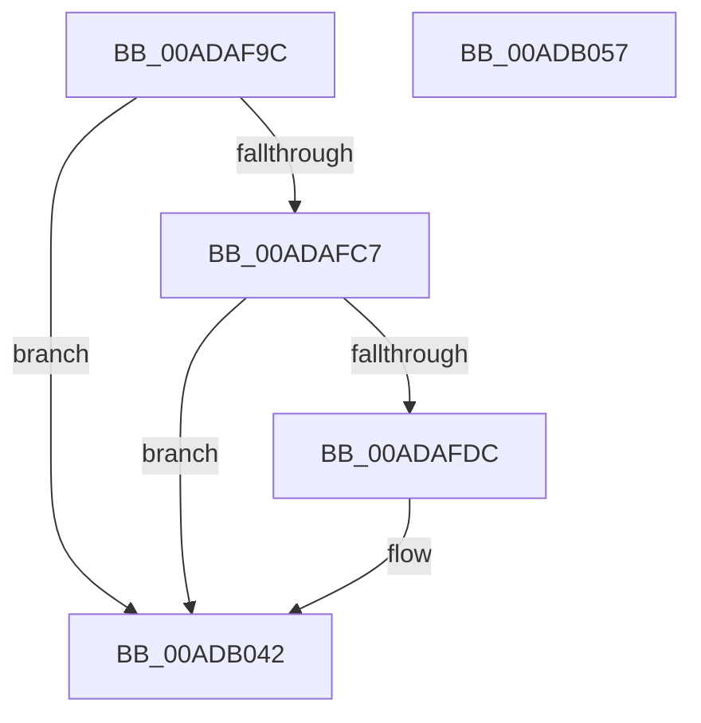

# TtmiLogConsoleUserPresent

- RVA: `0x00ADAF9C`–`0x00ADB058` (길이 `188` bytes)
- VA: `0x0000000140ADAF9C`
- 실행 섹션: `PAGE`
- PDB 이름 있음: `예`; PDB Function 태그: `아니요`
- unwind 정보 RVA: `0x0009EA9C`
- 디코드: `42`개 명령, `188/188` bytes 표시
- 미해석 바이트: `0` (있으면 어셈블리에 `.byte`로 보존)

> 이 문서는 커널 이미지의 기계어와 PDB 기호를 분석해 생성했습니다. 4번과 5번은 함수 원형과 자료형을 바이너리 사용 방식에서 추정한 C 해석이며 원본 소스 복구 결과는 아닙니다.

## 1. Dependencies

- 직접 호출 지점: **3**; 고유 호출 대상: **3**
- 직접 호출자로 확인된 함수: **1**
- RIP 상대 이미지 참조: **3**

### Outgoing calls
- `0x00ADAFD3` → [tlgKeywordOn](../../text/42/tlgKeywordOn_function_0042EAA0.md) (function, `0x0042EAA0`)
- `0x00ADB03D` → [tlgWriteTransfer_EtwWriteTransfer](../../text/42/tlgWriteTransfer_EtwWriteTransfer_function_004260E0.md) (function, `0x004260E0`)
- `0x00ADB049` → [_security_check_cookie](../../text/6A/_security_check_cookie_function_006AC640.md) (function, `0x006AC640`)

### Direct callers
- [TtmNotifyConsoleUserPresent](../91/TtmNotifyConsoleUserPresent_function_0091327C.md) at `0x009132F4`

### Static image references
- `0x00ADAFAA` → RVA `0x00E0A740` (`.data`; read)
- `0x00ADAFB8` → RVA `0x00FD88C8` (`PAGEDATA`; read)
- `0x00ADAFE8` → RVA `0x00051689` (`.rdata`; read)

## 2. Other-region calls and transfers

- 다른 실행 섹션으로 향하는 call: **3**
  - `0x00ADAFD3` → [tlgKeywordOn](../../text/42/tlgKeywordOn_function_0042EAA0.md) (`PAGE` → `.text`)
  - `0x00ADB03D` → [tlgWriteTransfer_EtwWriteTransfer](../../text/42/tlgWriteTransfer_EtwWriteTransfer_function_004260E0.md) (`PAGE` → `.text`)
  - `0x00ADB049` → [_security_check_cookie](../../text/6A/_security_check_cookie_function_006AC640.md) (`PAGE` → `.text`)
- 별도 외부 분기/꼬리 이동을 확인하지 못했습니다.

## 3. Assembly (complete function range)

```asm
00ADAF9C  40 55                           push rbp
00ADAF9E  48 8D 6C 24 A9                  lea rbp, [rsp - 0x57]
00ADAFA3  48 81 EC A0 00 00 00            sub rsp, 0xa0
00ADAFAA  48 8B 05 8F F7 32 00            mov rax, qword ptr [rip + 0x32f78f]
00ADAFB1  48 33 C4                        xor rax, rsp
00ADAFB4  48 89 45 47                     mov qword ptr [rbp + 0x47], rax
00ADAFB8  83 3D 09 D9 4F 00 05            cmp dword ptr [rip + 0x4fd909], 5
00ADAFBF  44 8B CA                        mov r9d, edx
00ADAFC2  44 8B D1                        mov r10d, ecx
00ADAFC5  76 7B                           jbe 0x140adb042
00ADAFC7  BA 01 00 00 00                  mov edx, 1
00ADAFCC  48 8D 0D F5 D8 4F 00            lea rcx, [rip + 0x4fd8f5]
00ADAFD3  E8 C8 3A 95 FF                  call 0x14042eaa0
00ADAFD8  84 C0                           test al, al
00ADAFDA  74 66                           je 0x140adb042
00ADAFDC  48 8D 45 E7                     lea rax, [rbp - 0x19]
00ADAFE0  44 89 4D EB                     mov dword ptr [rbp - 0x15], r9d
00ADAFE4  48 89 45 17                     mov qword ptr [rbp + 0x17], rax
00ADAFE8  48 8D 15 9A 66 57 FF            lea rdx, [rip - 0xa89966]
00ADAFEF  48 8D 45 EB                     lea rax, [rbp - 0x15]
00ADAFF3  44 89 45 EF                     mov dword ptr [rbp - 0x11], r8d
00ADAFF7  48 89 45 27                     mov qword ptr [rbp + 0x27], rax
00ADAFFB  48 8D 0D C6 D8 4F 00            lea rcx, [rip + 0x4fd8c6]
00ADB002  48 8D 45 EF                     lea rax, [rbp - 0x11]
00ADB006  44 89 55 E7                     mov dword ptr [rbp - 0x19], r10d
00ADB00A  48 89 45 37                     mov qword ptr [rbp + 0x37], rax
00ADB00E  45 33 C9                        xor r9d, r9d
00ADB011  48 8D 45 F7                     lea rax, [rbp - 9]
00ADB015  48 C7 45 1F 04 00 00 00         mov qword ptr [rbp + 0x1f], 4
00ADB01D  48 89 44 24 28                  mov qword ptr [rsp + 0x28], rax
00ADB022  45 33 C0                        xor r8d, r8d
00ADB025  C7 44 24 20 05 00 00 00         mov dword ptr [rsp + 0x20], 5
00ADB02D  48 C7 45 2F 04 00 00 00         mov qword ptr [rbp + 0x2f], 4
00ADB035  48 C7 45 3F 04 00 00 00         mov qword ptr [rbp + 0x3f], 4
00ADB03D  E8 9E B0 94 FF                  call 0x1404260e0
00ADB042  48 8B 4D 47                     mov rcx, qword ptr [rbp + 0x47]
00ADB046  48 33 CC                        xor rcx, rsp
00ADB049  E8 F2 15 BD FF                  call 0x1406ac640
00ADB04E  48 81 C4 A0 00 00 00            add rsp, 0xa0
00ADB055  5D                              pop rbp
00ADB056  C3                              ret
00ADB057  CC                              int3
```

## 4. C-style interpretation (structured pseudocode)

```c
__int64 __fastcall TtmiLogConsoleUserPresent(int a1, int a2, int a3)
{
    __int64 result;
    __int64 v_rsp;
    unsigned __int64 v_stack_m18;
    unsigned __int64 v_stack_m20;
    unsigned __int64 v_stack_m28;
    unsigned __int64 v_stack_m30;
    unsigned __int64 v_stack_m38;
    unsigned __int64 v_stack_m40;
    unsigned __int64 v_stack_m48;
    unsigned __int64 v_stack_m5F;
    unsigned __int64 v_stack_m68;
    unsigned int v_stack_m70;
    unsigned int v_stack_m74;
    unsigned __int64 v_stack_m78;
    unsigned __int64 v_stack_m80;
    unsigned int v_stack_m88;

    v_rsp = (v_rsp) - (160);
    result = (*(unsigned __int64 *)(v_rip + 3340175)) ^ (v_rsp);
    v_stack_m18 = result;
    if ((*(unsigned int *)(v_rip + 5232905)) <= 5) goto loc_00ADB042;
    result = tlgKeywordOn(v_rip + 5232885, 1, a3, (unsigned int)(a2));
    if ((unsigned __int8)(result) != 0) {
        result = v_stack_m78;
        v_stack_m74 = (unsigned int)((unsigned int)(a2));
        v_stack_m48 = result;
        a2 = v_rip - 11049318;
        result = v_stack_m74;
        v_stack_m70 = a3;
        v_stack_m38 = result;
        a1 = v_rip + 5232838;
        result = v_stack_m70;
        v_stack_m78 = (unsigned int)((unsigned int)(a1));
        v_stack_m28 = result;
        a4 = 0;
        result = v_stack_m68;
        v_stack_m40 = 4;
        v_stack_m80 = result;
        a3 = 0;
        v_stack_m88 = 5;
        v_stack_m30 = 4;
        v_stack_m20 = 4;
        result = tlgWriteTransfer_EtwWriteTransfer(a1, a2, a3, a4);
    }
    a1 = (v_stack_m18) ^ (v_rsp);
    result = _security_check_cookie(a1, a2, a3, a4);
    v_rsp = (v_rsp) + (160);
    return result;
}
```

## 5. (Beta) C Style

```c
int64_t TtmiLogConsoleUserPresent(int32_t Arg1, int32_t Arg2, int32_t Arg3)
{
    int64_t result;
    int64_t local_rsp;
    uint64_t v_stack_m18;
    uint64_t v_stack_m20;
    uint64_t v_stack_m28;
    uint64_t v_stack_m30;
    uint64_t v_stack_m38;
    uint64_t v_stack_m40;
    uint64_t v_stack_m48;
    uint64_t v_stack_m5F;
    uint64_t v_stack_m68;
    uint32_t v_stack_m70;
    uint32_t v_stack_m74;
    uint64_t v_stack_m78;
    uint64_t v_stack_m80;
    uint32_t v_stack_m88;

    local_rsp = (local_rsp) - (160);
    result = (*(uint64_t *)(v_rip + 0x32F78F)) ^ (local_rsp);
    v_stack_m18 = result;
    if ((*(uint32_t *)(v_rip + 0x4FD909)) <= 5) goto loc_00ADB042;
    result = tlgKeywordOn(v_rip + 5232885, 1, Arg3, (uint32_t)(Arg2));
    if ((uint8_t)(result) != 0) {
        result = v_stack_m78;
        v_stack_m74 = (uint32_t)((uint32_t)(Arg2));
        v_stack_m48 = result;
        Arg2 = v_rip - 11049318;
        result = v_stack_m74;
        v_stack_m70 = Arg3;
        v_stack_m38 = result;
        Arg1 = v_rip + 5232838;
        result = v_stack_m70;
        v_stack_m78 = (uint32_t)((uint32_t)(Arg1));
        v_stack_m28 = result;
        a4 = 0;
        result = v_stack_m68;
        v_stack_m40 = 4;
        v_stack_m80 = result;
        Arg3 = 0;
        v_stack_m88 = 5;
        v_stack_m30 = 4;
        v_stack_m20 = 4;
        result = tlgWriteTransfer_EtwWriteTransfer(Arg1, Arg2, Arg3, a4);
    }
    Arg1 = (v_stack_m18) ^ (local_rsp);
    result = _security_check_cookie(Arg1, Arg2, Arg3, a4);
    local_rsp = (local_rsp) + (160);
    return result;
}
```

## 6. Execution-region graph

[열기: 2D/3D 그래프와 함수 탐색 컨트롤 패널](../../../control-panel.html?section=page&rva=0x00ADAF9C&view=graph)

- 2D 그래프는 위에서 아래로 흐르고, 3D 그래프는 빈 공간을 드래그해 회전합니다. Shift+드래그는 이동, 휠은 확대·축소, 함수 노드 선택은 대상 보고서 이동입니다.

### Static fallback


