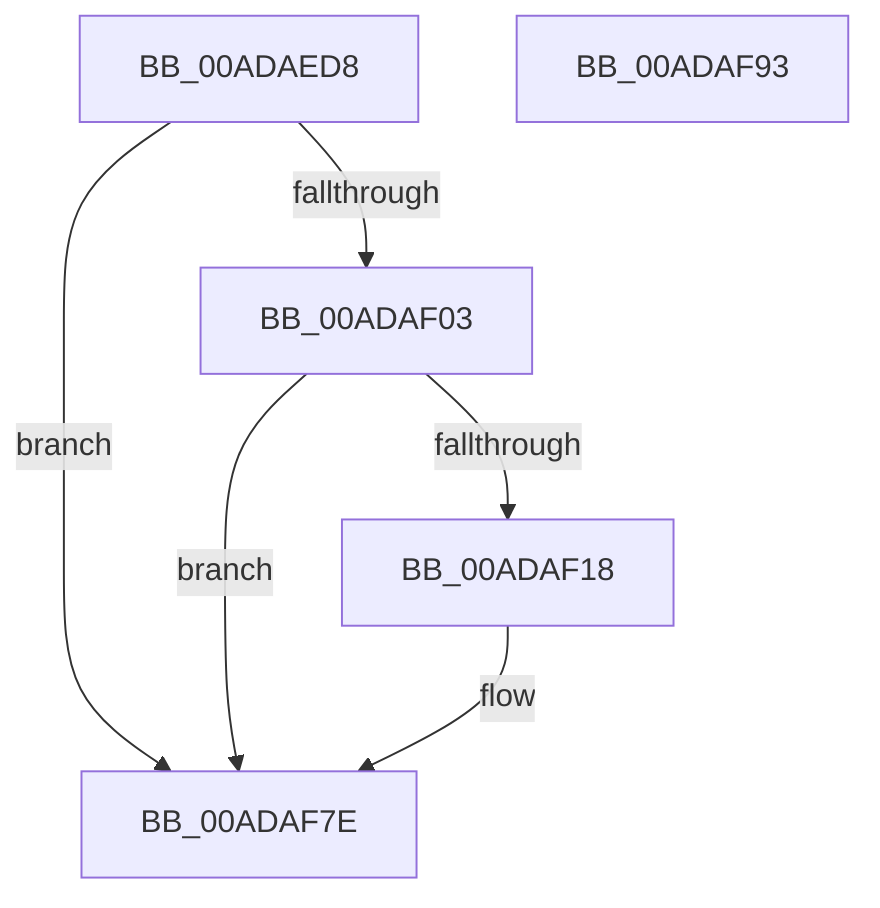

# TtmiLogSessionDisplayRequiredDereference

- RVA: `0x00ADAED8`–`0x00ADAF94` (길이 `188` bytes)
- VA: `0x0000000140ADAED8`
- 실행 섹션: `PAGE`
- PDB 이름 있음: `예`; PDB Function 태그: `아니요`
- unwind 정보 RVA: `0x0009EA9C`
- 디코드: `42`개 명령, `188/188` bytes 표시
- 미해석 바이트: `0` (있으면 어셈블리에 `.byte`로 보존)

> 이 문서는 커널 이미지의 기계어와 PDB 기호를 분석해 생성했습니다. 4번과 5번은 함수 원형과 자료형을 바이너리 사용 방식에서 추정한 C 해석이며 원본 소스 복구 결과는 아닙니다.

## 1. Dependencies

- 직접 호출 지점: **3**; 고유 호출 대상: **3**
- 직접 호출자로 확인된 함수: **1**
- RIP 상대 이미지 참조: **3**

### Outgoing calls
- `0x00ADAF0F` → [tlgKeywordOn](../../text/42/tlgKeywordOn_function_0042EAA0.md) (function, `0x0042EAA0`)
- `0x00ADAF79` → [tlgWriteTransfer_EtwWriteTransfer](../../text/42/tlgWriteTransfer_EtwWriteTransfer_function_004260E0.md) (function, `0x004260E0`)
- `0x00ADAF85` → [_security_check_cookie](../../text/6A/_security_check_cookie_function_006AC640.md) (function, `0x006AC640`)

### Direct callers
- [TtmNotifySessionDisplayRequiredChange](../98/TtmNotifySessionDisplayRequiredChange_function_0098C6B4.md) at `0x0098C7C2`

### Static image references
- `0x00ADAEE6` → RVA `0x00E0A740` (`.data`; read)
- `0x00ADAEF4` → RVA `0x00FD88C8` (`PAGEDATA`; read)
- `0x00ADAF24` → RVA `0x00052751` (`.rdata`; read)

## 2. Other-region calls and transfers

- 다른 실행 섹션으로 향하는 call: **3**
  - `0x00ADAF0F` → [tlgKeywordOn](../../text/42/tlgKeywordOn_function_0042EAA0.md) (`PAGE` → `.text`)
  - `0x00ADAF79` → [tlgWriteTransfer_EtwWriteTransfer](../../text/42/tlgWriteTransfer_EtwWriteTransfer_function_004260E0.md) (`PAGE` → `.text`)
  - `0x00ADAF85` → [_security_check_cookie](../../text/6A/_security_check_cookie_function_006AC640.md) (`PAGE` → `.text`)
- 별도 외부 분기/꼬리 이동을 확인하지 못했습니다.

## 3. Assembly (complete function range)

```asm
00ADAED8  40 55                           push rbp
00ADAEDA  48 8D 6C 24 A9                  lea rbp, [rsp - 0x57]
00ADAEDF  48 81 EC A0 00 00 00            sub rsp, 0xa0
00ADAEE6  48 8B 05 53 F8 32 00            mov rax, qword ptr [rip + 0x32f853]
00ADAEED  48 33 C4                        xor rax, rsp
00ADAEF0  48 89 45 47                     mov qword ptr [rbp + 0x47], rax
00ADAEF4  83 3D CD D9 4F 00 05            cmp dword ptr [rip + 0x4fd9cd], 5
00ADAEFB  44 8B CA                        mov r9d, edx
00ADAEFE  44 8B D1                        mov r10d, ecx
00ADAF01  76 7B                           jbe 0x140adaf7e
00ADAF03  BA 01 00 00 00                  mov edx, 1
00ADAF08  48 8D 0D B9 D9 4F 00            lea rcx, [rip + 0x4fd9b9]
00ADAF0F  E8 8C 3B 95 FF                  call 0x14042eaa0
00ADAF14  84 C0                           test al, al
00ADAF16  74 66                           je 0x140adaf7e
00ADAF18  48 8D 45 E7                     lea rax, [rbp - 0x19]
00ADAF1C  44 89 4D EB                     mov dword ptr [rbp - 0x15], r9d
00ADAF20  48 89 45 17                     mov qword ptr [rbp + 0x17], rax
00ADAF24  48 8D 15 26 78 57 FF            lea rdx, [rip - 0xa887da]
00ADAF2B  48 8D 45 EB                     lea rax, [rbp - 0x15]
00ADAF2F  44 89 45 EF                     mov dword ptr [rbp - 0x11], r8d
00ADAF33  48 89 45 27                     mov qword ptr [rbp + 0x27], rax
00ADAF37  48 8D 0D 8A D9 4F 00            lea rcx, [rip + 0x4fd98a]
00ADAF3E  48 8D 45 EF                     lea rax, [rbp - 0x11]
00ADAF42  44 89 55 E7                     mov dword ptr [rbp - 0x19], r10d
00ADAF46  48 89 45 37                     mov qword ptr [rbp + 0x37], rax
00ADAF4A  45 33 C9                        xor r9d, r9d
00ADAF4D  48 8D 45 F7                     lea rax, [rbp - 9]
00ADAF51  48 C7 45 1F 04 00 00 00         mov qword ptr [rbp + 0x1f], 4
00ADAF59  48 89 44 24 28                  mov qword ptr [rsp + 0x28], rax
00ADAF5E  45 33 C0                        xor r8d, r8d
00ADAF61  C7 44 24 20 05 00 00 00         mov dword ptr [rsp + 0x20], 5
00ADAF69  48 C7 45 2F 04 00 00 00         mov qword ptr [rbp + 0x2f], 4
00ADAF71  48 C7 45 3F 04 00 00 00         mov qword ptr [rbp + 0x3f], 4
00ADAF79  E8 62 B1 94 FF                  call 0x1404260e0
00ADAF7E  48 8B 4D 47                     mov rcx, qword ptr [rbp + 0x47]
00ADAF82  48 33 CC                        xor rcx, rsp
00ADAF85  E8 B6 16 BD FF                  call 0x1406ac640
00ADAF8A  48 81 C4 A0 00 00 00            add rsp, 0xa0
00ADAF91  5D                              pop rbp
00ADAF92  C3                              ret
00ADAF93  CC                              int3
```

## 4. C-style interpretation (structured pseudocode)

```c
__int64 __fastcall TtmiLogSessionDisplayRequiredDereference(int a1, int a2, int a3)
{
    __int64 result;
    __int64 v_rsp;
    unsigned __int64 v_stack_m18;
    unsigned __int64 v_stack_m20;
    unsigned __int64 v_stack_m28;
    unsigned __int64 v_stack_m30;
    unsigned __int64 v_stack_m38;
    unsigned __int64 v_stack_m40;
    unsigned __int64 v_stack_m48;
    unsigned __int64 v_stack_m5F;
    unsigned __int64 v_stack_m68;
    unsigned int v_stack_m70;
    unsigned int v_stack_m74;
    unsigned __int64 v_stack_m78;
    unsigned __int64 v_stack_m80;
    unsigned int v_stack_m88;

    v_rsp = (v_rsp) - (160);
    result = (*(unsigned __int64 *)(v_rip + 3340371)) ^ (v_rsp);
    v_stack_m18 = result;
    if ((*(unsigned int *)(v_rip + 5233101)) <= 5) goto loc_00ADAF7E;
    result = tlgKeywordOn(v_rip + 5233081, 1, a3, (unsigned int)(a2));
    if ((unsigned __int8)(result) != 0) {
        result = v_stack_m78;
        v_stack_m74 = (unsigned int)((unsigned int)(a2));
        v_stack_m48 = result;
        a2 = v_rip - 11044826;
        result = v_stack_m74;
        v_stack_m70 = a3;
        v_stack_m38 = result;
        a1 = v_rip + 5233034;
        result = v_stack_m70;
        v_stack_m78 = (unsigned int)((unsigned int)(a1));
        v_stack_m28 = result;
        a4 = 0;
        result = v_stack_m68;
        v_stack_m40 = 4;
        v_stack_m80 = result;
        a3 = 0;
        v_stack_m88 = 5;
        v_stack_m30 = 4;
        v_stack_m20 = 4;
        result = tlgWriteTransfer_EtwWriteTransfer(a1, a2, a3, a4);
    }
    a1 = (v_stack_m18) ^ (v_rsp);
    result = _security_check_cookie(a1, a2, a3, a4);
    v_rsp = (v_rsp) + (160);
    return result;
}
```

## 5. (Beta) C Style

```c
int64_t TtmiLogSessionDisplayRequiredDereference(int32_t Arg1, int32_t Arg2, int32_t Arg3)
{
    int64_t result;
    int64_t local_rsp;
    uint64_t v_stack_m18;
    uint64_t v_stack_m20;
    uint64_t v_stack_m28;
    uint64_t v_stack_m30;
    uint64_t v_stack_m38;
    uint64_t v_stack_m40;
    uint64_t v_stack_m48;
    uint64_t v_stack_m5F;
    uint64_t v_stack_m68;
    uint32_t v_stack_m70;
    uint32_t v_stack_m74;
    uint64_t v_stack_m78;
    uint64_t v_stack_m80;
    uint32_t v_stack_m88;

    local_rsp = (local_rsp) - (160);
    result = (*(uint64_t *)(v_rip + 0x32F853)) ^ (local_rsp);
    v_stack_m18 = result;
    if ((*(uint32_t *)(v_rip + 0x4FD9CD)) <= 5) goto loc_00ADAF7E;
    result = tlgKeywordOn(v_rip + 5233081, 1, Arg3, (uint32_t)(Arg2));
    if ((uint8_t)(result) != 0) {
        result = v_stack_m78;
        v_stack_m74 = (uint32_t)((uint32_t)(Arg2));
        v_stack_m48 = result;
        Arg2 = v_rip - 11044826;
        result = v_stack_m74;
        v_stack_m70 = Arg3;
        v_stack_m38 = result;
        Arg1 = v_rip + 5233034;
        result = v_stack_m70;
        v_stack_m78 = (uint32_t)((uint32_t)(Arg1));
        v_stack_m28 = result;
        a4 = 0;
        result = v_stack_m68;
        v_stack_m40 = 4;
        v_stack_m80 = result;
        Arg3 = 0;
        v_stack_m88 = 5;
        v_stack_m30 = 4;
        v_stack_m20 = 4;
        result = tlgWriteTransfer_EtwWriteTransfer(Arg1, Arg2, Arg3, a4);
    }
    Arg1 = (v_stack_m18) ^ (local_rsp);
    result = _security_check_cookie(Arg1, Arg2, Arg3, a4);
    local_rsp = (local_rsp) + (160);
    return result;
}
```

## 6. Execution-region graph

[열기: 2D/3D 그래프와 함수 탐색 컨트롤 패널](../../../control-panel.html?section=page&rva=0x00ADAED8&view=graph)

- 2D 그래프는 위에서 아래로 흐르고, 3D 그래프는 빈 공간을 드래그해 회전합니다. Shift+드래그는 이동, 휠은 확대·축소, 함수 노드 선택은 대상 보고서 이동입니다.

### Static fallback


