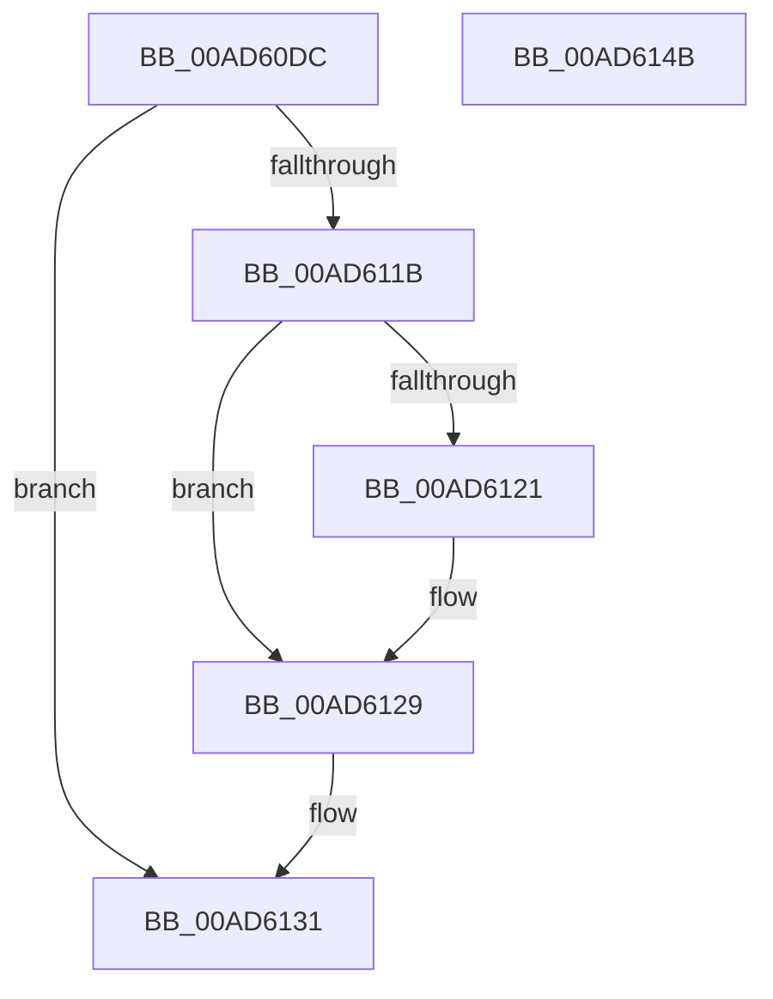

# VrpPostUnloadKey

- RVA: `0x00AD60DC`–`0x00AD614C` (길이 `112` bytes)
- VA: `0x0000000140AD60DC`
- 실행 섹션: `PAGE`
- PDB 이름 있음: `예`; PDB Function 태그: `아니요`
- unwind 정보 RVA: `0x000BEEF0`
- 디코드: `31`개 명령, `112/112` bytes 표시
- 미해석 바이트: `0` (있으면 어셈블리에 `.byte`로 보존)

> 이 문서는 커널 이미지의 기계어와 PDB 기호를 분석해 생성했습니다. 4번과 5번은 함수 원형과 자료형을 바이너리 사용 방식에서 추정한 C 해석이며 원본 소스 복구 결과는 아닙니다.

## 1. Dependencies

- 직접 호출 지점: **4**; 고유 호출 대상: **4**
- 직접 호출자로 확인된 함수: **1**
- RIP 상대 이미지 참조: **1**

### Outgoing calls
- `0x00AD610D` → [EtwActivityIdControl](../../text/41/EtwActivityIdControl_function_0041E720.md) (function, `0x0041E720`)
- `0x00AD6124` → [VrpDestroyNamespaceNode](../93/VrpDestroyNamespaceNode_function_00934A50.md) (function, `0x00934A50`)
- `0x00AD612C` → [VrpUnlockJobContextExclusive](../93/VrpUnlockJobContextExclusive_function_009354FC.md) (function, `0x009354FC`)
- `0x00AD613B` → [_security_check_cookie](../../text/6A/_security_check_cookie_function_006AC640.md) (function, `0x006AC640`)

### Direct callers
- [VrpRegistryCallback](../86/VrpRegistryCallback_function_00867450.md) at `0x008676B8`

### Static image references
- `0x00AD60E6` → RVA `0x00E0A740` (`.data`; read)

## 2. Other-region calls and transfers

- 다른 실행 섹션으로 향하는 call: **2**
  - `0x00AD610D` → [EtwActivityIdControl](../../text/41/EtwActivityIdControl_function_0041E720.md) (`PAGE` → `.text`)
  - `0x00AD613B` → [_security_check_cookie](../../text/6A/_security_check_cookie_function_006AC640.md) (`PAGE` → `.text`)
- 별도 외부 분기/꼬리 이동을 확인하지 못했습니다.

## 3. Assembly (complete function range)

```asm
00AD60DC  48 89 5C 24 18                  mov qword ptr [rsp + 0x18], rbx
00AD60E1  57                              push rdi
00AD60E2  48 83 EC 40                     sub rsp, 0x40
00AD60E6  48 8B 05 53 46 33 00            mov rax, qword ptr [rip + 0x334653]
00AD60ED  48 33 C4                        xor rax, rsp
00AD60F0  48 89 44 24 30                  mov qword ptr [rsp + 0x30], rax
00AD60F5  48 8B DA                        mov rbx, rdx
00AD60F8  48 8B F9                        mov rdi, rcx
00AD60FB  0F 57 C0                        xorps xmm0, xmm0
00AD60FE  48 8D 54 24 20                  lea rdx, [rsp + 0x20]
00AD6103  B9 03 00 00 00                  mov ecx, 3
00AD6108  0F 11 44 24 20                  movups xmmword ptr [rsp + 0x20], xmm0
00AD610D  E8 0E 86 94 FF                  call 0x14041e720
00AD6112  48 8B 57 20                     mov rdx, qword ptr [rdi + 0x20]
00AD6116  48 85 D2                        test rdx, rdx
00AD6119  74 16                           je 0x140ad6131
00AD611B  83 7F 08 00                     cmp dword ptr [rdi + 8], 0
00AD611F  7C 08                           jl 0x140ad6129
00AD6121  48 8B CB                        mov rcx, rbx
00AD6124  E8 27 E9 E5 FF                  call 0x140934a50
00AD6129  48 8B CB                        mov rcx, rbx
00AD612C  E8 CB F3 E5 FF                  call 0x1409354fc
00AD6131  33 C0                           xor eax, eax
00AD6133  48 8B 4C 24 30                  mov rcx, qword ptr [rsp + 0x30]
00AD6138  48 33 CC                        xor rcx, rsp
00AD613B  E8 00 65 BD FF                  call 0x1406ac640
00AD6140  48 8B 5C 24 60                  mov rbx, qword ptr [rsp + 0x60]
00AD6145  48 83 C4 40                     add rsp, 0x40
00AD6149  5F                              pop rdi
00AD614A  C3                              ret
00AD614B  CC                              int3
```

## 4. C-style interpretation (structured pseudocode)

```c
__int64 __fastcall VrpPostUnloadKey(__int64 a1, __int64 a2)
{
    __int64 result;
    __int64 v_rsp;
    unsigned __int64 v_stack_m18;
    unsigned __int64 v_stack_m28;
    unsigned __int64 v_stack_p18;

    v_stack_p18 = v_rbx;
    v_rsp = (v_rsp) - (64);
    result = (*(unsigned __int64 *)(v_rip + 3360339)) ^ (v_rsp);
    v_stack_m18 = result;
    v_stack_m28 = v_xmm0;
    result = EtwActivityIdControl(3, v_stack_m28, a3, a4);
    if (*(unsigned __int64 *)(a1 + 32) == 0) goto loc_00AD6131;
    if ((*(unsigned int *)(a1 + 8)) >= 0) {
        a1 = a2;
        result = VrpDestroyNamespaceNode(a1, *(unsigned __int64 *)(a1 + 32), a3, a4);
    }
    result = VrpUnlockJobContextExclusive(a2, *(unsigned __int64 *)(a1 + 32), a3, a4);
loc_00AD6131:
    result = 0;
    a1 = (v_stack_m18) ^ (v_rsp);
    result = _security_check_cookie(a1, *(unsigned __int64 *)(a1 + 32), a3, a4);
    v_rsp = (v_rsp) + (64);
    return result;
}
```

## 5. (Beta) C Style

```c
int64_t VrpPostUnloadKey(void *Arg1, int64_t Arg2)
{
    uint8_t *arg1 = (uint8_t *)Arg1;

    int64_t result;
    int64_t local_rsp;
    uint64_t v_stack_m18;
    uint64_t v_stack_m28;
    uint64_t v_stack_p18;

    v_stack_p18 = local_rbx;
    local_rsp = (local_rsp) - (64);
    result = (*(uint64_t *)(v_rip + 0x334653)) ^ (local_rsp);
    v_stack_m18 = result;
    v_stack_m28 = v_xmm0;
    result = EtwActivityIdControl(3, v_stack_m28, a3, a4);
    if (*(uint64_t *)(arg1 + 0x20) == 0) goto loc_00AD6131;
    if ((*(uint32_t *)(arg1 + 0x8)) >= 0) {
        Arg1 = Arg2;
        result = VrpDestroyNamespaceNode(Arg1, *(uint64_t *)(arg1 + 0x20), a3, a4);
    }
    result = VrpUnlockJobContextExclusive(Arg2, *(uint64_t *)(arg1 + 0x20), a3, a4);
loc_00AD6131:
    result = 0;
    Arg1 = (v_stack_m18) ^ (local_rsp);
    result = _security_check_cookie(Arg1, *(uint64_t *)(arg1 + 0x20), a3, a4);
    local_rsp = (local_rsp) + (64);
    return result;
}
```

### 관측된 메모리 오프셋

구조체 형식이 확인되지 않은 접근은 인자 기준의 오프셋으로만 기록했습니다.

| 기준 인자 | 오프셋 표현 | 폭 (bit) | 접근 |
|---|---:|---:|---|
| `Arg1` | `+ 0x8` | `32` | `R` |
| `Arg1` | `+ 0x20` | `64` | `R` |

## 6. Execution-region graph

[열기: 2D/3D 그래프와 함수 탐색 컨트롤 패널](../../../control-panel.html?section=page&rva=0x00AD60DC&view=graph)

- 2D 그래프는 위에서 아래로 흐르고, 3D 그래프는 빈 공간을 드래그해 회전합니다. Shift+드래그는 이동, 휠은 확대·축소, 함수 노드 선택은 대상 보고서 이동입니다.

### Static fallback


