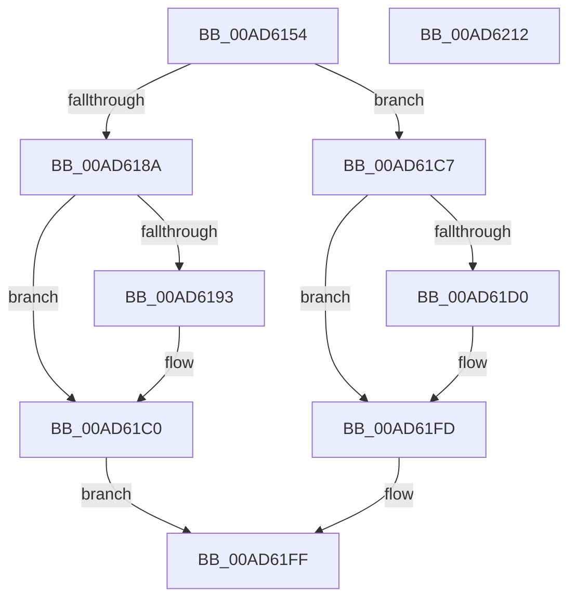

# VrpPreFlushKey

- RVA: `0x00AD6154`–`0x00AD6213` (길이 `191` bytes)
- VA: `0x0000000140AD6154`
- 실행 섹션: `PAGE`
- PDB 이름 있음: `예`; PDB Function 태그: `아니요`
- unwind 정보 RVA: `0x00087EC4`
- 디코드: `44`개 명령, `191/191` bytes 표시
- 미해석 바이트: `0` (있으면 어셈블리에 `.byte`로 보존)

> 이 문서는 커널 이미지의 기계어와 PDB 기호를 분석해 생성했습니다. 4번과 5번은 함수 원형과 자료형을 바이너리 사용 방식에서 추정한 C 해석이며 원본 소스 복구 결과는 아닙니다.

## 1. Dependencies

- 직접 호출 지점: **4**; 고유 호출 대상: **3**
- 직접 호출자로 확인된 함수: **1**
- RIP 상대 이미지 참조: **4**

### Outgoing calls
- `0x00AD617E` → [EtwActivityIdControl](../../text/41/EtwActivityIdControl_function_0041E720.md) (function, `0x0041E720`)
- `0x00AD61BB` → [tlgWriteTransfer_EtwWriteTransfer](../../text/42/tlgWriteTransfer_EtwWriteTransfer_function_004260E0.md) (function, `0x004260E0`)
- `0x00AD61F8` → [tlgWriteTransfer_EtwWriteTransfer](../../text/42/tlgWriteTransfer_EtwWriteTransfer_function_004260E0.md) (function, `0x004260E0`)
- `0x00AD6207` → [_security_check_cookie](../../text/6A/_security_check_cookie_function_006AC640.md) (function, `0x006AC640`)

### Direct callers
- [sub_00B17664](../B1/Unknown_function_00B17664.md) at `0x00B17668`

### Static image references
- `0x00AD615A` → RVA `0x00E0A740` (`.data`; read)
- `0x00AD618A` → RVA `0x00E0A630` (`.data`; read)
- `0x00AD61A5` → RVA `0x0005ABFB` (`.rdata`; read)
- `0x00AD61E2` → RVA `0x0005ABDA` (`.rdata`; read)

## 2. Other-region calls and transfers

- 다른 실행 섹션으로 향하는 call: **4**
  - `0x00AD617E` → [EtwActivityIdControl](../../text/41/EtwActivityIdControl_function_0041E720.md) (`PAGE` → `.text`)
  - `0x00AD61BB` → [tlgWriteTransfer_EtwWriteTransfer](../../text/42/tlgWriteTransfer_EtwWriteTransfer_function_004260E0.md) (`PAGE` → `.text`)
  - `0x00AD61F8` → [tlgWriteTransfer_EtwWriteTransfer](../../text/42/tlgWriteTransfer_EtwWriteTransfer_function_004260E0.md) (`PAGE` → `.text`)
  - `0x00AD6207` → [_security_check_cookie](../../text/6A/_security_check_cookie_function_006AC640.md) (`PAGE` → `.text`)
- 별도 외부 분기/꼬리 이동을 확인하지 못했습니다.

## 3. Assembly (complete function range)

```asm
00AD6154  40 53                           push rbx
00AD6156  48 83 EC 70                     sub rsp, 0x70
00AD615A  48 8B 05 DF 45 33 00            mov rax, qword ptr [rip + 0x3345df]
00AD6161  48 33 C4                        xor rax, rsp
00AD6164  48 89 44 24 60                  mov qword ptr [rsp + 0x60], rax
00AD6169  48 8B DA                        mov rbx, rdx
00AD616C  0F 57 C0                        xorps xmm0, xmm0
00AD616F  48 8D 54 24 30                  lea rdx, [rsp + 0x30]
00AD6174  B9 03 00 00 00                  mov ecx, 3
00AD6179  0F 11 44 24 30                  movups xmmword ptr [rsp + 0x30], xmm0
00AD617E  E8 9D 85 94 FF                  call 0x14041e720
00AD6183  8B 43 50                        mov eax, dword ptr [rbx + 0x50]
00AD6186  A8 01                           test al, 1
00AD6188  74 3D                           je 0x140ad61c7
00AD618A  83 3D 9F 44 33 00 05            cmp dword ptr [rip + 0x33449f], 5
00AD6191  76 2D                           jbe 0x140ad61c0
00AD6193  48 8D 44 24 40                  lea rax, [rsp + 0x40]
00AD6198  45 33 C9                        xor r9d, r9d
00AD619B  48 89 44 24 28                  mov qword ptr [rsp + 0x28], rax
00AD61A0  4C 8D 44 24 30                  lea r8, [rsp + 0x30]
00AD61A5  48 8D 15 4F 4A 58 FF            lea rdx, [rip - 0xa7b5b1]
00AD61AC  C7 44 24 20 02 00 00 00         mov dword ptr [rsp + 0x20], 2
00AD61B4  48 8D 0D 75 44 33 00            lea rcx, [rip + 0x334475]
00AD61BB  E8 20 FF 94 FF                  call 0x1404260e0
00AD61C0  B8 03 05 00 C0                  mov eax, 0xc0000503
00AD61C5  EB 38                           jmp 0x140ad61ff
00AD61C7  83 3D 62 44 33 00 05            cmp dword ptr [rip + 0x334462], 5
00AD61CE  76 2D                           jbe 0x140ad61fd
00AD61D0  48 8D 44 24 40                  lea rax, [rsp + 0x40]
00AD61D5  45 33 C9                        xor r9d, r9d
00AD61D8  48 89 44 24 28                  mov qword ptr [rsp + 0x28], rax
00AD61DD  4C 8D 44 24 30                  lea r8, [rsp + 0x30]
00AD61E2  48 8D 15 F1 49 58 FF            lea rdx, [rip - 0xa7b60f]
00AD61E9  C7 44 24 20 02 00 00 00         mov dword ptr [rsp + 0x20], 2
00AD61F1  48 8D 0D 38 44 33 00            lea rcx, [rip + 0x334438]
00AD61F8  E8 E3 FE 94 FF                  call 0x1404260e0
00AD61FD  33 C0                           xor eax, eax
00AD61FF  48 8B 4C 24 60                  mov rcx, qword ptr [rsp + 0x60]
00AD6204  48 33 CC                        xor rcx, rsp
00AD6207  E8 34 64 BD FF                  call 0x1406ac640
00AD620C  48 83 C4 70                     add rsp, 0x70
00AD6210  5B                              pop rbx
00AD6211  C3                              ret
00AD6212  CC                              int3
```

## 4. C-style interpretation (structured pseudocode)

```c
__int64 __fastcall VrpPreFlushKey(__int64 a1, __int64 a2, __int64 a3, int a4)
{
    __int64 result;
    __int64 v_rsp;
    unsigned __int64 v_stack_m18;
    unsigned __int64 v_stack_m38;
    unsigned __int64 v_stack_m48;
    unsigned __int64 v_stack_m50;
    unsigned int v_stack_m58;

    v_rsp = (v_rsp) - (112);
    result = (*(unsigned __int64 *)(v_rip + 3360223)) ^ (v_rsp);
    v_stack_m18 = result;
    v_stack_m48 = v_xmm0;
    result = EtwActivityIdControl(3, v_stack_m48, a3, a4);
    if ((((unsigned __int8)((unsigned int)(*(unsigned int *)(a2 + 80)))) & (1)) == 0) goto loc_00AD61C7;
    result = (unsigned int)(*(unsigned int *)(a2 + 80));
    if ((*(unsigned int *)(v_rip + 3359903)) >= = 5) {
        result = v_stack_m38;
        a4 = 0;
        v_stack_m50 = result;
        a3 = v_stack_m48;
        a2 = v_rip - 10991025;
        v_stack_m58 = 2;
        a1 = v_rip + 3359861;
        result = tlgWriteTransfer_EtwWriteTransfer(a1, a2, a3, a4);
    }
    goto loc_00AD61FF;
loc_00AD61C7:
    result = (unsigned int)(0xC0000503ULL);
    if ((*(unsigned int *)(v_rip + 3359842)) >= = 5) {
        result = v_stack_m38;
        a4 = 0;
        v_stack_m50 = result;
        a3 = v_stack_m48;
        a2 = v_rip - 10991119;
        v_stack_m58 = 2;
        a1 = v_rip + 3359800;
        result = tlgWriteTransfer_EtwWriteTransfer(a1, a2, a3, a4);
    }
    result = 0;
loc_00AD61FF:
    a1 = (v_stack_m18) ^ (v_rsp);
    result = _security_check_cookie(a1, a2, a3, a4);
    v_rsp = (v_rsp) + (112);
    return result;
}
```

## 5. (Beta) C Style

```c
int64_t VrpPreFlushKey(int64_t Arg1, void *Arg2, int64_t Arg3, int32_t Arg4)
{
    uint8_t *arg2 = (uint8_t *)Arg2;

    int64_t result;
    int64_t local_rsp;
    uint64_t v_stack_m18;
    uint64_t v_stack_m38;
    uint64_t v_stack_m48;
    uint64_t v_stack_m50;
    uint32_t v_stack_m58;

    local_rsp = (local_rsp) - (112);
    result = (*(uint64_t *)(v_rip + 0x3345DF)) ^ (local_rsp);
    v_stack_m18 = result;
    v_stack_m48 = v_xmm0;
    result = EtwActivityIdControl(3, v_stack_m48, Arg3, Arg4);
    if ((((uint8_t)((uint32_t)(*(uint32_t *)(arg2 + 0x50)))) & (1)) == 0) goto loc_00AD61C7;
    result = (uint32_t)(*(uint32_t *)(arg2 + 0x50));
    if ((*(uint32_t *)(v_rip + 0x33449F)) >= = 5) {
        result = v_stack_m38;
        Arg4 = 0;
        v_stack_m50 = result;
        Arg3 = v_stack_m48;
        Arg2 = v_rip - 10991025;
        v_stack_m58 = 2;
        Arg1 = v_rip + 3359861;
        result = tlgWriteTransfer_EtwWriteTransfer(Arg1, Arg2, Arg3, Arg4);
    }
    goto loc_00AD61FF;
loc_00AD61C7:
    result = (uint32_t)(0xC0000503ULL);
    if ((*(uint32_t *)(v_rip + 0x334462)) >= = 5) {
        result = v_stack_m38;
        Arg4 = 0;
        v_stack_m50 = result;
        Arg3 = v_stack_m48;
        Arg2 = v_rip - 10991119;
        v_stack_m58 = 2;
        Arg1 = v_rip + 3359800;
        result = tlgWriteTransfer_EtwWriteTransfer(Arg1, Arg2, Arg3, Arg4);
    }
    result = 0;
loc_00AD61FF:
    Arg1 = (v_stack_m18) ^ (local_rsp);
    result = _security_check_cookie(Arg1, Arg2, Arg3, Arg4);
    local_rsp = (local_rsp) + (112);
    return result;
}
```

### 관측된 메모리 오프셋

구조체 형식이 확인되지 않은 접근은 인자 기준의 오프셋으로만 기록했습니다.

| 기준 인자 | 오프셋 표현 | 폭 (bit) | 접근 |
|---|---:|---:|---|
| `Arg2` | `+ 0x50` | `32` | `R` |

## 6. Execution-region graph

[열기: 2D/3D 그래프와 함수 탐색 컨트롤 패널](../../../control-panel.html?section=page&rva=0x00AD6154&view=graph)

- 2D 그래프는 위에서 아래로 흐르고, 3D 그래프는 빈 공간을 드래그해 회전합니다. Shift+드래그는 이동, 휠은 확대·축소, 함수 노드 선택은 대상 보고서 이동입니다.

### Static fallback


