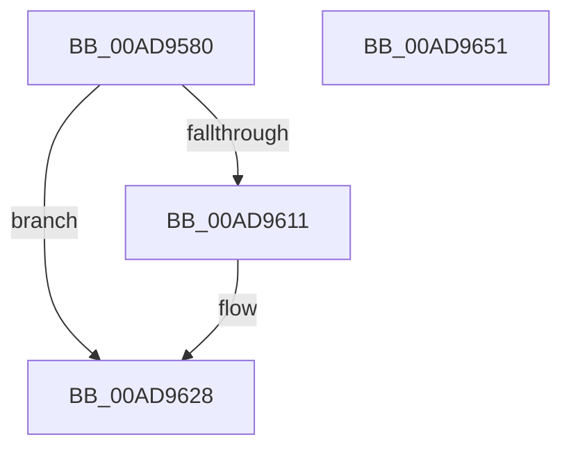

# VslDebugProtectSecureProcessMemory

- RVA: `0x00AD9580`–`0x00AD9652` (길이 `210` bytes)
- VA: `0x0000000140AD9580`
- 실행 섹션: `PAGE`
- PDB 이름 있음: `예`; PDB Function 태그: `아니요`
- unwind 정보 RVA: `0x000BF2B0`
- 디코드: `52`개 명령, `210/210` bytes 표시
- 미해석 바이트: `0` (있으면 어셈블리에 `.byte`로 보존)

> 이 문서는 커널 이미지의 기계어와 PDB 기호를 분석해 생성했습니다. 4번과 5번은 함수 원형과 자료형을 바이너리 사용 방식에서 추정한 C 해석이며 원본 소스 복구 결과는 아닙니다.

## 1. Dependencies

- 직접 호출 지점: **3**; 고유 호출 대상: **3**
- 직접 호출자로 확인된 함수: **1**
- RIP 상대 이미지 참조: **1**

### Outgoing calls
- `0x00AD95C7` → [memset](../../text/6C/memset_function_006C6C40.md) (function, `0x006C6C40`)
- `0x00AD9608` → [VslpEnterIumSecureMode](../../text/23/VslpEnterIumSecureMode_function_00235E50.md) (function, `0x00235E50`)
- `0x00AD9633` → [_security_check_cookie](../../text/6A/_security_check_cookie_function_006AC640.md) (function, `0x006AC640`)

### Direct callers
- [MiProtectEnclavePages](../../text/4D/MiProtectEnclavePages_function_004D5528.md) at `0x004D55BB`

### Static image references
- `0x00AD9596` → RVA `0x00E0A740` (`.data`; read)

## 2. Other-region calls and transfers

- 다른 실행 섹션으로 향하는 call: **3**
  - `0x00AD95C7` → [memset](../../text/6C/memset_function_006C6C40.md) (`PAGE` → `.text`)
  - `0x00AD9608` → [VslpEnterIumSecureMode](../../text/23/VslpEnterIumSecureMode_function_00235E50.md) (`PAGE` → `.text`)
  - `0x00AD9633` → [_security_check_cookie](../../text/6A/_security_check_cookie_function_006AC640.md) (`PAGE` → `.text`)
- 별도 외부 분기/꼬리 이동을 확인하지 못했습니다.

## 3. Assembly (complete function range)

```asm
00AD9580  48 89 5C 24 08                  mov qword ptr [rsp + 8], rbx
00AD9585  48 89 74 24 10                  mov qword ptr [rsp + 0x10], rsi
00AD958A  57                              push rdi
00AD958B  41 56                           push r14
00AD958D  41 57                           push r15
00AD958F  48 81 EC A0 00 00 00            sub rsp, 0xa0
00AD9596  48 8B 05 A3 11 33 00            mov rax, qword ptr [rip + 0x3311a3]
00AD959D  48 33 C4                        xor rax, rsp
00AD95A0  48 89 84 24 90 00 00 00         mov qword ptr [rsp + 0x90], rax
00AD95A8  4C 8B BC 24 E8 00 00 00         mov r15, qword ptr [rsp + 0xe8]
00AD95B0  48 8B FA                        mov rdi, rdx
00AD95B3  33 D2                           xor edx, edx
00AD95B5  49 8B F0                        mov rsi, r8
00AD95B8  48 8B D9                        mov rbx, rcx
00AD95BB  4D 8B F1                        mov r14, r9
00AD95BE  48 8D 4C 24 20                  lea rcx, [rsp + 0x20]
00AD95C3  44 8D 42 68                     lea r8d, [rdx + 0x68]
00AD95C7  E8 74 D6 BE FF                  call 0x1406c6c40
00AD95CC  48 8B 83 70 01 00 00            mov rax, qword ptr [rbx + 0x170]
00AD95D3  4C 8D 4C 24 20                  lea r9, [rsp + 0x20]
00AD95D8  48 89 44 24 28                  mov qword ptr [rsp + 0x28], rax
00AD95DD  BA 28 00 00 00                  mov edx, 0x28
00AD95E2  48 8B 06                        mov rax, qword ptr [rsi]
00AD95E5  45 33 C0                        xor r8d, r8d
00AD95E8  48 89 44 24 38                  mov qword ptr [rsp + 0x38], rax
00AD95ED  B1 02                           mov cl, 2
00AD95EF  49 8B 06                        mov rax, qword ptr [r14]
00AD95F2  48 89 44 24 40                  mov qword ptr [rsp + 0x40], rax
00AD95F7  8B 84 24 E0 00 00 00            mov eax, dword ptr [rsp + 0xe0]
00AD95FE  48 89 44 24 48                  mov qword ptr [rsp + 0x48], rax
00AD9603  48 89 7C 24 30                  mov qword ptr [rsp + 0x30], rdi
00AD9608  E8 43 C8 75 FF                  call 0x140235e50
00AD960D  85 C0                           test eax, eax
00AD960F  78 17                           js 0x140ad9628
00AD9611  48 8B 4C 24 38                  mov rcx, qword ptr [rsp + 0x38]
00AD9616  48 89 0E                        mov qword ptr [rsi], rcx
00AD9619  48 8B 4C 24 40                  mov rcx, qword ptr [rsp + 0x40]
00AD961E  49 89 0E                        mov qword ptr [r14], rcx
00AD9621  8B 4C 24 48                     mov ecx, dword ptr [rsp + 0x48]
00AD9625  41 89 0F                        mov dword ptr [r15], ecx
00AD9628  48 8B 8C 24 90 00 00 00         mov rcx, qword ptr [rsp + 0x90]
00AD9630  48 33 CC                        xor rcx, rsp
00AD9633  E8 08 30 BD FF                  call 0x1406ac640
00AD9638  4C 8D 9C 24 A0 00 00 00         lea r11, [rsp + 0xa0]
00AD9640  49 8B 5B 20                     mov rbx, qword ptr [r11 + 0x20]
00AD9644  49 8B 73 28                     mov rsi, qword ptr [r11 + 0x28]
00AD9648  49 8B E3                        mov rsp, r11
00AD964B  41 5F                           pop r15
00AD964D  41 5E                           pop r14
00AD964F  5F                              pop rdi
00AD9650  C3                              ret
00AD9651  CC                              int3
```

## 4. C-style interpretation (structured pseudocode)

```c
__int64 __fastcall VslDebugProtectSecureProcessMemory(__int64 a1, __int64 a2, __int64 a3, __int64 a4, unsigned int a5, __int64 a6)
{
    __int64 result;
    __int64 v_rsp;
    unsigned __int64 v_stack_m18;
    unsigned __int64 v_stack_m28;
    unsigned __int64 v_stack_m70;
    unsigned __int64 v_stack_m78;
    unsigned __int64 v_stack_m80;
    unsigned __int64 v_stack_m88;
    unsigned __int64 v_stack_m90;
    unsigned __int64 v_stack_m98;
    unsigned __int64 v_stack_p10;
    unsigned __int64 v_stack_p8;

    v_stack_p8 = v_rbx;
    v_stack_p10 = v_rsi;
    v_rsp = (v_rsp) - (160);
    result = (*(unsigned __int64 *)(v_rip + 3346851)) ^ (v_rsp);
    v_stack_m28 = result;
    a2 = 0;
    result = memset(v_stack_m98, a2, a2 + 104, a4);
    v_stack_m90 = *(unsigned __int64 *)(a1 + 368);
    a3 = 0;
    v_stack_m80 = *(unsigned __int64 *)(a3);
    v_stack_m78 = *(unsigned __int64 *)(a4);
    v_stack_m70 = (unsigned int)(a5);
    v_stack_m88 = 0;
    result = VslpEnterIumSecureMode(2, 40, a3, v_stack_m98);
    if (!(sign_flag)) {
        a1 = v_stack_m80;
        *(unsigned __int64 *)(a3) = a1;
        a1 = v_stack_m78;
        *(unsigned __int64 *)(a4) = a1;
        a1 = v_stack_m70;
        *(unsigned int *)(a6) = (unsigned int)(a1);
    }
    a1 = (v_stack_m28) ^ (v_rsp);
    result = _security_check_cookie(a1, 40, a3, v_stack_m98);
    return result;
}
```

## 5. (Beta) C Style

```c
int64_t VslDebugProtectSecureProcessMemory(void *Arg1, int64_t Arg2, void *Arg3, void *Arg4, uint32_t Arg5, void *Arg6)
{
    uint8_t *arg1 = (uint8_t *)Arg1;
    uint8_t *arg3 = (uint8_t *)Arg3;
    uint8_t *arg4 = (uint8_t *)Arg4;
    uint8_t *arg6 = (uint8_t *)Arg6;

    int64_t result;
    int64_t local_rsp;
    uint64_t v_stack_m18;
    uint64_t v_stack_m28;
    uint64_t v_stack_m70;
    uint64_t v_stack_m78;
    uint64_t v_stack_m80;
    uint64_t v_stack_m88;
    uint64_t v_stack_m90;
    uint64_t v_stack_m98;
    uint64_t v_stack_p10;
    uint64_t v_stack_p8;

    v_stack_p8 = local_rbx;
    v_stack_p10 = local_rsi;
    local_rsp = (local_rsp) - (160);
    result = (*(uint64_t *)(v_rip + 0x3311A3)) ^ (local_rsp);
    v_stack_m28 = result;
    Arg2 = 0;
    result = memset(v_stack_m98, Arg2, Arg2 + 104, Arg4);
    v_stack_m90 = *(uint64_t *)(arg1 + 0x170);
    Arg3 = 0;
    v_stack_m80 = *(uint64_t *)(arg3);
    v_stack_m78 = *(uint64_t *)(arg4);
    v_stack_m70 = (uint32_t)(Arg5);
    v_stack_m88 = 0;
    result = VslpEnterIumSecureMode(2, 40, Arg3, v_stack_m98);
    if (!(sign_flag)) {
        Arg1 = v_stack_m80;
        *(void **)(arg3) = Arg1;
        Arg1 = v_stack_m78;
        *(void **)(arg4) = Arg1;
        Arg1 = v_stack_m70;
        *(uint32_t *)(arg6) = (uint32_t)(Arg1);
    }
    Arg1 = (v_stack_m28) ^ (local_rsp);
    result = _security_check_cookie(Arg1, 40, Arg3, v_stack_m98);
    return result;
}
```

### 관측된 메모리 오프셋

구조체 형식이 확인되지 않은 접근은 인자 기준의 오프셋으로만 기록했습니다.

| 기준 인자 | 오프셋 표현 | 폭 (bit) | 접근 |
|---|---:|---:|---|
| `Arg1` | `+ 0x170` | `64` | `R` |
| `Arg3` | `+ 0x0` | `64` | `R` |
| `Arg3` | `+ 0x0` | `64` | `W` |
| `Arg4` | `+ 0x0` | `64` | `R` |
| `Arg4` | `+ 0x0` | `64` | `W` |
| `Arg6` | `+ 0x0` | `32` | `W` |

## 6. Execution-region graph

[열기: 2D/3D 그래프와 함수 탐색 컨트롤 패널](../../../control-panel.html?section=page&rva=0x00AD9580&view=graph)

- 2D 그래프는 위에서 아래로 흐르고, 3D 그래프는 빈 공간을 드래그해 회전합니다. Shift+드래그는 이동, 휠은 확대·축소, 함수 노드 선택은 대상 보고서 이동입니다.

### Static fallback


