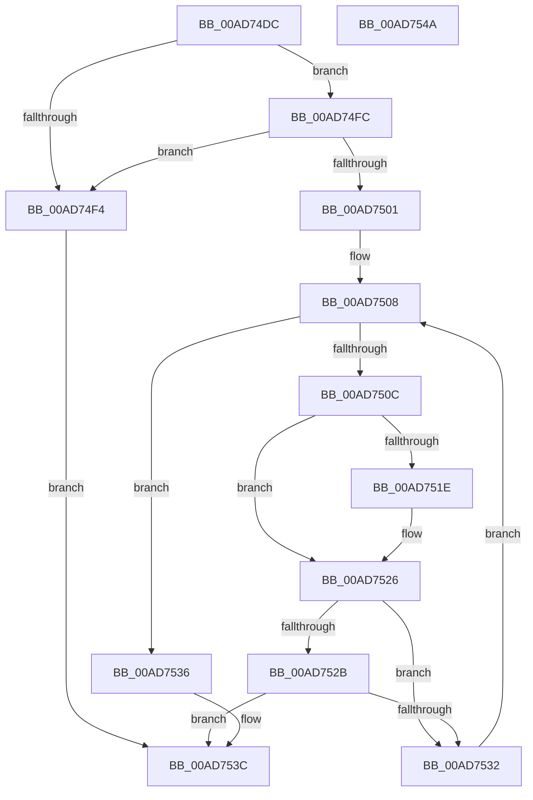

# WdipSemValidateEndEvent

- RVA: `0x00AD74DC`–`0x00AD754B` (길이 `111` bytes)
- VA: `0x0000000140AD74DC`
- 실행 섹션: `PAGE`
- PDB 이름 있음: `예`; PDB Function 태그: `아니요`
- unwind 정보 RVA: `0x000950EC`
- 디코드: `34`개 명령, `111/111` bytes 표시
- 미해석 바이트: `0` (있으면 어셈블리에 `.byte`로 보존)

> 이 문서는 커널 이미지의 기계어와 PDB 기호를 분석해 생성했습니다. 4번과 5번은 함수 원형과 자료형을 바이너리 사용 방식에서 추정한 C 해석이며 원본 소스 복구 결과는 아닙니다.

## 1. Dependencies

- 직접 호출 지점: **0**; 고유 호출 대상: **0**
- 직접 호출자로 확인된 함수: **1**
- RIP 상대 이미지 참조: **0**

### Outgoing calls
- 직접 디코드된 call 명령이 없습니다.

### Direct callers
- [sub_00B3DB56](../B3/Unknown_function_00B3DB56.md) at `0x00B3DB78`

### Static image references
- 디코드된 RIP-relative 메모리 참조가 없습니다.

## 2. Other-region calls and transfers

- 다른 실행 섹션으로 향하는 call: **0**
- 별도 외부 분기/꼬리 이동을 확인하지 못했습니다.

## 3. Assembly (complete function range)

```asm
00AD74DC  48 89 5C 24 08                  mov qword ptr [rsp + 8], rbx
00AD74E1  48 89 7C 24 10                  mov qword ptr [rsp + 0x10], rdi
00AD74E6  45 33 C9                        xor r9d, r9d
00AD74E9  0F B7 FA                        movzx edi, dx
00AD74EC  4C 8B D1                        mov r10, rcx
00AD74EF  48 85 C9                        test rcx, rcx
00AD74F2  75 08                           jne 0x140ad74fc
00AD74F4  41 B9 0D 00 00 C0               mov r9d, 0xc000000d
00AD74FA  EB 40                           jmp 0x140ad753c
00AD74FC  4D 85 C0                        test r8, r8
00AD74FF  74 F3                           je 0x140ad74f4
00AD7501  41 8B 58 34                     mov ebx, dword ptr [r8 + 0x34]
00AD7505  41 8B C9                        mov ecx, r9d
00AD7508  3B CB                           cmp ecx, ebx
00AD750A  73 2A                           jae 0x140ad7536
00AD750C  49 8B 12                        mov rdx, qword ptr [r10]
00AD750F  8B C1                           mov eax, ecx
00AD7511  4D 8B 9C C0 18 04 00 00         mov r11, qword ptr [r8 + rax*8 + 0x418]
00AD7519  49 2B 13                        sub rdx, qword ptr [r11]
00AD751C  75 08                           jne 0x140ad7526
00AD751E  49 8B 52 08                     mov rdx, qword ptr [r10 + 8]
00AD7522  49 2B 53 08                     sub rdx, qword ptr [r11 + 8]
00AD7526  48 85 D2                        test rdx, rdx
00AD7529  75 07                           jne 0x140ad7532
00AD752B  66 41 3B 7B 10                  cmp di, word ptr [r11 + 0x10]
00AD7530  74 0A                           je 0x140ad753c
00AD7532  FF C1                           inc ecx
00AD7534  EB D2                           jmp 0x140ad7508
00AD7536  41 B9 01 00 00 C0               mov r9d, 0xc0000001
00AD753C  48 8B 5C 24 08                  mov rbx, qword ptr [rsp + 8]
00AD7541  41 8B C1                        mov eax, r9d
00AD7544  48 8B 7C 24 10                  mov rdi, qword ptr [rsp + 0x10]
00AD7549  C3                              ret
00AD754A  CC                              int3
```

## 4. C-style interpretation (structured pseudocode)

```c
__int64 __fastcall WdipSemValidateEndEvent(__int64 a1, unsigned __int16 a2, __int64 a3, int a4)
{
    unsigned __int64 v_stack_p10;
    unsigned __int64 v_stack_p8;

    v_stack_p8 = v_rbx;
    v_stack_p10 = v_rdi;
    a4 = 0;
    if (a1 != 0) goto loc_00AD74FC;
loc_00AD74F4:
    goto loc_00AD753C;
loc_00AD74FC:
    if (a3 == 0) goto loc_00AD74F4;
loc_00AD7508:
    if (((unsigned int)((unsigned int)((unsigned int)((unsigned int)(0xC000000DULL))))) >= ((unsigned int)((unsigned int)(*(unsigned int *)(a3 + 52))))) goto loc_00AD7536;
    a2 = (*(unsigned __int64 *)(a1)) - (*(unsigned __int64 *)(*(unsigned __int64 *)(a3 + (unsigned int)((unsigned int)((unsigned int)((unsigned int)((unsigned int)(0xC000000DULL))))) * 8 + 1048)));
    if (!(condition_is_not_equal)) {
        a2 = *(unsigned __int64 *)(a1 + 8);
        a2 = (a2) - (*(unsigned __int64 *)(*(unsigned __int64 *)(a3 + (unsigned int)((unsigned int)((unsigned int)((unsigned int)((unsigned int)(0xC000000DULL))))) * 8 + 1048) + 8));
    }
    if (a2 != 0) goto loc_00AD7532;
    if (a2 == (*(unsigned __int16 *)(*(unsigned __int64 *)(a3 + (unsigned int)((unsigned int)((unsigned int)((unsigned int)((unsigned int)(0xC000000DULL))))) * 8 + 1048) + 16))) goto loc_00AD753C;
loc_00AD7532:
    a1 = (unsigned int)(((unsigned int)((unsigned int)((unsigned int)(0xC000000DULL)))) + 1);
    goto loc_00AD7508;
loc_00AD7536:
loc_00AD753C:
    return (unsigned int)((unsigned int)((unsigned int)(0xC0000001ULL)));
}
```

## 5. (Beta) C Style

```c
int64_t WdipSemValidateEndEvent(void *Arg1, uint16_t Arg2, int64_t Arg3, int32_t Arg4)
{
    uint8_t *arg1 = (uint8_t *)Arg1;

    uint64_t v_stack_p10;
    uint64_t v_stack_p8;

    v_stack_p8 = local_rbx;
    v_stack_p10 = local_rdi;
    Arg4 = 0;
    if (Arg1 != NULL) goto loc_00AD74FC;
loc_00AD74F4:
    goto loc_00AD753C;
loc_00AD74FC:
    if (Arg3 == 0) goto loc_00AD74F4;
loc_00AD7508:
    if (((uint32_t)((uint32_t)((uint32_t)((uint32_t)(0xC000000DULL))))) >= ((uint32_t)((uint32_t)(*(uint32_t *)(Arg3 + 0x34))))) goto loc_00AD7536;
    Arg2 = (*(uint64_t *)(arg1)) - (*(uint64_t *)(*(uint64_t *)(Arg3 + (uint32_t)((uint32_t)((uint32_t)((uint32_t)((uint32_t)(0xC000000DULL))))) * 8 + 0x418)));
    if (!(condition_is_not_equal)) {
        Arg2 = *(uint64_t *)(arg1 + 0x8);
        Arg2 = (Arg2) - (*(uint64_t *)(*(uint64_t *)(Arg3 + (uint32_t)((uint32_t)((uint32_t)((uint32_t)((uint32_t)(0xC000000DULL))))) * 8 + 0x418) + 0x8));
    }
    if (Arg2 != 0) goto loc_00AD7532;
    if (Arg2 == (*(uint16_t *)(*(uint64_t *)(Arg3 + (uint32_t)((uint32_t)((uint32_t)((uint32_t)((uint32_t)(0xC000000DULL))))) * 8 + 0x418) + 0x10))) goto loc_00AD753C;
loc_00AD7532:
    Arg1 = (uint32_t)(((uint32_t)((uint32_t)((uint32_t)(0xC000000DULL)))) + 1);
    goto loc_00AD7508;
loc_00AD7536:
loc_00AD753C:
    return (uint32_t)((uint32_t)((uint32_t)(0xC0000001ULL)));
}
```

### 관측된 메모리 오프셋

구조체 형식이 확인되지 않은 접근은 인자 기준의 오프셋으로만 기록했습니다.

| 기준 인자 | 오프셋 표현 | 폭 (bit) | 접근 |
|---|---:|---:|---|
| `Arg1` | `+ 0x0` | `64` | `R` |
| `Arg1` | `+ 0x8` | `64` | `R` |

## 6. Execution-region graph

[열기: 2D/3D 그래프와 함수 탐색 컨트롤 패널](../../../control-panel.html?section=page&rva=0x00AD74DC&view=graph)

- 2D 그래프는 위에서 아래로 흐르고, 3D 그래프는 빈 공간을 드래그해 회전합니다. Shift+드래그는 이동, 휠은 확대·축소, 함수 노드 선택은 대상 보고서 이동입니다.

### Static fallback


