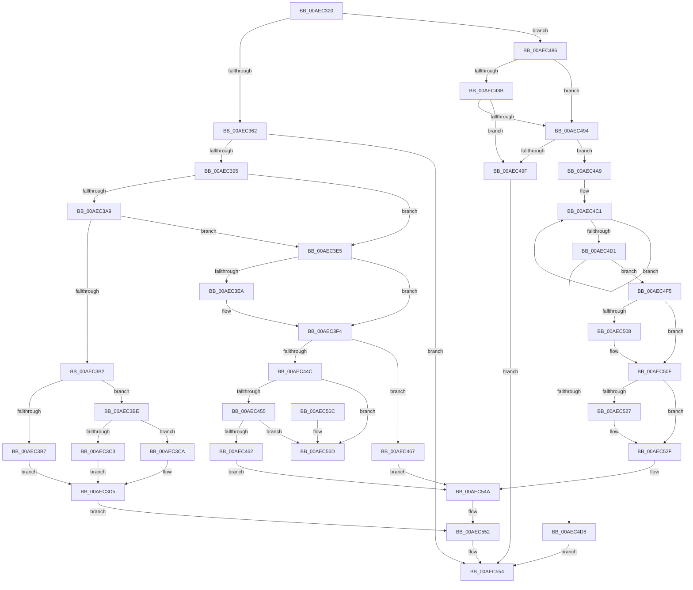

# NtTerminateProcess

- RVA: `0x00AEC320`–`0x00AEC58D` (길이 `621` bytes)
- VA: `0x0000000140AEC320`
- 실행 섹션: `PAGE`
- PDB 이름 있음: `예`; PDB Function 태그: `아니요`
- unwind 정보 RVA: `0x000CF2D4`
- 디코드: `159`개 명령, `621/621` bytes 표시
- 미해석 바이트: `0` (있으면 어셈블리에 `.byte`로 보존)

> 이 문서는 커널 이미지의 기계어와 PDB 기호를 분석해 생성했습니다. 4번과 5번은 함수 원형과 자료형을 바이너리 사용 방식에서 추정한 C 해석이며 원본 소스 복구 결과는 아닙니다.

## 1. Dependencies

- 직접 호출 지점: **18**; 고유 호출 대상: **17**
- 직접 호출자로 확인된 함수: **0**
- RIP 상대 이미지 참조: **1**

### Outgoing calls
- `0x00AEC388` → [ObpReferenceObjectByHandleWithTag](../86/ObpReferenceObjectByHandleWithTag_function_00869650.md) (function, `0x00869650`)
- `0x00AEC3D0` → [PsTerminateMinimalProcess](../78/PsTerminateMinimalProcess_function_007861A8.md) (function, `0x007861A8`)
- `0x00AEC3DB` → [ObfDereferenceObjectWithTag](../../text/2F/ObfDereferenceObjectWithTag_function_002F78E0.md) (function, `0x002F78E0`)
- `0x00AEC3FE` → [EtwpGetProcessStartKey](../../text/45/EtwpGetProcessStartKey_function_00459180.md) (function, `0x00459180`)
- `0x00AEC40E` → [PsGetProcessCreateTimeQuadPart](../../text/45/PsGetProcessCreateTimeQuadPart_function_00457540.md) (function, `0x00457540`)
- `0x00AEC433` → [PspTerminateProcess](../90/PspTerminateProcess_function_00903FFC.md) (function, `0x00903FFC`)
- `0x00AEC442` → [ObfDereferenceObjectWithTag](../../text/2F/ObfDereferenceObjectWithTag_function_002F78E0.md) (function, `0x002F78E0`)
- `0x00AEC47C` → [PspLogAuditTerminateRemoteProcessEvent](../AA/PspLogAuditTerminateRemoteProcessEvent_function_00AA5004.md) (function, `0x00AA5004`)
- `0x00AEC4AF` → [PspLockProcessExclusive](../../text/46/PspLockProcessExclusive_function_00460164.md) (function, `0x00460164`)
- `0x00AEC4DE` → [PspUnlockProcessExclusive](../../text/46/PspUnlockProcessExclusive_function_004601C0.md) (function, `0x004601C0`)
- `0x00AEC4EC` → [PspTerminateThreadByPointer](../90/PspTerminateThreadByPointer_function_00905E80.md) (function, `0x00905E80`)
- `0x00AEC52A` → [ExfTryToWakePushLock](../../text/26/ExfTryToWakePushLock_function_00265DD0.md) (function, `0x00265DD0`)
- `0x00AEC532` → [KeAbPostRelease](../../text/2E/KeAbPostRelease_function_002E1600.md) (function, `0x002E1600`)
- `0x00AEC543` → [PspTerminateAllThreads](../8C/PspTerminateAllThreads_function_008C97D0.md) (function, `0x008C97D0`)
- `0x00AEC54D` → [KiLeaveCriticalRegionUnsafe](../../text/25/KiLeaveCriticalRegionUnsafe_function_0025F010.md) (function, `0x0025F010`)
- `0x00AEC577` → [KeForceResumeThread](../../text/20/KeForceResumeThread_function_0020292C.md) (function, `0x0020292C`)
- `0x00AEC57F` → [KeLeaveCriticalRegionThread](../../text/25/KeLeaveCriticalRegionThread_function_0025EFF0.md) (function, `0x0025EFF0`)
- `0x00AEC587` → [PspExitThread](../90/PspExitThread_function_00905F60.md) (function, `0x00905F60`)

### Direct callers
- 이 함수 시작 RVA로 연결되는 직접 call은 확인되지 않았습니다. 간접 호출은 완전히 역산할 수 없습니다.

### Static image references
- `0x00AEC362` → RVA `0x00FC6A98` (`ALMOSTRO`; read)

## 2. Other-region calls and transfers

- 다른 실행 섹션으로 향하는 call: **11**
  - `0x00AEC3DB` → [ObfDereferenceObjectWithTag](../../text/2F/ObfDereferenceObjectWithTag_function_002F78E0.md) (`PAGE` → `.text`)
  - `0x00AEC3FE` → [EtwpGetProcessStartKey](../../text/45/EtwpGetProcessStartKey_function_00459180.md) (`PAGE` → `.text`)
  - `0x00AEC40E` → [PsGetProcessCreateTimeQuadPart](../../text/45/PsGetProcessCreateTimeQuadPart_function_00457540.md) (`PAGE` → `.text`)
  - `0x00AEC442` → [ObfDereferenceObjectWithTag](../../text/2F/ObfDereferenceObjectWithTag_function_002F78E0.md) (`PAGE` → `.text`)
  - `0x00AEC4AF` → [PspLockProcessExclusive](../../text/46/PspLockProcessExclusive_function_00460164.md) (`PAGE` → `.text`)
  - `0x00AEC4DE` → [PspUnlockProcessExclusive](../../text/46/PspUnlockProcessExclusive_function_004601C0.md) (`PAGE` → `.text`)
  - `0x00AEC52A` → [ExfTryToWakePushLock](../../text/26/ExfTryToWakePushLock_function_00265DD0.md) (`PAGE` → `.text`)
  - `0x00AEC532` → [KeAbPostRelease](../../text/2E/KeAbPostRelease_function_002E1600.md) (`PAGE` → `.text`)
  - `0x00AEC54D` → [KiLeaveCriticalRegionUnsafe](../../text/25/KiLeaveCriticalRegionUnsafe_function_0025F010.md) (`PAGE` → `.text`)
  - `0x00AEC577` → [KeForceResumeThread](../../text/20/KeForceResumeThread_function_0020292C.md) (`PAGE` → `.text`)
  - `0x00AEC57F` → [KeLeaveCriticalRegionThread](../../text/25/KeLeaveCriticalRegionThread_function_0025EFF0.md) (`PAGE` → `.text`)
- 별도 외부 분기/꼬리 이동을 확인하지 못했습니다.

## 3. Assembly (complete function range)

```asm
00AEC320  4C 8B DC                        mov r11, rsp
00AEC323  49 89 5B 10                     mov qword ptr [r11 + 0x10], rbx
00AEC327  55                              push rbp
00AEC328  56                              push rsi
00AEC329  57                              push rdi
00AEC32A  41 54                           push r12
00AEC32C  41 55                           push r13
00AEC32E  41 56                           push r14
00AEC330  41 57                           push r15
00AEC332  48 83 EC 40                     sub rsp, 0x40
00AEC336  65 48 8B 34 25 88 01 00 00      mov rsi, qword ptr gs:[0x188]
00AEC33F  33 DB                           xor ebx, ebx
00AEC341  49 89 5B 08                     mov qword ptr [r11 + 8], rbx
00AEC345  44 8B E2                        mov r12d, edx
00AEC348  48 8B BE B8 00 00 00            mov rdi, qword ptr [rsi + 0xb8]
00AEC34F  8D 6B 01                        lea ebp, [rbx + 1]
00AEC352  44 8A BE 32 02 00 00            mov r15b, byte ptr [rsi + 0x232]
00AEC359  48 85 C9                        test rcx, rcx
00AEC35C  0F 84 24 01 00 00               je 0x140aec486
00AEC362  4C 8B 05 2F A7 4D 00            mov r8, qword ptr [rip + 0x4da72f]
00AEC369  49 8D 43 08                     lea rax, [r11 + 8]
00AEC36D  49 89 5B C0                     mov qword ptr [r11 - 0x40], rbx
00AEC371  41 BD 50 73 54 65               mov r13d, 0x65547350
00AEC377  49 89 5B B8                     mov qword ptr [r11 - 0x48], rbx
00AEC37B  45 8A CF                        mov r9b, r15b
00AEC37E  49 89 43 B0                     mov qword ptr [r11 - 0x50], rax
00AEC382  8B D5                           mov edx, ebp
00AEC384  45 89 6B A8                     mov dword ptr [r11 - 0x58], r13d
00AEC388  E8 C3 D2 D7 FF                  call 0x140869650
00AEC38D  85 C0                           test eax, eax
00AEC38F  0F 88 BF 01 00 00               js 0x140aec554
00AEC395  4C 8B B4 24 80 00 00 00         mov r14, qword ptr [rsp + 0x80]
00AEC39D  41 8B 86 FC 05 00 00            mov eax, dword ptr [r14 + 0x5fc]
00AEC3A4  40 84 C5                        test bpl, al
00AEC3A7  74 3C                           je 0x140aec3e5
00AEC3A9  49 39 9E 40 06 00 00            cmp qword ptr [r14 + 0x640], rbx
00AEC3B0  75 33                           jne 0x140aec3e5
00AEC3B2  45 84 FF                        test r15b, r15b
00AEC3B5  74 07                           je 0x140aec3be
00AEC3B7  BB 22 00 00 C0                  mov ebx, 0xc0000022
00AEC3BC  EB 17                           jmp 0x140aec3d5
00AEC3BE  4C 3B F7                        cmp r14, rdi
00AEC3C1  75 07                           jne 0x140aec3ca
00AEC3C3  BB BB 00 00 C0                  mov ebx, 0xc00000bb
00AEC3C8  EB 0B                           jmp 0x140aec3d5
00AEC3CA  41 8B D4                        mov edx, r12d
00AEC3CD  49 8B CE                        mov rcx, r14
00AEC3D0  E8 D3 9D C9 FF                  call 0x1407861a8
00AEC3D5  41 8B D5                        mov edx, r13d
00AEC3D8  49 8B CE                        mov rcx, r14
00AEC3DB  E8 00 B5 80 FF                  call 0x1402f78e0
00AEC3E0  E9 6D 01 00 00                  jmp 0x140aec552
00AEC3E5  45 84 FF                        test r15b, r15b
00AEC3E8  75 0A                           jne 0x140aec3f4
00AEC3EA  40 84 AF 70 01 00 00            test byte ptr [rdi + 0x170], bpl
00AEC3F1  0F 44 DD                        cmove ebx, ebp
00AEC3F4  45 8B AE D0 01 00 00            mov r13d, dword ptr [r14 + 0x1d0]
00AEC3FB  49 8B CE                        mov rcx, r14
00AEC3FE  E8 7D CD 96 FF                  call 0x140459180
00AEC403  49 8B CE                        mov rcx, r14
00AEC406  48 89 84 24 98 00 00 00         mov qword ptr [rsp + 0x98], rax
00AEC40E  E8 2D B1 96 FF                  call 0x140457540
00AEC413  48 83 C9 FF                     or rcx, 0xffffffffffffffff
00AEC417  48 89 84 24 90 00 00 00         mov qword ptr [rsp + 0x90], rax
00AEC41F  66 01 8E E4 01 00 00            add word ptr [rsi + 0x1e4], cx
00AEC426  44 8B CB                        mov r9d, ebx
00AEC429  49 8B CE                        mov rcx, r14
00AEC42C  45 8B C4                        mov r8d, r12d
00AEC42F  48 8B D6                        mov rdx, rsi
00AEC432  90                              nop
00AEC433  E8 C4 7B E1 FF                  call 0x140903ffc
00AEC438  BA 50 73 54 65                  mov edx, 0x65547350
00AEC43D  49 8B CE                        mov rcx, r14
00AEC440  8B D8                           mov ebx, eax
00AEC442  E8 99 B4 80 FF                  call 0x1402f78e0
00AEC447  4C 3B F7                        cmp r14, rdi
00AEC44A  75 1B                           jne 0x140aec467
00AEC44C  44 3A FD                        cmp r15b, bpl
00AEC44F  0F 84 18 01 00 00               je 0x140aec56d
00AEC455  40 84 AF 70 01 00 00            test byte ptr [rdi + 0x170], bpl
00AEC45C  0F 85 0B 01 00 00               jne 0x140aec56d
00AEC462  E9 E3 00 00 00                  jmp 0x140aec54a
00AEC467  4C 8B 8C 24 90 00 00 00         mov r9, qword ptr [rsp + 0x90]
00AEC46F  8B D3                           mov edx, ebx
00AEC471  4C 8B 84 24 98 00 00 00         mov r8, qword ptr [rsp + 0x98]
00AEC479  41 8B CD                        mov ecx, r13d
00AEC47C  E8 83 8B FB FF                  call 0x140aa5004
00AEC481  E9 C4 00 00 00                  jmp 0x140aec54a
00AEC486  44 3A FD                        cmp r15b, bpl
00AEC489  74 09                           je 0x140aec494
00AEC48B  40 84 AF 70 01 00 00            test byte ptr [rdi + 0x170], bpl
00AEC492  74 0B                           je 0x140aec49f
00AEC494  8B 87 FC 05 00 00               mov eax, dword ptr [rdi + 0x5fc]
00AEC49A  40 84 C5                        test bpl, al
00AEC49D  74 0A                           je 0x140aec4a9
00AEC49F  B8 BB 00 00 C0                  mov eax, 0xc00000bb
00AEC4A4  E9 AB 00 00 00                  jmp 0x140aec554
00AEC4A9  48 8B D6                        mov rdx, rsi
00AEC4AC  48 8B CF                        mov rcx, rdi
00AEC4AF  E8 B0 3C 97 FF                  call 0x140460164
00AEC4B4  0F 0D 8F F4 01 00 00            prefetchw byte ptr [rdi + 0x1f4]
00AEC4BB  8B 87 F4 01 00 00               mov eax, dword ptr [rdi + 0x1f4]
00AEC4C1  8B D0                           mov edx, eax
00AEC4C3  0F BA EA 1E                     bts edx, 0x1e
00AEC4C7  F0 0F B1 97 F4 01 00 00         lock cmpxchg dword ptr [rdi + 0x1f4], edx
00AEC4CF  75 F0                           jne 0x140aec4c1
00AEC4D1  A9 08 00 00 40                  test eax, 0x40000008
00AEC4D6  74 1D                           je 0x140aec4f5
00AEC4D8  48 8B D6                        mov rdx, rsi
00AEC4DB  48 8B CF                        mov rcx, rdi
00AEC4DE  E8 DD 3C 97 FF                  call 0x1404601c0
00AEC4E3  44 8A C5                        mov r8b, bpl
00AEC4E6  41 8B D4                        mov edx, r12d
00AEC4E9  48 8B CE                        mov rcx, rsi
00AEC4EC  E8 8F 99 E1 FF                  call 0x140905e80
00AEC4F1  33 C0                           xor eax, eax
00AEC4F3  EB 5F                           jmp 0x140aec554
00AEC4F5  83 8E A4 05 00 00 40            or dword ptr [rsi + 0x5a4], 0x40
00AEC4FC  81 BF 54 05 00 00 03 01 00 00   cmp dword ptr [rdi + 0x554], 0x103
00AEC506  75 07                           jne 0x140aec50f
00AEC508  44 89 A7 54 05 00 00            mov dword ptr [rdi + 0x554], r12d
00AEC50F  48 8D 9F C8 01 00 00            lea rbx, [rdi + 0x1c8]
00AEC516  48 83 C9 FF                     or rcx, 0xffffffffffffffff
00AEC51A  F0 48 0F C1 0B                  lock xadd qword ptr [rbx], rcx
00AEC51F  80 E1 06                        and cl, 6
00AEC522  80 F9 02                        cmp cl, 2
00AEC525  75 08                           jne 0x140aec52f
00AEC527  48 8B CB                        mov rcx, rbx
00AEC52A  E8 A1 98 77 FF                  call 0x140265dd0
00AEC52F  48 8B CB                        mov rcx, rbx
00AEC532  E8 C9 50 7F FF                  call 0x1402e1600
00AEC537  45 33 C9                        xor r9d, r9d
00AEC53A  45 8B C4                        mov r8d, r12d
00AEC53D  48 8B D6                        mov rdx, rsi
00AEC540  48 8B CF                        mov rcx, rdi
00AEC543  E8 88 D2 DD FF                  call 0x1408c97d0
00AEC548  8B D8                           mov ebx, eax
00AEC54A  48 8B CE                        mov rcx, rsi
00AEC54D  E8 BE 2A 77 FF                  call 0x14025f010
00AEC552  8B C3                           mov eax, ebx
00AEC554  48 8B 9C 24 88 00 00 00         mov rbx, qword ptr [rsp + 0x88]
00AEC55C  48 83 C4 40                     add rsp, 0x40
00AEC560  41 5F                           pop r15
00AEC562  41 5E                           pop r14
00AEC564  41 5D                           pop r13
00AEC566  41 5C                           pop r12
00AEC568  5F                              pop rdi
00AEC569  5E                              pop rsi
00AEC56A  5D                              pop rbp
00AEC56B  C3                              ret
00AEC56C  CC                              int3
00AEC56D  F0 09 AE A0 05 00 00            lock or dword ptr [rsi + 0x5a0], ebp
00AEC574  48 8B CE                        mov rcx, rsi
00AEC577  E8 B0 63 71 FF                  call 0x14020292c
00AEC57C  48 8B CE                        mov rcx, rsi
00AEC57F  E8 6C 2A 77 FF                  call 0x14025eff0
00AEC584  41 8B CC                        mov ecx, r12d
00AEC587  E8 D4 99 E1 FF                  call 0x140905f60
00AEC58C  CC                              int3
```

## 4. C-style interpretation (structured pseudocode)

```c
__int64 __fastcall NtTerminateProcess(__int64 a1, int a2)
{
    __int64 result;
    __int64 v_rbx;
    __int64 v_rsp;
    unsigned __int64 v_stack_p10;
    unsigned __int64 v_stack_p18;
    unsigned __int64 v_stack_p20;
    unsigned __int64 v_stack_p8;

    *(unsigned __int64 *)(v_rsp + 16) = v_rbx;
    v_rsp = (v_rsp) - (64);
    v_rbx = 0;
    *(unsigned __int64 *)(v_rsp + 8) = 0;
    if (a1 == 0) goto loc_00AEC486;
    *(unsigned __int64 *)(v_rsp - 64) = 0;
    *(unsigned __int64 *)(v_rsp - 72) = 0;
    *(unsigned __int64 *)(v_rsp - 80) = v_rsp + 8;
    *(unsigned int *)(v_rsp - 88) = (unsigned int)((unsigned int)(0x65547350ULL));
    result = ObpReferenceObjectByHandleWithTag(a1, (unsigned int)((unsigned int)(v_rbx + 1)), *(unsigned __int64 *)(v_rip + 5089071), (unsigned __int8)(*(unsigned __int8 *)(*(unsigned __int64 *)(gs_base + (0 + 392)) + 562)));
    if (sign_flag) goto loc_00AEC554;
    if ((((unsigned __int8)(v_rbx + 1)) & ((unsigned __int8)((unsigned int)(*(unsigned int *)(v_stack_p8 + 1532))))) == 0) goto loc_00AEC3E5;
    if ((*(unsigned __int64 *)(v_stack_p8 + 1600)) != 0) goto loc_00AEC3E5;
    if ((unsigned __int8)(*(unsigned __int8 *)(*(unsigned __int64 *)(gs_base + (0 + 392)) + 562)) == 0) goto loc_00AEC3BE;
    goto loc_00AEC3D5;
loc_00AEC3BE:
    if (v_stack_p8 != (*(unsigned __int64 *)(*(unsigned __int64 *)(gs_base + (0 + 392)) + 184))) goto loc_00AEC3CA;
    goto loc_00AEC3D5;
loc_00AEC3CA:
    result = PsTerminateMinimalProcess(v_stack_p8, (unsigned int)((unsigned int)((unsigned int)(a2))), *(unsigned __int64 *)(v_rip + 5089071), (unsigned __int8)(*(unsigned __int8 *)(*(unsigned __int64 *)(gs_base + (0 + 392)) + 562)));
loc_00AEC3D5:
    result = ObfDereferenceObjectWithTag(v_stack_p8, (unsigned int)((unsigned int)((unsigned int)(0x65547350ULL))), *(unsigned __int64 *)(v_rip + 5089071), (unsigned __int8)(*(unsigned __int8 *)(*(unsigned __int64 *)(gs_base + (0 + 392)) + 562)));
    goto loc_00AEC552;
loc_00AEC3E5:
    v_rbx = (unsigned int)(0xC00000BBULL);
    if ((unsigned __int8)(*(unsigned __int8 *)(*(unsigned __int64 *)(gs_base + (0 + 392)) + 562)) == 0) {
        v_rbx = (unsigned int)(0xC00000BBULL);
        if (((*(unsigned __int8 *)(*(unsigned __int64 *)(*(unsigned __int64 *)(gs_base + (0 + 392)) + 184) + 368)) & ((unsigned __int8)(v_rbx + 1))) == 0) { v_rbx = (unsigned int)(v_rbx + 1); }
    }
    result = EtwpGetProcessStartKey(v_stack_p8, (unsigned int)((unsigned int)((unsigned int)(0x65547350ULL))), *(unsigned __int64 *)(v_rip + 5089071), (unsigned __int8)(*(unsigned __int8 *)(*(unsigned __int64 *)(gs_base + (0 + 392)) + 562)));
    v_stack_p20 = result;
    result = PsGetProcessCreateTimeQuadPart(v_stack_p8, (unsigned int)((unsigned int)((unsigned int)(0x65547350ULL))), *(unsigned __int64 *)(v_rip + 5089071), (unsigned __int8)(*(unsigned __int8 *)(*(unsigned __int64 *)(gs_base + (0 + 392)) + 562)));
    a1 = (v_stack_p8) | (-1);
    v_stack_p18 = result;
    result = PspTerminateProcess(v_stack_p8, *(unsigned __int64 *)(gs_base + (0 + 392)), (unsigned int)((unsigned int)((unsigned int)(a2))), (unsigned int)((unsigned int)(v_rbx)));
    result = ObfDereferenceObjectWithTag(v_stack_p8, (unsigned int)(0x65547350ULL), (unsigned int)((unsigned int)((unsigned int)(a2))), (unsigned int)((unsigned int)(v_rbx)));
    if (v_stack_p8 != (*(unsigned __int64 *)(*(unsigned __int64 *)(gs_base + (0 + 392)) + 184))) goto loc_00AEC467;
    if (((unsigned __int8)(*(unsigned __int8 *)(*(unsigned __int64 *)(gs_base + (0 + 392)) + 562))) == ((unsigned __int8)(v_rbx + 1))) goto loc_00AEC56D;
    if (((*(unsigned __int8 *)(*(unsigned __int64 *)(*(unsigned __int64 *)(gs_base + (0 + 392)) + 184) + 368)) & ((unsigned __int8)(v_rbx + 1))) != 0) goto loc_00AEC56D;
    goto loc_00AEC54A;
loc_00AEC467:
    result = PspLogAuditTerminateRemoteProcessEvent((unsigned int)((unsigned int)((unsigned int)(*(unsigned int *)(v_stack_p8 + 464)))), (unsigned int)((unsigned int)((unsigned int)((unsigned int)(result)))), v_stack_p20, v_stack_p18);
    goto loc_00AEC54A;
loc_00AEC486:
    if (((unsigned __int8)(*(unsigned __int8 *)(*(unsigned __int64 *)(gs_base + (0 + 392)) + 562))) == ((unsigned __int8)(v_rbx + 1))) goto loc_00AEC494;
    if (((*(unsigned __int8 *)(*(unsigned __int64 *)(*(unsigned __int64 *)(gs_base + (0 + 392)) + 184) + 368)) & ((unsigned __int8)(v_rbx + 1))) == 0) goto loc_00AEC49F;
loc_00AEC494:
    if ((((unsigned __int8)(v_rbx + 1)) & ((unsigned __int8)((unsigned int)(*(unsigned int *)(*(unsigned __int64 *)(*(unsigned __int64 *)(gs_base + (0 + 392)) + 184) + 1532))))) == 0) goto loc_00AEC4A9;
loc_00AEC49F:
    goto loc_00AEC554;
loc_00AEC4A9:
    result = PspLockProcessExclusive(*(unsigned __int64 *)(*(unsigned __int64 *)(gs_base + (0 + 392)) + 184), *(unsigned __int64 *)(gs_base + (0 + 392)), v_stack_p20, v_stack_p18);
loc_00AEC4C1:
    if ((((unsigned __int8)(v_rbx + 1)) & ((unsigned __int8)((unsigned int)(*(unsigned int *)(*(unsigned __int64 *)(*(unsigned __int64 *)(gs_base + (0 + 392)) + 184) + 1532))))) != 0) goto loc_00AEC4C1;
    if ((((unsigned int)((unsigned int)(*(unsigned int *)(*(unsigned __int64 *)(*(unsigned __int64 *)(gs_base + (0 + 392)) + 184) + 500)))) & (0x40000008ULL)) == 0) goto loc_00AEC4F5;
    result = PspUnlockProcessExclusive(*(unsigned __int64 *)(*(unsigned __int64 *)(gs_base + (0 + 392)) + 184), *(unsigned __int64 *)(gs_base + (0 + 392)), v_stack_p20, v_stack_p18);
    result = PspTerminateThreadByPointer(*(unsigned __int64 *)(gs_base + (0 + 392)), (unsigned int)((unsigned int)((unsigned int)(a2))), (unsigned __int8)(v_rbx + 1), v_stack_p18);
    result = 0;
    goto loc_00AEC554;
loc_00AEC4F5:
    if ((*(unsigned int *)(*(unsigned __int64 *)(*(unsigned __int64 *)(gs_base + (0 + 392)) + 184) + 1364)) == 259) {
        *(unsigned int *)(*(unsigned __int64 *)(*(unsigned __int64 *)(gs_base + (0 + 392)) + 184) + 1364) = (unsigned int)((unsigned int)(a2));
    }
    a1 = (*(unsigned __int64 *)(gs_base + (0 + 392))) | (-1);
    a1 = (unsigned __int8)((a1) & (6));
    if (((unsigned __int8)(a1)) == 2) {
        a1 = *(unsigned __int64 *)(*(unsigned __int64 *)(gs_base + (0 + 392)) + 184) + 456;
        result = ExfTryToWakePushLock(a1, (unsigned int)((unsigned int)((unsigned int)(a2))), (unsigned __int8)(v_rbx + 1), v_stack_p18);
    }
    result = KeAbPostRelease(*(unsigned __int64 *)(*(unsigned __int64 *)(gs_base + (0 + 392)) + 184) + 456, (unsigned int)((unsigned int)((unsigned int)(a2))), (unsigned __int8)(v_rbx + 1), v_stack_p18);
    a4 = 0;
    result = PspTerminateAllThreads(*(unsigned __int64 *)(*(unsigned __int64 *)(gs_base + (0 + 392)) + 184), *(unsigned __int64 *)(gs_base + (0 + 392)), (unsigned int)((unsigned int)((unsigned int)(a2))), a4);
loc_00AEC54A:
    result = KiLeaveCriticalRegionUnsafe(*(unsigned __int64 *)(gs_base + (0 + 392)), *(unsigned __int64 *)(gs_base + (0 + 392)), (unsigned int)((unsigned int)((unsigned int)(a2))), a4);
loc_00AEC552:
loc_00AEC554:
    v_rsp = (v_rsp) + (64);
    return (unsigned int)((unsigned int)((unsigned int)((unsigned int)(result))));
loc_00AEC56D:
    result = KeForceResumeThread(*(unsigned __int64 *)(gs_base + (0 + 392)), *(unsigned __int64 *)(gs_base + (0 + 392)), (unsigned int)((unsigned int)((unsigned int)(a2))), a4);
    result = KeLeaveCriticalRegionThread(*(unsigned __int64 *)(gs_base + (0 + 392)), *(unsigned __int64 *)(gs_base + (0 + 392)), (unsigned int)((unsigned int)((unsigned int)(a2))), a4);
    result = PspExitThread((unsigned int)((unsigned int)((unsigned int)(a2))), *(unsigned __int64 *)(gs_base + (0 + 392)), (unsigned int)((unsigned int)((unsigned int)(a2))), a4);
    return result;
}
```

## 5. (Beta) C Style

```c
int64_t NtTerminateProcess(int64_t Arg1, int32_t Arg2)
{
    int64_t result;
    int64_t local_rbx;
    int64_t local_rsp;
    uint64_t v_stack_p10;
    uint64_t v_stack_p18;
    uint64_t v_stack_p20;
    uint64_t v_stack_p8;

    *(uint64_t *)(local_rsp + 0x10) = local_rbx;
    local_rsp = (local_rsp) - (64);
    local_rbx = 0;
    *(uint64_t *)(local_rsp + 0x8) = 0;
    if (Arg1 == 0) goto loc_00AEC486;
    *(uint64_t *)(local_rsp - 0x40) = 0;
    *(uint64_t *)(local_rsp - 0x48) = 0;
    *(uint64_t *)(local_rsp - 0x50) = local_rsp + 8;
    *(uint32_t *)(local_rsp - 0x58) = (uint32_t)((uint32_t)(0x65547350ULL));
    result = ObpReferenceObjectByHandleWithTag(Arg1, (uint32_t)((uint32_t)(local_rbx + 1)), *(uint64_t *)(v_rip + 0x4DA72F), (uint8_t)(*(uint8_t *)(*(uint64_t *)(gs_base + (0 + 0x188)) + 0x232)));
    if (sign_flag) goto loc_00AEC554;
    if ((((uint8_t)(local_rbx + 1)) & ((uint8_t)((uint32_t)(*(uint32_t *)(v_stack_p8 + 0x5FC))))) == 0) goto loc_00AEC3E5;
    if ((*(uint64_t *)(v_stack_p8 + 0x640)) != 0) goto loc_00AEC3E5;
    if ((uint8_t)(*(uint8_t *)(*(uint64_t *)(gs_base + (0 + 0x188)) + 0x232)) == 0) goto loc_00AEC3BE;
    goto loc_00AEC3D5;
loc_00AEC3BE:
    if (v_stack_p8 != (*(uint64_t *)(*(uint64_t *)(gs_base + (0 + 0x188)) + 0xB8))) goto loc_00AEC3CA;
    goto loc_00AEC3D5;
loc_00AEC3CA:
    result = PsTerminateMinimalProcess(v_stack_p8, (uint32_t)((uint32_t)((uint32_t)(Arg2))), *(uint64_t *)(v_rip + 0x4DA72F), (uint8_t)(*(uint8_t *)(*(uint64_t *)(gs_base + (0 + 0x188)) + 0x232)));
loc_00AEC3D5:
    result = ObfDereferenceObjectWithTag(v_stack_p8, (uint32_t)((uint32_t)((uint32_t)(0x65547350ULL))), *(uint64_t *)(v_rip + 0x4DA72F), (uint8_t)(*(uint8_t *)(*(uint64_t *)(gs_base + (0 + 0x188)) + 0x232)));
    goto loc_00AEC552;
loc_00AEC3E5:
    local_rbx = (uint32_t)(0xC00000BBULL);
    if ((uint8_t)(*(uint8_t *)(*(uint64_t *)(gs_base + (0 + 0x188)) + 0x232)) == 0) {
        local_rbx = (uint32_t)(0xC00000BBULL);
        if (((*(uint8_t *)(*(uint64_t *)(*(uint64_t *)(gs_base + (0 + 0x188)) + 0xB8) + 0x170)) & ((uint8_t)(local_rbx + 1))) == 0) { local_rbx = (uint32_t)(local_rbx + 1); }
    }
    result = EtwpGetProcessStartKey(v_stack_p8, (uint32_t)((uint32_t)((uint32_t)(0x65547350ULL))), *(uint64_t *)(v_rip + 0x4DA72F), (uint8_t)(*(uint8_t *)(*(uint64_t *)(gs_base + (0 + 0x188)) + 0x232)));
    v_stack_p20 = result;
    result = PsGetProcessCreateTimeQuadPart(v_stack_p8, (uint32_t)((uint32_t)((uint32_t)(0x65547350ULL))), *(uint64_t *)(v_rip + 0x4DA72F), (uint8_t)(*(uint8_t *)(*(uint64_t *)(gs_base + (0 + 0x188)) + 0x232)));
    Arg1 = (v_stack_p8) | (-1);
    v_stack_p18 = result;
    result = PspTerminateProcess(v_stack_p8, *(uint64_t *)(gs_base + (0 + 0x188)), (uint32_t)((uint32_t)((uint32_t)(Arg2))), (uint32_t)((uint32_t)(local_rbx)));
    result = ObfDereferenceObjectWithTag(v_stack_p8, (uint32_t)(0x65547350ULL), (uint32_t)((uint32_t)((uint32_t)(Arg2))), (uint32_t)((uint32_t)(local_rbx)));
    if (v_stack_p8 != (*(uint64_t *)(*(uint64_t *)(gs_base + (0 + 0x188)) + 0xB8))) goto loc_00AEC467;
    if (((uint8_t)(*(uint8_t *)(*(uint64_t *)(gs_base + (0 + 0x188)) + 0x232))) == ((uint8_t)(local_rbx + 1))) goto loc_00AEC56D;
    if (((*(uint8_t *)(*(uint64_t *)(*(uint64_t *)(gs_base + (0 + 0x188)) + 0xB8) + 0x170)) & ((uint8_t)(local_rbx + 1))) != 0) goto loc_00AEC56D;
    goto loc_00AEC54A;
loc_00AEC467:
    result = PspLogAuditTerminateRemoteProcessEvent((uint32_t)((uint32_t)((uint32_t)(*(uint32_t *)(v_stack_p8 + 0x1D0)))), (uint32_t)((uint32_t)((uint32_t)((uint32_t)(result)))), v_stack_p20, v_stack_p18);
    goto loc_00AEC54A;
loc_00AEC486:
    if (((uint8_t)(*(uint8_t *)(*(uint64_t *)(gs_base + (0 + 0x188)) + 0x232))) == ((uint8_t)(local_rbx + 1))) goto loc_00AEC494;
    if (((*(uint8_t *)(*(uint64_t *)(*(uint64_t *)(gs_base + (0 + 0x188)) + 0xB8) + 0x170)) & ((uint8_t)(local_rbx + 1))) == 0) goto loc_00AEC49F;
loc_00AEC494:
    if ((((uint8_t)(local_rbx + 1)) & ((uint8_t)((uint32_t)(*(uint32_t *)(*(uint64_t *)(*(uint64_t *)(gs_base + (0 + 0x188)) + 0xB8) + 0x5FC))))) == 0) goto loc_00AEC4A9;
loc_00AEC49F:
    goto loc_00AEC554;
loc_00AEC4A9:
    result = PspLockProcessExclusive(*(uint64_t *)(*(uint64_t *)(gs_base + (0 + 0x188)) + 0xB8), *(uint64_t *)(gs_base + (0 + 0x188)), v_stack_p20, v_stack_p18);
loc_00AEC4C1:
    if ((((uint8_t)(local_rbx + 1)) & ((uint8_t)((uint32_t)(*(uint32_t *)(*(uint64_t *)(*(uint64_t *)(gs_base + (0 + 0x188)) + 0xB8) + 0x5FC))))) != 0) goto loc_00AEC4C1;
    if ((((uint32_t)((uint32_t)(*(uint32_t *)(*(uint64_t *)(*(uint64_t *)(gs_base + (0 + 0x188)) + 0xB8) + 0x1F4)))) & (0x40000008ULL)) == 0) goto loc_00AEC4F5;
    result = PspUnlockProcessExclusive(*(uint64_t *)(*(uint64_t *)(gs_base + (0 + 0x188)) + 0xB8), *(uint64_t *)(gs_base + (0 + 0x188)), v_stack_p20, v_stack_p18);
    result = PspTerminateThreadByPointer(*(uint64_t *)(gs_base + (0 + 0x188)), (uint32_t)((uint32_t)((uint32_t)(Arg2))), (uint8_t)(local_rbx + 1), v_stack_p18);
    result = 0;
    goto loc_00AEC554;
loc_00AEC4F5:
    if ((*(uint32_t *)(*(uint64_t *)(*(uint64_t *)(gs_base + (0 + 0x188)) + 0xB8) + 0x554)) == 259) {
        *(uint32_t *)(*(uint64_t *)(*(uint64_t *)(gs_base + (0 + 0x188)) + 0xB8) + 0x554) = (uint32_t)((uint32_t)(Arg2));
    }
    Arg1 = (*(uint64_t *)(gs_base + (0 + 0x188))) | (-1);
    Arg1 = (uint8_t)((Arg1) & (6));
    if (((uint8_t)(Arg1)) == 2) {
        Arg1 = *(uint64_t *)(*(uint64_t *)(gs_base + (0 + 0x188)) + 0xB8) + 456;
        result = ExfTryToWakePushLock(Arg1, (uint32_t)((uint32_t)((uint32_t)(Arg2))), (uint8_t)(local_rbx + 1), v_stack_p18);
    }
    result = KeAbPostRelease(*(uint64_t *)(*(uint64_t *)(gs_base + (0 + 0x188)) + 0xB8) + 456, (uint32_t)((uint32_t)((uint32_t)(Arg2))), (uint8_t)(local_rbx + 1), v_stack_p18);
    a4 = 0;
    result = PspTerminateAllThreads(*(uint64_t *)(*(uint64_t *)(gs_base + (0 + 0x188)) + 0xB8), *(uint64_t *)(gs_base + (0 + 0x188)), (uint32_t)((uint32_t)((uint32_t)(Arg2))), a4);
loc_00AEC54A:
    result = KiLeaveCriticalRegionUnsafe(*(uint64_t *)(gs_base + (0 + 0x188)), *(uint64_t *)(gs_base + (0 + 0x188)), (uint32_t)((uint32_t)((uint32_t)(Arg2))), a4);
loc_00AEC552:
loc_00AEC554:
    local_rsp = (local_rsp) + (64);
    return (uint32_t)((uint32_t)((uint32_t)((uint32_t)(result))));
loc_00AEC56D:
    result = KeForceResumeThread(*(uint64_t *)(gs_base + (0 + 0x188)), *(uint64_t *)(gs_base + (0 + 0x188)), (uint32_t)((uint32_t)((uint32_t)(Arg2))), a4);
    result = KeLeaveCriticalRegionThread(*(uint64_t *)(gs_base + (0 + 0x188)), *(uint64_t *)(gs_base + (0 + 0x188)), (uint32_t)((uint32_t)((uint32_t)(Arg2))), a4);
    result = PspExitThread((uint32_t)((uint32_t)((uint32_t)(Arg2))), *(uint64_t *)(gs_base + (0 + 0x188)), (uint32_t)((uint32_t)((uint32_t)(Arg2))), a4);
    return result;
}
```

## 6. Execution-region graph

[열기: 2D/3D 그래프와 함수 탐색 컨트롤 패널](../../../control-panel.html?section=page&rva=0x00AEC320&view=graph)

- 2D 그래프는 위에서 아래로 흐르고, 3D 그래프는 빈 공간을 드래그해 회전합니다. Shift+드래그는 이동, 휠은 확대·축소, 함수 노드 선택은 대상 보고서 이동입니다.

### Static fallback


