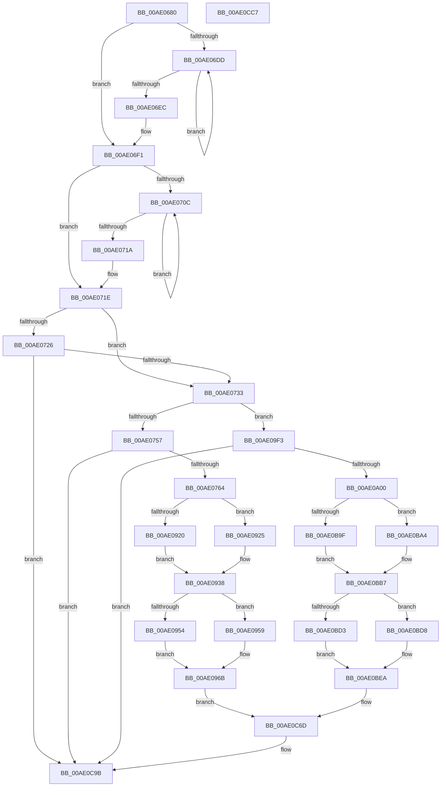

# PopAccountCbEnergyChange

- RVA: `0x00AE0680`–`0x00AE0CC8` (길이 `1,608` bytes)
- VA: `0x0000000140AE0680`
- 실행 섹션: `PAGE`
- PDB 이름 있음: `예`; PDB Function 태그: `아니요`
- unwind 정보 RVA: `0x000CCF10`
- 디코드: `338`개 명령, `1,608/1,608` bytes 표시
- 미해석 바이트: `0` (있으면 어셈블리에 `.byte`로 보존)

> 이 문서는 커널 이미지의 기계어와 PDB 기호를 분석해 생성했습니다. 4번과 5번은 함수 원형과 자료형을 바이너리 사용 방식에서 추정한 C 해석이며 원본 소스 복구 결과는 아닙니다.

## 1. Dependencies

- 직접 호출 지점: **30**; 고유 호출 대상: **4**
- 직접 호출자로 확인된 함수: **1**
- RIP 상대 이미지 참조: **33**

### Outgoing calls
- `0x00AE074A` → [Feature_BatteryChargeLimitV2Support__private_IsEnabledDeviceUsageNoInline](../../text/5D/Feature_BatteryChargeLimitV2Support__private_IsEnabledDeviceUsageNoInline_function_005D9484.md) (function, `0x005D9484`)
- `0x00AE0797` → [tlgCreate1Sz_char](../../text/42/tlgCreate1Sz_char_function_00427304.md) (function, `0x00427304`)
- `0x00AE07AF` → [tlgCreate1Sz_char](../../text/42/tlgCreate1Sz_char_function_00427304.md) (function, `0x00427304`)
- `0x00AE07CA` → [tlgCreate1Sz_char](../../text/42/tlgCreate1Sz_char_function_00427304.md) (function, `0x00427304`)
- `0x00AE07E1` → [tlgCreate1Sz_char](../../text/42/tlgCreate1Sz_char_function_00427304.md) (function, `0x00427304`)
- `0x00AE082F` → [tlgCreate1Sz_char](../../text/42/tlgCreate1Sz_char_function_00427304.md) (function, `0x00427304`)
- `0x00AE0847` → [tlgCreate1Sz_char](../../text/42/tlgCreate1Sz_char_function_00427304.md) (function, `0x00427304`)
- `0x00AE085E` → [tlgCreate1Sz_char](../../text/42/tlgCreate1Sz_char_function_00427304.md) (function, `0x00427304`)
- `0x00AE0875` → [tlgCreate1Sz_char](../../text/42/tlgCreate1Sz_char_function_00427304.md) (function, `0x00427304`)
- `0x00AE088D` → [tlgCreate1Sz_char](../../text/42/tlgCreate1Sz_char_function_00427304.md) (function, `0x00427304`)
- `0x00AE08A5` → [tlgCreate1Sz_char](../../text/42/tlgCreate1Sz_char_function_00427304.md) (function, `0x00427304`)
- `0x00AE08BD` → [tlgCreate1Sz_char](../../text/42/tlgCreate1Sz_char_function_00427304.md) (function, `0x00427304`)
- `0x00AE08D5` → [tlgCreate1Sz_char](../../text/42/tlgCreate1Sz_char_function_00427304.md) (function, `0x00427304`)
- `0x00AE08F2` → [tlgCreate1Sz_char](../../text/42/tlgCreate1Sz_char_function_00427304.md) (function, `0x00427304`)
- `0x00AE090F` → [tlgCreate1Sz_char](../../text/42/tlgCreate1Sz_char_function_00427304.md) (function, `0x00427304`)
- `0x00AE0A33` → [tlgCreate1Sz_char](../../text/42/tlgCreate1Sz_char_function_00427304.md) (function, `0x00427304`)
- `0x00AE0A4B` → [tlgCreate1Sz_char](../../text/42/tlgCreate1Sz_char_function_00427304.md) (function, `0x00427304`)
- `0x00AE0A66` → [tlgCreate1Sz_char](../../text/42/tlgCreate1Sz_char_function_00427304.md) (function, `0x00427304`)
- `0x00AE0A7D` → [tlgCreate1Sz_char](../../text/42/tlgCreate1Sz_char_function_00427304.md) (function, `0x00427304`)
- `0x00AE0ACB` → [tlgCreate1Sz_char](../../text/42/tlgCreate1Sz_char_function_00427304.md) (function, `0x00427304`)
- `0x00AE0AE3` → [tlgCreate1Sz_char](../../text/42/tlgCreate1Sz_char_function_00427304.md) (function, `0x00427304`)
- `0x00AE0AFA` → [tlgCreate1Sz_char](../../text/42/tlgCreate1Sz_char_function_00427304.md) (function, `0x00427304`)
- `0x00AE0B11` → [tlgCreate1Sz_char](../../text/42/tlgCreate1Sz_char_function_00427304.md) (function, `0x00427304`)
- `0x00AE0B29` → [tlgCreate1Sz_char](../../text/42/tlgCreate1Sz_char_function_00427304.md) (function, `0x00427304`)
- `0x00AE0B41` → [tlgCreate1Sz_char](../../text/42/tlgCreate1Sz_char_function_00427304.md) (function, `0x00427304`)
- `0x00AE0B59` → [tlgCreate1Sz_char](../../text/42/tlgCreate1Sz_char_function_00427304.md) (function, `0x00427304`)
- `0x00AE0B71` → [tlgCreate1Sz_char](../../text/42/tlgCreate1Sz_char_function_00427304.md) (function, `0x00427304`)
- `0x00AE0B8E` → [tlgCreate1Sz_char](../../text/42/tlgCreate1Sz_char_function_00427304.md) (function, `0x00427304`)
- `0x00AE0C96` → [tlgWriteTransfer_EtwWriteTransfer](../../text/42/tlgWriteTransfer_EtwWriteTransfer_function_004260E0.md) (function, `0x004260E0`)
- `0x00AE0CA5` → [_security_check_cookie](../../text/6A/_security_check_cookie_function_006AC640.md) (function, `0x006AC640`)

### Direct callers
- [PopBatteryApplyCompositeState](PopBatteryApplyCompositeState_function_00AE0CD0.md) at `0x00AE10B2`

### Static image references
- `0x00AE06A2` → RVA `0x00E0A740` (`.data`; read)
- `0x00AE06B5` → RVA `0x00F0C040` (`.data`; read)
- `0x00AE06F1` → RVA `0x00F0C050` (`.data`; read)
- `0x00AE071E` → RVA `0x00F0C2B0` (`.data`; read)
- `0x00AE0726` → RVA `0x00F0C2B8` (`.data`; read)
- `0x00AE0742` → RVA `0x00F0C2B0` (`.data`; write)
- `0x00AE0757` → RVA `0x00E07748` (`.data`; read)
- `0x00AE0777` → RVA `0x00B028B0` (` ?? ::NNGAKEGL::`string'`; read)
- `0x00AE077E` → RVA `0x00B02C00` (` ?? ::NNGAKEGL::`string'`; read)
- `0x00AE07A0` → RVA `0x00B02A00` (` ?? ::NNGAKEGL::`string'`; read)
- `0x00AE07BB` → RVA `0x00B02C70` (` ?? ::NNGAKEGL::`string'`; read)
- `0x00AE07D2` → RVA `0x00B02C50` (` ?? ::NNGAKEGL::`string'`; read)
- `0x00AE07E6` → RVA `0x00F0C060` (`.data`; read)
- `0x00AE07F6` → RVA `0x00B02A20` (` ?? ::NNGAKEGL::`string'`; read)
- `0x00AE07FD` → RVA `0x00F0C034` (`.data`; read)
- `0x00AE081C` → RVA `0x00B02A60` (` ?? ::NNGAKEGL::`string'`; read)
- `0x00AE0838` → RVA `0x00B02A40` (` ?? ::NNGAKEGL::`string'`; read)
- `0x00AE084F` → RVA `0x00B02A90` (` ?? ::NNGAKEGL::`string'`; read)
- `0x00AE0866` → RVA `0x00B02A70` (` ?? ::NNGAKEGL::`string'`; read)
- `0x00AE087E` → RVA `0x00B02AE0` (` ?? ::NNGAKEGL::`string'`; read)
- `0x00AE0896` → RVA `0x00B02AB0` (` ?? ::NNGAKEGL::`string'`; read)
- `0x00AE08AE` → RVA `0x00B02990` (` ?? ::NNGAKEGL::`string'`; read)
- `0x00AE08C6` → RVA `0x00B02970` (` ?? ::NNGAKEGL::`string'`; read)
- `0x00AE08DA` → RVA `0x00F0C2C0` (`.data`; reference)
- `0x00AE08E0` → RVA `0x00B029D0` (` ?? ::NNGAKEGL::`string'`; read)
- `0x00AE08F7` → RVA `0x00F0C2C1` (`.data`; reference)
- `0x00AE08FD` → RVA `0x00B029B0` (` ?? ::NNGAKEGL::`string'`; read)
- `0x00AE0914` → RVA `0x00F0C0A0` (`.data`; read)
- `0x00AE0925` → RVA `0x00F0C064` (`.data`; read)
- `0x00AE096F` → RVA `0x0004CE07` (`.rdata`; read)
- `0x00AE09A9` → RVA `0x00F0C068` (`.data`; read)
- `0x00AE09BF` → RVA `0x00F0C06C` (`.data`; read)
- `0x00AE0BEE` → RVA `0x0004D591` (`.rdata`; read)

## 2. Other-region calls and transfers

- 다른 실행 섹션으로 향하는 call: **30**
  - `0x00AE074A` → [Feature_BatteryChargeLimitV2Support__private_IsEnabledDeviceUsageNoInline](../../text/5D/Feature_BatteryChargeLimitV2Support__private_IsEnabledDeviceUsageNoInline_function_005D9484.md) (`PAGE` → `.text`)
  - `0x00AE0797` → [tlgCreate1Sz_char](../../text/42/tlgCreate1Sz_char_function_00427304.md) (`PAGE` → `.text`)
  - `0x00AE07AF` → [tlgCreate1Sz_char](../../text/42/tlgCreate1Sz_char_function_00427304.md) (`PAGE` → `.text`)
  - `0x00AE07CA` → [tlgCreate1Sz_char](../../text/42/tlgCreate1Sz_char_function_00427304.md) (`PAGE` → `.text`)
  - `0x00AE07E1` → [tlgCreate1Sz_char](../../text/42/tlgCreate1Sz_char_function_00427304.md) (`PAGE` → `.text`)
  - `0x00AE082F` → [tlgCreate1Sz_char](../../text/42/tlgCreate1Sz_char_function_00427304.md) (`PAGE` → `.text`)
  - `0x00AE0847` → [tlgCreate1Sz_char](../../text/42/tlgCreate1Sz_char_function_00427304.md) (`PAGE` → `.text`)
  - `0x00AE085E` → [tlgCreate1Sz_char](../../text/42/tlgCreate1Sz_char_function_00427304.md) (`PAGE` → `.text`)
  - `0x00AE0875` → [tlgCreate1Sz_char](../../text/42/tlgCreate1Sz_char_function_00427304.md) (`PAGE` → `.text`)
  - `0x00AE088D` → [tlgCreate1Sz_char](../../text/42/tlgCreate1Sz_char_function_00427304.md) (`PAGE` → `.text`)
  - `0x00AE08A5` → [tlgCreate1Sz_char](../../text/42/tlgCreate1Sz_char_function_00427304.md) (`PAGE` → `.text`)
  - `0x00AE08BD` → [tlgCreate1Sz_char](../../text/42/tlgCreate1Sz_char_function_00427304.md) (`PAGE` → `.text`)
  - `0x00AE08D5` → [tlgCreate1Sz_char](../../text/42/tlgCreate1Sz_char_function_00427304.md) (`PAGE` → `.text`)
  - `0x00AE08F2` → [tlgCreate1Sz_char](../../text/42/tlgCreate1Sz_char_function_00427304.md) (`PAGE` → `.text`)
  - `0x00AE090F` → [tlgCreate1Sz_char](../../text/42/tlgCreate1Sz_char_function_00427304.md) (`PAGE` → `.text`)
  - `0x00AE0A33` → [tlgCreate1Sz_char](../../text/42/tlgCreate1Sz_char_function_00427304.md) (`PAGE` → `.text`)
  - `0x00AE0A4B` → [tlgCreate1Sz_char](../../text/42/tlgCreate1Sz_char_function_00427304.md) (`PAGE` → `.text`)
  - `0x00AE0A66` → [tlgCreate1Sz_char](../../text/42/tlgCreate1Sz_char_function_00427304.md) (`PAGE` → `.text`)
  - `0x00AE0A7D` → [tlgCreate1Sz_char](../../text/42/tlgCreate1Sz_char_function_00427304.md) (`PAGE` → `.text`)
  - `0x00AE0ACB` → [tlgCreate1Sz_char](../../text/42/tlgCreate1Sz_char_function_00427304.md) (`PAGE` → `.text`)
  - `0x00AE0AE3` → [tlgCreate1Sz_char](../../text/42/tlgCreate1Sz_char_function_00427304.md) (`PAGE` → `.text`)
  - `0x00AE0AFA` → [tlgCreate1Sz_char](../../text/42/tlgCreate1Sz_char_function_00427304.md) (`PAGE` → `.text`)
  - `0x00AE0B11` → [tlgCreate1Sz_char](../../text/42/tlgCreate1Sz_char_function_00427304.md) (`PAGE` → `.text`)
  - `0x00AE0B29` → [tlgCreate1Sz_char](../../text/42/tlgCreate1Sz_char_function_00427304.md) (`PAGE` → `.text`)
  - `0x00AE0B41` → [tlgCreate1Sz_char](../../text/42/tlgCreate1Sz_char_function_00427304.md) (`PAGE` → `.text`)
  - `0x00AE0B59` → [tlgCreate1Sz_char](../../text/42/tlgCreate1Sz_char_function_00427304.md) (`PAGE` → `.text`)
  - `0x00AE0B71` → [tlgCreate1Sz_char](../../text/42/tlgCreate1Sz_char_function_00427304.md) (`PAGE` → `.text`)
  - `0x00AE0B8E` → [tlgCreate1Sz_char](../../text/42/tlgCreate1Sz_char_function_00427304.md) (`PAGE` → `.text`)
  - `0x00AE0C96` → [tlgWriteTransfer_EtwWriteTransfer](../../text/42/tlgWriteTransfer_EtwWriteTransfer_function_004260E0.md) (`PAGE` → `.text`)
  - `0x00AE0CA5` → [_security_check_cookie](../../text/6A/_security_check_cookie_function_006AC640.md) (`PAGE` → `.text`)
- 별도 외부 분기/꼬리 이동을 확인하지 못했습니다.

## 3. Assembly (complete function range)

```asm
00AE0680  48 8B C4                        mov rax, rsp
00AE0683  48 89 58 08                     mov qword ptr [rax + 8], rbx
00AE0687  48 89 70 10                     mov qword ptr [rax + 0x10], rsi
00AE068B  48 89 78 18                     mov qword ptr [rax + 0x18], rdi
00AE068F  4C 89 70 20                     mov qword ptr [rax + 0x20], r14
00AE0693  55                              push rbp
00AE0694  48 8D A8 E8 FE FF FF            lea rbp, [rax - 0x118]
00AE069B  48 81 EC 10 02 00 00            sub rsp, 0x210
00AE06A2  48 8B 05 97 A0 32 00            mov rax, qword ptr [rip + 0x32a097]
00AE06A9  48 33 C4                        xor rax, rsp
00AE06AC  48 89 85 00 01 00 00            mov qword ptr [rbp + 0x100], rax
00AE06B3  33 C0                           xor eax, eax
00AE06B5  48 8D 0D 84 B9 42 00            lea rcx, [rip + 0x42b984]
00AE06BC  48 89 44 24 54                  mov qword ptr [rsp + 0x54], rax
00AE06C1  45 33 F6                        xor r14d, r14d
00AE06C4  48 89 44 24 50                  mov qword ptr [rsp + 0x50], rax
00AE06C9  41 8B DE                        mov ebx, r14d
00AE06CC  48 8B 05 6D B9 42 00            mov rax, qword ptr [rip + 0x42b96d]
00AE06D3  48 89 5C 24 58                  mov qword ptr [rsp + 0x58], rbx
00AE06D8  48 3B C1                        cmp rax, rcx
00AE06DB  74 14                           je 0x140ae06f1
00AE06DD  48 03 98 08 01 00 00            add rbx, qword ptr [rax + 0x108]
00AE06E4  48 8B 00                        mov rax, qword ptr [rax]
00AE06E7  48 3B C1                        cmp rax, rcx
00AE06EA  75 F1                           jne 0x140ae06dd
00AE06EC  48 89 5C 24 58                  mov qword ptr [rsp + 0x58], rbx
00AE06F1  48 8B 05 58 B9 42 00            mov rax, qword ptr [rip + 0x42b958]
00AE06F8  48 8D 0D 51 B9 42 00            lea rcx, [rip + 0x42b951]
00AE06FF  44 89 74 24 50                  mov dword ptr [rsp + 0x50], r14d
00AE0704  41 8B FE                        mov edi, r14d
00AE0707  48 3B C1                        cmp rax, rcx
00AE070A  74 12                           je 0x140ae071e
00AE070C  0B B8 C0 00 00 00               or edi, dword ptr [rax + 0xc0]
00AE0712  48 8B 00                        mov rax, qword ptr [rax]
00AE0715  48 3B C1                        cmp rax, rcx
00AE0718  75 F2                           jne 0x140ae070c
00AE071A  89 7C 24 50                     mov dword ptr [rsp + 0x50], edi
00AE071E  3B 3D 8C BB 42 00               cmp edi, dword ptr [rip + 0x42bb8c]
00AE0724  75 0D                           jne 0x140ae0733
00AE0726  48 3B 1D 8B BB 42 00            cmp rbx, qword ptr [rip + 0x42bb8b]
00AE072D  0F 84 68 05 00 00               je 0x140ae0c9b
00AE0733  0F 10 44 24 50                  movups xmm0, xmmword ptr [rsp + 0x50]
00AE0738  48 8B F3                        mov rsi, rbx
00AE073B  48 2B 35 76 BB 42 00            sub rsi, qword ptr [rip + 0x42bb76]
00AE0742  F3 0F 7F 05 66 BB 42 00         movdqu xmmword ptr [rip + 0x42bb66], xmm0
00AE074A  E8 35 8D AF FF                  call 0x1405d9484
00AE074F  85 C0                           test eax, eax
00AE0751  0F 84 9C 02 00 00               je 0x140ae09f3
00AE0757  83 3D EA 6F 32 00 05            cmp dword ptr [rip + 0x326fea], 5
00AE075E  0F 86 37 05 00 00               jbe 0x140ae0c9b
00AE0764  48 8D 44 24 60                  lea rax, [rsp + 0x60]
00AE0769  48 89 5C 24 60                  mov qword ptr [rsp + 0x60], rbx
00AE076E  B3 01                           mov bl, 1
00AE0770  48 89 45 90                     mov qword ptr [rbp - 0x70], rax
00AE0774  40 84 FB                        test bl, dil
00AE0777  4C 8D 15 32 21 02 00            lea r10, [rip + 0x22132]
00AE077E  48 8D 15 7B 24 02 00            lea rdx, [rip + 0x2247b]
00AE0785  41 BB 08 00 00 00               mov r11d, 8
00AE078B  49 0F 44 D2                     cmove rdx, r10
00AE078F  4C 89 5D 98                     mov qword ptr [rbp - 0x68], r11
00AE0793  48 8D 4D A0                     lea rcx, [rbp - 0x60]
00AE0797  E8 68 6B 94 FF                  call 0x140427304
00AE079C  40 F6 C7 02                     test dil, 2
00AE07A0  48 8D 15 59 22 02 00            lea rdx, [rip + 0x22259]
00AE07A7  48 8D 4D B0                     lea rcx, [rbp - 0x50]
00AE07AB  49 0F 44 D2                     cmove rdx, r10
00AE07AF  E8 50 6B 94 FF                  call 0x140427304
00AE07B4  45 8D 4B FC                     lea r9d, [r11 - 4]
00AE07B8  41 84 F9                        test r9b, dil
00AE07BB  48 8D 15 AE 24 02 00            lea rdx, [rip + 0x224ae]
00AE07C2  48 8D 4D C0                     lea rcx, [rbp - 0x40]
00AE07C6  49 0F 44 D2                     cmove rdx, r10
00AE07CA  E8 35 6B 94 FF                  call 0x140427304
00AE07CF  41 84 FB                        test r11b, dil
00AE07D2  48 8D 15 77 24 02 00            lea rdx, [rip + 0x22477]
00AE07D9  48 8D 4D D0                     lea rcx, [rbp - 0x30]
00AE07DD  49 0F 44 D2                     cmove rdx, r10
00AE07E1  E8 1E 6B 94 FF                  call 0x140427304
00AE07E6  44 8B 05 73 B8 42 00            mov r8d, dword ptr [rip + 0x42b873]
00AE07ED  48 8D 44 24 50                  lea rax, [rsp + 0x50]
00AE07F2  48 89 45 E0                     mov qword ptr [rbp - 0x20], rax
00AE07F6  48 8D 15 23 22 02 00            lea rdx, [rip + 0x22223]
00AE07FD  8B 05 31 B8 42 00               mov eax, dword ptr [rip + 0x42b831]
00AE0803  48 8D 4D 00                     lea rcx, [rbp]
00AE0807  89 44 24 30                     mov dword ptr [rsp + 0x30], eax
00AE080B  44 84 C3                        test bl, r8b
00AE080E  48 8D 44 24 30                  lea rax, [rsp + 0x30]
00AE0813  48 89 74 24 50                  mov qword ptr [rsp + 0x50], rsi
00AE0818  48 89 45 F0                     mov qword ptr [rbp - 0x10], rax
00AE081C  48 8D 05 3D 22 02 00            lea rax, [rip + 0x2223d]
00AE0823  48 0F 44 D0                     cmove rdx, rax
00AE0827  4C 89 5D E8                     mov qword ptr [rbp - 0x18], r11
00AE082B  4C 89 4D F8                     mov qword ptr [rbp - 8], r9
00AE082F  E8 D0 6A 94 FF                  call 0x140427304
00AE0834  41 F6 C0 02                     test r8b, 2
00AE0838  48 8D 15 01 22 02 00            lea rdx, [rip + 0x22201]
00AE083F  48 8D 4D 10                     lea rcx, [rbp + 0x10]
00AE0843  49 0F 44 D2                     cmove rdx, r10
00AE0847  E8 B8 6A 94 FF                  call 0x140427304
00AE084C  45 84 C1                        test r9b, r8b
00AE084F  48 8D 15 3A 22 02 00            lea rdx, [rip + 0x2223a]
00AE0856  48 8D 4D 20                     lea rcx, [rbp + 0x20]
00AE085A  49 0F 44 D2                     cmove rdx, r10
00AE085E  E8 A1 6A 94 FF                  call 0x140427304
00AE0863  45 84 C3                        test r11b, r8b
00AE0866  48 8D 15 03 22 02 00            lea rdx, [rip + 0x22203]
00AE086D  48 8D 4D 30                     lea rcx, [rbp + 0x30]
00AE0871  49 0F 44 D2                     cmove rdx, r10
00AE0875  E8 8A 6A 94 FF                  call 0x140427304
00AE087A  41 F6 C0 10                     test r8b, 0x10
00AE087E  48 8D 15 5B 22 02 00            lea rdx, [rip + 0x2225b]
00AE0885  48 8D 4D 40                     lea rcx, [rbp + 0x40]
00AE0889  49 0F 44 D2                     cmove rdx, r10
00AE088D  E8 72 6A 94 FF                  call 0x140427304
00AE0892  41 F6 C0 20                     test r8b, 0x20
00AE0896  48 8D 15 13 22 02 00            lea rdx, [rip + 0x22213]
00AE089D  48 8D 4D 50                     lea rcx, [rbp + 0x50]
00AE08A1  49 0F 44 D2                     cmove rdx, r10
00AE08A5  E8 5A 6A 94 FF                  call 0x140427304
00AE08AA  41 F6 C0 40                     test r8b, 0x40
00AE08AE  48 8D 15 DB 20 02 00            lea rdx, [rip + 0x220db]
00AE08B5  48 8D 4D 60                     lea rcx, [rbp + 0x60]
00AE08B9  49 0F 44 D2                     cmove rdx, r10
00AE08BD  E8 42 6A 94 FF                  call 0x140427304
00AE08C2  41 F6 C0 80                     test r8b, 0x80
00AE08C6  48 8D 15 A3 20 02 00            lea rdx, [rip + 0x220a3]
00AE08CD  48 8D 4D 70                     lea rcx, [rbp + 0x70]
00AE08D1  49 0F 44 D2                     cmove rdx, r10
00AE08D5  E8 2A 6A 94 FF                  call 0x140427304
00AE08DA  84 1D E0 B9 42 00               test byte ptr [rip + 0x42b9e0], bl
00AE08E0  48 8D 15 E9 20 02 00            lea rdx, [rip + 0x220e9]
00AE08E7  49 0F 44 D2                     cmove rdx, r10
00AE08EB  48 8D 8D 80 00 00 00            lea rcx, [rbp + 0x80]
00AE08F2  E8 0D 6A 94 FF                  call 0x140427304
00AE08F7  84 1D C4 B9 42 00               test byte ptr [rip + 0x42b9c4], bl
00AE08FD  48 8D 15 AC 20 02 00            lea rdx, [rip + 0x220ac]
00AE0904  48 8D 8D 90 00 00 00            lea rcx, [rbp + 0x90]
00AE090B  49 0F 44 D2                     cmove rdx, r10
00AE090F  E8 F0 69 94 FF                  call 0x140427304
00AE0914  44 8B 05 85 B7 42 00            mov r8d, dword ptr [rip + 0x42b785]
00AE091B  45 85 C0                        test r8d, r8d
00AE091E  75 05                           jne 0x140ae0925
00AE0920  41 8B C6                        mov eax, r14d
00AE0923  EB 13                           jmp 0x140ae0938
00AE0925  6B 05 38 B7 42 00 64            imul eax, dword ptr [rip + 0x42b738], 0x64
00AE092C  41 8B C8                        mov ecx, r8d
00AE092F  D1 E9                           shr ecx, 1
00AE0931  33 D2                           xor edx, edx
00AE0933  03 C1                           add eax, ecx
00AE0935  41 F7 F0                        div r8d
00AE0938  89 44 24 34                     mov dword ptr [rsp + 0x34], eax
00AE093C  48 8D 44 24 34                  lea rax, [rsp + 0x34]
00AE0941  48 89 85 A0 00 00 00            mov qword ptr [rbp + 0xa0], rax
00AE0948  4C 89 8D A8 00 00 00            mov qword ptr [rbp + 0xa8], r9
00AE094F  45 85 C0                        test r8d, r8d
00AE0952  75 05                           jne 0x140ae0959
00AE0954  41 8B C6                        mov eax, r14d
00AE0957  EB 12                           jmp 0x140ae096b
00AE0959  8B 05 05 B7 42 00               mov eax, dword ptr [rip + 0x42b705]
00AE095F  33 D2                           xor edx, edx
00AE0961  48 69 C0 A0 86 01 00            imul rax, rax, 0x186a0
00AE0968  49 F7 F0                        div r8
00AE096B  89 44 24 38                     mov dword ptr [rsp + 0x38], eax
00AE096F  48 8D 15 91 C4 56 FF            lea rdx, [rip - 0xa93b6f]
00AE0976  48 8D 44 24 38                  lea rax, [rsp + 0x38]
00AE097B  44 89 44 24 40                  mov dword ptr [rsp + 0x40], r8d
00AE0980  48 89 85 B0 00 00 00            mov qword ptr [rbp + 0xb0], rax
00AE0987  8B 05 D7 B6 42 00               mov eax, dword ptr [rip + 0x42b6d7]
00AE098D  89 44 24 3C                     mov dword ptr [rsp + 0x3c], eax
00AE0991  48 8D 44 24 3C                  lea rax, [rsp + 0x3c]
00AE0996  48 89 85 C0 00 00 00            mov qword ptr [rbp + 0xc0], rax
00AE099D  48 8D 44 24 40                  lea rax, [rsp + 0x40]
00AE09A2  48 89 85 D0 00 00 00            mov qword ptr [rbp + 0xd0], rax
00AE09A9  8B 05 B9 B6 42 00               mov eax, dword ptr [rip + 0x42b6b9]
00AE09AF  89 44 24 44                     mov dword ptr [rsp + 0x44], eax
00AE09B3  48 8D 44 24 44                  lea rax, [rsp + 0x44]
00AE09B8  48 89 85 E0 00 00 00            mov qword ptr [rbp + 0xe0], rax
00AE09BF  8B 05 A7 B6 42 00               mov eax, dword ptr [rip + 0x42b6a7]
00AE09C5  89 44 24 48                     mov dword ptr [rsp + 0x48], eax
00AE09C9  48 8D 44 24 48                  lea rax, [rsp + 0x48]
00AE09CE  48 89 85 F0 00 00 00            mov qword ptr [rbp + 0xf0], rax
00AE09D5  48 8D 44 24 70                  lea rax, [rsp + 0x70]
00AE09DA  48 89 44 24 28                  mov qword ptr [rsp + 0x28], rax
00AE09DF  C7 44 24 20 19 00 00 00         mov dword ptr [rsp + 0x20], 0x19
00AE09E7  4C 89 8D F8 00 00 00            mov qword ptr [rbp + 0xf8], r9
00AE09EE  E9 7A 02 00 00                  jmp 0x140ae0c6d
00AE09F3  83 3D 4E 6D 32 00 05            cmp dword ptr [rip + 0x326d4e], 5
00AE09FA  0F 86 9B 02 00 00               jbe 0x140ae0c9b
00AE0A00  48 8D 44 24 50                  lea rax, [rsp + 0x50]
00AE0A05  48 89 5C 24 50                  mov qword ptr [rsp + 0x50], rbx
00AE0A0A  B3 01                           mov bl, 1
00AE0A0C  48 89 45 90                     mov qword ptr [rbp - 0x70], rax
00AE0A10  40 84 FB                        test bl, dil
00AE0A13  4C 8D 15 96 1E 02 00            lea r10, [rip + 0x21e96]
00AE0A1A  48 8D 15 DF 21 02 00            lea rdx, [rip + 0x221df]
00AE0A21  41 BB 08 00 00 00               mov r11d, 8
00AE0A27  49 0F 44 D2                     cmove rdx, r10
00AE0A2B  4C 89 5D 98                     mov qword ptr [rbp - 0x68], r11
00AE0A2F  48 8D 4D A0                     lea rcx, [rbp - 0x60]
00AE0A33  E8 CC 68 94 FF                  call 0x140427304
00AE0A38  40 F6 C7 02                     test dil, 2
00AE0A3C  48 8D 15 BD 1F 02 00            lea rdx, [rip + 0x21fbd]
00AE0A43  48 8D 4D B0                     lea rcx, [rbp - 0x50]
00AE0A47  49 0F 44 D2                     cmove rdx, r10
00AE0A4B  E8 B4 68 94 FF                  call 0x140427304
00AE0A50  45 8D 4B FC                     lea r9d, [r11 - 4]
00AE0A54  41 84 F9                        test r9b, dil
00AE0A57  48 8D 15 12 22 02 00            lea rdx, [rip + 0x22212]
00AE0A5E  48 8D 4D C0                     lea rcx, [rbp - 0x40]
00AE0A62  49 0F 44 D2                     cmove rdx, r10
00AE0A66  E8 99 68 94 FF                  call 0x140427304
00AE0A6B  41 84 FB                        test r11b, dil
00AE0A6E  48 8D 15 DB 21 02 00            lea rdx, [rip + 0x221db]
00AE0A75  48 8D 4D D0                     lea rcx, [rbp - 0x30]
00AE0A79  49 0F 44 D2                     cmove rdx, r10
00AE0A7D  E8 82 68 94 FF                  call 0x140427304
00AE0A82  44 8B 05 D7 B5 42 00            mov r8d, dword ptr [rip + 0x42b5d7]
00AE0A89  48 8D 44 24 60                  lea rax, [rsp + 0x60]
00AE0A8E  48 89 45 E0                     mov qword ptr [rbp - 0x20], rax
00AE0A92  48 8D 15 87 1F 02 00            lea rdx, [rip + 0x21f87]
00AE0A99  8B 05 95 B5 42 00               mov eax, dword ptr [rip + 0x42b595]
00AE0A9F  48 8D 4D 00                     lea rcx, [rbp]
00AE0AA3  89 44 24 48                     mov dword ptr [rsp + 0x48], eax
00AE0AA7  44 84 C3                        test bl, r8b
00AE0AAA  48 8D 44 24 48                  lea rax, [rsp + 0x48]
00AE0AAF  48 89 74 24 60                  mov qword ptr [rsp + 0x60], rsi
00AE0AB4  48 89 45 F0                     mov qword ptr [rbp - 0x10], rax
00AE0AB8  48 8D 05 A1 1F 02 00            lea rax, [rip + 0x21fa1]
00AE0ABF  48 0F 44 D0                     cmove rdx, rax
00AE0AC3  4C 89 5D E8                     mov qword ptr [rbp - 0x18], r11
00AE0AC7  4C 89 4D F8                     mov qword ptr [rbp - 8], r9
00AE0ACB  E8 34 68 94 FF                  call 0x140427304
00AE0AD0  41 F6 C0 02                     test r8b, 2
00AE0AD4  48 8D 15 65 1F 02 00            lea rdx, [rip + 0x21f65]
00AE0ADB  48 8D 4D 10                     lea rcx, [rbp + 0x10]
00AE0ADF  49 0F 44 D2                     cmove rdx, r10
00AE0AE3  E8 1C 68 94 FF                  call 0x140427304
00AE0AE8  45 84 C1                        test r9b, r8b
00AE0AEB  48 8D 15 9E 1F 02 00            lea rdx, [rip + 0x21f9e]
00AE0AF2  48 8D 4D 20                     lea rcx, [rbp + 0x20]
00AE0AF6  49 0F 44 D2                     cmove rdx, r10
00AE0AFA  E8 05 68 94 FF                  call 0x140427304
00AE0AFF  45 84 C3                        test r11b, r8b
00AE0B02  48 8D 15 67 1F 02 00            lea rdx, [rip + 0x21f67]
00AE0B09  48 8D 4D 30                     lea rcx, [rbp + 0x30]
00AE0B0D  49 0F 44 D2                     cmove rdx, r10
00AE0B11  E8 EE 67 94 FF                  call 0x140427304
00AE0B16  41 F6 C0 10                     test r8b, 0x10
00AE0B1A  48 8D 15 BF 1F 02 00            lea rdx, [rip + 0x21fbf]
00AE0B21  48 8D 4D 40                     lea rcx, [rbp + 0x40]
00AE0B25  49 0F 44 D2                     cmove rdx, r10
00AE0B29  E8 D6 67 94 FF                  call 0x140427304
00AE0B2E  41 F6 C0 20                     test r8b, 0x20
00AE0B32  48 8D 15 77 1F 02 00            lea rdx, [rip + 0x21f77]
00AE0B39  48 8D 4D 50                     lea rcx, [rbp + 0x50]
00AE0B3D  49 0F 44 D2                     cmove rdx, r10
00AE0B41  E8 BE 67 94 FF                  call 0x140427304
00AE0B46  41 F6 C0 40                     test r8b, 0x40
00AE0B4A  48 8D 15 3F 1E 02 00            lea rdx, [rip + 0x21e3f]
00AE0B51  48 8D 4D 60                     lea rcx, [rbp + 0x60]
00AE0B55  49 0F 44 D2                     cmove rdx, r10
00AE0B59  E8 A6 67 94 FF                  call 0x140427304
00AE0B5E  41 F6 C0 80                     test r8b, 0x80
00AE0B62  48 8D 15 07 1E 02 00            lea rdx, [rip + 0x21e07]
00AE0B69  48 8D 4D 70                     lea rcx, [rbp + 0x70]
00AE0B6D  49 0F 44 D2                     cmove rdx, r10
00AE0B71  E8 8E 67 94 FF                  call 0x140427304
00AE0B76  84 1D 44 B7 42 00               test byte ptr [rip + 0x42b744], bl
00AE0B7C  48 8D 15 4D 1E 02 00            lea rdx, [rip + 0x21e4d]
00AE0B83  49 0F 44 D2                     cmove rdx, r10
00AE0B87  48 8D 8D 80 00 00 00            lea rcx, [rbp + 0x80]
00AE0B8E  E8 71 67 94 FF                  call 0x140427304
00AE0B93  44 8B 05 06 B5 42 00            mov r8d, dword ptr [rip + 0x42b506]
00AE0B9A  45 85 C0                        test r8d, r8d
00AE0B9D  75 05                           jne 0x140ae0ba4
00AE0B9F  41 8B C6                        mov eax, r14d
00AE0BA2  EB 13                           jmp 0x140ae0bb7
00AE0BA4  6B 05 B9 B4 42 00 64            imul eax, dword ptr [rip + 0x42b4b9], 0x64
00AE0BAB  41 8B C8                        mov ecx, r8d
00AE0BAE  D1 E9                           shr ecx, 1
00AE0BB0  33 D2                           xor edx, edx
00AE0BB2  03 C1                           add eax, ecx
00AE0BB4  41 F7 F0                        div r8d
00AE0BB7  89 44 24 44                     mov dword ptr [rsp + 0x44], eax
00AE0BBB  48 8D 44 24 44                  lea rax, [rsp + 0x44]
00AE0BC0  48 89 85 90 00 00 00            mov qword ptr [rbp + 0x90], rax
00AE0BC7  4C 89 8D 98 00 00 00            mov qword ptr [rbp + 0x98], r9
00AE0BCE  45 85 C0                        test r8d, r8d
00AE0BD1  75 05                           jne 0x140ae0bd8
00AE0BD3  41 8B C6                        mov eax, r14d
00AE0BD6  EB 12                           jmp 0x140ae0bea
00AE0BD8  8B 05 86 B4 42 00               mov eax, dword ptr [rip + 0x42b486]
00AE0BDE  33 D2                           xor edx, edx
00AE0BE0  48 69 C0 A0 86 01 00            imul rax, rax, 0x186a0
00AE0BE7  49 F7 F0                        div r8
00AE0BEA  89 44 24 40                     mov dword ptr [rsp + 0x40], eax
00AE0BEE  48 8D 15 9C C9 56 FF            lea rdx, [rip - 0xa93664]
00AE0BF5  48 8D 44 24 40                  lea rax, [rsp + 0x40]
00AE0BFA  4C 89 8D A8 00 00 00            mov qword ptr [rbp + 0xa8], r9
00AE0C01  48 89 85 A0 00 00 00            mov qword ptr [rbp + 0xa0], rax
00AE0C08  8B 05 56 B4 42 00               mov eax, dword ptr [rip + 0x42b456]
00AE0C0E  89 44 24 3C                     mov dword ptr [rsp + 0x3c], eax
00AE0C12  48 8D 44 24 3C                  lea rax, [rsp + 0x3c]
00AE0C17  48 89 85 B0 00 00 00            mov qword ptr [rbp + 0xb0], rax
00AE0C1E  48 8D 44 24 38                  lea rax, [rsp + 0x38]
00AE0C23  48 89 85 C0 00 00 00            mov qword ptr [rbp + 0xc0], rax
00AE0C2A  8B 05 38 B4 42 00               mov eax, dword ptr [rip + 0x42b438]
00AE0C30  89 44 24 34                     mov dword ptr [rsp + 0x34], eax
00AE0C34  48 8D 44 24 34                  lea rax, [rsp + 0x34]
00AE0C39  48 89 85 D0 00 00 00            mov qword ptr [rbp + 0xd0], rax
00AE0C40  8B 05 26 B4 42 00               mov eax, dword ptr [rip + 0x42b426]
00AE0C46  89 44 24 30                     mov dword ptr [rsp + 0x30], eax
00AE0C4A  48 8D 44 24 30                  lea rax, [rsp + 0x30]
00AE0C4F  48 89 85 E0 00 00 00            mov qword ptr [rbp + 0xe0], rax
00AE0C56  48 8D 44 24 70                  lea rax, [rsp + 0x70]
00AE0C5B  48 89 44 24 28                  mov qword ptr [rsp + 0x28], rax
00AE0C60  C7 44 24 20 18 00 00 00         mov dword ptr [rsp + 0x20], 0x18
00AE0C68  44 89 44 24 38                  mov dword ptr [rsp + 0x38], r8d
00AE0C6D  4C 89 8D B8 00 00 00            mov qword ptr [rbp + 0xb8], r9
00AE0C74  48 8D 0D CD 6A 32 00            lea rcx, [rip + 0x326acd]
00AE0C7B  4C 89 8D C8 00 00 00            mov qword ptr [rbp + 0xc8], r9
00AE0C82  45 33 C0                        xor r8d, r8d
00AE0C85  4C 89 8D D8 00 00 00            mov qword ptr [rbp + 0xd8], r9
00AE0C8C  4C 89 8D E8 00 00 00            mov qword ptr [rbp + 0xe8], r9
00AE0C93  45 33 C9                        xor r9d, r9d
00AE0C96  E8 45 54 94 FF                  call 0x1404260e0
00AE0C9B  48 8B 8D 00 01 00 00            mov rcx, qword ptr [rbp + 0x100]
00AE0CA2  48 33 CC                        xor rcx, rsp
00AE0CA5  E8 96 B9 BC FF                  call 0x1406ac640
00AE0CAA  4C 8D 9C 24 10 02 00 00         lea r11, [rsp + 0x210]
00AE0CB2  49 8B 5B 10                     mov rbx, qword ptr [r11 + 0x10]
00AE0CB6  49 8B 73 18                     mov rsi, qword ptr [r11 + 0x18]
00AE0CBA  49 8B 7B 20                     mov rdi, qword ptr [r11 + 0x20]
00AE0CBE  4D 8B 73 28                     mov r14, qword ptr [r11 + 0x28]
00AE0CC2  49 8B E3                        mov rsp, r11
00AE0CC5  5D                              pop rbp
00AE0CC6  C3                              ret
00AE0CC7  CC                              int3
```

## 4. C-style interpretation (structured pseudocode)

```c
__int64 __fastcall PopAccountCbEnergyChange(void)
{
    __int64 result;
    __int64 v_r14;
    __int64 v_rbx;
    __int64 v_rdi;
    __int64 v_rsi;
    __int64 v_rsp;
    unsigned __int64 v_stack_m1A8;
    unsigned __int64 v_stack_m1B8;
    unsigned __int64 v_stack_m1C0;
    unsigned __int64 v_stack_m1C4;
    unsigned __int64 v_stack_m1C8;
    unsigned int v_stack_m1D0;
    unsigned int v_stack_m1D4;
    unsigned int v_stack_m1D8;
    unsigned int v_stack_m1DC;
    unsigned int v_stack_m1E0;
    unsigned int v_stack_m1E4;
    unsigned int v_stack_m1E8;
    unsigned __int64 v_stack_m1F0;
    unsigned int v_stack_m1F8;
    unsigned __int64 v_stack_m8;

    *(unsigned __int64 *)(v_rsp + 8) = v_rbx;
    *(unsigned __int64 *)(v_rsp + 16) = v_rsi;
    *(unsigned __int64 *)(v_rsp + 24) = v_rdi;
    *(unsigned __int64 *)(v_rsp + 32) = v_r14;
    v_rsp = (v_rsp) - (528);
    result = (*(unsigned __int64 *)(v_rip + 3317911)) ^ (v_rsp);
    *(unsigned __int64 *)(v_rsp - 280 + 256) = result;
    result = 0;
    v_stack_m1C4 = 0;
    v_r14 = 0;
    v_stack_m1C8 = 0;
    v_stack_m1C0 = 0;
    if ((*(unsigned __int64 *)(v_rip + 4372845)) == (v_rip + 4372868)) goto loc_00AE06F1;
loc_00AE06DD:
    v_rbx = (0) + (*(unsigned __int64 *)(*(unsigned __int64 *)(v_rip + 4372845) + 264));
    if ((*(unsigned __int64 *)(*(unsigned __int64 *)(v_rip + 4372845))) != (v_rip + 4372868)) goto loc_00AE06DD;
    v_stack_m1C0 = v_rbx;
loc_00AE06F1:
    v_stack_m1C8 = 0;
    if ((*(unsigned __int64 *)(v_rip + 4372824)) == (v_rip + 4372817)) goto loc_00AE071E;
loc_00AE070C:
    v_rdi = (unsigned int)((0) | (*(unsigned int *)(*(unsigned __int64 *)(v_rip + 4372824) + 192)));
    if ((*(unsigned __int64 *)(*(unsigned __int64 *)(v_rip + 4372824))) != (v_rip + 4372817)) goto loc_00AE070C;
    v_stack_m1C8 = (unsigned int)(v_rdi);
loc_00AE071E:
    if (((unsigned int)(v_rdi)) != (*(unsigned int *)(v_rip + 4373388))) goto loc_00AE0733;
    if (v_rbx == (*(unsigned __int64 *)(v_rip + 4373387))) goto loc_00AE0C9B;
loc_00AE0733:
    v_rsi = (v_rbx) - (*(unsigned __int64 *)(v_rip + 4373366));
    *(unsigned __int64 *)(v_rip + 4373350) = v_xmm0;
    result = Feature_BatteryChargeLimitV2Support__private_IsEnabledDeviceUsageNoInline(v_rip + 4372817, a2, a3, a4);
    if ((unsigned int)(result) == 0) goto loc_00AE09F3;
    if ((*(unsigned int *)(v_rip + 3305450)) <= 5) goto loc_00AE0C9B;
    v_stack_m1B8 = v_rbx;
    *(unsigned __int64 *)(v_rsp - 280 - 112) = v_stack_m1B8;
    a2 = v_rip + 140411;
    if (((1) & ((unsigned __int8)(v_rdi))) == 0) { a2 = v_rip + 139570; }
    *(unsigned __int64 *)(v_rsp - 280 - 104) = 8;
    result = tlgCreate1Sz_char(v_rsp - 280 - 96, a2, a3, a4);
    a2 = v_rip + 139865;
    if ((((unsigned __int8)(v_rdi)) & (2)) == 0) { a2 = v_rip + 139570; }
    result = tlgCreate1Sz_char(v_rsp - 280 - 80, a2, a3, a4);
    a2 = v_rip + 140462;
    if ((((unsigned __int8)(8 - 4)) & ((unsigned __int8)(v_rdi))) == 0) { a2 = v_rip + 139570; }
    result = tlgCreate1Sz_char(v_rsp - 280 - 64, a2, a3, 8 - 4);
    a2 = v_rip + 140407;
    if (((8) & ((unsigned __int8)(v_rdi))) == 0) { a2 = v_rip + 139570; }
    result = tlgCreate1Sz_char(v_rsp - 280 - 48, a2, a3, 8 - 4);
    *(unsigned __int64 *)(v_rsp - 280 - 32) = v_stack_m1C8;
    v_stack_m1E8 = (unsigned int)((unsigned int)(*(unsigned int *)(v_rip + 4372529)));
    v_stack_m1C8 = v_rsi;
    *(unsigned __int64 *)(v_rsp - 280 - 16) = v_stack_m1E8;
    a2 = v_rip + 139811;
    if (((1) & ((unsigned __int8)((unsigned int)(*(unsigned int *)(v_rip + 4372595))))) == 0) { a2 = v_rip + 139837; }
    *(unsigned __int64 *)(v_rsp - 280 - 24) = 8;
    *(unsigned __int64 *)(v_rsp - 280 - 8) = 8 - 4;
    result = tlgCreate1Sz_char(v_rsp - 280, a2, (unsigned int)(*(unsigned int *)(v_rip + 4372595)), 8 - 4);
    a2 = v_rip + 139777;
    if ((((unsigned __int8)((unsigned int)(*(unsigned int *)(v_rip + 4372595)))) & (2)) == 0) { a2 = v_rip + 139570; }
    result = tlgCreate1Sz_char(v_rsp - 280 + 16, a2, (unsigned int)(*(unsigned int *)(v_rip + 4372595)), 8 - 4);
    a2 = v_rip + 139834;
    if ((((unsigned __int8)(8 - 4)) & ((unsigned __int8)((unsigned int)(*(unsigned int *)(v_rip + 4372595))))) == 0) { a2 = v_rip + 139570; }
    result = tlgCreate1Sz_char(v_rsp - 280 + 32, a2, (unsigned int)(*(unsigned int *)(v_rip + 4372595)), 8 - 4);
    a2 = v_rip + 139779;
    if (((8) & ((unsigned __int8)((unsigned int)(*(unsigned int *)(v_rip + 4372595))))) == 0) { a2 = v_rip + 139570; }
    result = tlgCreate1Sz_char(v_rsp - 280 + 48, a2, (unsigned int)(*(unsigned int *)(v_rip + 4372595)), 8 - 4);
    a2 = v_rip + 139867;
    if ((((unsigned __int8)((unsigned int)(*(unsigned int *)(v_rip + 4372595)))) & (16)) == 0) { a2 = v_rip + 139570; }
    result = tlgCreate1Sz_char(v_rsp - 280 + 64, a2, (unsigned int)(*(unsigned int *)(v_rip + 4372595)), 8 - 4);
    a2 = v_rip + 139795;
    if ((((unsigned __int8)((unsigned int)(*(unsigned int *)(v_rip + 4372595)))) & (32)) == 0) { a2 = v_rip + 139570; }
    result = tlgCreate1Sz_char(v_rsp - 280 + 80, a2, (unsigned int)(*(unsigned int *)(v_rip + 4372595)), 8 - 4);
    a2 = v_rip + 139483;
    if ((((unsigned __int8)((unsigned int)(*(unsigned int *)(v_rip + 4372595)))) & (64)) == 0) { a2 = v_rip + 139570; }
    result = tlgCreate1Sz_char(v_rsp - 280 + 96, a2, (unsigned int)(*(unsigned int *)(v_rip + 4372595)), 8 - 4);
    a2 = v_rip + 139427;
    if ((((unsigned __int8)((unsigned int)(*(unsigned int *)(v_rip + 4372595)))) & (128)) == 0) { a2 = v_rip + 139570; }
    result = tlgCreate1Sz_char(v_rsp - 280 + 112, a2, (unsigned int)(*(unsigned int *)(v_rip + 4372595)), 8 - 4);
    a2 = v_rip + 139497;
    if (((*(unsigned __int8 *)(v_rip + 4372960)) & (1)) == 0) { a2 = v_rip + 139570; }
    result = tlgCreate1Sz_char(v_rsp - 280 + 128, a2, (unsigned int)(*(unsigned int *)(v_rip + 4372595)), 8 - 4);
    a2 = v_rip + 139436;
    if (((*(unsigned __int8 *)(v_rip + 4372932)) & (1)) == 0) { a2 = v_rip + 139570; }
    result = tlgCreate1Sz_char(v_rsp - 280 + 144, a2, (unsigned int)(*(unsigned int *)(v_rip + 4372595)), 8 - 4);
    if ((unsigned int)((unsigned int)(*(unsigned int *)(v_rip + 4372357))) != 0) goto loc_00AE0925;
    goto loc_00AE0938;
loc_00AE0925:
    result = (unsigned int)((0) * (*(unsigned int *)(v_rip + 4372280)));
    a1 = (unsigned int)(((unsigned int)((unsigned int)((unsigned int)(*(unsigned int *)(v_rip + 4372357))))) >> (1));
    a2 = 0;
    result = (unsigned int)((result) + ((unsigned int)(a1)));
loc_00AE0938:
    v_stack_m1E4 = (unsigned int)(result);
    *(unsigned __int64 *)(v_rsp - 280 + 160) = v_stack_m1E4;
    *(unsigned __int64 *)(v_rsp - 280 + 168) = 8 - 4;
    if ((unsigned int)((unsigned int)(*(unsigned int *)(v_rip + 4372357))) != 0) goto loc_00AE0959;
    goto loc_00AE096B;
loc_00AE0959:
    a2 = 0;
    result = ((unsigned int)(*(unsigned int *)(v_rip + 4372229))) * ((unsigned int)(*(unsigned int *)(v_rip + 4372229)));
loc_00AE096B:
    v_stack_m1E0 = (unsigned int)(result);
    v_stack_m1D8 = (unsigned int)((unsigned int)(*(unsigned int *)(v_rip + 4372357)));
    *(unsigned __int64 *)(v_rsp - 280 + 176) = v_stack_m1E0;
    v_stack_m1DC = (unsigned int)((unsigned int)(*(unsigned int *)(v_rip + 4372183)));
    *(unsigned __int64 *)(v_rsp - 280 + 192) = v_stack_m1DC;
    *(unsigned __int64 *)(v_rsp - 280 + 208) = v_stack_m1D8;
    v_stack_m1D4 = (unsigned int)((unsigned int)(*(unsigned int *)(v_rip + 4372153)));
    *(unsigned __int64 *)(v_rsp - 280 + 224) = v_stack_m1D4;
    v_stack_m1D0 = (unsigned int)((unsigned int)(*(unsigned int *)(v_rip + 4372135)));
    *(unsigned __int64 *)(v_rsp - 280 + 240) = v_stack_m1D0;
    v_stack_m1F0 = v_stack_m1A8;
    v_stack_m1F8 = 25;
    *(unsigned __int64 *)(v_rsp - 280 + 248) = 8 - 4;
    goto loc_00AE0C6D;
loc_00AE09F3:
    if ((*(unsigned int *)(v_rip + 3304782)) <= 5) goto loc_00AE0C9B;
    v_stack_m1C8 = 1;
    *(unsigned __int64 *)(v_rsp - 280 - 112) = v_stack_m1C8;
    a2 = v_rip + 139743;
    if (((1) & ((unsigned __int8)(v_rdi))) == 0) { a2 = v_rip + 138902; }
    *(unsigned __int64 *)(v_rsp - 280 - 104) = 8;
    result = tlgCreate1Sz_char(v_rsp - 280 - 96, a2, (unsigned int)(*(unsigned int *)(v_rip + 4372357)), 8 - 4);
    a2 = v_rip + 139197;
    if ((((unsigned __int8)(v_rdi)) & (2)) == 0) { a2 = v_rip + 138902; }
    result = tlgCreate1Sz_char(v_rsp - 280 - 80, a2, (unsigned int)(*(unsigned int *)(v_rip + 4372357)), 8 - 4);
    a2 = v_rip + 139794;
    if ((((unsigned __int8)(8 - 4)) & ((unsigned __int8)(v_rdi))) == 0) { a2 = v_rip + 138902; }
    result = tlgCreate1Sz_char(v_rsp - 280 - 64, a2, (unsigned int)(*(unsigned int *)(v_rip + 4372357)), 8 - 4);
    a2 = v_rip + 139739;
    if (((8) & ((unsigned __int8)(v_rdi))) == 0) { a2 = v_rip + 138902; }
    result = tlgCreate1Sz_char(v_rsp - 280 - 48, a2, (unsigned int)(*(unsigned int *)(v_rip + 4372357)), 8 - 4);
    *(unsigned __int64 *)(v_rsp - 280 - 32) = v_stack_m1B8;
    v_stack_m1D0 = (unsigned int)((unsigned int)(*(unsigned int *)(v_rip + 4371861)));
    v_stack_m1B8 = v_rsi;
    *(unsigned __int64 *)(v_rsp - 280 - 16) = v_stack_m1D0;
    a2 = v_rip + 139143;
    if (((1) & ((unsigned __int8)((unsigned int)(*(unsigned int *)(v_rip + 4371927))))) == 0) { a2 = v_rip + 139169; }
    *(unsigned __int64 *)(v_rsp - 280 - 24) = 8;
    *(unsigned __int64 *)(v_rsp - 280 - 8) = 8 - 4;
    result = tlgCreate1Sz_char(v_rsp - 280, a2, (unsigned int)(*(unsigned int *)(v_rip + 4371927)), 8 - 4);
    a2 = v_rip + 139109;
    if ((((unsigned __int8)((unsigned int)(*(unsigned int *)(v_rip + 4371927)))) & (2)) == 0) { a2 = v_rip + 138902; }
    result = tlgCreate1Sz_char(v_rsp - 280 + 16, a2, (unsigned int)(*(unsigned int *)(v_rip + 4371927)), 8 - 4);
    a2 = v_rip + 139166;
    if ((((unsigned __int8)(8 - 4)) & ((unsigned __int8)((unsigned int)(*(unsigned int *)(v_rip + 4371927))))) == 0) { a2 = v_rip + 138902; }
    result = tlgCreate1Sz_char(v_rsp - 280 + 32, a2, (unsigned int)(*(unsigned int *)(v_rip + 4371927)), 8 - 4);
    a2 = v_rip + 139111;
    if (((8) & ((unsigned __int8)((unsigned int)(*(unsigned int *)(v_rip + 4371927))))) == 0) { a2 = v_rip + 138902; }
    result = tlgCreate1Sz_char(v_rsp - 280 + 48, a2, (unsigned int)(*(unsigned int *)(v_rip + 4371927)), 8 - 4);
    a2 = v_rip + 139199;
    if ((((unsigned __int8)((unsigned int)(*(unsigned int *)(v_rip + 4371927)))) & (16)) == 0) { a2 = v_rip + 138902; }
    result = tlgCreate1Sz_char(v_rsp - 280 + 64, a2, (unsigned int)(*(unsigned int *)(v_rip + 4371927)), 8 - 4);
    a2 = v_rip + 139127;
    if ((((unsigned __int8)((unsigned int)(*(unsigned int *)(v_rip + 4371927)))) & (32)) == 0) { a2 = v_rip + 138902; }
    result = tlgCreate1Sz_char(v_rsp - 280 + 80, a2, (unsigned int)(*(unsigned int *)(v_rip + 4371927)), 8 - 4);
    a2 = v_rip + 138815;
    if ((((unsigned __int8)((unsigned int)(*(unsigned int *)(v_rip + 4371927)))) & (64)) == 0) { a2 = v_rip + 138902; }
    result = tlgCreate1Sz_char(v_rsp - 280 + 96, a2, (unsigned int)(*(unsigned int *)(v_rip + 4371927)), 8 - 4);
    a2 = v_rip + 138759;
    if ((((unsigned __int8)((unsigned int)(*(unsigned int *)(v_rip + 4371927)))) & (128)) == 0) { a2 = v_rip + 138902; }
    result = tlgCreate1Sz_char(v_rsp - 280 + 112, a2, (unsigned int)(*(unsigned int *)(v_rip + 4371927)), 8 - 4);
    a2 = v_rip + 138829;
    if (((*(unsigned __int8 *)(v_rip + 4372292)) & (1)) == 0) { a2 = v_rip + 138902; }
    result = tlgCreate1Sz_char(v_rsp - 280 + 128, a2, (unsigned int)(*(unsigned int *)(v_rip + 4371927)), 8 - 4);
    if ((unsigned int)((unsigned int)(*(unsigned int *)(v_rip + 4371718))) != 0) goto loc_00AE0BA4;
    goto loc_00AE0BB7;
loc_00AE0BA4:
    result = (unsigned int)((0) * (*(unsigned int *)(v_rip + 4371641)));
    a1 = (unsigned int)(((unsigned int)((unsigned int)((unsigned int)(*(unsigned int *)(v_rip + 4371718))))) >> (1));
    a2 = 0;
    result = (unsigned int)((result) + ((unsigned int)(a1)));
loc_00AE0BB7:
    v_stack_m1D4 = (unsigned int)(result);
    *(unsigned __int64 *)(v_rsp - 280 + 144) = v_stack_m1D4;
    *(unsigned __int64 *)(v_rsp - 280 + 152) = 8 - 4;
    if ((unsigned int)((unsigned int)(*(unsigned int *)(v_rip + 4371718))) != 0) goto loc_00AE0BD8;
    goto loc_00AE0BEA;
loc_00AE0BD8:
    a2 = 0;
    result = ((unsigned int)(*(unsigned int *)(v_rip + 4371590))) * ((unsigned int)(*(unsigned int *)(v_rip + 4371590)));
loc_00AE0BEA:
    v_stack_m1D8 = (unsigned int)(result);
    *(unsigned __int64 *)(v_rsp - 280 + 168) = 8 - 4;
    *(unsigned __int64 *)(v_rsp - 280 + 160) = v_stack_m1D8;
    v_stack_m1DC = (unsigned int)((unsigned int)(*(unsigned int *)(v_rip + 4371542)));
    *(unsigned __int64 *)(v_rsp - 280 + 176) = v_stack_m1DC;
    *(unsigned __int64 *)(v_rsp - 280 + 192) = v_stack_m1E0;
    v_stack_m1E4 = (unsigned int)((unsigned int)(*(unsigned int *)(v_rip + 4371512)));
    *(unsigned __int64 *)(v_rsp - 280 + 208) = v_stack_m1E4;
    v_stack_m1E8 = (unsigned int)((unsigned int)(*(unsigned int *)(v_rip + 4371494)));
    *(unsigned __int64 *)(v_rsp - 280 + 224) = v_stack_m1E8;
    v_stack_m1F0 = v_stack_m1A8;
    v_stack_m1F8 = 24;
    v_stack_m1E0 = (unsigned int)((unsigned int)(*(unsigned int *)(v_rip + 4371718)));
loc_00AE0C6D:
    *(unsigned __int64 *)(v_rsp - 280 + 184) = 8 - 4;
    *(unsigned __int64 *)(v_rsp - 280 + 200) = 8 - 4;
    a3 = 0;
    *(unsigned __int64 *)(v_rsp - 280 + 216) = 8 - 4;
    *(unsigned __int64 *)(v_rsp - 280 + 232) = 8 - 4;
    a4 = 0;
    result = tlgWriteTransfer_EtwWriteTransfer(v_rip + 3304141, v_rip - 11089508, a3, a4);
loc_00AE0C9B:
    a1 = (*(unsigned __int64 *)(v_rsp - 280 + 256)) ^ (v_rsp);
    result = _security_check_cookie(a1, v_rip - 11089508, a3, a4);
    return result;
}
```

## 5. (Beta) C Style

```c
void PopAccountCbEnergyChange(void)
{
    int64_t result;
    int64_t local_r14;
    int64_t local_rbx;
    int64_t local_rdi;
    int64_t local_rsi;
    int64_t local_rsp;
    uint64_t v_stack_m1A8;
    uint64_t v_stack_m1B8;
    uint64_t v_stack_m1C0;
    uint64_t v_stack_m1C4;
    uint64_t v_stack_m1C8;
    uint32_t v_stack_m1D0;
    uint32_t v_stack_m1D4;
    uint32_t v_stack_m1D8;
    uint32_t v_stack_m1DC;
    uint32_t v_stack_m1E0;
    uint32_t v_stack_m1E4;
    uint32_t v_stack_m1E8;
    uint64_t v_stack_m1F0;
    uint32_t v_stack_m1F8;
    uint64_t v_stack_m8;

    *(uint64_t *)(local_rsp + 0x8) = local_rbx;
    *(uint64_t *)(local_rsp + 0x10) = local_rsi;
    *(uint64_t *)(local_rsp + 0x18) = local_rdi;
    *(uint64_t *)(local_rsp + 0x20) = local_r14;
    local_rsp = (local_rsp) - (528);
    result = (*(uint64_t *)(v_rip + 0x32A097)) ^ (local_rsp);
    *(uint64_t *)(local_rsp - 0x118 + 0x100) = result;
    result = 0;
    v_stack_m1C4 = 0;
    local_r14 = 0;
    v_stack_m1C8 = 0;
    v_stack_m1C0 = 0;
    if ((*(uint64_t *)(v_rip + 0x42B96D)) == (v_rip + 4372868)) goto loc_00AE06F1;
loc_00AE06DD:
    local_rbx = (0) + (*(uint64_t *)(*(uint64_t *)(v_rip + 0x42B96D) + 0x108));
    if ((*(uint64_t *)(*(uint64_t *)(v_rip + 0x42B96D))) != (v_rip + 4372868)) goto loc_00AE06DD;
    v_stack_m1C0 = local_rbx;
loc_00AE06F1:
    v_stack_m1C8 = 0;
    if ((*(uint64_t *)(v_rip + 0x42B958)) == (v_rip + 4372817)) goto loc_00AE071E;
loc_00AE070C:
    local_rdi = (uint32_t)((0) | (*(uint32_t *)(*(uint64_t *)(v_rip + 0x42B958) + 0xC0)));
    if ((*(uint64_t *)(*(uint64_t *)(v_rip + 0x42B958))) != (v_rip + 4372817)) goto loc_00AE070C;
    v_stack_m1C8 = (uint32_t)(local_rdi);
loc_00AE071E:
    if (((uint32_t)(local_rdi)) != (*(uint32_t *)(v_rip + 0x42BB8C))) goto loc_00AE0733;
    if (local_rbx == (*(uint64_t *)(v_rip + 0x42BB8B))) goto loc_00AE0C9B;
loc_00AE0733:
    local_rsi = (local_rbx) - (*(uint64_t *)(v_rip + 0x42BB76));
    *(uint64_t *)(v_rip + 0x42BB66) = v_xmm0;
    result = Feature_BatteryChargeLimitV2Support__private_IsEnabledDeviceUsageNoInline(v_rip + 4372817, a2, a3, a4);
    if ((uint32_t)(result) == 0) goto loc_00AE09F3;
    if ((*(uint32_t *)(v_rip + 0x326FEA)) <= 5) goto loc_00AE0C9B;
    v_stack_m1B8 = local_rbx;
    *(uint64_t *)(local_rsp - 0x118 - 0x70) = v_stack_m1B8;
    a2 = v_rip + 140411;
    if (((1) & ((uint8_t)(local_rdi))) == 0) { a2 = v_rip + 139570; }
    *(uint64_t *)(local_rsp - 0x118 - 0x68) = 8;
    result = tlgCreate1Sz_char(local_rsp - 280 - 96, a2, a3, a4);
    a2 = v_rip + 139865;
    if ((((uint8_t)(local_rdi)) & (2)) == 0) { a2 = v_rip + 139570; }
    result = tlgCreate1Sz_char(local_rsp - 280 - 80, a2, a3, a4);
    a2 = v_rip + 140462;
    if ((((uint8_t)(8 - 4)) & ((uint8_t)(local_rdi))) == 0) { a2 = v_rip + 139570; }
    result = tlgCreate1Sz_char(local_rsp - 280 - 64, a2, a3, 8 - 4);
    a2 = v_rip + 140407;
    if (((8) & ((uint8_t)(local_rdi))) == 0) { a2 = v_rip + 139570; }
    result = tlgCreate1Sz_char(local_rsp - 280 - 48, a2, a3, 8 - 4);
    *(uint64_t *)(local_rsp - 0x118 - 0x20) = v_stack_m1C8;
    v_stack_m1E8 = (uint32_t)((uint32_t)(*(uint32_t *)(v_rip + 0x42B831)));
    v_stack_m1C8 = local_rsi;
    *(uint64_t *)(local_rsp - 0x118 - 0x10) = v_stack_m1E8;
    a2 = v_rip + 139811;
    if (((1) & ((uint8_t)((uint32_t)(*(uint32_t *)(v_rip + 0x42B873))))) == 0) { a2 = v_rip + 139837; }
    *(uint64_t *)(local_rsp - 0x118 - 0x18) = 8;
    *(uint64_t *)(local_rsp - 0x118 - 0x8) = 8 - 4;
    result = tlgCreate1Sz_char(local_rsp - 280, a2, (uint32_t)(*(uint32_t *)(v_rip + 0x42B873)), 8 - 4);
    a2 = v_rip + 139777;
    if ((((uint8_t)((uint32_t)(*(uint32_t *)(v_rip + 0x42B873)))) & (2)) == 0) { a2 = v_rip + 139570; }
    result = tlgCreate1Sz_char(local_rsp - 280 + 16, a2, (uint32_t)(*(uint32_t *)(v_rip + 0x42B873)), 8 - 4);
    a2 = v_rip + 139834;
    if ((((uint8_t)(8 - 4)) & ((uint8_t)((uint32_t)(*(uint32_t *)(v_rip + 0x42B873))))) == 0) { a2 = v_rip + 139570; }
    result = tlgCreate1Sz_char(local_rsp - 280 + 32, a2, (uint32_t)(*(uint32_t *)(v_rip + 0x42B873)), 8 - 4);
    a2 = v_rip + 139779;
    if (((8) & ((uint8_t)((uint32_t)(*(uint32_t *)(v_rip + 0x42B873))))) == 0) { a2 = v_rip + 139570; }
    result = tlgCreate1Sz_char(local_rsp - 280 + 48, a2, (uint32_t)(*(uint32_t *)(v_rip + 0x42B873)), 8 - 4);
    a2 = v_rip + 139867;
    if ((((uint8_t)((uint32_t)(*(uint32_t *)(v_rip + 0x42B873)))) & (16)) == 0) { a2 = v_rip + 139570; }
    result = tlgCreate1Sz_char(local_rsp - 280 + 64, a2, (uint32_t)(*(uint32_t *)(v_rip + 0x42B873)), 8 - 4);
    a2 = v_rip + 139795;
    if ((((uint8_t)((uint32_t)(*(uint32_t *)(v_rip + 0x42B873)))) & (32)) == 0) { a2 = v_rip + 139570; }
    result = tlgCreate1Sz_char(local_rsp - 280 + 80, a2, (uint32_t)(*(uint32_t *)(v_rip + 0x42B873)), 8 - 4);
    a2 = v_rip + 139483;
    if ((((uint8_t)((uint32_t)(*(uint32_t *)(v_rip + 0x42B873)))) & (64)) == 0) { a2 = v_rip + 139570; }
    result = tlgCreate1Sz_char(local_rsp - 280 + 96, a2, (uint32_t)(*(uint32_t *)(v_rip + 0x42B873)), 8 - 4);
    a2 = v_rip + 139427;
    if ((((uint8_t)((uint32_t)(*(uint32_t *)(v_rip + 0x42B873)))) & (128)) == 0) { a2 = v_rip + 139570; }
    result = tlgCreate1Sz_char(local_rsp - 280 + 112, a2, (uint32_t)(*(uint32_t *)(v_rip + 0x42B873)), 8 - 4);
    a2 = v_rip + 139497;
    if (((*(uint8_t *)(v_rip + 0x42B9E0)) & (1)) == 0) { a2 = v_rip + 139570; }
    result = tlgCreate1Sz_char(local_rsp - 280 + 128, a2, (uint32_t)(*(uint32_t *)(v_rip + 0x42B873)), 8 - 4);
    a2 = v_rip + 139436;
    if (((*(uint8_t *)(v_rip + 0x42B9C4)) & (1)) == 0) { a2 = v_rip + 139570; }
    result = tlgCreate1Sz_char(local_rsp - 280 + 144, a2, (uint32_t)(*(uint32_t *)(v_rip + 0x42B873)), 8 - 4);
    if ((uint32_t)((uint32_t)(*(uint32_t *)(v_rip + 0x42B785))) != 0) goto loc_00AE0925;
    goto loc_00AE0938;
loc_00AE0925:
    result = (uint32_t)((0) * (*(uint32_t *)(v_rip + 0x42B738)));
    a1 = (uint32_t)(((uint32_t)((uint32_t)((uint32_t)(*(uint32_t *)(v_rip + 0x42B785))))) >> (1));
    a2 = 0;
    result = (uint32_t)((result) + ((uint32_t)(a1)));
loc_00AE0938:
    v_stack_m1E4 = (uint32_t)(result);
    *(uint64_t *)(local_rsp - 0x118 + 0xA0) = v_stack_m1E4;
    *(uint64_t *)(local_rsp - 0x118 + 0xA8) = 8 - 4;
    if ((uint32_t)((uint32_t)(*(uint32_t *)(v_rip + 0x42B785))) != 0) goto loc_00AE0959;
    goto loc_00AE096B;
loc_00AE0959:
    a2 = 0;
    result = ((uint32_t)(*(uint32_t *)(v_rip + 0x42B705))) * ((uint32_t)(*(uint32_t *)(v_rip + 0x42B705)));
loc_00AE096B:
    v_stack_m1E0 = (uint32_t)(result);
    v_stack_m1D8 = (uint32_t)((uint32_t)(*(uint32_t *)(v_rip + 0x42B785)));
    *(uint64_t *)(local_rsp - 0x118 + 0xB0) = v_stack_m1E0;
    v_stack_m1DC = (uint32_t)((uint32_t)(*(uint32_t *)(v_rip + 0x42B6D7)));
    *(uint64_t *)(local_rsp - 0x118 + 0xC0) = v_stack_m1DC;
    *(uint64_t *)(local_rsp - 0x118 + 0xD0) = v_stack_m1D8;
    v_stack_m1D4 = (uint32_t)((uint32_t)(*(uint32_t *)(v_rip + 0x42B6B9)));
    *(uint64_t *)(local_rsp - 0x118 + 0xE0) = v_stack_m1D4;
    v_stack_m1D0 = (uint32_t)((uint32_t)(*(uint32_t *)(v_rip + 0x42B6A7)));
    *(uint64_t *)(local_rsp - 0x118 + 0xF0) = v_stack_m1D0;
    v_stack_m1F0 = v_stack_m1A8;
    v_stack_m1F8 = 25;
    *(uint64_t *)(local_rsp - 0x118 + 0xF8) = 8 - 4;
    goto loc_00AE0C6D;
loc_00AE09F3:
    if ((*(uint32_t *)(v_rip + 0x326D4E)) <= 5) goto loc_00AE0C9B;
    v_stack_m1C8 = 1;
    *(uint64_t *)(local_rsp - 0x118 - 0x70) = v_stack_m1C8;
    a2 = v_rip + 139743;
    if (((1) & ((uint8_t)(local_rdi))) == 0) { a2 = v_rip + 138902; }
    *(uint64_t *)(local_rsp - 0x118 - 0x68) = 8;
    result = tlgCreate1Sz_char(local_rsp - 280 - 96, a2, (uint32_t)(*(uint32_t *)(v_rip + 0x42B785)), 8 - 4);
    a2 = v_rip + 139197;
    if ((((uint8_t)(local_rdi)) & (2)) == 0) { a2 = v_rip + 138902; }
    result = tlgCreate1Sz_char(local_rsp - 280 - 80, a2, (uint32_t)(*(uint32_t *)(v_rip + 0x42B785)), 8 - 4);
    a2 = v_rip + 139794;
    if ((((uint8_t)(8 - 4)) & ((uint8_t)(local_rdi))) == 0) { a2 = v_rip + 138902; }
    result = tlgCreate1Sz_char(local_rsp - 280 - 64, a2, (uint32_t)(*(uint32_t *)(v_rip + 0x42B785)), 8 - 4);
    a2 = v_rip + 139739;
    if (((8) & ((uint8_t)(local_rdi))) == 0) { a2 = v_rip + 138902; }
    result = tlgCreate1Sz_char(local_rsp - 280 - 48, a2, (uint32_t)(*(uint32_t *)(v_rip + 0x42B785)), 8 - 4);
    *(uint64_t *)(local_rsp - 0x118 - 0x20) = v_stack_m1B8;
    v_stack_m1D0 = (uint32_t)((uint32_t)(*(uint32_t *)(v_rip + 0x42B595)));
    v_stack_m1B8 = local_rsi;
    *(uint64_t *)(local_rsp - 0x118 - 0x10) = v_stack_m1D0;
    a2 = v_rip + 139143;
    if (((1) & ((uint8_t)((uint32_t)(*(uint32_t *)(v_rip + 0x42B5D7))))) == 0) { a2 = v_rip + 139169; }
    *(uint64_t *)(local_rsp - 0x118 - 0x18) = 8;
    *(uint64_t *)(local_rsp - 0x118 - 0x8) = 8 - 4;
    result = tlgCreate1Sz_char(local_rsp - 280, a2, (uint32_t)(*(uint32_t *)(v_rip + 0x42B5D7)), 8 - 4);
    a2 = v_rip + 139109;
    if ((((uint8_t)((uint32_t)(*(uint32_t *)(v_rip + 0x42B5D7)))) & (2)) == 0) { a2 = v_rip + 138902; }
    result = tlgCreate1Sz_char(local_rsp - 280 + 16, a2, (uint32_t)(*(uint32_t *)(v_rip + 0x42B5D7)), 8 - 4);
    a2 = v_rip + 139166;
    if ((((uint8_t)(8 - 4)) & ((uint8_t)((uint32_t)(*(uint32_t *)(v_rip + 0x42B5D7))))) == 0) { a2 = v_rip + 138902; }
    result = tlgCreate1Sz_char(local_rsp - 280 + 32, a2, (uint32_t)(*(uint32_t *)(v_rip + 0x42B5D7)), 8 - 4);
    a2 = v_rip + 139111;
    if (((8) & ((uint8_t)((uint32_t)(*(uint32_t *)(v_rip + 0x42B5D7))))) == 0) { a2 = v_rip + 138902; }
    result = tlgCreate1Sz_char(local_rsp - 280 + 48, a2, (uint32_t)(*(uint32_t *)(v_rip + 0x42B5D7)), 8 - 4);
    a2 = v_rip + 139199;
    if ((((uint8_t)((uint32_t)(*(uint32_t *)(v_rip + 0x42B5D7)))) & (16)) == 0) { a2 = v_rip + 138902; }
    result = tlgCreate1Sz_char(local_rsp - 280 + 64, a2, (uint32_t)(*(uint32_t *)(v_rip + 0x42B5D7)), 8 - 4);
    a2 = v_rip + 139127;
    if ((((uint8_t)((uint32_t)(*(uint32_t *)(v_rip + 0x42B5D7)))) & (32)) == 0) { a2 = v_rip + 138902; }
    result = tlgCreate1Sz_char(local_rsp - 280 + 80, a2, (uint32_t)(*(uint32_t *)(v_rip + 0x42B5D7)), 8 - 4);
    a2 = v_rip + 138815;
    if ((((uint8_t)((uint32_t)(*(uint32_t *)(v_rip + 0x42B5D7)))) & (64)) == 0) { a2 = v_rip + 138902; }
    result = tlgCreate1Sz_char(local_rsp - 280 + 96, a2, (uint32_t)(*(uint32_t *)(v_rip + 0x42B5D7)), 8 - 4);
    a2 = v_rip + 138759;
    if ((((uint8_t)((uint32_t)(*(uint32_t *)(v_rip + 0x42B5D7)))) & (128)) == 0) { a2 = v_rip + 138902; }
    result = tlgCreate1Sz_char(local_rsp - 280 + 112, a2, (uint32_t)(*(uint32_t *)(v_rip + 0x42B5D7)), 8 - 4);
    a2 = v_rip + 138829;
    if (((*(uint8_t *)(v_rip + 0x42B744)) & (1)) == 0) { a2 = v_rip + 138902; }
    result = tlgCreate1Sz_char(local_rsp - 280 + 128, a2, (uint32_t)(*(uint32_t *)(v_rip + 0x42B5D7)), 8 - 4);
    if ((uint32_t)((uint32_t)(*(uint32_t *)(v_rip + 0x42B506))) != 0) goto loc_00AE0BA4;
    goto loc_00AE0BB7;
loc_00AE0BA4:
    result = (uint32_t)((0) * (*(uint32_t *)(v_rip + 0x42B4B9)));
    a1 = (uint32_t)(((uint32_t)((uint32_t)((uint32_t)(*(uint32_t *)(v_rip + 0x42B506))))) >> (1));
    a2 = 0;
    result = (uint32_t)((result) + ((uint32_t)(a1)));
loc_00AE0BB7:
    v_stack_m1D4 = (uint32_t)(result);
    *(uint64_t *)(local_rsp - 0x118 + 0x90) = v_stack_m1D4;
    *(uint64_t *)(local_rsp - 0x118 + 0x98) = 8 - 4;
    if ((uint32_t)((uint32_t)(*(uint32_t *)(v_rip + 0x42B506))) != 0) goto loc_00AE0BD8;
    goto loc_00AE0BEA;
loc_00AE0BD8:
    a2 = 0;
    result = ((uint32_t)(*(uint32_t *)(v_rip + 0x42B486))) * ((uint32_t)(*(uint32_t *)(v_rip + 0x42B486)));
loc_00AE0BEA:
    v_stack_m1D8 = (uint32_t)(result);
    *(uint64_t *)(local_rsp - 0x118 + 0xA8) = 8 - 4;
    *(uint64_t *)(local_rsp - 0x118 + 0xA0) = v_stack_m1D8;
    v_stack_m1DC = (uint32_t)((uint32_t)(*(uint32_t *)(v_rip + 0x42B456)));
    *(uint64_t *)(local_rsp - 0x118 + 0xB0) = v_stack_m1DC;
    *(uint64_t *)(local_rsp - 0x118 + 0xC0) = v_stack_m1E0;
    v_stack_m1E4 = (uint32_t)((uint32_t)(*(uint32_t *)(v_rip + 0x42B438)));
    *(uint64_t *)(local_rsp - 0x118 + 0xD0) = v_stack_m1E4;
    v_stack_m1E8 = (uint32_t)((uint32_t)(*(uint32_t *)(v_rip + 0x42B426)));
    *(uint64_t *)(local_rsp - 0x118 + 0xE0) = v_stack_m1E8;
    v_stack_m1F0 = v_stack_m1A8;
    v_stack_m1F8 = 24;
    v_stack_m1E0 = (uint32_t)((uint32_t)(*(uint32_t *)(v_rip + 0x42B506)));
loc_00AE0C6D:
    *(uint64_t *)(local_rsp - 0x118 + 0xB8) = 8 - 4;
    *(uint64_t *)(local_rsp - 0x118 + 0xC8) = 8 - 4;
    a3 = 0;
    *(uint64_t *)(local_rsp - 0x118 + 0xD8) = 8 - 4;
    *(uint64_t *)(local_rsp - 0x118 + 0xE8) = 8 - 4;
    a4 = 0;
    result = tlgWriteTransfer_EtwWriteTransfer(v_rip + 3304141, v_rip - 11089508, a3, a4);
loc_00AE0C9B:
    a1 = (*(uint64_t *)(local_rsp - 0x118 + 0x100)) ^ (local_rsp);
    result = _security_check_cookie(a1, v_rip - 11089508, a3, a4);
    return result;
}
```

## 6. Execution-region graph

[열기: 2D/3D 그래프와 함수 탐색 컨트롤 패널](../../../control-panel.html?section=page&rva=0x00AE0680&view=graph)

- 2D 그래프는 위에서 아래로 흐르고, 3D 그래프는 빈 공간을 드래그해 회전합니다. Shift+드래그는 이동, 휠은 확대·축소, 함수 노드 선택은 대상 보고서 이동입니다.

### Static fallback


