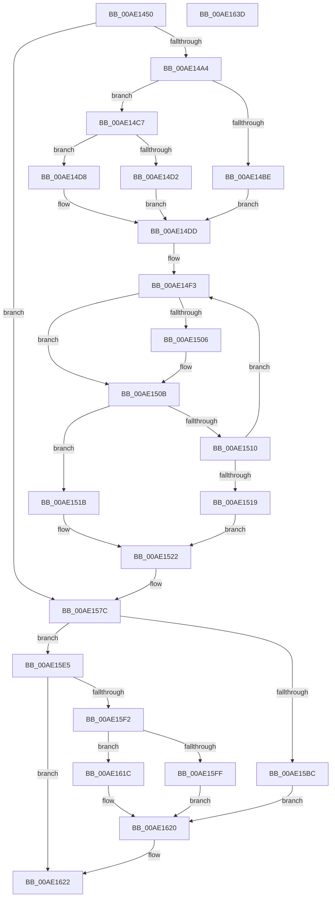

# PopBatteryQueryStatus

- RVA: `0x00AE1450`–`0x00AE163E` (길이 `494` bytes)
- VA: `0x0000000140AE1450`
- 실행 섹션: `PAGE`
- PDB 이름 있음: `예`; PDB Function 태그: `아니요`
- unwind 정보 RVA: `0x0005D7BC`
- 디코드: `128`개 명령, `494/494` bytes 표시
- 미해석 바이트: `0` (있으면 어셈블리에 `.byte`로 보존)

> 이 문서는 커널 이미지의 기계어와 PDB 기호를 분석해 생성했습니다. 4번과 5번은 함수 원형과 자료형을 바이너리 사용 방식에서 추정한 C 해석이며 원본 소스 복구 결과는 아닙니다.

## 1. Dependencies

- 직접 호출 지점: **4**; 고유 호출 대상: **4**
- 직접 호출자로 확인된 함수: **1**
- RIP 상대 이미지 참조: **5**

### Outgoing calls
- `0x00AE1577` → [DbgPrintEx](../../text/35/DbgPrintEx_function_00359290.md) (function, `0x00359290`)
- `0x00AE15AE` → [PopPrepareIoctl](../A7/PopPrepareIoctl_function_00A74A98.md) (function, `0x00A74A98`)
- `0x00AE15DE` → [IofCallDriver](../../text/29/IofCallDriver_function_0029B4B0.md) (function, `0x0029B4B0`)
- `0x00AE15E9` → [IoSynchronousCallDriver](../../text/48/IoSynchronousCallDriver_function_00484050.md) (function, `0x00484050`)

### Direct callers
- [PopBatteryWorker](PopBatteryWorker_function_00AE1650.md) at `0x00AE19C8`
- [PopBatteryWorker](PopBatteryWorker_function_00AE1650.md) at `0x00AE23C0`

### Static image references
- `0x00AE153E` → RVA `0x00FC534C` (`ALMOSTRO`; read)
- `0x00AE154A` → RVA `0x00FC5350` (`ALMOSTRO`; read)
- `0x00AE1555` → RVA `0x00B02740` (` ?? ::NNGAKEGL::`string'`; read)
- `0x00AE1562` → RVA `0x00FC5348` (`ALMOSTRO`; read)
- `0x00AE15C3` → RVA `0x004AE360` (`PopBatteryIrpComplete`; read)

## 2. Other-region calls and transfers

- 다른 실행 섹션으로 향하는 call: **3**
  - `0x00AE1577` → [DbgPrintEx](../../text/35/DbgPrintEx_function_00359290.md) (`PAGE` → `.text`)
  - `0x00AE15DE` → [IofCallDriver](../../text/29/IofCallDriver_function_0029B4B0.md) (`PAGE` → `.text`)
  - `0x00AE15E9` → [IoSynchronousCallDriver](../../text/48/IoSynchronousCallDriver_function_00484050.md) (`PAGE` → `.text`)
- 별도 외부 분기/꼬리 이동을 확인하지 못했습니다.

## 3. Assembly (complete function range)

```asm
00AE1450  48 8B C4                        mov rax, rsp
00AE1453  48 89 58 08                     mov qword ptr [rax + 8], rbx
00AE1457  48 89 68 10                     mov qword ptr [rax + 0x10], rbp
00AE145B  48 89 70 18                     mov qword ptr [rax + 0x18], rsi
00AE145F  48 89 78 20                     mov qword ptr [rax + 0x20], rdi
00AE1463  41 56                           push r14
00AE1465  48 83 EC 30                     sub rsp, 0x30
00AE1469  48 8D B9 D4 00 00 00            lea rdi, [rcx + 0xd4]
00AE1470  33 C0                           xor eax, eax
00AE1472  48 8D B1 A4 00 00 00            lea rsi, [rcx + 0xa4]
00AE1479  0F 57 C0                        xorps xmm0, xmm0
00AE147C  44 8A F2                        mov r14b, dl
00AE147F  48 8B D9                        mov rbx, rcx
00AE1482  0F 11 07                        movups xmmword ptr [rdi], xmm0
00AE1485  0F 11 47 10                     movups xmmword ptr [rdi + 0x10], xmm0
00AE1489  48 89 47 20                     mov qword ptr [rdi + 0x20], rax
00AE148D  89 47 28                        mov dword ptr [rdi + 0x28], eax
00AE1490  8B 41 6C                        mov eax, dword ptr [rcx + 0x6c]
00AE1493  89 07                           mov dword ptr [rdi], eax
00AE1495  C6 81 E8 00 00 00 02            mov byte ptr [rcx + 0xe8], 2
00AE149C  84 D2                           test dl, dl
00AE149E  0F 85 D8 00 00 00               jne 0x140ae157c
00AE14A4  44 8B 89 A8 00 00 00            mov r9d, dword ptr [rcx + 0xa8]
00AE14AB  8B 06                           mov eax, dword ptr [rsi]
00AE14AD  89 81 DC 00 00 00               mov dword ptr [rcx + 0xdc], eax
00AE14B3  8B 89 88 00 00 00               mov ecx, dword ptr [rcx + 0x88]
00AE14B9  44 3B C9                        cmp r9d, ecx
00AE14BC  76 09                           jbe 0x140ae14c7
00AE14BE  44 8D 41 01                     lea r8d, [rcx + 1]
00AE14C2  83 C9 FF                        or ecx, 0xffffffff
00AE14C5  EB 16                           jmp 0x140ae14dd
00AE14C7  8B 83 84 00 00 00               mov eax, dword ptr [rbx + 0x84]
00AE14CD  44 3B C8                        cmp r9d, eax
00AE14D0  76 06                           jbe 0x140ae14d8
00AE14D2  44 8D 40 01                     lea r8d, [rax + 1]
00AE14D6  EB 05                           jmp 0x140ae14dd
00AE14D8  45 33 C0                        xor r8d, r8d
00AE14DB  8B C8                           mov ecx, eax
00AE14DD  8B 83 80 00 00 00               mov eax, dword ptr [rbx + 0x80]
00AE14E3  41 BA 64 00 00 00               mov r10d, 0x64
00AE14E9  44 69 D8 C7 00 00 00            imul r11d, eax, 0xc7
00AE14F0  8D 2C 00                        lea ebp, [rax + rax]
00AE14F3  B8 1F 85 EB 51                  mov eax, 0x51eb851f
00AE14F8  41 F7 E3                        mul r11d
00AE14FB  C1 EA 06                        shr edx, 6
00AE14FE  8D 42 FF                        lea eax, [rdx - 1]
00AE1501  41 3B C1                        cmp eax, r9d
00AE1504  72 05                           jb 0x140ae150b
00AE1506  3B C1                           cmp eax, ecx
00AE1508  0F 42 C8                        cmovb ecx, eax
00AE150B  41 3B D1                        cmp edx, r9d
00AE150E  76 0B                           jbe 0x140ae151b
00AE1510  44 2B DD                        sub r11d, ebp
00AE1513  41 83 C2 FF                     add r10d, -1
00AE1517  75 DA                           jne 0x140ae14f3
00AE1519  EB 07                           jmp 0x140ae1522
00AE151B  41 3B D0                        cmp edx, r8d
00AE151E  44 0F 47 C2                     cmova r8d, edx
00AE1522  83 8B D8 00 00 00 FF            or dword ptr [rbx + 0xd8], 0xffffffff
00AE1529  4C 8B CB                        mov r9, rbx
00AE152C  89 8B E4 00 00 00               mov dword ptr [rbx + 0xe4], ecx
00AE1532  BA 02 00 00 00                  mov edx, 2
00AE1537  44 89 83 E0 00 00 00            mov dword ptr [rbx + 0xe0], r8d
00AE153E  8B 05 08 3E 4E 00               mov eax, dword ptr [rip + 0x4e3e08]
00AE1544  89 83 EC 00 00 00               mov dword ptr [rbx + 0xec], eax
00AE154A  8B 05 00 3E 4E 00               mov eax, dword ptr [rip + 0x4e3e00]
00AE1550  44 89 44 24 28                  mov dword ptr [rsp + 0x28], r8d
00AE1555  4C 8D 05 E4 11 02 00            lea r8, [rip + 0x211e4]
00AE155C  89 83 F0 00 00 00               mov dword ptr [rbx + 0xf0], eax
00AE1562  8B 05 E0 3D 4E 00               mov eax, dword ptr [rip + 0x4e3de0]
00AE1568  89 4C 24 20                     mov dword ptr [rsp + 0x20], ecx
00AE156C  B9 92 00 00 00                  mov ecx, 0x92
00AE1571  89 83 F4 00 00 00               mov dword ptr [rbx + 0xf4], eax
00AE1577  E8 14 7D 87 FF                  call 0x140359290
00AE157C  8B 93 18 01 00 00               mov edx, dword ptr [rbx + 0x118]
00AE1582  4C 8B CF                        mov r9, rdi
00AE1585  83 E2 01                        and edx, 1
00AE1588  8B C2                           mov eax, edx
00AE158A  F7 D8                           neg eax
00AE158C  1B C9                           sbb ecx, ecx
00AE158E  C1 E2 04                        shl edx, 4
00AE1591  83 E1 1C                        and ecx, 0x1c
00AE1594  83 C2 14                        add edx, 0x14
00AE1597  83 C1 10                        add ecx, 0x10
00AE159A  45 33 C0                        xor r8d, r8d
00AE159D  89 4C 24 28                     mov dword ptr [rsp + 0x28], ecx
00AE15A1  48 8B 4B 38                     mov rcx, qword ptr [rbx + 0x38]
00AE15A5  89 54 24 20                     mov dword ptr [rsp + 0x20], edx
00AE15A9  BA 64 40 29 00                  mov edx, 0x294064
00AE15AE  E8 E5 34 F9 FF                  call 0x140a74a98
00AE15B3  48 8B 53 38                     mov rdx, qword ptr [rbx + 0x38]
00AE15B7  45 84 F6                        test r14b, r14b
00AE15BA  75 29                           jne 0x140ae15e5
00AE15BC  48 8B 82 B8 00 00 00            mov rax, qword ptr [rdx + 0xb8]
00AE15C3  48 8D 0D 96 CD 9C FF            lea rcx, [rip - 0x63326a]
00AE15CA  48 89 48 F0                     mov qword ptr [rax - 0x10], rcx
00AE15CE  48 89 58 F8                     mov qword ptr [rax - 8], rbx
00AE15D2  C6 40 BB E0                     mov byte ptr [rax - 0x45], 0xe0
00AE15D6  48 8B 53 38                     mov rdx, qword ptr [rbx + 0x38]
00AE15DA  48 8B 4B 30                     mov rcx, qword ptr [rbx + 0x30]
00AE15DE  E8 CD 9E 7B FF                  call 0x14029b4b0
00AE15E3  EB 3B                           jmp 0x140ae1620
00AE15E5  48 8B 4B 30                     mov rcx, qword ptr [rbx + 0x30]
00AE15E9  E8 62 2A 9A FF                  call 0x140484050
00AE15EE  85 C0                           test eax, eax
00AE15F0  78 30                           js 0x140ae1622
00AE15F2  8B 83 18 01 00 00               mov eax, dword ptr [rbx + 0x118]
00AE15F8  0F 10 07                        movups xmm0, xmmword ptr [rdi]
00AE15FB  A8 01                           test al, 1
00AE15FD  74 1D                           je 0x140ae161c
00AE15FF  0F 10 4F 10                     movups xmm1, xmmword ptr [rdi + 0x10]
00AE1603  8B 47 28                        mov eax, dword ptr [rdi + 0x28]
00AE1606  0F 11 06                        movups xmmword ptr [rsi], xmm0
00AE1609  F2 0F 10 47 20                  movsd xmm0, qword ptr [rdi + 0x20]
00AE160E  0F 11 4E 10                     movups xmmword ptr [rsi + 0x10], xmm1
00AE1612  F2 0F 11 46 20                  movsd qword ptr [rsi + 0x20], xmm0
00AE1617  89 46 28                        mov dword ptr [rsi + 0x28], eax
00AE161A  EB 04                           jmp 0x140ae1620
00AE161C  F3 0F 7F 06                     movdqu xmmword ptr [rsi], xmm0
00AE1620  33 C0                           xor eax, eax
00AE1622  48 8B 5C 24 40                  mov rbx, qword ptr [rsp + 0x40]
00AE1627  48 8B 6C 24 48                  mov rbp, qword ptr [rsp + 0x48]
00AE162C  48 8B 74 24 50                  mov rsi, qword ptr [rsp + 0x50]
00AE1631  48 8B 7C 24 58                  mov rdi, qword ptr [rsp + 0x58]
00AE1636  48 83 C4 30                     add rsp, 0x30
00AE163A  41 5E                           pop r14
00AE163C  C3                              ret
00AE163D  CC                              int3
```

## 4. C-style interpretation (structured pseudocode)

```c
__int64 __fastcall PopBatteryQueryStatus(__int64 a1, int a2)
{
    __int64 result;
    __int64 v_r10;
    __int64 v_r11;
    __int64 v_rsp;
    unsigned int v_stack_m10;
    unsigned int v_stack_m18;
    unsigned __int64 v_stack_p10;
    unsigned __int64 v_stack_p18;
    unsigned __int64 v_stack_p20;
    unsigned __int64 v_stack_p8;

    *(unsigned __int64 *)(v_rsp + 8) = v_rbx;
    *(unsigned __int64 *)(v_rsp + 16) = v_rbp;
    *(unsigned __int64 *)(v_rsp + 24) = v_rsi;
    *(unsigned __int64 *)(v_rsp + 32) = v_rdi;
    v_rsp = (v_rsp) - (48);
    result = 0;
    *(unsigned __int64 *)(a1 + 212) = v_xmm0;
    *(unsigned __int64 *)(a1 + 212 + 16) = v_xmm0;
    *(unsigned __int64 *)(a1 + 212 + 32) = 0;
    *(unsigned int *)(a1 + 212 + 40) = 0;
    *(unsigned int *)(a1 + 212) = (unsigned int)((unsigned int)(*(unsigned int *)(a1 + 108)));
    *(unsigned __int8 *)(a1 + 232) = 2;
    if ((unsigned __int8)(a2) != 0) goto loc_00AE157C;
    *(unsigned int *)(a1 + 220) = (unsigned int)((unsigned int)(*(unsigned int *)(a1 + 164)));
    if (((unsigned int)((unsigned int)(*(unsigned int *)(a1 + 168)))) <= ((unsigned int)((unsigned int)(*(unsigned int *)(a1 + 136))))) goto loc_00AE14C7;
    a1 = (unsigned int)(((unsigned int)(*(unsigned int *)(a1 + 136))) | (0xFFFFFFFFULL));
    goto loc_00AE14DD;
loc_00AE14C7:
    if (((unsigned int)((unsigned int)(*(unsigned int *)(a1 + 168)))) <= ((unsigned int)((unsigned int)(*(unsigned int *)(a1 + 132))))) goto loc_00AE14D8;
    goto loc_00AE14DD;
loc_00AE14D8:
    a3 = 0;
loc_00AE14DD:
    v_r11 = (unsigned int)((v_r11) * ((unsigned int)((unsigned int)(*(unsigned int *)(a1 + 128)))));
loc_00AE14F3:
    a2 = (unsigned int)((a2) >> (6));
    if (((unsigned int)(a2 - 1)) >= ((unsigned int)((unsigned int)(*(unsigned int *)(a1 + 168))))) {
        a1 = (unsigned int)((unsigned int)((unsigned int)(*(unsigned int *)(a1 + 132))));
        if (((unsigned int)(a2 - 1)) < ((unsigned int)((unsigned int)((unsigned int)((unsigned int)(*(unsigned int *)(a1 + 132))))))) { a1 = (unsigned int)(a2 - 1); }
    }
    if (a2 <= ((unsigned int)((unsigned int)(*(unsigned int *)(a1 + 168))))) goto loc_00AE151B;
    v_r11 = (unsigned int)((v_r11) - ((unsigned int)((unsigned int)(*(unsigned int *)(a1 + 128)) + (unsigned int)(*(unsigned int *)(a1 + 128)) * 1)));
    v_r10 = (unsigned int)((100) + (-1));
    if (condition_is_not_equal) goto loc_00AE14F3;
    goto loc_00AE1522;
loc_00AE151B:
    if (a2 > 0) { a3 = a2; }
loc_00AE1522:
    *(unsigned int *)(a1 + 228) = (unsigned int)(a1);
    *(unsigned int *)(a1 + 224) = (unsigned int)(a3);
    *(unsigned int *)(a1 + 236) = (unsigned int)((unsigned int)(*(unsigned int *)(v_rip + 5127688)));
    v_stack_m10 = (unsigned int)(a3);
    *(unsigned int *)(a1 + 240) = (unsigned int)((unsigned int)(*(unsigned int *)(v_rip + 5127680)));
    v_stack_m18 = (unsigned int)(a1);
    *(unsigned int *)(a1 + 244) = (unsigned int)((unsigned int)(*(unsigned int *)(v_rip + 5127648)));
    result = DbgPrintEx(146, 2, v_rip + 135652, a1);
loc_00AE157C:
    a2 = (unsigned int)(((unsigned int)(*(unsigned int *)(a1 + 280))) & (1));
    result = (unsigned int)(-((unsigned int)(a2)));
    a2 = (unsigned int)((a2) << (4));
    a1 = (unsigned int)((146) & (28));
    a2 = (unsigned int)((a2) + (20));
    a1 = (unsigned int)((a1) + (16));
    a3 = 0;
    v_stack_m10 = (unsigned int)(a1);
    v_stack_m18 = a2;
    result = PopPrepareIoctl(*(unsigned __int64 *)(a1 + 56), (unsigned int)(0x294064ULL), a3, a1 + 212);
    if ((unsigned __int8)((unsigned __int8)(a2)) != 0) goto loc_00AE15E5;
    *(unsigned __int64 *)(*(unsigned __int64 *)(*(unsigned __int64 *)(a1 + 56) + 184) - 16) = v_rip - 6500970;
    *(unsigned __int64 *)(*(unsigned __int64 *)(*(unsigned __int64 *)(a1 + 56) + 184) - 8) = a1;
    *(unsigned __int8 *)(*(unsigned __int64 *)(*(unsigned __int64 *)(a1 + 56) + 184) - 69) = 224;
    result = IofCallDriver(*(unsigned __int64 *)(a1 + 48), *(unsigned __int64 *)(a1 + 56), a3, a1 + 212);
    goto loc_00AE1620;
loc_00AE15E5:
    result = IoSynchronousCallDriver(*(unsigned __int64 *)(a1 + 48), *(unsigned __int64 *)(a1 + 56), a3, a1 + 212);
    if (sign_flag) goto loc_00AE1622;
    if ((((unsigned __int8)((unsigned int)(*(unsigned int *)(a1 + 280)))) & (1)) == 0) goto loc_00AE161C;
    *(unsigned __int64 *)(a1 + 164) = v_xmm0;
    *(unsigned __int64 *)(a1 + 164 + 16) = v_xmm1;
    *(unsigned __int64 *)(a1 + 164 + 32) = v_xmm0;
    *(unsigned int *)(a1 + 164 + 40) = (unsigned int)((unsigned int)(*(unsigned int *)(a1 + 212 + 40)));
    goto loc_00AE1620;
loc_00AE161C:
    *(unsigned __int64 *)(a1 + 164) = v_xmm0;
loc_00AE1620:
    result = 0;
loc_00AE1622:
    v_rsp = (v_rsp) + (48);
    return result;
}
```

## 5. (Beta) C Style

```c
int64_t PopBatteryQueryStatus(void *Arg1, int32_t Arg2)
{
    uint8_t *arg1 = (uint8_t *)Arg1;

    int64_t result;
    int64_t local_r10;
    int64_t local_r11;
    int64_t local_rsp;
    uint32_t v_stack_m10;
    uint32_t v_stack_m18;
    uint64_t v_stack_p10;
    uint64_t v_stack_p18;
    uint64_t v_stack_p20;
    uint64_t v_stack_p8;

    *(uint64_t *)(local_rsp + 0x8) = local_rbx;
    *(uint64_t *)(local_rsp + 0x10) = local_rbp;
    *(uint64_t *)(local_rsp + 0x18) = local_rsi;
    *(uint64_t *)(local_rsp + 0x20) = local_rdi;
    local_rsp = (local_rsp) - (48);
    result = 0;
    *(uint64_t *)(arg1 + 0xD4) = v_xmm0;
    *(uint64_t *)(arg1 + 0xD4 + 0x10) = v_xmm0;
    *(uint64_t *)(arg1 + 0xD4 + 0x20) = 0;
    *(uint32_t *)(arg1 + 0xD4 + 0x28) = 0;
    *(uint32_t *)(arg1 + 0xD4) = (uint32_t)((uint32_t)(*(uint32_t *)(arg1 + 0x6C)));
    *(uint8_t *)(arg1 + 0xE8) = 2;
    if ((uint8_t)(Arg2) != 0) goto loc_00AE157C;
    *(uint32_t *)(arg1 + 0xDC) = (uint32_t)((uint32_t)(*(uint32_t *)(arg1 + 0xA4)));
    if (((uint32_t)((uint32_t)(*(uint32_t *)(arg1 + 0xA8)))) <= ((uint32_t)((uint32_t)(*(uint32_t *)(arg1 + 0x88))))) goto loc_00AE14C7;
    Arg1 = (uint32_t)(((uint32_t)(*(uint32_t *)(arg1 + 0x88))) | (0xFFFFFFFFULL));
    goto loc_00AE14DD;
loc_00AE14C7:
    if (((uint32_t)((uint32_t)(*(uint32_t *)(arg1 + 0xA8)))) <= ((uint32_t)((uint32_t)(*(uint32_t *)(arg1 + 0x84))))) goto loc_00AE14D8;
    goto loc_00AE14DD;
loc_00AE14D8:
    a3 = 0;
loc_00AE14DD:
    local_r11 = (uint32_t)((local_r11) * ((uint32_t)((uint32_t)(*(uint32_t *)(arg1 + 0x80)))));
loc_00AE14F3:
    Arg2 = (uint32_t)((Arg2) >> (6));
    if (((uint32_t)(Arg2 - 1)) >= ((uint32_t)((uint32_t)(*(uint32_t *)(arg1 + 0xA8))))) {
        Arg1 = (uint32_t)((uint32_t)((uint32_t)(*(uint32_t *)(arg1 + 0x84))));
        if (((uint32_t)(Arg2 - 1)) < ((uint32_t)((uint32_t)((uint32_t)((uint32_t)(*(uint32_t *)(arg1 + 0x84))))))) { Arg1 = (uint32_t)(Arg2 - 1); }
    }
    if (Arg2 <= ((uint32_t)((uint32_t)(*(uint32_t *)(arg1 + 0xA8))))) goto loc_00AE151B;
    local_r11 = (uint32_t)((local_r11) - ((uint32_t)((uint32_t)(*(uint32_t *)(arg1 + 0x80)) + (uint32_t)(*(uint32_t *)(arg1 + 0x80)) * 1)));
    local_r10 = (uint32_t)((100) + (-1));
    if (condition_is_not_equal) goto loc_00AE14F3;
    goto loc_00AE1522;
loc_00AE151B:
    if (Arg2 > 0) { a3 = Arg2; }
loc_00AE1522:
    *(uint32_t *)(arg1 + 0xE4) = (uint32_t)(Arg1);
    *(uint32_t *)(arg1 + 0xE0) = (uint32_t)(a3);
    *(uint32_t *)(arg1 + 0xEC) = (uint32_t)((uint32_t)(*(uint32_t *)(v_rip + 0x4E3E08)));
    v_stack_m10 = (uint32_t)(a3);
    *(uint32_t *)(arg1 + 0xF0) = (uint32_t)((uint32_t)(*(uint32_t *)(v_rip + 0x4E3E00)));
    v_stack_m18 = (uint32_t)(Arg1);
    *(uint32_t *)(arg1 + 0xF4) = (uint32_t)((uint32_t)(*(uint32_t *)(v_rip + 0x4E3DE0)));
    result = DbgPrintEx(146, 2, v_rip + 135652, Arg1);
loc_00AE157C:
    Arg2 = (uint32_t)(((uint32_t)(*(uint32_t *)(arg1 + 0x118))) & (1));
    result = (uint32_t)(-((uint32_t)(Arg2)));
    Arg2 = (uint32_t)((Arg2) << (4));
    Arg1 = (uint32_t)((146) & (28));
    Arg2 = (uint32_t)((Arg2) + (20));
    Arg1 = (uint32_t)((Arg1) + (16));
    a3 = 0;
    v_stack_m10 = (uint32_t)(Arg1);
    v_stack_m18 = Arg2;
    result = PopPrepareIoctl(*(uint64_t *)(arg1 + 0x38), (uint32_t)(0x294064ULL), a3, Arg1 + 212);
    if ((uint8_t)((uint8_t)(Arg2)) != 0) goto loc_00AE15E5;
    *(uint64_t *)(*(uint64_t *)(*(uint64_t *)(arg1 + 0x38) + 0xB8) - 0x10) = v_rip - 6500970;
    *(void **)(*(uint64_t *)(*(uint64_t *)(arg1 + 0x38) + 0xB8) - 0x8) = Arg1;
    *(uint8_t *)(*(uint64_t *)(*(uint64_t *)(arg1 + 0x38) + 0xB8) - 0x45) = 224;
    result = IofCallDriver(*(uint64_t *)(arg1 + 0x30), *(uint64_t *)(arg1 + 0x38), a3, Arg1 + 212);
    goto loc_00AE1620;
loc_00AE15E5:
    result = IoSynchronousCallDriver(*(uint64_t *)(arg1 + 0x30), *(uint64_t *)(arg1 + 0x38), a3, Arg1 + 212);
    if (sign_flag) goto loc_00AE1622;
    if ((((uint8_t)((uint32_t)(*(uint32_t *)(arg1 + 0x118)))) & (1)) == 0) goto loc_00AE161C;
    *(uint64_t *)(arg1 + 0xA4) = v_xmm0;
    *(uint64_t *)(arg1 + 0xA4 + 0x10) = v_xmm1;
    *(uint64_t *)(arg1 + 0xA4 + 0x20) = v_xmm0;
    *(uint32_t *)(arg1 + 0xA4 + 0x28) = (uint32_t)((uint32_t)(*(uint32_t *)(arg1 + 0xD4 + 0x28)));
    goto loc_00AE1620;
loc_00AE161C:
    *(uint64_t *)(arg1 + 0xA4) = v_xmm0;
loc_00AE1620:
    result = 0;
loc_00AE1622:
    local_rsp = (local_rsp) + (48);
    return result;
}
```

### 관측된 메모리 오프셋

구조체 형식이 확인되지 않은 접근은 인자 기준의 오프셋으로만 기록했습니다.

| 기준 인자 | 오프셋 표현 | 폭 (bit) | 접근 |
|---|---:|---:|---|
| `Arg1` | `+ 0x0` | `32` | `R` |
| `Arg1` | `+ 0x0` | `32` | `W` |
| `Arg1` | `+ 0x0` | `128` | `R` |
| `Arg1` | `+ 0x0` | `128` | `W` |
| `Arg1` | `+ 0x10` | `128` | `R` |
| `Arg1` | `+ 0x20` | `64` | `R` |
| `Arg1` | `+ 0x20` | `64` | `W` |
| `Arg1` | `+ 0x28` | `32` | `R` |
| `Arg1` | `+ 0x28` | `32` | `W` |
| `Arg1` | `+ 0x30` | `64` | `R` |
| `Arg1` | `+ 0x38` | `64` | `R` |
| `Arg1` | `+ 0x6C` | `32` | `R` |
| `Arg1` | `+ 0x80` | `32` | `R` |
| `Arg1` | `+ 0x84` | `32` | `R` |
| `Arg1` | `+ 0x88` | `32` | `R` |
| `Arg1` | `+ 0xA4` | `64` | `R` |
| `Arg1` | `+ 0xA8` | `32` | `R` |
| `Arg1` | `+ 0xD4` | `64` | `R` |
| `Arg1` | `+ 0xD8` | `32` | `R/W` |
| `Arg1` | `+ 0xDC` | `32` | `W` |
| `Arg1` | `+ 0xE0` | `32` | `W` |
| `Arg1` | `+ 0xE4` | `32` | `W` |
| `Arg1` | `+ 0xE8` | `8` | `W` |
| `Arg1` | `+ 0xEC` | `32` | `W` |
| `Arg1` | `+ 0xF0` | `32` | `W` |
| `Arg1` | `+ 0xF4` | `32` | `W` |
| `Arg1` | `+ 0x118` | `32` | `R` |

## 6. Execution-region graph

[열기: 2D/3D 그래프와 함수 탐색 컨트롤 패널](../../../control-panel.html?section=page&rva=0x00AE1450&view=graph)

- 2D 그래프는 위에서 아래로 흐르고, 3D 그래프는 빈 공간을 드래그해 회전합니다. Shift+드래그는 이동, 휠은 확대·축소, 함수 노드 선택은 대상 보고서 이동입니다.

### Static fallback


